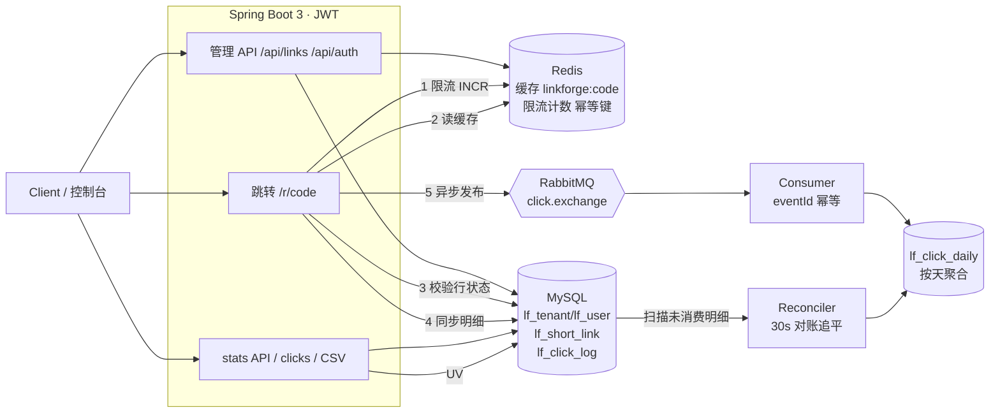

# LinkForge

多租户短链 + 访问分析后端服务（v1.0.0，P0–P5 全阶段交付并通过两轮外部审计）。

面向 2027 春招实习简历项目：用真实路径练 **MySQL / Redis / RabbitMQ / JWT**，业务壳是短链创建与 302 跳转。
本仓库为**自研骨架**，不是对任何开源短链项目的换皮。

## 技术栈

| 层级 | 选型 |
|------|------|
| 语言 / 运行时 | Java 17 |
| 框架 | Spring Boot 3.3、Spring Security、Validation、Actuator |
| ORM | MyBatis-Plus |
| 主库 | MySQL 8 |
| 缓存 | Redis 7 |
| MQ | RabbitMQ 3.13（`ClickEventPublisher` 接口，便于以后换 RocketMQ） |
| 鉴权 | JWT（Bearer）；可后续换 Sa-Token |
| 构建 | Maven |

**边界与不做**：AI / PostgreSQL / Supabase / 向量库（整体延期，后续另立方案）；Spring Cloud / Seata / 多机房；独立前端 SPA（静态控制台已够用）；云公网部署（D5=本地 Compose，prod profile 已备好收紧开关）。

## 鉴权策略

**bootstrap 演示账号 + 开放注册共存**（D3）。两条路径：

1. **bootstrap**：启动时由 `BootstrapDataLoader` 幂等写入演示租户。口令不写在源码里，只从环境变量读取：
   - `LINKFORGE_BOOTSTRAP_TENANT`（默认 `demo`）
   - `LINKFORGE_BOOTSTRAP_USERNAME`（默认 `admin`）
   - `LINKFORGE_BOOTSTRAP_PASSWORD`（必填，无默认值）
2. **开放注册** `POST /api/auth/register`：自助创建一个全新租户及其首个用户，成功即返回 JWT。邀请码**未启用**（无邀请码逻辑）。注册按 IP 固定窗口限流，默认 5 次 / 10 分钟，超限 429；阈值可用 `LINKFORGE_REGISTER_MAX` / `LINKFORGE_REGISTER_WINDOW_SECONDS` 调整。

本地示例值只在 `.env.example`。

## 模块（包）结构

单 Maven 模块，按包划分边界：

```
com.linkforge
├── common      # 统一响应、异常
├── config      # MyBatis / Redis / RabbitMQ / 配置属性
├── security    # JWT、SecurityFilterChain
├── bootstrap   # 演示租户种子数据
├── user        # 租户 / 用户 / 登录
├── link        # 短链创建、302 跳转、健康检查
└── stats       # 点击落库 + RabbitMQ 发布/消费/幂等聚合 + 对账追平 + stats API
```

## 快速开始

前置：JDK 17、Maven 3.9+、Docker Desktop。没有本地 Maven 或 JDK17 时，编译可走下方 Docker 镜像路径。

### 1. 启动依赖（Docker Compose）

在仓库根目录执行。Compose 不再内置数据库或 MQ 口令，必须先有 `.env`：

```bash
cp .env.example .env   # 本地示例；不要提交 .env
docker compose up -d
docker compose ps      # 确认 mysql / redis / rabbitmq healthy
```

Compose 读取 `MYSQL_ROOT_PASSWORD`、`MYSQL_PASSWORD`、`RABBITMQ_PASSWORD`（以及可选的库名、用户名、端口）。用户名默认 `linkforge`，口令只来自 `.env`。

### 2. 编译

```bash
mvn -q -DskipTests package
```

无本地 Maven / JDK17 时，用 Docker 里的 JDK17 Maven 构建（Windows PowerShell 把 `$PWD` 换成 `${PWD}`）：

```bash
docker run --rm -v "$PWD":/app -v linkforge_m2:/root/.m2 -w /app \
  maven:3.9-eclipse-temurin-17 mvn -B package
```

### 3. 运行应用

应用不会自动加载 `.env`。先导出变量再启动：

```bash
set -a
source .env
set +a
mvn spring-boot:run
# 或
java -jar target/linkforge-1.0.0.jar
```

默认端口 `8080`，profile `dev`。未设置下列必填变量时，Spring 占位符无法解析，进程起不来：

| 变量 | 作用 |
|------|------|
| `LINKFORGE_BOOTSTRAP_PASSWORD` | bootstrap 用户口令 |
| `SPRING_DATASOURCE_PASSWORD` | MySQL 用户口令 |
| `SPRING_RABBITMQ_PASSWORD` | RabbitMQ 口令 |
| `JWT_SECRET` | JWT HMAC 密钥，至少 32 字符 |

可选、源码里有非敏感默认值：`LINKFORGE_BOOTSTRAP_TENANT`、`LINKFORGE_BOOTSTRAP_USERNAME`、`SPRING_DATASOURCE_URL`、`SPRING_DATASOURCE_USERNAME`、`SPRING_DATA_REDIS_HOST`、`SPRING_DATA_REDIS_PORT`、`SPRING_RABBITMQ_HOST`、`SPRING_RABBITMQ_PORT`、`SPRING_RABBITMQ_USERNAME`。Redis 口令默认空（`SPRING_DATA_REDIS_PASSWORD`）。

### 4. 冒烟

```bash
# 健康检查
curl -s http://localhost:8080/api/health
curl -s http://localhost:8080/actuator/health

# 登录
TOKEN=$(curl -s -X POST http://localhost:8080/api/auth/login \
  -H 'Content-Type: application/json' \
  -d '{"tenantName":"'"${LINKFORGE_BOOTSTRAP_TENANT:-demo}"'","username":"'"${LINKFORGE_BOOTSTRAP_USERNAME:-admin}"'","password":"'"${LINKFORGE_BOOTSTRAP_PASSWORD}"'"}' \
  | python3 -c 'import sys,json; print(json.load(sys.stdin)["data"]["token"])')

# 创建短链
curl -s -X POST http://localhost:8080/api/links \
  -H "Authorization: Bearer $TOKEN" \
  -H 'Content-Type: application/json' \
  -d '{"originalUrl":"https://example.com","title":"demo"}'

# 302 跳转（把 CODE 换成返回的 code；`curl -I` 发 HEAD 也可探测：同 GET 语义返回 302/404/410，但不产生点击记录）
curl -s -D - -o /dev/null http://localhost:8080/r/CODE
```

一键冒烟（仓库根目录执行，自动做 health → 登录 → 建链 → 302 → Redis 校验 → 注册 → 生命周期，口令读 `.env`）：

```bash
bash scripts/smoke.sh
```

应用启动后：`http://localhost:8080/` 是**极简控制台**（可选特性；登录/注册、建链（支持自定义码与过期时间）、列表、启停/删除、点击与 UV 统计、CSV 导出入口）；接口文档在 `http://localhost:8080/swagger-ui/index.html`（springdoc 生成，prod 下关闭）。

MQ 宕机演练（基线聚合 → 停 Rabbit 全部 302 → 恢复后追平）：

```bash
bash scripts/mq-drill.sh
```

## 已实现接口

| 方法 | 路径 | 说明 |
|------|------|------|
| GET | `/api/health` | 应用健康（无需鉴权） |
| GET | `/actuator/health` | Actuator |
| POST | `/api/auth/login` | JWT 登录 |
| POST | `/api/auth/register` | 开放注册（新建租户+用户，返回 JWT；按 IP 限流） |
| POST | `/api/links` | 创建短链（需 Bearer Token；可选 `expireAt` 未来时间、可选 `customCode` 自定义短码 4-16 位 `[A-Za-z0-9_-]`、可选 `Idempotency-Key` 头幂等重放） |
| GET | `/api/links?page=&size=` | 分页列表（仅本人创建的链，size 1..100 默认 20） |
| GET | `/api/links/{code}` | 详情：目标 URL、状态、过期时间、创建/更新时间 |
| PATCH | `/api/links/{code}` | 改目标 URL / 备注 / 过期时间（未来）；成功后写穿缓存 + 延迟双删 |
| POST | `/api/links/{code}/disable` | 禁用；缓存失效 |
| POST | `/api/links/{code}/enable` | 重新启用（过期时间不受影响） |
| DELETE | `/api/links/{code}` | 逻辑删除；**短码永久保留不可复用**（uk_code） |
| GET | `/api/links/{code}/stats?days=7` | 点击统计（仅链主）：总量、**精确 UV**（按 IP 去重，来自同步明细）+ 按天序列，days 1..90 |
| GET | `/api/links/{code}/clicks?page=&size=` | 点击明细（仅链主）：时间/IP/UA/Referer，新到旧分页 |
| GET | `/api/links/export` | 导出本人全部短链 CSV（UTF-8 BOM，逗号/引号转义） |
| GET | `/r/{code}` | 302 跳转；Redis 缓存优先，未命中回源 MySQL；同步写 `lf_click_log` |
| HEAD | `/r/{code}` | 可跳性探测：302（带 Location）/404/410 与 GET 同档，但**不写点击明细、不发 MQ、不计 UV**（共用按 IP 跳转限流） |

**错误码语义（已写死）**：跳转遇 **禁用或不存在 → 404**，**过期 → 410**；管理接口的越权访问统一 **404**（不泄露他人短码存在性）；未携带/无效凭证 **401**；注册租户名冲突 **409**、自定义短码被占用 **409**；触发限流 **429**。

**自定义短码**：`customCode` 需 4-16 位字母/数字/下划线/连字符，保留字（admin、login、stats、actuator、console、metrics 等，大小写不敏感）不可用，短于 4 位的词（api、r）天然被长度规则挡住；已被占用（含已删除链占用的码）返回 409。随机码与自定义码共用 `uk_code` 唯一索引，并发安全。

**限流（P3）**：注册按 IP 5 次/10 分钟；创建按用户 30 次/分钟；公开跳转按 IP 300 次/分钟。全部为 Redis 固定窗口，超限 429，阈值见下方环境变量。限流器在 Redis 故障时放行（degrade open）。客户端 IP 默认取 socket 地址、**不信任** `X-Forwarded-For`（该头可伪造、会被用来绕限流）；仅在可信反向代理后部署时设 `LINKFORGE_TRUST_XFF=true`。同一客户端经 IPv4/IPv6 两个协议访问会各占一个计数桶（本机 `127.0.0.1` 与 `::1` 并存属预期现象）。

**缓存一致性（P3）**：更新短链时**写穿**（立即写入新值）并安排 1 秒后的延迟双删，清除并发读旧库行回填的脏值；禁用同理（先删 + 延迟双删）。最终一致窗口约 1 秒，上限为 TTL（默认 3600 秒）。过期链路不依赖缓存（每次跳转都校验 DB 行状态）。

**创建幂等与并发（P3）**：携带 `Idempotency-Key` 头的重复提交返回同一短码（Redis `pending→code` 两段式，并发同键只建一条，映射保留 24h）；短码生成靠 `uk_code` 唯一索引兜底，撞码自动重试新码，并发创建不会产生重复短码。

跳转路径缓存键：`linkforge:code:{code}`。更新/禁用会主动删除该键，下一次跳转回源后重建。  

## 点击统计管道（D7 双写）

跳转产生一次点击后会**双写**：

1. **同步明细**：插入 `lf_click_log`（开关 `LINKFORGE_SYNC_CLICK_ENABLED`，默认开）。
2. **异步聚合**：发布 `ClickEvent` 到 RabbitMQ（开关 `LINKFORGE_ASYNC_CLICK_ENABLED`，默认开），真实消费者按 `eventId` 幂等写入 `lf_consumed_event` + 按天累加 `lf_click_daily`。

幂等设计：`eventId = "log-{click_log.id}"`（确定性），实时消费与对账重放共用同一键，同一次点击无论被投递多少次只计一次。消费失败的消息进死信队列 `linkforge.click.dlq`（不回队热循环）。

**对账与追平**：`ClickLogReconciler` 定时（`LINKFORGE_MQ_RECONCILE_FIXED_DELAY_MS`，默认 30s）扫描 `lf_click_log` 中尚未出现在 `lf_consumed_event` 的行并重放聚合——MQ 宕机期间发布失败的点击由它自动补齐（`scripts/mq-drill.sh` 演练此场景）。手工对账：

```sql
-- 明细与聚合应一致（sync 开关开着时；库中不应有测试注入的合成事件）
SELECT (SELECT COUNT(*) FROM lf_click_log) AS detail,
       (SELECT IFNULL(SUM(clicks),0) FROM lf_click_daily) AS aggregate;
```

**何时可关同步**：⚠️ **关同步（`LINKFORGE_SYNC_CLICK_ENABLED=false`）后，MQ 发布失败的点击无法由对账器追平**（无 outbox，新点击 eventId 为随机 UUID 且无明细行）；精确 UV / 点击明细也只覆盖历史数据。关之前必须：连续观察 `detail == aggregate`、确认 MQ 稳定、并接受上述边界；纯异步 + 可追平需要 outbox 改造（未实现）。保持默认双写。MQ：`linkforge.click.exchange` → `linkforge.click.queue`（DLX：`linkforge.click.dlx` / `linkforge.click.dlq`）。

**存量库迁移注记**：`lf_click_daily` / `lf_consumed_event` 两张表只会在**全新数据卷**上由 schema.sql 自动创建；已有旧卷的库需手动执行 `src/main/resources/db/schema.sql` 中对应的两段 `CREATE TABLE IF NOT EXISTS`（幂等，可重复跑）。

## 当前状态 vs 后续

| 阶段 | 内容 | 状态 |
|------|------|------|
| **P0–P3** | Compose 三件套、登录/注册（限流）、短链 CRUD/禁用/过期、缓存跳转（写穿+双删）、MQ 异步聚合（幂等/对账/断链追平）、创建幂等、并发不撞码、限流、Actuator 组件健康 | ✅ 已交付并审计通过 |
| **P4** | Testcontainers 测试隔离（63 测试）、GitHub Actions CI、bench.md 实测压测、架构 README、resume.md、prod profile | ✅ 已交付并审计通过 |
| **P5** | 盘点补洞（migrate.sh、路由核对、文档收口） | ✅ 完成，**v1.0.0 完整交付**（git tag `v1.0.0`） |

## 核心路径 vs 可选特性

| 类别 | 能力 | 说明 |
|------|------|------|
| **核心**（主路径 Demo 只依赖这些） | 注册/登录（JWT）、创建短链、`/r/{code}` 302 跳转、stats 统计、限流、点击双写 + 幂等消费 + 对账追平、CI / bench | 冒烟（smoke.sh）与断链演练（mq-drill.sh）覆盖的即主路径 |
| 可选（演示可用，面试可讲，主路径不强制） | 自定义短码、CSV 导出、Swagger UI、静态控制台、精确 UV / 点击明细 | R2–R4 提前落地，均有集成测试与隔离验证；prod profile 下文档与控制台默认关闭 |

## 配置要点

见 `src/main/resources/application.yml`。口令与 `JWT_SECRET` 只有环境变量，没有写在 yml 或 Java 默认值里。本地示例见 `.env.example`。

- `linkforge.mq.async-click-enabled` 控制是否发 MQ
- `LINKFORGE_REGISTER_MAX` / `LINKFORGE_REGISTER_WINDOW_SECONDS` 注册限流阈值（默认 5 / 600 秒）
- `LINKFORGE_CREATE_RATE_MAX` / `LINKFORGE_CREATE_RATE_WINDOW_SECONDS` 创建限流（默认 30 / 60 秒，按用户）
- `LINKFORGE_REDIRECT_RATE_MAX` / `LINKFORGE_REDIRECT_RATE_WINDOW_SECONDS` 跳转限流（默认 300 / 60 秒，按 IP）
- `LINKFORGE_IDEMPOTENCY_TTL_SECONDS` 创建幂等键保留时长（默认 86400 秒）
- `LINKFORGE_TRUST_XFF` 是否信任 X-Forwarded-For（默认 false，仅在可信反代后开启）
- 限流覆盖说明：注册按 IP、创建按用户（**含自定义短码创建，共用 POST /api/links 的限额**）；CSV 导出与统计查询属管理 API（JWT 必需、租户隔离），未单独限流，导出有 1 万行上限保护
- `/actuator/health` 展示组件细节（db / redis / rabbit / diskSpace），依赖 DOWN 时整体 503
- `/actuator/metrics/**` 暴露业务计数器（`linkforge.links.created`、`linkforge.redirects`、`linkforge.ratelimit.rejected{entry=register|create|redirect}`），需 Bearer Token
- **公网部署**：本地 Demo 一律默认 profile（全开放）；对外部署设 `SPRING_PROFILES_ACTIVE=prod` 一键收紧——health 细节转 `when_authorized`、springdoc 与静态控制台关闭、文档/控制台路径在过滤器层 denyAll（见 application.yml prod 段与 ProdProfileIT）

## 架构



**跳转时序（GET /r/{code}）**：① 限流器按 IP 固定窗口 INCR（Redis，超限 429）→ ② 读缓存 `linkforge:code:{code}`（命中则省 URL 字段）→ ③ 无论命中与否都读 `lf_short_link` 行做禁用/过期判定（404/410，防脏缓存）→ ④ 目标 URL 严格校验后写入 `lf_click_log`（D7 同步明细）→ ⑤ 发布 `ClickEvent`（eventId=log-{id}）到 RabbitMQ → 返回 302。消费端以 eventId 唯一索引幂等累加 `lf_click_daily`；发布失败由 Reconciler 定时从明细补投（断 MQ 演练见 `scripts/mq-drill.sh`）。更新/禁用走写穿 + 1s 延迟双删防旧值回填。

**本地 Demo 五步**（只走核心路径）：

1. `cp .env.example .env && docker compose up -d`，等 `docker compose ps` 三容器 healthy（MySQL 首次初始化约 5 分钟；存量卷可 `bash scripts/migrate.sh` 幂等补表）
2. 构建：`mvn -B -DskipTests package`（无本地 Maven 用 README 上方的 Docker 命令）
3. 启动：`set -a && . ./.env && set +a && java -jar target/linkforge-1.0.0.jar`
4. 核心链路：登录（`POST /api/auth/login`，demo/admin）→ 建链（`POST /api/links` 带 Bearer）→ 浏览器/curl 访问 `/r/{code}` 得 302（示例见上方冒烟段）
5. 验证：`bash scripts/smoke.sh`（SMOKE OK）、`bash scripts/mq-drill.sh`（断 MQ 追平）、`curl -s localhost:8080/actuator/health`

可选入口：浏览器打开 `http://localhost:8080/` 极简控制台（登录/建链/启停删除/统计/CSV 一站式，属可选特性，非主路径依赖）。

**Linux 复现**：Linux 无 `host.docker.internal`。测试/运行容器用 `--network host` 并把 `SPRING_DATASOURCE_URL`/`SPRING_DATA_REDIS_HOST`/`SPRING_RABBITMQ_HOST` 指向 `127.0.0.1`（Compose 已映射端口），或指向 docker0 网桥 `172.17.0.1`。CI（ubuntu-latest）即按此环境跑 `mvn -B verify`（Testcontainers 原生 Docker，无需 Compose）。示例：

```bash
docker run --rm --network host -v "$PWD":/app -v m2:/root/.m2 -w /app \
  -e SPRING_DATASOURCE_PASSWORD=... -e SPRING_DATA_REDIS_HOST=127.0.0.1 \
  -e SPRING_RABBITMQ_HOST=127.0.0.1 -e SPRING_RABBITMQ_PASSWORD=... -e JWT_SECRET=... \
  maven:3.9-eclipse-temurin-17 mvn -B verify
```

**压测数字**：见 `docs/bench.md`（wrk 实测：health 基线 888 QPS；跳转写路径分解：关同步明细后 13→276 QPS、P50 678→31ms；缓存命中率 100%）。

## 许可证

个人学习 / 面试项目，未设开源许可证条款时可按私有仓库使用。
