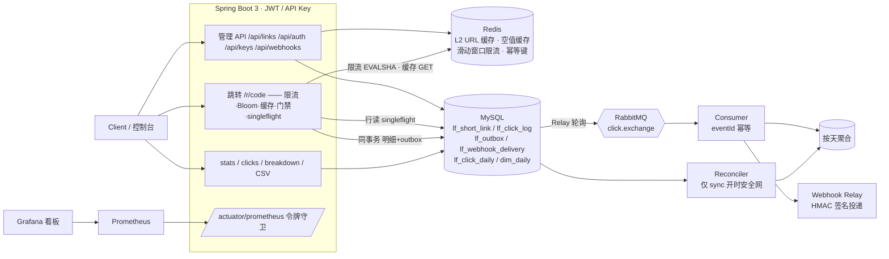

# LinkForge


多租户短链 + 访问分析后端服务。**v2.0.0**＝P0–P5 全阶段交付（v1.0.0）+ 深化 A2–A10 + B 档波 1–5（B7/B8、B4/B5、B6/B2/B9/B3/B1），多轮外部审计通过。

面向 2027 春招实习简历项目：用真实路径练 **MySQL / Redis / RabbitMQ / JWT**，业务壳是短链创建与 302 跳转。
本仓库为**自研骨架**，不是对任何开源短链项目的换皮。每个模块都写明「诚实边界」——能做到什么、明确不做什么。

> 压测声明：README 与 `docs/bench.md` 中的性能数字测于旧版本（固定窗口限流时期），**不代表 v2.0.0 现状**；B10 复测挂起中（见[待办](docs/backlog.md)）。

## 目录

- [功能总览](#-功能总览)
- [快速上手](#-快速上手)
- [架构总览](#-架构总览)
- [模块详解](#-模块详解)
- [配置参考](#️-配置参考)
- [指标参考](#-指标参考)
- [测试与质量](#-测试与质量)
- [性能与压测](#-性能与压测)
- [待办与后续](#️-待办与后续)
- [版本历史](#-版本历史)

## ✨ 功能总览

| 域 | 能力 | 模块章节 |
|------|------|------|
| 认证 | JWT 登录 / 开放注册（按 IP 限流）/ bootstrap 演示租户 / 多租户隔离 | [认证与多租户](#认证与多租户) |
| 短链 | CRUD、自定义短码（区分大小写）、过期/禁用、创建幂等、并发不撞码、CSV 导出 | [短链管理](#短链管理) |
| 跳转 | 302 + HEAD 探测；五层读取防护（限流→Bloom→空值缓存→L1/L2→singleflight） | [跳转读取路径](#跳转读取路径五层防护) |
| 限流 | Redis 滑动窗口日志（精确计数、Redis TIME 时钟、Retry-After）+ 日固定配额 | [限流体系](#限流体系b6滑动窗口) |
| 统计 | 同事务 Outbox + Relay 投递 + 幂等消费 + 断链自动追平；精确 UV；设备/来源维度 | [点击统计管道](#点击统计管道a7-transactional-outbox)、[维度分析](#维度分析a8-预聚合) |
| 安全 | BCrypt 密码短链（签名 cookie、先限流后校验）、本地域名名单门禁（BLOCK/WARN）、非人点击不计 | [密码短链](#密码短链b3)、[域名门禁](#目标域名名单门禁b9)、[非人点击](#非人点击b2预取与预览-bot-照常-302-但不计) |
| 开放 | API Key（哈希存储+配额）、点击 Webhook（HMAC 签名、AES-256-GCM at-rest、SSRF 防护） | [开放能力](#开放能力b4-api-key--b5-webhook) |
| 可观测 | 令牌守卫的 `/actuator/prometheus`、Grafana 自动 provision 看板、积压 gauge | [可观测](#可观测b1-prometheus--grafana) |
| 工程 | Flyway 版本化迁移（V1–V7）、Testcontainers 集成测试 211 例、GitHub Actions CI、prod profile 一键收紧 | [测试与质量](#-测试与质量) |

**明确不做**（冻结决策，详见[待办](docs/backlog.md)）：AI / PostgreSQL / Supabase / 向量库（整体延期另立方案）；Spring Cloud / Seata / 多机房；独立前端 SPA（静态控制台已够用）；云公网部署（D5=本地 Compose，prod profile 已备好收紧开关）。

## 🚀 快速上手

### 前置

| 依赖 | 版本 | 说明 |
|------|------|------|
| JDK | 17 | 运行需 17+（本机 21 可跑 17 字节码） |
| Maven | 3.9+ | 没有本地 Maven 时用下方 Docker 构建路径 |
| Docker Desktop | 任意近期版 | MySQL 8 / Redis 7 / RabbitMQ 3.13 全部容器化 |

### 五步跑通

**1. 启动依赖**（仓库根目录；Compose 不内置口令，必须先有 `.env`）：

```bash
cp .env.example .env    # 本地示例值；.env 已 gitignore，不要提交
docker compose up -d
docker compose ps       # 期望：mysql / redis / rabbitmq 三行 healthy（MySQL 首次初始化约 5 分钟）
```

**2. 编译**：

```bash
mvn -q -DskipTests package
# 无本地 Maven / JDK17 时（Windows PowerShell 把 $PWD 换成 ${PWD}）：
docker run --rm -v "$PWD":/app -v linkforge_m2:/root/.m2 -w /app \
  maven:3.9-eclipse-temurin-17 mvn -B package
```

**3. 运行**（应用不自动加载 `.env`，先导出再启动）：

```bash
set -a
source .env
set +a
java -jar target/linkforge-2.0.0.jar   # 或 mvn spring-boot:run；默认端口 8080，profile dev
```

**4. 冒烟**：

```bash
# 健康检查
curl -s http://localhost:8080/actuator/health          # 期望 {"status":"UP",...}

# 登录 → 拿 token
TOKEN=$(curl -s -X POST http://localhost:8080/api/auth/login \
  -H 'Content-Type: application/json' \
  -d '{"tenantName":"'"${LINKFORGE_BOOTSTRAP_TENANT:-demo}"'","username":"'"${LINKFORGE_BOOTSTRAP_USERNAME:-admin}"'","password":"'"${LINKFORGE_BOOTSTRAP_PASSWORD}"'"}' \
  | python3 -c 'import sys,json; print(json.load(sys.stdin)["data"]["token"])')

# 建链 → 302
curl -s -X POST http://localhost:8080/api/links -H "Authorization: Bearer $TOKEN" \
  -H 'Content-Type: application/json' -d '{"originalUrl":"https://example.com"}'
curl -s -D - -o /dev/null http://localhost:8080/r/CODE   # 期望 HTTP/1.1 302 + Location
```

**5. 验证脚本**（口令读 `.env`，期望输出 `SMOKE OK` 等）：

```bash
bash scripts/smoke.sh        # health → 登录 → 建链 → 302 → Redis 校验 → 注册 → 生命周期
bash scripts/mq-drill.sh     # sync 开 + 断 MQ → 恢复追平
bash scripts/outbox-drill.sh # sync 关 + 断 MQ → 恢复追平（自带 8082 独立实例）
```

浏览器入口：`http://localhost:8080/` 极简控制台（登录/注册、建链、列表、启停/删除、统计、CSV 导出；可选特性，非主路径依赖）；接口文档 `http://localhost:8080/swagger-ui/index.html`（springdoc 生成，prod 下关闭）。

### 常见坑

- **必填环境变量缺失起不来**：`LINKFORGE_BOOTSTRAP_PASSWORD`、`SPRING_DATASOURCE_PASSWORD`、`SPRING_RABBITMQ_PASSWORD`、`JWT_SECRET`（≥32 字符）没有默认值，Spring 占位符解析失败即退出。
- **Linux 上 Prometheus 抓不到宿主机应用**：Compose 已为 Prometheus 配 `host.docker.internal:host-gateway`；自己起容器跑应用/测试时用 `--network host` 并把连接变量指向 `127.0.0.1`。
- **scrape-token 文件权限**（Linux 踩坑实录）：Prometheus 容器内进程（`prom/prometheus` 以 nobody 运行）必须能读 `/etc/linkforge/scrape-token`。宿主机上该文件若是 `600` 且属主是登录用户，容器内读取被拒、target 永久 down。Linux 下 `chmod 644 ops/observability/scrape-token`（Windows / Docker Desktop 不校验 Unix 权限位，无此坑）。文件内容须与 `.env` 的 `LINKFORGE_METRICS_SCRAPE_TOKEN` 逐字一致，建议 `printf '%s' <token> >` 写入、避免尾随换行引入差异。
- **本机开 Clash/Surge fake-IP**：198.18.0.0/15 段会被 Webhook SSRF 防护拒掉，保存公网 webhook 目标返回 400；联调前关 fake-IP 或改 redir-host。
- **jar 名随版本走**：v2.0.0 起 jar 为 `target/linkforge-2.0.0.jar`。

## 🧱 架构总览



**跳转判定总顺序**（`GET /r/{code}`，HEAD 共用；每步的失败语义互不吞并）：

1. **限流**：按 IP 滑动窗口日志，超限 429 + `Retry-After`
2. **Bloom**：从未存在的码直接 404，不碰缓存与 MySQL
3. **空值缓存**：`linkforge:absent:{code}` 命中 → 404
4. **L1（Caffeine）→ L2（Redis）**：命中只省 URL 字段读取
5. **行读**：每请求读 `lf_short_link` 行（同码并发经 singleflight 合并为一次在途读）；行不存在 → 写空值缓存 + 404
6. **状态/过期判定**：本请求时钟，禁用→404、过期→410（这两种不进空值缓存）
7. **URL 可渲染校验**：脏行一律 410，与缓存命中与否无关
8. **B9 BLOCK** → 403 拦截页（无 Location）
9. **B3 密码门**：无有效凭证 → 200 解锁页（HEAD 401），不计点击
10. **B9 WARN** → 200 警示中间页，`?lf_continue=1` 只跳过 WARN 门
11. **B2 分类**：预取/预览 bot 照常 302 但全链路不计
12. **302 + 记点击**：同事务写明细 + outbox → 消费端幂等聚合

管理 API 的越权访问统一 404（不泄露他人短码存在性）；未携带/无效凭证 401；注册租户名冲突、短码占用 409。

## 🧩 模块详解

### 认证与多租户

**设计**：bootstrap 演示账号 + 开放注册共存（D3）。口令只从环境变量读取，本地示例值只在 `.env.example`。注册按 IP 滑动窗口限流（默认 5 次/10 分钟）。

- **bootstrap**：启动时 `BootstrapDataLoader` 幂等写入演示租户——`LINKFORGE_BOOTSTRAP_TENANT`（默认 `demo`）、`LINKFORGE_BOOTSTRAP_USERNAME`（默认 `admin`）、`LINKFORGE_BOOTSTRAP_PASSWORD`（必填）
- **开放注册** `POST /api/auth/register`：自助创建全新租户及首个用户，成功即返 JWT；无邀请码逻辑

### 短链管理

**设计**：短码随机生成靠 `uk_code` 唯一索引兜底，撞码自动重试，并发创建不产生重复短码。**短码区分大小写**（V4 列排序规则 `utf8mb4_0900_bin`，NO PAD——`AbC123` 与 `abc123` 是两个码，尾随空格也不等价）；保留字检查（admin、login、stats、actuator、console、metrics 等，大小写不敏感）防 `ADMIN` 绕过。

**使用**：

| 方法 | 路径 | 说明 |
|------|------|------|
| POST | `/api/links` | 创建；可选 `expireAt`（未来）、`customCode`（4–16 位 `[A-Za-z0-9_-]`）、`Idempotency-Key` 头幂等重放、`accessPassword` 设密码保护 |
| GET | `/api/links?page=&size=` | 分页列表（仅本人创建；size 1..100 默认 20） |
| GET | `/api/links/{code}` | 详情（多一个 `passwordProtected` 布尔） |
| PATCH | `/api/links/{code}` | 改目标 URL / 备注 / 过期时间；设/换密码用 `accessPassword`、清除用 `clearAccessPassword:true`（两者同发 400） |
| POST | `/api/links/{code}/disable` `/enable` | 禁用/启用（过期时间不受影响） |
| DELETE | `/api/links/{code}` | 逻辑删除；**短码永久保留不可复用** |
| GET | `/api/links/{code}/stats?days=7` | 总量、精确 UV（按 IP 去重）+ 按天序列；days 1..90 |
| GET | `/api/links/{code}/stats/breakdown?dim=device\|referer_host` | 维度分布（口径是点击数不是 UV） |
| GET | `/api/links/{code}/clicks?page=&size=` | 点击明细（时间/IP/UA/Referer） |
| GET | `/api/links/export` | CSV（UTF-8 BOM；1 万行上限；哈希/明文永不出现在任何导出） |
| GET | `/r/{code}` | 302 跳转（全判定链见上节） |
| HEAD | `/r/{code}` | 探测：302/404/410 与 GET 同档，**不写明细、不发 MQ、不计 UV** |
| POST | `/r/{code}/unlock` | 密码短链解锁表单（见[密码短链](#密码短链b3)） |

**缓存一致性**：更新/禁用走**写穿 + 1 秒延迟双删**（清并发读旧库行回填的脏值），最终一致窗口约 1 秒、上限为 TTL（默认 3600 秒）。过期链路不依赖缓存（每次跳转都校验 DB 行）。缓存键 `linkforge:code:{code}`；幂等键 Redis `pending→code` 两段式保留 24h。

### 限流体系（B6：滑动窗口）

**设计**：分钟级入口全部为 **Redis ZSET + Lua 滑动窗口日志**——精确计数非近似；只有放行的请求占名额（被拒不占）；窗口时钟取 Redis `TIME`，多实例 JVM 时钟漂移不影响窗口；**不是令牌桶/漏桶**。API Key 日配额保持 **Asia/Shanghai 自然日固定计数**（零点重置）。

| 入口 | 限额（默认） | 调整变量 |
|------|------|------|
| 注册 | 5 次 / 10 分钟 / IP | `LINKFORGE_REGISTER_MAX` `_WINDOW_SECONDS` |
| 创建（含自定义码） | 30 次 / 分钟 / 用户 | `LINKFORGE_CREATE_RATE_MAX` `_WINDOW_SECONDS` |
| 跳转 | 300 次 / 分钟 / IP | `LINKFORGE_REDIRECT_RATE_MAX` `_WINDOW_SECONDS` |
| 解锁 | 5 次/300s 同 IP 同码 + 50 次/300s 同码 | `LINKFORGE_LINK_ACCESS_UNLOCK_*` |
| API Key | 120 次/分钟 + 10000/日 / key | 创建时按 Key 覆盖 |

- 所有 429 带 `Retry-After`（按窗口内最老一条请求计算，≤窗口秒数；日配额=到零点秒数）
- **fail-open**：Redis 故障时限流放行并计 `linkforge.ratelimit.failopen{reason=error|null}`（「限流已失效」可见）
- 客户端 IP 默认取 socket 地址、**不信任** `X-Forwarded-For`（可伪造绕限流）；仅可信反代后设 `LINKFORGE_TRUST_XFF=true`。同一客户端经 IPv4/IPv6 各占一个计数桶（`127.0.0.1` 与 `::1` 并存属预期）
- 滑窗键在 `linkforge:rl:sw:` 命名空间，与旧固定窗口 STRING 键不同名，升级残留自然过期互不干扰；每 key 内存上界＝窗口内最大放行数

### 跳转读取路径：五层防护

**先说实话**：为了强一致，跳转**每个请求都要读一次 DB 行**判禁用/过期——Redis 只省 URL 字段，不替 DB 挡流量。以下五层省的是：不存在码的 DB miss、热点码的 Redis 往返、同码并发的重复行读，以及雪崩形态。

1. **Bloom 防穿透（A9）**：进程内 Guava `BloomFilter<String>` 只存短码。负答（`mightContain == false`）是权威否定 → 直接 404 不碰 Redis/MySQL；误判（fpp 默认 1e-4）只是多一次 DB miss 照常 404。启动 `ApplicationReadyEvent` 全量装载，创建成功即 `put`。禁用/过期/删除语义不变（Bloom 只挡「从未存在」）；已删码仍装进 Bloom（逻辑删除、码位不可复用）。装载失败自动 fail-open（`linkforge.bloom.loadfailed`）。**已知限制**：多实例各自装载不共享——实例 B 新建的码在实例 A 重启前是假阴性 404（Demo 单实例可接受；RedisBloom 后置）。
2. **空值缓存（B7）**：只缓存「DB 行读取结果为 null」这一种负答，键 `linkforge:absent:{code}`（哨兵 `"1"`）。**禁用/过期/不可渲染绝不写入**（行还在，启用后须立即生效）；创建成功后 DEL。TTL 60s+30s 抖动；`LINKFORGE_ABSENT_TTL_SECONDS<=0` 关闭。
3. **TTL 抖动（防同批过期雪崩）**：正缓存与空值缓存 TTL 统一 `base + uniform[0, jitter]` 只向上抖——正缓存 `3600+300`、空值 `60+30`；同一批创建的码不再同时失效。
4. **Caffeine L1（B8）**：进程内缓存 URL 字符串（与 Redis L2 同形状，不缓存行），maximum-size 10000、TTL 10s。**命中不跳过 singleflight/DB 行读**，禁用/过期语义零变化。多实例不同步（实例 A 改 URL，实例 B 在 L1 TTL 内可能跳旧值；pub/sub 广播后置）。
5. **singleflight 防击穿（A10）**：同一短码的并发行读合并成一次在途读（`ConcurrentHashMap<code, CompletableFuture<行>>`，完成即摘除）。跟车等待超时（默认 500ms）自己读库（fail-open）。写路径提交后 `forget(code)`，写后到达的请求重新领头读新行。**不引入分布式锁**：在「每请求必须读行」前提下，分布式互斥只会把读串行化、拉长尾延迟。

**行级 URL 校验门（B8 护栏）**：行的 `original_url` 不可渲染时一律 410，与缓存命中与否无关——「脏行 + 旧缓存未清」永远不会被旧缓存遮蔽成 302（IT 钉住）。

### 点击统计管道（A7 Transactional Outbox）

**设计**：热路径不直接触碰 RabbitMQ。跳转产生点击后在**同一 DB 事务**内写：① 同步明细 `lf_click_log`（`LINKFORGE_SYNC_CLICK_ENABLED`，默认开）；② Outbox `lf_outbox`（PENDING）。`ClickOutboxRelay`（默认批量 100、2s 轮询）投递到 `linkforge.click.exchange`，成功标 SENT；失败按 2^n 秒退避（上限 60s）重试。

- **投递可靠性**：publish 走 correlated confirm + mandatory returns，broker ack 后才标 SENT；nack/路由不可达/确认超时（5s）一律退避重试；超过 `LINKFORGE_MQ_RELAY_MAX_ATTEMPTS`（默认 30）标 FAILED（指标 `linkforge.outbox.failed`；手工重放：`UPDATE lf_outbox SET status='PENDING', next_attempt_at=NULL WHERE status='FAILED'`；SENT 行永久保留，自动清理见[待办](docs/backlog.md)）。多实例 at-least-once，消费端 eventId 幂等兜底（`lf_consumed_event` 唯一索引 + 按天累加 `lf_click_daily`）；消费失败进死信 `linkforge.click.dlq`
- **关 sync 后明细不丢**：消费者为 UUID 事件回填 `lf_click_log`，明细/UV 最终一致；断 MQ/断 Relay 期间点击停在 outbox（跳转照常 302），恢复自动补投
- **对账**：`ClickLogReconciler`（默认 30s）仅 sync 开启时运行（直连补聚合安全网）；sync 关闭时追平完全由 outbox 承担
- **手工对账**（sync 开时两边应相等）：

```sql
SELECT (SELECT COUNT(*) FROM lf_click_log) AS detail,
       (SELECT IFNULL(SUM(clicks),0) FROM lf_click_daily) AS aggregate;
```

### 维度分析（A8 预聚合）

只做消费路径：`consume` 在既有幂等事务内把 UA / Referer 解析进 `lf_click_dim_daily`，302 热路径零新增计算。

- **设备桶**（bot 优先 → tablet → mobile → desktop → unknown；轻量确定性规则无第三方库）；**来源桶**（Referer 归一化 host，小写、去 `www.`、截断 128；缺失/非法 → direct）
- API：`GET /api/links/{code}/stats/breakdown?dim=device|referer_host&days=1..90`（仅链主）；控制台同步展示
- 口径：维度计数是**点击数**，与 UV（按 IP 去重）不同；历史明细不回填

### 非人点击（B2：预取与预览 bot 照常 302 但不计）

**设计**：窄名单，只挡「自报家门」的请求。浏览器/IM 的**预取**（`Sec-Purpose: prefetch` 及 `prefetch;prerender`、旧式 `Purpose`/`X-Purpose`/`X-Moz`）与**具名预览 bot**（Slackbot、facebookexternalhit、Twitterbot、TelegramBot、WhatsApp、Discordbot、Googlebot 等 21 个默认 token）照常得到 302 与相同 `Location`，但**全链路不计**：无明细、无 UV、无聚合、无 Webhook，只计 `linkforge.click.skipped{reason=prefetch|preview_bot}`。

- 判定点在跳转限流**之后**——预览 bot 照样消耗按 IP 的跳转限流
- `curl`/`wget`/`java`/`okhttp`、泛词 `bot` 与 App 内置浏览器（FBAN/Instagram/MicroMessenger，真人）**不在名单、照常计数**；名单外自动化 UA 仍进 `device=bot` 维度桶
- 配置：`LINKFORGE_CLICK_FILTER_ENABLED` / `_PREFETCH_ENABLED` / `_BOT_UA_TOKENS`（逗号分隔**整表覆盖**）
- **诚实边界**：UA 可伪造；浏览器把预取 302 用于真实导航会**少计**；名单外爬虫仍计数；`enabled=false` 恢复旧口径

### 目标域名名单门禁（B9）

**先说边界**：本服务**就是开放重定向**——任何登录用户可缩短任意 http(s) 目标。B9 只是一层**手工维护的本地域名名单** + userinfo 规则：没有接 Google Safe Browsing / PhishTank 或任何信誉服务，不做内容扫描、不做 DNS 解析；名单外的新钓鱼域照样能建能跳；WARN 中间页可被 `?lf_continue=1` 绕过；目标站自己的二次跳转管不到。统一叫「本地域名名单门禁」，不叫「防钓鱼系统」。

- **判定（纯函数 `TargetPolicy.evaluate`）**：host 规范化（去尾点、小写、IDN punycode）后按 **label 边界后缀匹配**（`evil.com` 命中 `a.evil.com`，不命中 `notevil.com`、`evil.com.cn`）；BLOCK 优先于 WARN；**userinfo 规则**（`https://paypal.com@evil.com` 伪装）：建链/改链 → 400，存量行跳转 → WARN 中间页
- **检查时机**：① 建链/改链 BLOCK → 400（消息不回显名单项）；② 跳转时对**行上的 URL** 复查——名单变更对存量链立即生效，零额外 I/O
- **页面**：无 JS、无外链资源、全部动态值 `HtmlUtils.htmlEscape` 转义（有直接单测 `GatePagesTest` 钉住）、CSP `default-src 'none'`。BLOCK → 403 拦截页（无 Location、`no-store`）；WARN → 200 警示页（显示转义后目标与 punycode host，`noindex` + `no-referrer`）
- **名单来源**：`LINKFORGE_PHISHING_BLOCK_DOMAINS` / `_WARN_DOMAINS`（逗号分隔整表覆盖，默认空）+ 可选 `_BLOCKLIST_FILE`（每行一域、`#` 注释、`!warn ` 前缀=警示级）；按 mtime 热加载（默认 30s），坏文件/消失 → 保留旧快照 + `linkforge.phishing.reload{result=failed}`。**无管理 API**（无管理员角色）
- **与 `WebhookTargetGuard` 分工**：Guard 防**服务端出站请求**（SSRF：DNS 解析后拒私网/元数据 IP）；B9 管**浏览器去访问的目标域**——私网/内网目标照常允许（企业内网短链是合法用法）。互不复用

### 密码短链（B3）

**设计**：建链/改链携带 `accessPassword`（4–64 字符）即受保护。库里只存 **BCrypt 哈希**（`access_password_hash`，V7），哈希与明文**永不出 API/CSV/日志**；清除走显式 `SET NULL`（MyBatis-Plus 默认 NOT_NULL 策略会跳过 null 字段，IT 钉住 DB 列确为 NULL）。

- **受保护 GET**：无有效凭证 → 200 解锁页（页面不出现目标 URL 与 title，`noindex`+`no-store`），**不计点击**；HEAD → 401（探测方知道要凭证）；预览 bot 看到 unlock 页同样不计
- **解锁**：`POST /r/{code}/unlock` 成功 → 303 回 `/r/{code}` + `Set-Cookie lf_ac_{code}`（`Path=/r/{code}`、`HttpOnly`、`SameSite=Lax`、默认 1 小时）；失败 → 401 + 解锁页（不提示剩余次数）
- **cookie 语义**：值 = `{exp}.{HMAC-SHA256 签名}`，绑定 linkId+code+exp+**pwdVer**（当前哈希 SHA-256 前 8 字节）——**改/清密码后旧 cookie 即刻失效**；常量时间比较；跨链不通用；密钥由 `JWT_SECRET` 域分离派生（无新增 env；轮换 JWT_SECRET 会使全部解锁 cookie 失效）
- **爆破防护**：unlock **先两级限流、后 BCrypt**（同 IP 同码 5 次/300s + 同码总量 50 次/300s）——否则 BCrypt 的几十 ms CPU 会被打成 DoS；IT 用「第 6 次提交**正确**密码仍 429」钉住顺序
- **判定顺序（D-Bw345-51）**：B9 BLOCK 403 → 密码门 → B9 WARN → B2 → 302。受保护的恶意链不给解锁页
- **诚实边界**：保护的是「短链入口」不是目标资源——拿到原 URL 的人可直接访问；无 ACL/一次性密码/审计日志；解锁表单无 CSRF token（CSRF 全局已关闭，SameSite=Lax + 表单只能解锁，风险低）

### 开放能力（B4 API Key + B5 Webhook）

#### B4 API Key（哈希存储 + 配额）

外部系统不拿 JWT、改用 API Key 调链接面 API：

- 明文 `lfk_{8位前缀}_{32位Base62}` 只在**创建响应里出现一次**；库里只有 `key_hash = SHA-256(明文)`（唯一索引点查）+ 展示用 `key_prefix`
- 请求头 `X-API-Key: lfk_...`（不能放 `Authorization: Bearer`——混发两样返回 400）；Key 以**创建者用户**身份调用（`ROLE_API_KEY`），租户隔离/限流/幂等语义与 JWT 一致
- **权限白名单**：可调 `/api/links/**`（含 stats/breakdown/clicks/export）；不可调 `/api/keys/**`、`/api/webhooks/**`、`/actuator/**` → 403（防泄露后横向扩权）
- **吊销即时**：每请求按 hash 点查一次库，删除后下一请求即 401（不做认证缓存）
- **配额**：分钟滑窗 + 日固定窗两道闸（见[限流体系](#限流体系b6滑动窗口)），超限 429 + `Retry-After`；默认 120/分钟、10000/日，创建时可覆盖；每用户活跃上限 10
- 管理 API（仅 JWT）：`POST /api/keys` / `GET /api/keys` / `DELETE /api/keys/{id}`

```bash
curl -X POST -H "Authorization: Bearer $JWT" -H "Content-Type: application/json" \
  -d '{"name":"ci","quotaPerMinute":60}' http://localhost:8080/api/keys
# → data.key = "lfk_xxxxxxxx_..." （仅此一次）
curl -X POST -H "X-API-Key: lfk_xxxxxxxx_xxx" -H "Content-Type: application/json" \
  -d '{"originalUrl":"https://example.com"}' http://localhost:8080/api/links
```

#### B5 点击 Webhook（建在 Outbox 链上）

租户可配置一个回调地址，点击事件逐次推送（`link.clicked`）：

- **投递来源**：`recordClick` 热路径零新增——点击照旧 outbox → MQ → consume，在幂等去重事务内落 `lf_webhook_delivery(PENDING)`，独立 relay 轮询 HTTP 投递；断 MQ 期间点击停在 outbox，恢复后自动补出投递
- **签名与防重放**：`X-LinkForge-Event-Id`（跨重试稳定）/ `X-LinkForge-Timestamp`（Unix 秒）/ `X-LinkForge-Signature: v1=HMAC-SHA256(secret, ts + "." + rawBody)`；接收方常量时间比较 + **±300s** 容差 + 按 event id 去重
- **payload 最小化**：`{id, type, createdAt, data:{linkId, code, clickedAt, device, refererHost}}`——不推原始 IP / 完整 UA / 完整 Referer
- **secret at-rest**：AES-256-GCM 密文（`v1:` + Base64(nonce‖ct‖tag)），主密钥 env `LINKFORGE_WEBHOOK_SECRET_KEY`（Base64 32 字节，`openssl rand -base64 32`）；明文只在创建/轮换时返回一次，GET 只给掩码。**主密钥缺失时 endpoint 管理 503，投递意图照常落 PENDING**（不静默丢），补密钥重启后补投；主密钥丢失须对全部租户 rotate-secret 重发
- **重试**：2xx = SENT；网络错/超时/408/429/5xx 按 `min(1h, 10s·2^attempts)` 退避（首次重试等 20s）；其它 4xx 首败即 FAILED；上限 8 次。退避在 **DB 时钟**上调度，JVM 与 MySQL 时区不一致不会拉长或杀掉退避
- **SSRF 基本防护**：保存时与每次发送前双校验——仅 http/https、拒 userinfo、解析出的所有 IP 拒环回/私网/链路本地（含 169.254.169.254）/CGNAT/ULA、不跟随重定向。**诚实限制**：DNS rebinding TOCTOU 不做、无端口白名单、无出口代理隔离；`LINKFORGE_WEBHOOK_ALLOW_PRIVATE_TARGETS` 仅测试用
- **调度隔离**：`spring.task.scheduling.pool.size=4`，webhook relay 慢不拖点击 outbox 追平；纯 sync 模式（`LINKFORGE_ASYNC_CLICK_ENABLED=false`）不产生回调

### 可观测（B1 Prometheus + Grafana）

- **抓取端点**：`/actuator/prometheus` 由专用令牌守卫——`Authorization: Bearer {LINKFORGE_METRICS_SCRAPE_TOKEN}` 常量时间比较；**令牌未配置 = 对所有请求 401（fail-closed）**；API Key 打它 403；令牌不进仓库（`.env` 与 `ops/observability/scrape-token` 各一份，后者 gitignore；Prometheus 原生 `authorization.credentials_file`；**文件须对容器内进程可读，见「常见坑」**）
- **一键起观测栈**：`docker compose --profile observability up -d`（默认 up 不含）。镜像 tag 写死（prom/prometheus:v2.55.1、grafana/grafana-oss:11.3.0），端口只绑 127.0.0.1（9090/3000）；Grafana 密码 `GRAFANA_ADMIN_PASSWORD`（默认值仅限本机）；看板「LinkForge SLO」自动 provision（datasource uid `linkforge-prom`），截图见 `docs/img/grafana-*.png`
- **看板**：跳转 QPS/状态、P50/P95/P99（直方图）、SLO 达标率（≤100ms）与 5xx 率、跳过与限流拒绝、L1/L2 命中率、Bloom/absent、singleflight、fail-open、Outbox/Webhook 积压、API Key、门禁与解锁、JVM/Hikari。**SLO 阈值是 Demo 目标不是生产承诺**；`DashboardMetricsIT` 断言看板引用的每个指标都真实存在于 scrape
- **tag 有界**：任何 tag 不含 code/URL/域名/IP/用户/Key id，`uri` 只出现模板值（`/r/{code}`）；`http.server.requests` 开 percentile 直方图 + SLO 桶（仅该 meter）；积压 gauge（`BacklogGauges` 每 15s 采样，不在 scrape 线程查库，失败保留上次值）

### 数据迁移（Flyway，V1–V7）

schema 版本化在 `src/main/resources/db/migration`，应用启动自动迁移（`baseline-on-migrate=true`）：

- **全新数据卷**：首次启动自动建全部表（Compose 的 MySQL 不挂 initdb 脚本）
- **已到 v1.0.0 schema 的存量卷**（表齐、无 `flyway_schema_history`）：自动记 baseline（version 1）跳过 V1，无需删卷，幂等可重复跑；`scripts/migrate.sh` 可对存量库单独驱动
- **更老的卷**（缺 `lf_click_daily`/`lf_consumed_event`）：先按 `db/schema.sql` 里的 `CREATE TABLE IF NOT EXISTS` 补表（幂等）再启动

`db/schema.sql` 仅作历史参考，不再被执行；新增 DDL 一律写 `db/migration` 新版本（V7 = `access_password_hash`）。

## ⚙️ 配置参考

口令与 `JWT_SECRET` 只有环境变量，无 yml/代码默认值；本地示例见 `.env.example`。以下按域分组（默认值括注）。

**必填（缺失起不来）**

| 变量 | 说明 |
|------|------|
| `LINKFORGE_BOOTSTRAP_PASSWORD` | bootstrap 用户口令 |
| `SPRING_DATASOURCE_PASSWORD` / `SPRING_RABBITMQ_PASSWORD` | MySQL / RabbitMQ 口令 |
| `JWT_SECRET` | JWT HMAC 密钥 ≥32 字符（也用于解锁 cookie 域分离派生） |

**限流与网络**

| 变量 | 默认 |
|------|------|
| `LINKFORGE_REGISTER_MAX` / `_WINDOW_SECONDS` | 5 / 600 |
| `LINKFORGE_CREATE_RATE_MAX` / `_WINDOW_SECONDS` | 30 / 60 |
| `LINKFORGE_REDIRECT_RATE_MAX` / `_WINDOW_SECONDS` | 300 / 60 |
| `LINKFORGE_TRUST_XFF` | false（仅可信反代后开） |

**跳转读取路径**

| 变量 | 默认 |
|------|------|
| `LINKFORGE_BLOOM_ENABLED` / `_EXPECTED_INSERTIONS` / `_FPP` | true / 100000 / 0.0001 |
| `LINKFORGE_SINGLEFLIGHT_ENABLED` / `_WAIT_TIMEOUT_MS` | true / 500 |
| `LINKFORGE_CACHE_TTL_JITTER_SECONDS` | 300 |
| `LINKFORGE_ABSENT_TTL_SECONDS` / `_JITTER_SECONDS` | 60 / 30（≤0 关闭空值缓存） |
| `LINKFORGE_L1_ENABLED` / `_MAXIMUM_SIZE` / `_TTL_SECONDS` | true / 10000 / 10 |

**点击与门禁**

| 变量 | 默认 |
|------|------|
| `LINKFORGE_SYNC_CLICK_ENABLED` / `LINKFORGE_ASYNC_CLICK_ENABLED` | true / true |
| `LINKFORGE_MQ_RELAY_ENABLED` / `_BATCH_SIZE` / `_FIXED_DELAY_MS` / `_INITIAL_DELAY_MS` / `_MAX_ATTEMPTS` | true / 100 / 2000 / 3000 / 30 |
| `LINKFORGE_MQ_RECONCILE_FIXED_DELAY_MS` | 30000（仅 sync 开时运行） |
| `LINKFORGE_CLICK_FILTER_ENABLED` / `_PREFETCH_ENABLED` / `_BOT_UA_TOKENS` | true / true / 21 个具名预览 bot（整表覆盖） |
| `LINKFORGE_PHISHING_ENABLED` / `_BLOCK_DOMAINS` / `_WARN_DOMAINS` / `_BLOCKLIST_FILE` / `_RELOAD_INTERVAL`（毫秒） / `_REJECT_USERINFO` | true / 空 / 空 / 空 / 30000 / true |

**密码短链 / API Key / Webhook / 可观测**

| 变量 | 默认 |
|------|------|
| `LINKFORGE_LINK_ACCESS_TTL_SECONDS` / `_UNLOCK_IP_MAX` / `_UNLOCK_CODE_MAX` / `_UNLOCK_WINDOW_SECONDS` | 3600 / 5 / 50 / 300 |
| `LINKFORGE_APIKEY_QUOTA_PER_MINUTE` / `_PER_DAY` / `_MAX_ACTIVE` | 120 / 10000 / 10 |
| `LINKFORGE_WEBHOOK_ENABLED` / `_SECRET_KEY` / `_RELAY_FIXED_DELAY_MS` / `_MAX_ATTEMPTS` / `_ALLOW_PRIVATE_TARGETS` | true / env 必填 32 字节 / 2000 / 8 / false（仅测试） |
| `LINKFORGE_IDEMPOTENCY_TTL_SECONDS` | 86400 |
| `LINKFORGE_METRICS_SCRAPE_TOKEN` / `LINKFORGE_METRICS_BACKLOG_INTERVAL` | 空（=端点 fail-closed 401）/ 15000 |

**连接与其他**：`SPRING_DATASOURCE_URL`、`SPRING_DATASOURCE_USERNAME`、`SPRING_DATA_REDIS_HOST/PORT/PASSWORD`、`SPRING_RABBITMQ_HOST/PORT/USERNAME`、`LINKFORGE_BOOTSTRAP_TENANT`（demo）、`LINKFORGE_BOOTSTRAP_USERNAME`（admin）、`GRAFANA_ADMIN_PASSWORD`。**公网部署**：设 `SPRING_PROFILES_ACTIVE=prod` 一键收紧（health 细节 `when_authorized`、springdoc 与控制台关闭、对应路径 denyAll）。

## 📊 指标参考

`/actuator/metrics/**`（JWT）与 `/actuator/prometheus`（抓取令牌）。公共 tag `application="linkforge"`。

| 域 | 指标 |
|------|------|
| 跳转/点击 | `linkforge.links.created`、`linkforge.redirects`、`linkforge.click.skipped{reason=prefetch\|preview_bot}` |
| 限流 | `linkforge.ratelimit.rejected{entry=register\|create\|redirect}`、`linkforge.ratelimit.failopen{reason=error\|null}` |
| Bloom | `linkforge.bloom.rejected` / `.loaded` / `.loadfailed` |
| singleflight | `linkforge.singleflight.loads` / `.shared` / `.timeout` |
| 缓存 | `linkforge.cache.absent.hit` / `.put`、`linkforge.l1.hit` / `.miss`、`linkforge.cache.l2{result=hit\|miss}` |
| 门禁 | `linkforge.phishing.gate{action,stage}`、`.continue`、`.reload{result}`、gauge `.rules{level}` |
| 密码短链 | `linkforge.link.unlock{result=ok\|bad_password\|rate_limited}`、`linkforge.link.locked` |
| API Key | `linkforge.apikey.auth{result=ok\|invalid\|revoked\|ambiguous}`、`.quota.rejected{window}` |
| Webhook | `linkforge.webhook.delivery{result}`、`.enqueued`、`.blocked`、`.enqueue.failed{reason}`、`.relay.skipped{reason}` |
| Outbox | `linkforge.outbox.sent`、`.failed`、gauge `.pending`；gauge `linkforge.webhook.pending` / `.failed` |
| HTTP/JVM | `http.server.requests`（percentile 直方图 + SLO 桶）、Hikari、JVM（Boot 自带） |

## 🧪 测试与质量

- **211 例全绿**（v2.0.0）：surefire 纯单测 **90** + failsafe Testcontainers 集成 **119** + 时区 fork **2**（`WebhookRetryClockIT` 独立 fork 到 Asia/Shanghai，钉 DB 时钟退避）
- **红先纪律**：每个特性先提交测试（CI 红 = 证据）再提交实现（CI 绿）；B 波 3+4+5 轮 13 次分支红全部留档根因（progress.md）
- **CI**：GitHub Actions `mvn -B verify`（ubuntu + 原生 Docker Testcontainers），push 即跑，main 恒绿
- **连接预算口径**：集成测试共享一个 Testcontainers MySQL（`--max-connections=500` 是**配置侧天花板**）；上下文峰值 ≈ 24×10+4×4 = **256 是最坏情形推导值**（每上下文 Hikari 同时满池的纸面相加），余量 244，全绿即零 `Too many connections`
- **对账演练**：`scripts/mq-drill.sh` / `scripts/outbox-drill.sh` 断 MQ 追平，回归皆绿
- 审计证据与逐轮记录：[docs/progress.md](docs/progress.md)（1112+ 行，每阶段验收、决策、红绿史）

## 📈 性能与压测

见 [docs/bench.md](docs/bench.md)。wrk 实测（测于 `df904f8` 固定窗口限流时期，早于 A7–B8 与 B6 滑窗）：health 基线 888 QPS；跳转写路径分解：关同步明细后 13→276 QPS、P50 678→31ms；缓存命中率 100%。**新数字留待 B10 Linux 复测**——v2.0.0 的新增门禁（密码、域名名单、滑窗 ZSET）都会进热路径，届时以实测为准。

## 🗺️ 待办与后续

集中登记在 [docs/backlog.md](docs/backlog.md)，要点：

| 优先 | 事项 |
|------|------|
| 高 | **B10：Linux 复跑 bench 刷新数字**（现数字不代表 v2.0.0） |
| 中 | QR 码 + UTM（B3 备选）；Bloom 多实例共享（RedisBloom）；L1 失效广播 |
| 低 | 维度扩展（os/browser/Geo）；Outbox/Webhook SENT 行自动清理；Webhook DNS rebinding |

按范围纪律：开新轮次需运营者指令。

## 📜 版本历史

| 版本 | 日期 | 内容 |
|------|------|------|
| **v2.0.0** | 2026-10-25 | 深化 A2–A10（保留字/HEAD 探测/Flyway/Outbox/维度/Bloom/singleflight）+ B 档波 1–5：B7 空值缓存+TTL 抖动、B8 L1、B4 API Key、B5 Webhook、B6 滑动窗口限流、B2 非人点击不计、B9 域名名单门禁、B3 密码短链、B1 Prometheus+Grafana；测试 155→211；多轮审计（含两次修复轮）通过；tag `v2.0.0` |
| v1.0.0 | 2026-10-24 | P0–P5 完整交付：Compose 三件套、认证、短链 CRUD、缓存跳转（写穿+双删）、MQ 异步聚合（幂等/对账/断链追平）、创建幂等、并发不撞码、限流、Testcontainers CI、bench、prod profile；tag `v1.0.0` |

## 许可证

个人学习 / 面试项目，未设开源许可证条款时可按私有仓库使用。
