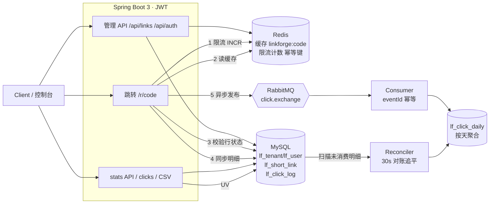

# LinkForge

多租户短链 + 访问分析后端服务（v1.0.0，P0–P5 全阶段交付并通过两轮外部审计）。

面向 2027 春招实习简历项目：用真实路径练 **MySQL / Redis / RabbitMQ / JWT**，业务壳是短链创建与 302 跳转。
本仓库为**自研骨架**，不是对任何开源短链项目的换皮。

## 技术栈

| 层级 | 选型 |
|------|------|
| 语言 / 运行时 | Java 17 |
| 框架 | Spring Boot 3.3、Spring Security、Validation、Actuator |
| ORM | MyBatis-Plus |
| 主库 | MySQL 8 |
| 缓存 | Redis 7 |
| MQ | RabbitMQ 3.13（`ClickEventPublisher` 接口，便于以后换 RocketMQ） |
| 鉴权 | JWT（Bearer）；可后续换 Sa-Token |
| 构建 | Maven |

**边界与不做**：AI / PostgreSQL / Supabase / 向量库（整体延期，后续另立方案）；Spring Cloud / Seata / 多机房；独立前端 SPA（静态控制台已够用）；云公网部署（D5=本地 Compose，prod profile 已备好收紧开关）。

## 鉴权策略

**bootstrap 演示账号 + 开放注册共存**（D3）。两条路径：

1. **bootstrap**：启动时由 `BootstrapDataLoader` 幂等写入演示租户。口令不写在源码里，只从环境变量读取：
   - `LINKFORGE_BOOTSTRAP_TENANT`（默认 `demo`）
   - `LINKFORGE_BOOTSTRAP_USERNAME`（默认 `admin`）
   - `LINKFORGE_BOOTSTRAP_PASSWORD`（必填，无默认值）
2. **开放注册** `POST /api/auth/register`：自助创建一个全新租户及其首个用户，成功即返回 JWT。邀请码**未启用**（无邀请码逻辑）。注册按 IP 固定窗口限流，默认 5 次 / 10 分钟，超限 429；阈值可用 `LINKFORGE_REGISTER_MAX` / `LINKFORGE_REGISTER_WINDOW_SECONDS` 调整。

本地示例值只在 `.env.example`。

## 模块（包）结构

单 Maven 模块，按包划分边界：

```
com.linkforge
├── common      # 统一响应、异常
├── config      # MyBatis / Redis / RabbitMQ / 配置属性
├── security    # JWT、SecurityFilterChain
├── bootstrap   # 演示租户种子数据
├── user        # 租户 / 用户 / 登录
├── link        # 短链创建、302 跳转、健康检查
└── stats       # 点击同事务落库/Outbox + Relay 投递 + RabbitMQ 消费幂等聚合 + 对账追平 + stats API
```

## 快速开始

前置：JDK 17、Maven 3.9+、Docker Desktop。没有本地 Maven 或 JDK17 时，编译可走下方 Docker 镜像路径。

### 1. 启动依赖（Docker Compose）

在仓库根目录执行。Compose 不再内置数据库或 MQ 口令，必须先有 `.env`：

```bash
cp .env.example .env   # 本地示例；不要提交 .env
docker compose up -d
docker compose ps      # 确认 mysql / redis / rabbitmq healthy
```

Compose 读取 `MYSQL_ROOT_PASSWORD`、`MYSQL_PASSWORD`、`RABBITMQ_PASSWORD`（以及可选的库名、用户名、端口）。用户名默认 `linkforge`，口令只来自 `.env`。

### 2. 编译

```bash
mvn -q -DskipTests package
```

无本地 Maven / JDK17 时，用 Docker 里的 JDK17 Maven 构建（Windows PowerShell 把 `$PWD` 换成 `${PWD}`）：

```bash
docker run --rm -v "$PWD":/app -v linkforge_m2:/root/.m2 -w /app \
  maven:3.9-eclipse-temurin-17 mvn -B package
```

### 3. 运行应用

应用不会自动加载 `.env`。先导出变量再启动：

```bash
set -a
source .env
set +a
mvn spring-boot:run
# 或
java -jar target/linkforge-1.0.0.jar
```

默认端口 `8080`，profile `dev`。未设置下列必填变量时，Spring 占位符无法解析，进程起不来：

| 变量 | 作用 |
|------|------|
| `LINKFORGE_BOOTSTRAP_PASSWORD` | bootstrap 用户口令 |
| `SPRING_DATASOURCE_PASSWORD` | MySQL 用户口令 |
| `SPRING_RABBITMQ_PASSWORD` | RabbitMQ 口令 |
| `JWT_SECRET` | JWT HMAC 密钥，至少 32 字符 |

可选、源码里有非敏感默认值：`LINKFORGE_BOOTSTRAP_TENANT`、`LINKFORGE_BOOTSTRAP_USERNAME`、`SPRING_DATASOURCE_URL`、`SPRING_DATASOURCE_USERNAME`、`SPRING_DATA_REDIS_HOST`、`SPRING_DATA_REDIS_PORT`、`SPRING_RABBITMQ_HOST`、`SPRING_RABBITMQ_PORT`、`SPRING_RABBITMQ_USERNAME`。Redis 口令默认空（`SPRING_DATA_REDIS_PASSWORD`）。

### 4. 冒烟

```bash
# 健康检查
curl -s http://localhost:8080/api/health
curl -s http://localhost:8080/actuator/health

# 登录
TOKEN=$(curl -s -X POST http://localhost:8080/api/auth/login \
  -H 'Content-Type: application/json' \
  -d '{"tenantName":"'"${LINKFORGE_BOOTSTRAP_TENANT:-demo}"'","username":"'"${LINKFORGE_BOOTSTRAP_USERNAME:-admin}"'","password":"'"${LINKFORGE_BOOTSTRAP_PASSWORD}"'"}' \
  | python3 -c 'import sys,json; print(json.load(sys.stdin)["data"]["token"])')

# 创建短链
curl -s -X POST http://localhost:8080/api/links \
  -H "Authorization: Bearer $TOKEN" \
  -H 'Content-Type: application/json' \
  -d '{"originalUrl":"https://example.com","title":"demo"}'

# 302 跳转（把 CODE 换成返回的 code；`curl -I` 发 HEAD 也可探测：同 GET 语义返回 302/404/410，但不产生点击记录）
curl -s -D - -o /dev/null http://localhost:8080/r/CODE
```

一键冒烟（仓库根目录执行，自动做 health → 登录 → 建链 → 302 → Redis 校验 → 注册 → 生命周期，口令读 `.env`）：

```bash
bash scripts/smoke.sh
```

应用启动后：`http://localhost:8080/` 是**极简控制台**（可选特性；登录/注册、建链（支持自定义码与过期时间）、列表、启停/删除、点击与 UV 统计、CSV 导出入口）；接口文档在 `http://localhost:8080/swagger-ui/index.html`（springdoc 生成，prod 下关闭）。

MQ 宕机演练（两套，回归皆应绿）：

```bash
bash scripts/mq-drill.sh      # sync 开 + 断 MQ → 恢复追平（P2 旧验收）
bash scripts/outbox-drill.sh  # sync 关 + 断 MQ → 恢复追平（A7 硬验收；自带 8082 独立实例）
```

## 已实现接口

| 方法 | 路径 | 说明 |
|------|------|------|
| GET | `/api/health` | 应用健康（无需鉴权） |
| GET | `/actuator/health` | Actuator |
| POST | `/api/auth/login` | JWT 登录 |
| POST | `/api/auth/register` | 开放注册（新建租户+用户，返回 JWT；按 IP 限流） |
| POST | `/api/links` | 创建短链（需 Bearer Token；可选 `expireAt` 未来时间、可选 `customCode` 自定义短码 4-16 位 `[A-Za-z0-9_-]`、可选 `Idempotency-Key` 头幂等重放） |
| GET | `/api/links?page=&size=` | 分页列表（仅本人创建的链，size 1..100 默认 20） |
| GET | `/api/links/{code}` | 详情：目标 URL、状态、过期时间、创建/更新时间 |
| PATCH | `/api/links/{code}` | 改目标 URL / 备注 / 过期时间（未来）；成功后写穿缓存 + 延迟双删 |
| POST | `/api/links/{code}/disable` | 禁用；缓存失效 |
| POST | `/api/links/{code}/enable` | 重新启用（过期时间不受影响） |
| DELETE | `/api/links/{code}` | 逻辑删除；**短码永久保留不可复用**（uk_code） |
| GET | `/api/links/{code}/stats?days=7` | 点击统计（仅链主）：总量、**精确 UV**（按 IP 去重，来自同步明细）+ 按天序列，days 1..90 |
| GET | `/api/links/{code}/stats/breakdown?dim=device\|referer_host&days=7` | **维度分布**（仅链主）：设备（mobile/desktop/tablet/bot/unknown）与来源 host（归一化，空→direct）各桶点击数降序，days 1..90；维度口径是点击数**不是 UV** |
| GET | `/api/links/{code}/clicks?page=&size=` | 点击明细（仅链主）：时间/IP/UA/Referer，新到旧分页 |
| GET | `/api/links/export` | 导出本人全部短链 CSV（UTF-8 BOM，逗号/引号转义） |
| GET | `/r/{code}` | 302 跳转；短码**区分大小写**、原样精确匹配；Bloom 前置（从未存在的码 404 不查库，见「防穿透」），Redis 缓存优先，未命中回源 MySQL；同步写 `lf_click_log` |
| HEAD | `/r/{code}` | 可跳性探测：302（带 Location）/404/410 与 GET 同档，但**不写点击明细、不发 MQ、不计 UV**（共用按 IP 跳转限流） |

**错误码语义（已写死）**：跳转遇 **禁用或不存在 → 404**，**过期 → 410**；管理接口的越权访问统一 **404**（不泄露他人短码存在性）；未携带/无效凭证 **401**；注册租户名冲突 **409**、自定义短码被占用 **409**；触发限流 **429**。

**自定义短码**：`customCode` 需 4-16 位字母/数字/下划线/连字符，保留字（admin、login、stats、actuator、console、metrics 等，大小写不敏感）不可用，短于 4 位的词（api、r）天然被长度规则挡住；已被占用（含已删除链占用的码）返回 409。随机码与自定义码共用 `uk_code` 唯一索引，并发安全。**短码区分大小写**（A10 V4，列排序规则 `utf8mb4_0900_bin`）：`AbC123` 与 `abc123` 是两个独立的码，跳转与管理 API 都按原样精确匹配（尾随空格也不等价，NO PAD）；保留字检查仍不区分大小写，防 `ADMIN` 绕过。

**限流（P3）**：注册按 IP 5 次/10 分钟；创建按用户 30 次/分钟；公开跳转按 IP 300 次/分钟。全部为 Redis 固定窗口，超限 429，阈值见下方环境变量。限流器在 Redis 故障时放行（degrade open）。客户端 IP 默认取 socket 地址、**不信任** `X-Forwarded-For`（该头可伪造、会被用来绕限流）；仅在可信反向代理后部署时设 `LINKFORGE_TRUST_XFF=true`。同一客户端经 IPv4/IPv6 两个协议访问会各占一个计数桶（本机 `127.0.0.1` 与 `::1` 并存属预期现象）。

**缓存一致性（P3）**：更新短链时**写穿**（立即写入新值）并安排 1 秒后的延迟双删，清除并发读旧库行回填的脏值；禁用同理（先删 + 延迟双删）。最终一致窗口约 1 秒，上限为 TTL（默认 3600 秒）。过期链路不依赖缓存（每次跳转都校验 DB 行状态）。

**创建幂等与并发（P3）**：携带 `Idempotency-Key` 头的重复提交返回同一短码（Redis `pending→code` 两段式，并发同键只建一条，映射保留 24h）；短码生成靠 `uk_code` 唯一索引兜底，撞码自动重试新码，并发创建不会产生重复短码。

跳转路径缓存键：`linkforge:code:{code}`。更新/禁用会主动删除该键，下一次跳转回源后重建。  

## 点击统计管道（A7 Transactional Outbox）

跳转产生一次点击后，在**同一 DB 事务**内写入：

1. **同步明细**（可选）：插入 `lf_click_log`（开关 `LINKFORGE_SYNC_CLICK_ENABLED`，默认开）。
2. **Outbox**：插入 `lf_outbox`（PENDING；开关 `LINKFORGE_ASYNC_CLICK_ENABLED`，默认开）。eventId＝sync 开时 `log-{明细行id}`（确定性），sync 关时为稳定 UUID（持久在 outbox）。

**热路径不直接触碰 RabbitMQ**。`ClickOutboxRelay`（开关/批量/节奏见 `LINKFORGE_MQ_RELAY_*`，默认开、批量 100、2s 轮询）把 PENDING 行投递到 `linkforge.click.exchange`，成功标 SENT；失败 attempts+1 并按 2^n 秒退避（上限 60s）重试。消费端不变：真实消费者按 `eventId` 幂等写 `lf_consumed_event` + 按天累加 `lf_click_daily`，消费失败进死信队列 `linkforge.click.dlq`（不回队热循环）。

**关 sync 后的语义（A7 起与旧版不同）**：明细/UV **不再丢失**——消费者为 UUID 事件**回填** `lf_click_log`（行上打 `event_id` 标记），明细/UV 变为最终一致（延迟 ≈ Relay 轮询 + 消费）；聚合照常追平。断 MQ / 断 Relay 期间点击全部停在 outbox（跳转照常 302），恢复后自动补投。旧叙事「关 sync + MQ down 即丢失」已由演练证伪。

**对账与追平**：`ClickLogReconciler`（`LINKFORGE_MQ_RECONCILE_FIXED_DELAY_MS`，默认 30s）降级为 **sync 开启时的安全网**（直连补聚合，`log-{id}` 去重，跳过消费端回填行）；**sync 关闭时不运行**，追平完全由 outbox 承担。手工对账（sync 开时两边应相等）：

```sql
SELECT (SELECT COUNT(*) FROM lf_click_log) AS detail,
       (SELECT IFNULL(SUM(clicks),0) FROM lf_click_daily) AS aggregate;
```

MQ：`linkforge.click.exchange` → `linkforge.click.queue`（DLX：`linkforge.click.dlx` / `linkforge.click.dlq`）。

**投递可靠性（A7 审计 S1/N3-N5 落地）**：publish 走 **correlated confirm + mandatory returns**，broker ack 后才标 SENT；nack / 路由不可达 / 确认超时（5s）一律退避重试。超过 `LINKFORGE_MQ_RELAY_MAX_ATTEMPTS`（默认 30）的行标 **FAILED**（指标 `linkforge.outbox.failed`，手工重放：`UPDATE lf_outbox SET status='PENDING', next_attempt_at=NULL WHERE status='FAILED'`）。多实例 Relay 无 SKIP LOCKED，可能重复投递——**at-least-once**，消费端 eventId 幂等兜底。SENT 行当前永久保留（自动清理未实现，登记为运维项；可用 `DELETE ... WHERE status='SENT' AND sent_at < NOW() - INTERVAL 30 DAY` 定期清理）。

## 维度分析（A8 预聚合）

**只做消费路径**：`consume` 在既有幂等事务内把 UA / Referer 解析进 `lf_click_dim_daily`（同事务＝同 eventId 幂等，重放不双计），302 热路径零新增计算。

- **设备桶**（`dim=device`）：轻量确定性规则（无第三方库）——bot 优先（bot/spider/crawler/curl/wget/python-requests/java 等），次 tablet（iPad / Android 无 Mobile），次 mobile（iPhone / Android+Mobile / 含 mobile），次 desktop（Windows/Mac/X11/Linux），解析不出 → `unknown`
- **来源桶**（`dim=referer_host`）：Referer 归一化 host（小写、去 `www.`、超长截断 128），缺失/非法 → `direct`
- **API**：`GET /api/links/{code}/stats/breakdown?dim=device|referer_host&days=1..90`（仅链主，非法 dim 400）；控制台统计区同步展示设备/来源两行
- **口径**：维度计数是**点击数**，与 UV（按 IP 去重）不同——一次设备点击 ≠ 一个访客
- 历史明细（A8 上线前）不做回填；新点击自消费起进维度表

## 防穿透（A9 Bloom）

跳转热路径在限流之后、DB 之前加了一层 **Guava `BloomFilter<String>`**（进程内，只存短码 `code`）：

- **一定不存在 → 直接 404**：`mightContain == false` 是权威否定（该码在启动装载时不在库中、之后也没在本实例创建过），跳过 Redis 与 MySQL，计数指标 `linkforge.bloom.rejected`
- **存在或误判 → 回源**：false positive（`fpp` 配置，默认 1e-4）只是多一次 DB miss 后照常 404，**正确性不受影响**；启动 `ApplicationReadyEvent` 全量 `SELECT code` 装载，创建成功即 `put`
- **禁用/过期/删除语义不变**：Bloom 只挡「从未存在」的码，不存 status/expire——禁用行仍在（Bloom 保持正答 → 回源 DB → 404）；删除是**逻辑删除**（行保留、`uk_code` 码位不可复用），已删码仍被装进 Bloom（播种 SQL 故意绕过 `@TableLogic`）→ 回源 DB（`deleted=0` 过滤）→ 404；经典 Bloom 无法回收条目（如需回收走定期全量 rebuild，后置）；**删除/过期判断永远以 DB 为准**
- **降级**：`LINKFORGE_BLOOM_ENABLED=false` 一键关闭（回落 A8 行为，非法码照旧 404 但查库）；装载失败/未就绪自动 fail-open 走旧路径（warn + `linkforge.bloom.loadfailed`），Bloom 故障不会导致 5xx
- **容量**：`LINKFORGE_BLOOM_EXPECTED_INSERTIONS`（默认 100000）/ `LINKFORGE_BLOOM_FPP`（默认 0.0001）；实际插入量长期超过预期会劣化误判率（更「宁可误判回源」，不会漏），届时调大容量重启即可
- **已知限制**：多实例各自装载、不共享——在实例 B 新建的码，在实例 A **重启前**是负答 → A 上 404（**真正的假阴性**；Demo 只跑单实例所以可接受，生产需换 RedisBloom 或广播 put，后置）。与「长链去重 Bloom」是**两个不同结构**，不得混用

## 防击穿（A10 singleflight）

**先说实话（本项目不是经典击穿形状）**：经典击穿是「缓存 key 过期 → 一窝请求同时打 DB」。LinkForge 为了强一致，`resolveTarget` **每个请求都要读一次 DB 行**判禁用/过期（Redis 只省 URL 字段，不替 DB 挡流量），所以热点码的 DB 读压力和 QPS 成正比、与缓存过期无关。A10 的 singleflight 合并的就是「每请求读行」本身：同一短码的并发读行合并成**一次在途读**，其余请求跟车拿同一份行，把 DB 读压成「每个在途窗口（一次查询耗时）1 次」。

- **只合并读行**：限流、Bloom、Redis GET、状态/过期判定、URL 校验、缓存回填、点击记录仍在每个请求自己的线程上；过期判定用**本请求**的 `now()`，404/410 结论不共享。同步点击明细照旧每次一写——DB 总负载只省掉读那一半
- **实现**：进程内 `ConcurrentHashMap<code, CompletableFuture<行>>`；领头 `putIfAbsent` 后在**自己线程上**同步读库，完成即摘除条目（`remove(key, future)` 两参版）——**不是结果缓存**，无 TTL、无最近值。跟车等待超时（`LINKFORGE_SINGLEFLIGHT_WAIT_TIMEOUT_MS`，默认 500ms）就**自己读一次库**（fail-open，计 `linkforge.singleflight.timeout`），合并器故障不会造成 5xx/误 404
- **一致性窗口**：跟车拿到的行最多比它到达时早一个查询耗时（毫秒级），小于既有 1s 延迟双删窗口。写路径收紧：`update` / 禁用/启用 / 删除提交后调 `forget(code)` 摘掉在途条目，写后到达的请求重新领头读新行（有 IT 钉住「disable 后的 GET 不跟车旧行」）
- **Bloom 在合并器之前**：负答 404 永远不进 flight；Bloom 误判/已删码的并发 miss 也合并（同一时刻只读 1 次库），但 null 不缓存（空值缓存是 B7，后置）
- **多实例**：合并是进程内的，最坏「每实例每在途窗口 1 次」，DB 读压力上限＝实例数（Demo 可接受）。**不引入分布式锁**（Redisson / `SET NX`）：在「每请求必须读行」的前提下，分布式互斥只会把读串行化、拉长尾延迟，收益不成立
- **面试对照**：mutex（`synchronized`/单飞锁）把同码请求全串行、等待面大；singleflight（本实现）只在读库这点上并发合并、完成即散；XFetch（概率早刷新）提前续期把击穿概率压到趋零，但需要 TTL 语义配合——本项目行读无 TTL 可续，故选 singleflight。指标：`linkforge.singleflight.loads`（领头真读库次数）/ `shared`（跟车复用）/ `timeout`（超时退化），开关 `LINKFORGE_SINGLEFLIGHT_ENABLED=false` 回到 A9 行为（计数器不注册）

## 多级缓存（B7 空值缓存 + TTL 抖动 / B8 L1）

**先说边界**：这一波之后跳转仍是**每请求读 DB 行**判状态（接 A10 叙事）——L1 与空值缓存都**不是**「跳过 DB 的行缓存」。省掉的是：不存在码的重复 DB miss（B7）与热点码的 Redis 往返（B8）；TTL 抖动防的是**同一批 key 同时过期**的雪崩形态。

- **B7 空值缓存**：只缓存「**DB 行读取结果为 null**」这一种负答（从未存在、逻辑删除、Bloom 误判后回源 null），key 独立为 `linkforge:absent:{code}`（哨兵 `"1"`，不污染正缓存）。**禁用（404）/过期（410）/URL 不可渲染（410）绝不写入**——这些码的行还在，启用/改期后必须立即生效。Bloom 负答路径不读不写 absent（Bloom 先拦）；`doCreate` 成功后 DEL absent（新码可能刚被扫成 absent）；TTL 默认 60s + 抖动 30s；`LINKFORGE_ABSENT_TTL_SECONDS<=0` 整体关闭。指标 `linkforge.cache.absent.hit` / `.put`；探查/写入异常一律 fail-open 当 miss
- **TTL 抖动（防同批过期雪崩）**：正缓存与空值缓存 TTL 统一为 **`base + uniform[0, jitter]`（只向上抖）**：正缓存 `3600 + 300`（`LINKFORGE_CACHE_TTL_JITTER_SECONDS`），空值 `60 + 30`；jitter=0 时退化为裸 base。过期时间被打散，同一批创建的码不再同时失效
- **B8 Caffeine L1**：进程内缓存**URL 字符串**（与 Redis L2 同形状，不缓存行），`maximum-size` 默认 10000、TTL 默认 **10s**（远小于 Redis TTL）。命中省一次 Redis 往返；**命中不跳过 singleflight/DB 行读**，禁用/过期语义零变化。写路径同触碰：`cacheUrl` 写穿 L1+L2（带抖动 TTL），`evictCache`/延迟双删同时失效 L1。指标 `linkforge.l1.hit` / `.miss`；`LINKFORGE_L1_ENABLED=false` 回到 A10 行为
- **行级 URL 校验门（B8 引入的护栏）**：每次跳转都会读行，行的 `original_url` 不可渲染时**一律 410，与缓存命中与否无关**——带 B8 后「脏行 + 旧缓存未清」会被旧缓存遮蔽成 302，此门保证脏行永远不被旧缓存掩盖（`LinkLifecycleIT` legacy-dirty 契约钉住）
- **多实例诚实口径**：L1 进程内、实例间**不同步**（无 pub/sub 广播）——实例 A 改了 URL，实例 B 在 L1 TTL（≤10s）内可能仍跳旧 URL，与 Redis 双删窗口叠加时取更长者；空值缓存在 Redis、多实例共享。Bloom 的多实例限制见「防穿透」

## 开放能力（B4 API Key / B5 Webhook）

### B4 API Key（哈希存储 + 配额）

外部系统可以不拿 JWT、改用 **API Key** 调链接面 API：

- **格式与存储**：明文 `lfk_{8位前缀}_{32位Base62}`，只在**创建响应里出现一次**；库里只有 `key_hash = SHA-256(明文)`（唯一索引点查）+ 展示用 `key_prefix`，明文与 hash 都不进日志/列表
- **请求头**：`X-API-Key: lfk_...`（**不能**放 `Authorization: Bearer`——那是 JWT 专用，混发两样返回 400）
- **身份**：Key 以**创建者用户**的身份调用（`ROLE_API_KEY`），归属/限流/幂等语义与 JWT 完全一致；多租户隔离不变
- **权限白名单**：Key 可调 `/api/links/**`（含 stats / breakdown / clicks / export）；**不可**调 `/api/keys/**`、`/api/webhooks/**`、`/actuator/**`（health 除外）→ 403。Key 不能再签 Key、改回调地址、看全局指标（防泄露后横向扩权）
- **吊销即时**：每请求按 hash 点查一次库，`DELETE /api/keys/{id}` 后**下一请求即 401**（不做认证缓存，代价是每请求一次点查）
- **配额**：Key 级分钟/日两道固定窗口（复用限流实现，键 `linkforge:rl:apikey:min|day:{keyId}`），超限 429 + `Retry-After`；额度默认 120/分钟、10000/日，可在创建时按 Key 覆盖。**诚实边界**：Redis 故障期间配额 fail-open 不生效（配额是商业限额不是安全边界）；固定窗口边界可瞬时 2×；分钟被拒时日计数已 +1（小幅高估）
- **管理 API（仅 JWT）**：`POST /api/keys`（明文仅此一次）/ `GET /api/keys` / `DELETE /api/keys/{id}`（幂等吊销）；每用户活跃 Key 上限 10

```bash
curl -X POST -H "Authorization: Bearer $JWT" -H "Content-Type: application/json"   -d '{"name":"ci","quotaPerMinute":60}' http://localhost:8080/api/keys
# → data.key = "lfk_xxxxxxxx_..." （仅此一次）
curl -X POST -H "X-API-Key: lfk_xxxxxxxx_xxx" -H "Content-Type: application/json"   -d '{"originalUrl":"https://example.com"}' http://localhost:8080/api/links
```

### B5 点击 Webhook（建在 A7 Outbox 链上）

租户可配置一个回调地址，点击事件**逐次**推送（`link.clicked`）：

- **投递来源（关键）**：`recordClick` 热路径**零新增**——点击照旧走 `lf_outbox → MQ → consume`，在 `consume` 的**幂等去重事务内**落一行 `lf_webhook_delivery(PENDING)`，独立 relay 轮询做 HTTP 投递。同一 eventId 无论重放几次只产生一行；断 MQ 期间点击停在 outbox，恢复后自动补出投递
- **签名与防重放**：头 `X-LinkForge-Event-Id`（= `evt_` + 点击 eventId，跨重试/重放稳定）、`X-LinkForge-Timestamp`（Unix 秒）、`X-LinkForge-Signature: v1=HMAC-SHA256(secret, timestamp + "." + rawBody)`。接收方校验：常量时间比较 + **±300s** 容差 + 按 event id 去重
- **payload**：`{id, type:"link.clicked", createdAt, data:{linkId, code, clickedAt, device, refererHost}}`——**不推原始 IP / 完整 UA / 完整 Referer**（隐私最小化）
- **重放**：手工重放：`UPDATE lf_webhook_delivery SET status='PENDING', next_attempt_at=NULL WHERE id=?`。**at-least-once**（多实例无 SKIP LOCKED），接收方按 event id 去重
- **secret 存储（Q1 拍板）**：at-rest 为 **AES-256-GCM 密文**（`v1:` + Base64(nonce‖ct‖tag)），主密钥来自 env **`LINKFORGE_WEBHOOK_SECRET_KEY`**（Base64 32 字节，`openssl rand -base64 32` 生成；留空则签名不可用）。创建/轮换时明文只返回一次，GET 只给掩码。**运维边界**：主密钥丢失 → 库内密文全部不可解密，须对所有租户 `rotate-secret` 重发；主密钥不进仓库。**降级口径（修复轮 S1）**：主密钥未配置时 endpoint 照常可配、**投递意图照常落 PENDING 行**（不静默丢），relay 整批跳过不耗次数（指标 `relay.skipped`），补上主密钥重启后自然补投；`LINKFORGE_WEBHOOK_ENABLED=false` 关闭期间的点击**不补投**
- **投递意图与失败语义（修复轮 S1）**：入队插入失败时**整条点击随 consume 事务回滚**进 DLQ（统计与回调意图同生共死），重复 (endpoint_id, event_id) 视为已入队放行
- **重试与退避（修复轮 N8 口径）**：2xx = SENT；网络错/超时/408/429/5xx 按 `min(1h, 10s·2^attempts)` 退避（attempts 从 1 起计，**首次重试等 20s**，attempts 计入最终那一次）；其它 4xx 首败即 FAILED；上限 8 次后 FAILED。退避在 **DB 时钟**上调度（`DATE_ADD(NOW(),…)`），JVM 与 MySQL 时区不一致不会拉长或杀掉退避
- **SSRF 基本防护**：保存时与**每次发送前**双校验——仅 http/https、拒 userinfo、解析出的所有 IP 不得为环回/私网/链路本地（含云元数据 169.254.169.254）/CGNAT/ULA，不跟随重定向（3xx = 不可重试失败）。**诚实限制**：DNS rebinding（校验与连接两次解析的 TOCTOU）本波不做、无端口白名单、无出口代理隔离；`LINKFORGE_WEBHOOK_ALLOW_PRIVATE_TARGETS` 仅测试用，prod 禁开
- **调度隔离**：`spring.task.scheduling.pool.size=4`，webhook relay 慢不拖点击 outbox 追平；webhook 依赖 `LINKFORGE_ASYNC_CLICK_ENABLED=true`（纯 sync 模式不产生回调）

**存量库迁移（Flyway，深化 A6）**：schema 已版本化在 `src/main/resources/db/migration`（`V1__baseline_schema.sql`），由应用启动时自动迁移（`spring.flyway.baseline-on-migrate=true`）：

- **全新数据卷**：首次启动应用（或跑 `scripts/migrate.sh`）由 Flyway 建全部表；Compose 的 MySQL 不再挂载 initdb 脚本，容器 healthy 后直接起应用即可。
- **已到 v1.0.0 schema 的存量卷**（表齐、无 `flyway_schema_history`）：应用启动或 `migrate.sh` 会自动记一笔 baseline（version 1）并跳过 V1，**无需删卷**，幂等可重复跑。
- **P2 之前的更老卷**（缺 `lf_click_daily` / `lf_consumed_event`）：baseline 会跳过 V1 补不了缺口——先按参考文件 `src/main/resources/db/schema.sql` 里的两段 `CREATE TABLE IF NOT EXISTS` 补表（幂等），再启动应用完成 baseline。

`db/schema.sql` 仅作历史参考与上述补表用途，**不再被执行**；新增 DDL 一律写 `db/migration` 新版本。

## 当前状态 vs 后续

| 阶段 | 内容 | 状态 |
|------|------|------|
| **P0–P3** | Compose 三件套、登录/注册（限流）、短链 CRUD/禁用/过期、缓存跳转（写穿+双删）、MQ 异步聚合（幂等/对账/断链追平）、创建幂等、并发不撞码、限流、Actuator 组件健康 | ✅ 已交付并审计通过 |
| **P4** | Testcontainers 测试隔离（63 测试）、GitHub Actions CI、bench.md 实测压测、架构 README、resume.md、prod profile | ✅ 已交付并审计通过 |
| **P5** | 盘点补洞（migrate.sh、路由核对、文档收口） | ✅ 完成，**v1.0.0 完整交付**（git tag `v1.0.0`） |

## 核心路径 vs 可选特性

| 类别 | 能力 | 说明 |
|------|------|------|
| **核心**（主路径 Demo 只依赖这些） | 注册/登录（JWT）、创建短链、`/r/{code}` 302 跳转（Bloom 防穿透）、stats 统计、限流、同事务 Outbox + Relay 投递 + 幂等消费 + 断链追平、CI / bench | 冒烟（smoke.sh）与断链演练（mq-drill.sh / outbox-drill.sh）覆盖的即主路径 |
| 可选（演示可用，面试可讲，主路径不强制） | 自定义短码、CSV 导出、Swagger UI、静态控制台、精确 UV / 点击明细、**维度分布（设备/来源）** | R2–R4 与深化 A8 落地，均有集成测试与隔离验证；prod profile 下文档与控制台默认关闭 |

## 配置要点

见 `src/main/resources/application.yml`。口令与 `JWT_SECRET` 只有环境变量，没有写在 yml 或 Java 默认值里。本地示例见 `.env.example`。

- Schema 版本化迁移用 **Flyway**（`spring.flyway.*`，dev/test/prod 同生效）：空库自动跑 `db/migration`；存量库自动 baseline，详见上方「存量库迁移」

- `linkforge.mq.async-click-enabled` 控制是否走 Outbox 管道；`ClickOutboxRelay` 用 `LINKFORGE_MQ_RELAY_ENABLED` / `_BATCH_SIZE`（默认 100）/ `_FIXED_DELAY_MS`（默认 2000）/ `_INITIAL_DELAY_MS`（默认 3000）/ `_MAX_ATTEMPTS`（默认 30，超过标 FAILED）
- `LINKFORGE_MQ_RECONCILE_*` 旧对账器节奏（仅 sync 开启时运行，见「点击统计管道」）
- `LINKFORGE_REGISTER_MAX` / `LINKFORGE_REGISTER_WINDOW_SECONDS` 注册限流阈值（默认 5 / 600 秒）
- `LINKFORGE_CREATE_RATE_MAX` / `LINKFORGE_CREATE_RATE_WINDOW_SECONDS` 创建限流（默认 30 / 60 秒，按用户）
- `LINKFORGE_REDIRECT_RATE_MAX` / `LINKFORGE_REDIRECT_RATE_WINDOW_SECONDS` 跳转限流（默认 300 / 60 秒，按 IP）
- `LINKFORGE_BLOOM_ENABLED` / `LINKFORGE_BLOOM_EXPECTED_INSERTIONS` / `LINKFORGE_BLOOM_FPP` 跳转防穿透 Bloom（默认 true / 100000 / 0.0001，见「防穿透」；装载失败自动 fail-open）
- `LINKFORGE_SINGLEFLIGHT_ENABLED` / `LINKFORGE_SINGLEFLIGHT_WAIT_TIMEOUT_MS` 同码并发读行合并（默认 true / 500ms，见「防击穿」；超时退化自读）
- `LINKFORGE_CACHE_TTL_JITTER_SECONDS`（默认 300）/ `LINKFORGE_ABSENT_TTL_SECONDS`（默认 60）/ `LINKFORGE_ABSENT_TTL_JITTER_SECONDS`（默认 30）空值缓存与抖动（见「多级缓存」；absent ≤0 关闭负缓存）
- `LINKFORGE_L1_ENABLED` / `LINKFORGE_L1_MAXIMUM_SIZE` / `LINKFORGE_L1_TTL_SECONDS` Caffeine L1（默认 true / 10000 / 10 秒，见「多级缓存」；命中不跳过 DB 行读）
- `LINKFORGE_APIKEY_QUOTA_PER_MINUTE`（默认 120）/ `LINKFORGE_APIKEY_QUOTA_PER_DAY`（默认 10000）/ `LINKFORGE_APIKEY_MAX_ACTIVE`（默认 10）API Key 配额与上限（见「开放能力」）
- `LINKFORGE_WEBHOOK_ENABLED`（默认 true）/ `LINKFORGE_WEBHOOK_SECRET_KEY`（Base64 32 字节 AES-256 主密钥，缺失则 webhook 降级关）/ `LINKFORGE_WEBHOOK_RELAY_FIXED_DELAY_MS`（默认 2000）/ `LINKFORGE_WEBHOOK_MAX_ATTEMPTS`（默认 8）/ `LINKFORGE_WEBHOOK_ALLOW_PRIVATE_TARGETS`（默认 false，仅测试）
- `LINKFORGE_IDEMPOTENCY_TTL_SECONDS` 创建幂等键保留时长（默认 86400 秒）
- `LINKFORGE_TRUST_XFF` 是否信任 X-Forwarded-For（默认 false，仅在可信反代后开启）
- 限流覆盖说明：注册按 IP、创建按用户（**含自定义短码创建，共用 POST /api/links 的限额**）；CSV 导出与统计查询属管理 API（JWT 必需、租户隔离），未单独限流，导出有 1 万行上限保护
- `/actuator/health` 展示组件细节（db / redis / rabbit / diskSpace），依赖 DOWN 时整体 503
- `/actuator/metrics/**` 暴露业务计数器（`linkforge.links.created`、`linkforge.redirects`、`linkforge.ratelimit.rejected{entry=register|create|redirect}`、`linkforge.bloom.rejected` / `linkforge.bloom.loaded` / `linkforge.bloom.loadfailed`、`linkforge.singleflight.loads` / `linkforge.singleflight.shared` / `linkforge.singleflight.timeout`、`linkforge.cache.absent.hit` / `linkforge.cache.absent.put`、`linkforge.l1.hit` / `linkforge.l1.miss`、`linkforge.apikey.auth{result=ok|invalid|revoked|ambiguous}` / `linkforge.apikey.quota.rejected{window}`、`linkforge.webhook.delivery{result}` / `linkforge.webhook.enqueued` / `linkforge.webhook.blocked` / `linkforge.webhook.enqueue.failed{reason}` / `linkforge.webhook.relay.skipped{reason}`、`linkforge.outbox.failed`），需 Bearer Token
- **公网部署**：本地 Demo 一律默认 profile（全开放）；对外部署设 `SPRING_PROFILES_ACTIVE=prod` 一键收紧——health 细节转 `when_authorized`、springdoc 与静态控制台关闭、文档/控制台路径在过滤器层 denyAll（见 application.yml prod 段与 ProdProfileIT）

## 架构



**跳转时序（GET /r/{code}，HEAD 共用）**：① 限流器按 IP 固定窗口 INCR（Redis，超限 429）→ ② **Bloom 门（A9）**：从未存在的码直接 404，不碰缓存与 MySQL → ③ **空值缓存探查（B7）**：`linkforge:absent:{code}` 命中 → 404（DB 近期已确认不存在）→ ④ **Caffeine L1（B8）** 读 URL → ⑤ **Redis L2** 读 URL（④⑤命中则省回源 URL 字段）→ ⑥ 无论命中与否都读 `lf_short_link` 行（**同码并发读行经 singleflight 合并为一次在途读（A10）**；DB 返回 null → 写空值缓存并 404）→ ⑦ 状态/过期判定（本请求时钟，404/410；**这两种 404/410 不进空值缓存**）→ ⑧ 选 URL（缓存命中优先，否则行上 URL）→ ⑨ 回填 L1+L2（正缓存，TTL 带抖动）→ 目标 URL 严格校验（不过 410）→ 写 `lf_click_log`（D7 同步明细）→ 发布 `ClickEvent`（eventId=log-{id}）到 RabbitMQ → 返回 302。消费端以 eventId 唯一索引幂等累加 `lf_click_daily`；发布失败由 Reconciler 定时从明细补投（断 MQ 演练见 `scripts/mq-drill.sh`）。更新/禁用走写穿 + 1s 延迟双删防旧值回填。

**本地 Demo 五步**（只走核心路径）：

1. `cp .env.example .env && docker compose up -d`，等 `docker compose ps` 三容器 healthy（MySQL 首次初始化约 5 分钟；表由应用启动时 Flyway 自动建，见下方「存量库迁移」；存量卷可 `bash scripts/migrate.sh` 幂等迁移）
2. 构建：`mvn -B -DskipTests package`（无本地 Maven 用 README 上方的 Docker 命令）
3. 启动：`set -a && . ./.env && set +a && java -jar target/linkforge-1.0.0.jar`
4. 核心链路：登录（`POST /api/auth/login`，demo/admin）→ 建链（`POST /api/links` 带 Bearer）→ 浏览器/curl 访问 `/r/{code}` 得 302（示例见上方冒烟段）
5. 验证：`bash scripts/smoke.sh`（SMOKE OK）、`bash scripts/mq-drill.sh`（断 MQ 追平）、`curl -s localhost:8080/actuator/health`

可选入口：浏览器打开 `http://localhost:8080/` 极简控制台（登录/建链/启停删除/统计/CSV 一站式，属可选特性，非主路径依赖）。

**Linux 复现**：Linux 无 `host.docker.internal`。测试/运行容器用 `--network host` 并把 `SPRING_DATASOURCE_URL`/`SPRING_DATA_REDIS_HOST`/`SPRING_RABBITMQ_HOST` 指向 `127.0.0.1`（Compose 已映射端口），或指向 docker0 网桥 `172.17.0.1`。CI（ubuntu-latest）即按此环境跑 `mvn -B verify`（Testcontainers 原生 Docker，无需 Compose）。示例：

```bash
docker run --rm --network host -v "$PWD":/app -v m2:/root/.m2 -w /app \
  -e SPRING_DATASOURCE_PASSWORD=... -e SPRING_DATA_REDIS_HOST=127.0.0.1 \
  -e SPRING_RABBITMQ_HOST=127.0.0.1 -e SPRING_RABBITMQ_PASSWORD=... -e JWT_SECRET=... \
  maven:3.9-eclipse-temurin-17 mvn -B verify
```

**压测数字**：见 `docs/bench.md`（wrk 实测：health 基线 888 QPS；跳转写路径分解：关同步明细后 13→276 QPS、P50 678→31ms；缓存命中率 100%）。

## 许可证

个人学习 / 面试项目，未设开源许可证条款时可按私有仓库使用。
