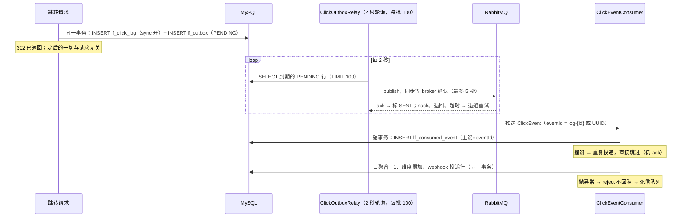

# RabbitMQ、Outbox 与幂等消费

优先级 P0，目标层级 L3（消息丢失三环节、Outbox 取舍、幂等设计要能应对全部追问）。本档是面试的胜负手专题。

## 先说人话（初学者第一遍从这里读）

消息队列解决三个痛点：**解耦**（统计代码挂了别拖累跳转）、**削峰**（洪峰先排队）、**失败传播隔离**（下游死了主路照常）。但它自己带来新麻烦：消息会丢、会重、会乱。学 MQ 一半在学收发，一半在学为它的毛病打补丁。第一遍带走三件事：

1. 「写了数据库又要发消息」是个两难：先写库后发消息，发挂了丢事件；先发消息后写库，写挂了出假消息。Outbox 的答案是**把「要发的消息」当成数据库的一行，和业务数据在同一个事务里写进去**，再由后台程序慢慢发出去。
2. 消息重复投递是常态，不是事故。消费端必须做到「处理两次等于处理一次」（这个性质叫幂等）。本项目靠一张以消息 id 为主键的去重表。
3. 消息有三个环节可能丢：发的时候、存的时候、收的时候。每个环节有一个对应的补丁，每个补丁都能在本项目里找到落地代码。

本章的结构就是这条主线：先讲为什么需要队列，再讲 RabbitMQ 的收发模型，然后把三个丢失环节逐个推演打补丁，最后把 Outbox 全链拼起来，逐环推演「丢了会怎样」。

## 学习目标

读完本章，你应该能：

- 默画「点击 → outbox → relay → MQ → 消费 → 聚合」的全链路时序图。
- 对链路上每一环说出：丢了数据会怎样、靠什么机制补救、补救机制本身失效时靠什么兜底。
- 讲透 Outbox 模式：解决什么问题、代价是什么、和 RocketMQ 事务消息与 CDC 的一句话取舍。
- 解释「at-least-once 投递 + 消费端幂等 = exactly-once 的效果」，并说出本项目的幂等键设计。
- 说清指数退避公式 `min(60, 2^n)` 的每一部分为什么存在，包括退避时间为什么必须用数据库时钟算。

## 前置知识

- [Spring 核心](30-spring-core.md)：`@Transactional` 与事务边界、自调用失效问题。
- [MySQL](40-mysql.md)：`lf_outbox` 表结构与 `idx_outbox_pending` 索引设计、唯一索引兜底。
- [并发与多线程](13-concurrency.md)：`@Scheduled` 定时任务与调度线程池隔离。
- [注解、反射与动态代理](java/10-07-annotations-reflection-proxy.md)：`@MapperScan` 宽扫描误代理的事故（本章会交叉引用）。

## 为什么需要消息队列：同步调用的三笔账

### 没有队列时，LinkForge 的跳转长什么样

短链项目的核心动作是：用户访问 `/r/abc1234`，服务查出原始网址，返回 302。产品还想要点击统计：每个短链每天被点了多少次、来自什么设备。

没有队列的写法是：跳转请求线程查完网址之后，顺手把统计的活也干了——写明细表、更新日聚合表，甚至调用下游的报表服务。所有逻辑串在同一个 HTTP 请求线程里。这笔账有三项：

**第一笔：耦合。** 统计代码和跳转代码必须在同一个进程里同生共死。统计里一行 `NullPointerException`，用户的 302 跳转直接 500。两个不相干的功能被一行执行顺序绑死了。以后想加一个「点击时通知 webhook 订阅者」，就得再改跳转代码——每加一个关心点击的下游，主路都要改一次。

**第二笔：失败传播。** 就算统计代码没 bug，它依赖的东西挂了也会把主路拖死。报表服务响应慢 5 秒，跳转就慢 5 秒；报表服务彻底宕机，跳转跟着不可用。下游的故障顺着调用链向上传播，一直烧到用户脸上。

**第三笔：扛不住洪峰。** 某个短链被大 V 转发，瞬时 1 万次点击。数据库每秒要吃下 1 万次明细写入加聚合更新，先撑不住的往往是它，然后跳转本身也查不出网址了。主路被一个「附属功能」的峰值流量打死。

### 队列的答案与它的代价

消息队列（Message Queue，简称 MQ）是一个独立的中间服务。生产者把「发生了什么」写成一条消息交给它，消费者按自己的节奏取出来处理。比喻它是**邮局**：寄件人把信投进邮筒就走，邮局按地址分拣，收件人什么时候来取都行。比喻的边界：邮局的信不会重复投递，MQ 会；邮局不丢信，MQ 在默认配置下会丢——所以本章大部分篇幅在给邮局打补丁。

换成队列后：跳转线程只写一行 outbox 记录就返回 302，统计逻辑搬到独立的消费者里慢慢做。三笔账各销一笔：统计挂了不影响跳转（解耦）；报表宕机时消息堆在队列里，它恢复后接着消费（失败传播被切断）；洪峰先落在队列里，消费端按自己的能力取（削峰）。

队列同时带来三个新问题，它们是本章的主角：

- **消息会丢**（三个环节都可能丢，下文逐环推演）。
- **消息会重**（可靠投递必然伴随重复，下文证明这一点）。
- **消息不保证顺序**（重试、并发消费都会打乱先后；本项目按天聚合加幂等去重，乱序无害——面试被问到顺序时就这么答）。

## RabbitMQ 的模型：交换机、队列与绑定

### 先遇到问题：生产者该把消息发给谁

最直觉的设计是生产者直接把消息写进某个队列。但有第二个消费者出现时它就不够用了：点击事件既要给「统计聚合」消费，将来还要给「webhook 通知」消费。生产者必须知道世界上有哪些队列、各自要什么——每加一个下游，生产者改一次。这和上一节耦合是同一个病。

RabbitMQ 的解法是把「投递」拆成两段。生产者永远不直接碰队列，它只把消息交给一个叫**交换机**（exchange）的中转站，并附上一个**路由键**（routing key，一个字符串标签）。交换机根据**绑定**（binding）决定消息去哪些队列：每条绑定声明「凡是路由键匹配 X 的消息，抄送给我绑的队列」。生产者从此只认识交换机，不认识任何队列。

### 四个名词的准确定义

- **exchange（交换机）**：接收生产者消息并按规则路由的中转站。它不存消息，路由完就忘。路由规则由交换机类型决定：`direct` 类型要求路由键**精确相等**；`topic` 类型支持通配符（`*` 匹配一个词、`#` 匹配零或多个词）。
- **queue（队列）**：存放消息的缓冲区，先进先出。消费者从队列取消息。
- **binding（绑定）**：连接交换机和队列的规则，声明「什么路由键的消息进这个队列」。
- **routing key（路由键）**：生产者随消息附带的字符串，交换机拿它和绑定规则做匹配。

一个 RabbitMQ 里 exchange、queue 的关系像这样（本项目真实拓扑）：

```text
                    routing key = "click.recorded"
  relay ──publish──▶ linkforge.click.exchange ──binding──▶ linkforge.click.queue ──push──▶ ClickEventConsumer
                          │（消费失败 reject 不回队）              │
                          │                                       ▼
                    basic.return / confirm ack        linkforge.click.dlx ──▶ linkforge.click.dlq
```

### 本项目拓扑逐段（`RabbitMqConfig`）

拓扑在 `src/main/java/com/linkforge/config/RabbitMqConfig.java` 里以 Bean 的形式声明。这是**框架行为**：Spring AMQP 启动时把这些 Bean 翻译成 AMQP 声明命令发给 broker，broker 上没有就创建。

```java
@Bean
public TopicExchange clickExchange() {
    return new TopicExchange(CLICK_EXCHANGE, true, false);
}

@Bean
public Queue clickQueue() {
    return QueueBuilder.durable(CLICK_QUEUE)
            .deadLetterExchange(CLICK_DLX)
            .deadLetterRoutingKey(CLICK_DLQ_KEY)
            .build();
}

@Bean
public Binding clickBinding(Queue clickQueue, TopicExchange clickExchange) {
    return BindingBuilder.bind(clickQueue).to(clickExchange).with(CLICK_ROUTING_KEY);
}
```

逐行看：

- 交换机类型是 `topic`，三个参数是（名字，durable，autoDelete）。durable=true 表示 broker 重启后交换机还在；autoDelete=false 表示没有消费者时也不自动删除。这里要纠正一个常见说法：本项目用的是 **topic 交换机，不是 direct**。但它只有一条绑定、路由键 `click.recorded` 是纯字面量、不含 `*` 或 `#`，通配符匹配退化成精确匹配，**行为上与 direct 等同**。选 topic 留了余地：以后加一条 `click.recorded.webhook` 之类的通配绑定，不用换交换机。
- 队列用 `QueueBuilder.durable(...)` 声明，durable=true。队列还挂了两个**死信属性**：死信交换机（DLX）指向另一个 topic 交换机，死信路由键固定为 `click.dead`。这两个属性的意思是：以后凡是这个队列里「被拒绝且不重回队列」的消息，自动转发给 DLX。DLX 本身就是个普通交换机，再经一条绑定把 `click.dead` 路由到 `linkforge.click.dlq`。死信机制放在消费端那节细讲。
- 绑定把队列和交换机用字面量 `click.recorded` 连起来。生产者发消息时带的路由键就是它，恰好匹配。

本项目拓扑里**没有**配置消息 TTL（TTL = time to live，消息存活期，到期自动死信）。TTL 加 DLX 的组合常用来做「延迟重试队列」：失败消息进一个带 TTL 的队列，到期死信回原队列，实现「过 30 秒再试」。本项目没做这层——消费失败直接进 DLQ 人工排检，逻辑更简单，代价是恢复靠人。如实记住这个取舍。

### 反例：默认消息转换器丢时间字段（真实事故）

消息是 Java 对象（`ClickEvent`，含 `LocalDateTime clickedAt` 字段），过网络前要序列化成字节。Spring AMQP 默认用 JDK 序列化，项目换成了 JSON：`RabbitMqConfig` 最后一个 Bean 把 Spring 容器里的 `ObjectMapper`（Jackson 的 JSON 引擎）包进 `Jackson2JsonMessageConverter`。源码注释记录了一次事故：

```java
@Bean
public MessageConverter jacksonMessageConverter(ObjectMapper objectMapper) {
    // Spring's mapper has JavaTimeModule; the converter's default one cannot
    // round-trip LocalDateTime and dead-letters every ClickEvent.
    return new Jackson2JsonMessageConverter(objectMapper);
}
```

初学者很容易自己 `new Jackson2JsonMessageConverter()` 不传参数。转换器内部的默认 `ObjectMapper` 没注册 `JavaTimeModule`（Jackson 处理 Java 8 日期类型的扩展模块），遇到 `LocalDateTime` 字段直接抛序列化异常。后果是**每一条**点击消息都序列化失败，全部落进死信队列——消息一条没丢，统计一条没进。事故的教训：序列化配置是全链路的公共件，改一处要想到两端。消费者靠同一个转换器把 JSON 反序列化回 `ClickEvent`，两边的 `ObjectMapper` 配置必须对称。

## 投递语义：at-least-once 为什么是唯一现实的选择

先遇到问题：消费者处理完一条消息，向 broker 发回一个「处理完了」的确认（ack）。broker 收到 ack 才删除消息。看起来滴水不漏，但**ack 本身也是一条网络消息，也可能丢**。推演一遍：

1. broker 把消息推给消费者，消费者处理成功，发出 ack。
2. ack 在网络上丢了，或者消费者刚处理完、还没发出 ack 就崩了。
3. broker 等不到 ack，超时后认为「没送达」，把消息重新投递。
4. 同一条消息被处理了两次。

broker 无法区分「没处理」和「处理了但 ack 丢了」，因为这两种情况在它眼里一模一样。结论是硬的：**要不丢就必须允许重投，允许重投就必然可能重复**。三个术语由此而来：

- **at-most-once**：发了就算，丢了不补。重复不可能，丢失不设防。
- **at-least-once**：保证至少送达一次，代价是可能重复。几乎所有工程系统的选择。
- **exactly-once**：端到端恰好一次。在「网络可能丢包、确认可能丢失」的前提下，把它作为一种**机制**去承诺是不可证的；能交付的是**效果等价**：at-least-once 投递，加上消费端幂等，重复被吸收，净效果就是恰好一次。面试里轻率声称「系统实现了严格 exactly-once」是减分项，加分答法是把上面的推演讲一遍。

## 消息丢失三环节与补丁

一条消息从生产到生效要过三道关：生产者发出去、broker 存下来、消费者收下来。逐环推演「怎么丢」，再逐环打补丁。

### 环节一：生产端——「调用了发送方法」不等于「发出去了」

**怎么丢。** 初学者以为 `rabbitTemplate.convertAndSend(...)` 一返回消息就安全了。实际发生的是（框架行为）：这个调用把消息写进 TCP 连接的发送缓冲区就返回了。之后有三种坏结局它都不知情：网络在半路断了；消息到了 broker，但路由键匹配不上任何绑定——AMQP 默认把这种**不可路由**的消息静默丢弃；broker 刚收到就宕机。程序继续往下跑，统计数据里这条点击永远消失，而且没有任何报错。

**补丁一：publisher confirm。** 开启后（本项目 `application.yml` 里 `publisher-confirm-type: correlated`），broker 处理完消息后**主动回发一个确认帧**：`ack` 表示我收到了，`nack` 表示我内部出错了。生产者把「收到 ack」当作发送成功的唯一判据。

**补丁二：mandatory + returns。** confirm 只保证「broker 收到了」，不保证「路由到了」。开启 `publisher-returns: true` 和 `template.mandatory: true` 后，不可路由的消息不再被静默丢弃，broker 把它**退回**给生产者（AMQP 的 basic.return 帧），Spring AMQP 回调注册的 ReturnsCallback。

本项目两个补丁都开着，落地在 `src/main/java/com/linkforge/stats/mq/RabbitClickEventPublisher.java`。逐段看它怎么把「broker 确认」变成一条硬规则：

```java
@Override
public void publish(ClickEvent event) {
    CorrelationData correlation = new CorrelationData(event.getEventId());
    rabbitTemplate.convertAndSend(
            RabbitMqConfig.CLICK_EXCHANGE,
            RabbitMqConfig.CLICK_ROUTING_KEY,
            event,
            correlation);
    try {
        CorrelationData.Confirm confirm = correlation.getFuture()
                .get(CONFIRM_TIMEOUT.toSeconds(), TimeUnit.SECONDS);
        if (confirm == null || !confirm.isAck()) {
            throw new IllegalStateException("broker nacked event " + event.getEventId());
        }
        if (returnedIds.remove(correlation.getId())) {
            throw new IllegalStateException("unroutable event " + event.getEventId());
        }
    } catch (InterruptedException ex) {
        ...
    } catch (ExecutionException | TimeoutException ex) {
        throw new IllegalStateException("publisher confirm failed for " + event.getEventId(), ex);
    }
}
```

逐段讲：

- `CorrelationData` 是随消息携带的**回执编号**，这里用 eventId 当编号。发送后 `correlation.getFuture()` 是一个 `CompletableFuture`（Java 并发工具，代表「未来某个时刻会有结果」，见[并发与多线程](13-concurrency.md)），broker 的 ack 到达时它被完成。`get(5, TimeUnit.SECONDS)` 同步等待，最多 5 秒（类顶的常量 `CONFIRM_TIMEOUT = Duration.ofSeconds(5)`）。
- **nack**：`confirm.isAck()` 为 false 说明 broker 明确拒绝，抛异常。
- **超时**：5 秒内没等到 ack，抛 `TimeoutException` 分支的异常。宁可当作失败重发，也不把「不知道成没成」当成功。
- **不可路由**：类里维护了一个 `returnedIds` 集合（`ConcurrentHashMap.newKeySet()`，并发安全的 Set）。`@PostConstruct` 阶段注册的 ReturnsCallback 把每条被退回消息的编号记进集合；发送方等 ack 之后再 `remove` 检查：编号在集合里，说明这条消息被退回了，抛异常。
- 为什么「等完 ack 再查集合」就够了？RabbitMQ 的文档行为：对 mandatory 且不可路由的消息，broker 先发 basic.return 再发 basic.ack，两条帧在同一连接上按序到达，所以 ack 到达时退回通知一定已经处理完（本机无 broker，此条未实测，标注为 broker 文档行为）。
- 上面任何一种失败都抛异常，调用方（relay）捕获后**不标记成功**，行保持待发状态稍后重试。类的 javadoc 原话：宁可重试也不静默丢。

面试常问「为什么不用异步 confirm（`addConfirmListener`，吞吐更高）」。答：relay 的节奏是每两秒一批、每批至多百条，同步等 ack 的延迟成本可以忽略；换来的是「这条消息确定成功了才标记 SENT」这条极简单的推理链。语义清晰比吞吐重要，量级不支持优化。

### 环节二：broker——durable 与高可用是两件事

**怎么丢。** RabbitMQ 默认把消息放在内存里。broker 进程重启（或所在机器断电），内存里的消息全部蒸发。就算生产端 confirm 都成功了也救不了：confirm 只代表「我收到了」，不代表「我落盘了」。

**补丁：三层持久化，缺一不可。**

1. 交换机 durable（`RabbitMqConfig` 里 topic 交换机的第二个参数 true）。
2. 队列 durable（`QueueBuilder.durable(...)`）。
3. 消息本身持久化（delivery mode = 2）。Spring AMQP 用 `RabbitTemplate` 发送的消息默认就是 PERSISTENT（框架默认值，不需要额外配置）。

三层齐了，broker 重启后拓扑和消息都能恢复。但要分清 durable 的承诺边界：**durable 只保证「重启后还在」，不保证「挂了服务还在」**。单节点的 broker 宕机期间整个队列不可用，消息再持久也得等它起来。高可用要靠副本：现代方案是 quorum 队列（RabbitMQ 3.8 引入，用 Raft 协议在多个节点上投票写入）；旧的镜像队列机制已在 RabbitMQ 4.0 移除。本项目 `docker-compose.yml` 里是 `rabbitmq:3.13-management-alpine` 单节点，没有 HA——如实说，并知道上生产的第一个补丁是什么。以下 broker 行为本机 Docker 不可用，均未实测，标注示意。

### 环节三：消费端——自动 ack 是把删除权提前交了出去

**怎么丢。** 监听容器如果配置成自动 ack，消息一推到消费者内存里 broker 就删。随后消费者进程崩溃、或者处理逻辑抛异常，消息已经不存在了——处理结果却永远没有产生。推演一条点击的丢失：消息推给消费者 → 自动 ack → 消费者写数据库时连不上 → 异常 → 但消息已删 → 这次点击在统计里消失。

**补丁：手动 ack + 失败不重回队列 + 死信。** 本项目用 Spring AMQP 的 `@RabbitListener`（框架行为）：监听方法**正常返回**，容器替你发 ack；方法**抛异常**，容器发 reject，是否重回队列取决于配置。`application.yml` 的消费端配置：

```yaml
listener:
  simple:
    auto-startup: ${LINKFORGE_MQ_LISTENER_AUTO_STARTUP:true}
    # Errored messages go to the dead-letter queue instead of hot-looping.
    default-requeue-rejected: ${LINKFORGE_MQ_DEFAULT_REQUEUE_REJECTED:false}
```

`default-requeue-rejected: false` 是关键：处理失败的消息**不重回队列**。为什么不能让它回去重试？推演「无限重试回队」的下场：

1. 一条消息让消费逻辑必抛异常（比如 payload 里有个字段是 null，代码没判）。这种消息叫**毒消息**。
2. 它被 reject 后重回队列**头部**，broker 立刻重新推给消费者。
3. 再抛，再回队，再推。单条消息以微秒级节奏空转，消费者线程被它吃满。
4. 它身后的所有正常消息排在后面一条也消费不了；日志以每秒成百条的速度膨胀。整个队列事实上瘫痪。

所以失败消息的去向不能是队列头部，得是另一个地方：死信队列。链路是：reject 且 requeue=false → 队列的死信属性接管（`RabbitMqConfig` 里 `deadLetterExchange(CLICK_DLX)`）→ 消息以路由键 `click.dead` 发给 DLX → 经绑定落到 `linkforge.click.dlq`。DLQ 就是个普通队列，没有消费者，消息堆着等人排检。AMQP 还有另外两种消息也会走死信（broker 行为，示意）：消息 TTL 到期、队列超过长度上限被挤掉。本项目只触发 reject 这一种。

消费代码本身很短，`src/main/java/com/linkforge/stats/mq/ClickEventConsumer.java` 全文核心就这几行：

```java
@RabbitListener(queues = RabbitMqConfig.CLICK_QUEUE)
public void onMessage(ClickEvent event) {
    boolean counted = clickStatsService.consume(event);
    log.debug("click event consumed code={} eventId={} counted={}",
            event.getCode(), event.getEventId(), counted);
}
```

注意一个细节：`consume` 返回 false（重复事件）时方法**正常返回**，容器发 ack。重复不是错误，不该进 DLQ，更不该 reject。类 javadoc 原话：重复的 eventId 直接 ack 不再计数。

还要如实说清本项目的重试策略：消费失败**一次就进 DLQ**，没有「重试 3 次再死信」的中间层（项目没启用 spring-retry）。这个选择简单可预期；温和一点的方案要么在消费逻辑里自己做有限重试，要么用 TTL+DLX 组成延迟重试队列（前文提过），代价都是复杂度。webhook 投递链选择的是前者——它有自己独立的退避重试，见后文时钟事故一节。

## 重复投递与幂等消费

### 重复是推不掉的

前文投递语义一节已经推演过 ack 丢失导致重投。本项目链路上还有两个必然产生重复的点，都来自「先确认后记账」的顺序选择：

- relay 调 `publish` 成功（broker 已 ack），随后还没来得及执行 `markSent` 就崩了。重启后这行还是 PENDING，再次投递同一事件。
- broker 重投给消费者（消费者超时没 ack），而第一次其实处理成功了。

重复投递在 at-least-once 系统里是**设计内的常态**。防御只能放在消费端，要求消费逻辑幂等。

### 幂等的准确定义与三种实现

幂等（idempotent）：同一操作执行一次和执行多次，对系统的最终状态影响相同。三种常用实现，各自适用面不同：

1. **天然幂等写**：`UPDATE lf_click_daily SET clicks = 5`，执行多少遍结果都是 5。限制：新值必须不依赖旧值。
2. **唯一约束去重**：往一张以业务键为主键的表 INSERT，撞键即说明处理过。最通用，能防并发。
3. **状态机**：`UPDATE orders SET status='PAID' WHERE id=1 AND status='NEW'`，影响行数为 0 说明已经不是新单。适合有明确状态流转的场景。

### 本项目的去重表与两态 eventId

去重表 `lf_consumed_event`（建表 SQL 在 `src/main/resources/db/migration/V1__baseline_schema.sql`，实体在 `src/main/java/com/linkforge/stats/entity/ConsumedEvent.java`）：

```sql
CREATE TABLE lf_consumed_event (
    event_id      VARCHAR(64) PRIMARY KEY,
    consumed_at   DATETIME    NOT NULL DEFAULT CURRENT_TIMESTAMP
) ENGINE=InnoDB DEFAULT CHARSET=utf8mb4;
```

主键就是 eventId。消费逻辑在 `src/main/java/com/linkforge/stats/service/ClickStatsService.java` 的 `consume` 方法（第 66 到 107 行），骨架：

```java
return Boolean.TRUE.equals(dedupTx.execute(status -> {
    try {
        ConsumedEvent row = new ConsumedEvent();
        row.setEventId(event.getEventId());
        row.setConsumedAt(LocalDateTime.now());
        consumedEventMapper.insert(row);                  // 主键去重，撞键抛 DuplicateKeyException
    } catch (DuplicateKeyException ex) {
        return false;                                     // 重放：安静跳过
    }
    // ... 只有赢下去重插入的事件才继续：
    // 日聚合 +1、维度累加、webhook 投递行（片段，完整逻辑见源码）
    return true;
}));
```

三个设计点逐个说：

1. **去重即插入**。不「先查一下处理过没」再处理，直接 INSERT，让数据库的唯一索引当裁判。为什么不用先查后插？见下文反例一节的并发推演：查和插是两步，两步之间另一个线程可以把同一个 eventId 插进去，两个线程都通过检查、都计数。唯一索引是数据库在**写入那一刻**做的原子检查，没有缝隙。
2. **撞键为什么安全**。MySQL/InnoDB 对唯一键冲突的处理是**语句级回滚**（数据库行为）：只回滚失败的那条 INSERT，不影响事务里的其他语句。源码注释原话：MySQL rolls back only the failed statement。本例中去重插入本来就是事务第一条语句，前面没有别的写操作，撞键后干净返回 false。
3. **两态 eventId**。幂等的前提是「同一次点击的每次投递带同一个 id」。这个 id 的生成规则分两态（业务逻辑，规则见 `ClickRecordService` 的 javadoc 与 `src/main/java/com/linkforge/stats/mq/ClickEvent.java` 的 javadoc）：
   - **同步明细写开着时**：eventId = `log-{明细表自增id}`。明细行的 id 是数据库分配的、确定唯一的，MyBatis-Plus 在 insert 后把自增主键回填到实体（框架行为），所以能拼出这个键。它的关键性质是**确定性**：消费者投一次、对账器重放一次，都从同一行明细算出同一个 eventId，去重表撞键后只计一次。随机 UUID 做不到这一点——重放时拿不到上次那个随机数。
   - **同步写关闭时**：没有明细行可依托，eventId 退化为 `UUID.randomUUID()`，但**持久化在 outbox 行和 payload 里**，重发多少次都是同一个值。此时明细行由消费端补写（见下文对账一节），明细与 UV 从实时一致退化为最终一致，而不是消失。

### 可运行示例：Set 主键吸收重复投递

下面这个最小程序模拟「at-least-once 投递 + 主键去重」。`HashSet.add` 与数据库唯一约束同构：第一次加入返回 true，重复加入返回 false。完整文件，可直接编译运行。

```java
import java.util.HashSet;
import java.util.List;
import java.util.Set;

/**
 * 教学示例：模拟 at-least-once 投递下的幂等消费。
 * consumed 表 = HashSet（主键去重），lf_click_daily 的 clicks = long 计数器。
 * 事件流里有重复投递，唯一键吸收它们，最终 clicks 与去重后的事件数一致。
 */
public class IdempotentConsumeDemo {

    record ClickEvent(String eventId, String code) { }

    public static void main(String[] args) {
        // 消费者收到的投递序列：e3 是重复投递（relay 重发），e1 也是。
        List<ClickEvent> deliveries = List.of(
                new ClickEvent("e1", "abc1234"),
                new ClickEvent("e2", "abc1234"),
                new ClickEvent("e1", "abc1234"),
                new ClickEvent("e3", "abc1234"),
                new ClickEvent("e3", "abc1234"));

        Set<String> consumed = new HashSet<>(); // 对应 lf_consumed_event，主键 event_id
        long clicks = 0;                        // 对应 lf_click_daily.clicks

        for (ClickEvent event : deliveries) {
            boolean firstTime = consumed.add(event.eventId()); // 主键插入，撞键返回 false
            if (!firstTime) {
                System.out.println("skip duplicate " + event.eventId());
                continue;
            }
            clicks++; // 只有赢下去重插入的事件才累加
            System.out.println("counted " + event.eventId());
        }
        System.out.println("deliveries=" + deliveries.size() + " counted=" + clicks);
    }
}
```

```text
counted e1
counted e2
skip duplicate e1
counted e3
skip duplicate e3
deliveries=5 counted=3
```

5 次投递只有 3 个不同事件，计数器最终是 3。真实系统里把 `consumed.add(...)` 换成 `consumedEventMapper.insert(row)`、把返回 false 换成捕获 `DuplicateKeyException`，逻辑不变。示例的失效边界：它假设「处理」只有计数一步。真实 `consume` 里去重插入和聚合加一在**同一个事务**里，这是下一步要讲的短事务设计。

### 短事务：为什么用 `TransactionTemplate`

`consume` 里的写操作必须原子：去重插入、（sync 关时）补写明细行、日聚合加一、维度桶累加、webhook 投递行——这些要么全做，要么全不做，否则崩在中间会双计或漏计。类注释把这叫「short transaction」：事务只包这几条数据库写，不含 MQ 调用、不含 HTTP，崩溃时要么完整回滚要么还没开始。

实现用的是程序化事务 `TransactionTemplate`（类在构造器里手工 `new TransactionTemplate(transactionManager)`，见第 53 行），而不是方法上加 `@Transactional`。两种写法能力等价——`consume` 是跨 Bean 调用，注解代理照样生效（[Spring 核心](30-spring-core.md)讲过自调用失效的边界）。选程序化的理由：事务范围**钉在代码里**，`execute(callback)` 的回调体就是事务体，读代码的人不用猜切面在哪里；同类里的 `stats`、`clicks`、`breakdown` 是无事务读方法，一眼能区分。两写法皆对，面试能说清取舍即可。

## Outbox 模式全解

### 双写两难：三种直觉写法都不行

回到本章开头那个两难，现在可以完整推演。需求是「点击明细写数据库」和「事件发到 MQ」两件事都要发生。三种写法：

1. **先写库，再发 MQ。** 写库成功后进程崩了、或 MQ 这时不可用——事件永远没发出去。数据库里有明细，统计里没有这次点击。
2. **先发 MQ，再写库。** 消息发出去了、消费端都处理完了，本地事务写库失败回滚——统计里多了一次根本没发生的点击（幽灵事件）。
3. **在业务事务里发 MQ。** 把发送挪进 `@Transactional` 方法里。两个问题：发送是网络 IO，把最慢的环节塞进事务，数据库连接和行锁的持有时间被拉长（[MySQL](40-mysql.md) 的「事务要短」纪律）；更糟的是发送成功后本地事务回滚了——MQ 里已经有一条对应不存在的业务数据的事。两步跨了两个系统（MySQL 和 RabbitMQ），**任何顺序都没法让它们原子**。这是分布式双写的一致性问题本身，不是代码技巧能绕开的。

### 药方：把消息当数据库行

Outbox（发件箱）模式的思路：既然两步没法原子，就**只做一步**——把「要发的消息」变成数据库的一行，和业务数据在同一个本地事务里提交。数据库事务是原子的，所以「业务数据存在」和「事件存在」永远同生共死。之后由一个独立的后台程序（relay，中继）轮询这张表，把 PENDING 行投给 MQ，broker 确认后标记 SENT。

整条链是：**本地事务双写 → relay 轮询投递 → at-least-once → 消费端幂等吸收重复**。前两步保证不丢，后两步保证重复无害。

### 第一环：同事务双写（`ClickRecordService`）

`src/main/java/com/linkforge/stats/service/ClickRecordService.java` 第 40 到 74 行。跳转命中后调用，方法上有 `@Transactional`：

```java
@Transactional
public void recordClick(ShortLink link, HttpServletRequest request) {
    ...
    if (properties.getMq().isSyncClickEnabled()) {
        clickLogMapper.insert(logRow);            // 同步明细写（可开关）
    }
    if (properties.getMq().isAsyncClickEnabled()) {
        String eventId = logRow.getId() != null
                ? "log-" + logRow.getId()
                : UUID.randomUUID().toString();
        ...
        Outbox outbox = new Outbox();
        outbox.setEventId(eventId);
        outbox.setPayload(toJson(event));         // ClickEvent 序列化成 JSON 存下
        outbox.setStatus(Outbox.STATUS_PENDING);
        outbox.setAttempts(0);
        outboxMapper.insert(outbox);              // 发件箱行，与明细同事务
    }
}
```

要点：

- 两个开关独立：`sync-click-enabled` 控制要不要同步写明细行，`async-click-enabled` 控制要不要走 outbox 链。都开着就是双写，一个事务两条 INSERT，同生共死（[Spring 核心](30-spring-core.md)讲过这个双写的事务语义，[MySQL](40-mysql.md) 讲过表结构，这里不重复）。
- **事务里没有任何 MQ 调用**。eventId 的两态规则就产生在这里：同步写开着时 `logRow.getId()` 已被回填，用确定性键；关着时是随机 UUID，持久化在 outbox 行和 payload 里。
- payload 是完整事件的 JSON。relay 之后把它原样重发，不依赖内存状态——进程重启也不丢。

表结构在 `src/main/resources/db/migration/V2__outbox.sql`：`lf_outbox` 有 `event_id`（唯一键 `uk_outbox_event_id`）、`payload`（JSON）、`status`（PENDING/SENT/FAILED）、`attempts`、`next_attempt_at` 等列。`idx_outbox_pending(status, next_attempt_at, id)` 这个索引是为 relay 的扫描 SQL 逐列设计的，推导见 [MySQL](40-mysql.md)，此处不重复。

### 第二环：relay 轮询投递（`ClickOutboxRelay`）

`src/main/java/com/linkforge/stats/service/ClickOutboxRelay.java` 是一个 `@Scheduled` 定时任务（调度线程池的隔离配置见[并发与多线程](13-concurrency.md)）。核心流程第 39 到 73 行：

- 每 2 秒一轮（`relay-fixed-delay-ms: 2000`，启动后延迟 3 秒开始），**每轮开头重读开关**：relay 关了或 async 关了就空转。开关每 tick 重读是演练脚本和测试能在运行时切换状态的前提（javadoc 原话）。
- `outboxMapper.selectPendingBatch(100)` 取一批待发行。扫描 SQL 在 `src/main/java/com/linkforge/stats/mapper/OutboxMapper.java` 第 13 到 16 行：`WHERE status='PENDING' AND (next_attempt_at IS NULL OR next_attempt_at <= NOW()) ORDER BY id ASC LIMIT 100`——只取到期（或从没失败过）的行。
- 对每行：失败次数达到 `relay-max-attempts`（30）就 `markFailed` 打上 FAILED 标记并计数指标，跳过；否则把 payload 反序列化回 `ClickEvent`，调 `clickEventPublisher.publish(event)`——就是上一节那个「broker 确认后才返回」的发送。**publish 正常返回才 `markSent`**（`UPDATE lf_outbox SET status='SENT', sent_at=NOW()`）。
- publish 抛任何异常（nack、退回、超时）→ `markRetry`：`attempts+1`，并把 `next_attempt_at` 推迟到将来。行仍是 PENDING，等下轮再取。
- 整个流程包在 try-catch 里：连 `selectPendingBatch` 本身失败（比如数据库抖动）也只记日志，不影响下一个 tick。

这里藏着一个重要的顺序选择：**markSent 在 publish 之后**。如果 broker 已经 ack、JVM 在执行 `markSent` 前崩溃，这行下次还是 PENDING，会被再投一次——重复投递，由消费端 eventId 去重吸收。反过来如果先 markSent 后 publish，publish 失败就真的丢了。原则是**宁可重发，不可丢发**，重复交给幂等。

### 第三环：指数退避与「用谁的时钟」

#### 退避公式与它的计算依据

失败重试如果每次都隔 2 秒，MQ 持续宕机时 relay 会以固定频率撞墙，日志全是无效重试。指数退避让等待时间随失败次数翻倍。`ClickOutboxRelay` 第 75 到 78 行：

```java
private static final long MAX_BACKOFF_SECONDS = 60;

private static long backoffSeconds(Integer attempts) {
    int n = attempts == null ? 0 : attempts;
    return Math.min(MAX_BACKOFF_SECONDS, 1L << Math.min(n, 6));
}
```

公式是 `min(60, 2^n)`，n 是数据库里已记录的失败次数。三个部分各有依据：

- `1L << n` 是 2 的 n 次方（位移 1 位乘 2，见[Java 基础](10-java-basics.md)的位运算）。
- `Math.min(n, 6)` 的位移封顶不只是风格问题，是**正确性**问题。Java 语言规定：对 long 位移时距离只取低 6 位（JLS 15.19），所以 `1L << 64` 的结果是 `1L << 0`，等于 1。不封顶的话，失败 64 次后退避会突然掉回 1 秒，重试风暴重来一遍。下面这个程序实测了这个语言行为：

```java
public class ShiftDemo {
    public static void main(String[] args) {
        long capped = 1L << Math.min(64, 6);
        long uncapped = 1L << 64; // JLS 15.19: long shift distance is masked to low 6 bits
        System.out.println("capped=" + capped);
        System.out.println("uncapped=" + uncapped);
    }
}
```

```text
capped=64
uncapped=1
```

- `Math.min(MAX_BACKOFF_SECONDS, ...)` 把等待封在 60 秒：退避再长，恢复感知也不能太迟钝。60 封顶同时意味着 `1L << 6` 之后的 `64` 也会被压到 60。

完整重试序列（把 `backoffSeconds` 原样复刻，打印前 8 次）：

```java
/** 教学示例：复刻 ClickOutboxRelay 的指数退避公式，打印每次重试的等待秒数。 */
public class BackoffDemo {

    static final long MAX_BACKOFF_SECONDS = 60;

    // 与 src/main/java/com/linkforge/stats/service/ClickOutboxRelay.java 的
    // backoffSeconds 完全一致：1L << min(n, 6) 再用 60 封顶。
    static long backoffSeconds(Integer attempts) {
        int n = attempts == null ? 0 : attempts;
        return Math.min(MAX_BACKOFF_SECONDS, 1L << Math.min(n, 6));
    }

    public static void main(String[] args) {
        for (int attempts = 0; attempts < 8; attempts++) {
            System.out.println("retry " + (attempts + 1) + " waits " + backoffSeconds(attempts) + "s");
        }
    }
}
```

```text
retry 1 waits 1s
retry 2 waits 2s
retry 3 waits 4s
retry 4 waits 8s
retry 5 waits 16s
retry 6 waits 32s
retry 7 waits 60s
retry 8 waits 60s
```

第 1 次重试等 1 秒，第 7 次起封顶 60 秒。照 30 次上限手算总时长：1+2+4+8+16+32 加上之后 24 次 × 60 秒，约 25 分钟。也就是说 MQ 宕机半小时内 relay 都在自愈尝试，超限才标 FAILED 等人工（推算，非实测）。

#### 关键决策：退避时间用数据库时钟算

`markRetry` 的 SQL（`OutboxMapper` 第 24 到 26 行）：

```sql
UPDATE lf_outbox SET attempts = attempts + 1, next_attempt_at =
    DATE_ADD(NOW(), INTERVAL #{backoffSeconds} SECOND) WHERE id = #{id}
```

注意分工：**等待时长**（多少秒）在 Java 里算好传进来；**从什么时刻开始等**（NOW() + 时长）在数据库里算。为什么不干脆在 Java 里 `LocalDateTime.now().plusSeconds(backoff)` 算好字面值传进去？因为这个项目的真实故障就是这么来的。

故障经过（现象 → 根因 → 修复，见[设计决策](82-linkforge-decisions.md)的 F1 案例）：webhook 投递链的退避最初用 JVM 时钟算好时间字面值写进 `next_attempt_at`。这台机器 JVM 跑在东八区，MySQL 会话的 `NOW()` 返回 UTC 时间，两边对「现在」的理解差 8 小时。一行「20 秒后重试」的记录，在数据库看来要等到 8 小时后才到期——重试像死了一样，20 秒的退避被拉成 8 小时。

修复与规则：**调度时间字段一律用数据库时钟计算**（`DATE_ADD(NOW(), ...)`），业务时间戳（比如点击发生时间）才用 JVM 时钟。这条规则同时覆盖 outbox 与 webhook 两处 `markRetry`。钉住它的测试是 `src/test/java/com/linkforge/webhook/WebhookRetryClockIT.java`：普通环境下 JVM 与数据库时区同源，bug 复现不出来，所以测试在 `pom.xml` 里配了独立 fork，用 `-Duser.timezone=Asia/Shanghai` 强制时区错位，把旧实现跑成红、新实现跑成绿（pom 第 215 到 225 行的双 execution 配置）。这条与时区相关的背景见 [JVM](12-jvm.md)。

### 失败到顶：FAILED 与人工重放

重试 30 次仍失败（约 25 分钟的 broker 宕机）后，relay 调 `markFailed` 把行标成 FAILED，计数器 `linkforge.outbox.failed` 加一，打 ERROR 日志。注意两点：

- **FAILED 行没有丢**。payload 完整保留在表里，重放是把状态手工改回去：`UPDATE lf_outbox SET status='PENDING'`（`Outbox` 实体里 `STATUS_FAILED` 常量的注释原话）。这是 Demo 项目「留待人工」的姿态：自动重试有上界，人工干预有入口。
- FAILED 期间对应的点击不进统计，点数暂时不涨；重放后追平。

### 对比：RocketMQ 事务消息与 CDC

Outbox 不是唯一的解，另外两条路线一句话说清取舍：

- **RocketMQ 事务消息**：生产者先发一条对消费者不可见的**半消息**，broker 落盘后生产者执行本地事务，按结果 commit（消息转正）或 rollback（删除）；broker 还会定时**回查**生产者「那个事务到底成了没」，生产者要实现一个查库接口。它把「保证发出」的责任挪进了 MQ 品牌，代价是强绑定 RocketMQ、回查逻辑要自己写且同样要幂等。
- **CDC**（Change Data Capture，用 canal/debezium 之类工具伪装成 MySQL 从库订阅 binlog）：数据库自己把每行变更广播出来，不用业务写 outbox 表。代价是基础设施变重，而且事件语义要从表行的增删改**反推**——payload 不再是自己拼的、含义显式的 JSON。

LinkForge 是小栈：不引新组件、事件语义显式（payload 自己拼）、用现有 MySQL 加 RabbitMQ 就够，代价只有秒级投递延迟和一张表。这是[设计决策](82-linkforge-decisions.md) D7 的结论。

## 对账：`ClickLogReconciler` 安全网

前两环保证事件不丢，这一环兜「事件投了但消费没成」的尾巴。`src/main/java/com/linkforge/stats/service/ClickLogReconciler.java`：每 30 秒（启动延迟 15 秒）扫一遍**已写明细但从未被计数**的同步明细行，用同款确定性 eventId 重放 `consume`。已计入的撞去重键被跳过，漏计的补上。

扫描 SQL 在 `src/main/java/com/linkforge/stats/mapper/ClickLogMapper.java` 第 14 到 17 行：

```sql
SELECT l.* FROM lf_click_log l
LEFT JOIN lf_consumed_event c ON c.event_id = CONCAT('log-', l.id)
WHERE c.event_id IS NULL AND l.event_id IS NULL
ORDER BY l.id LIMIT #{limit}
```

两个条件的含义要分开读：

- `c.event_id IS NULL`：左连出去重表，没连上说明 `log-{id}` 这个键从未被消费过——这一行真的漏了。
- `l.event_id IS NULL`：排除消费端补写的明细行。sync 关闭时消费者补写的明细行带着 UUID eventId 存进 `event_id` 列（V2 迁移给 `lf_click_log` 加的列），它们已经被计数，标记列就是为了让扫描跳过（V2 迁移注释原话）。

定位要摆正（javadoc 原话：安全网，live delivery 属于 relay）。断 MQ 不丢数的真实保障是 outbox；对账兜的是另一种窗口：事件已被 relay 发出并确认（outbox 行已 SENT），但消费端写库失败进了 DLQ——此时明细行还在、去重表里没有键，对账器 30 秒内重放补上。

开关联动：`reconcile()` 开头检查 `async && sync` 两个开关**同时开**才跑。sync 关闭时 live 投递全权归 relay，对账职责消失；而且此时它认识的 `log-{id}` 键没有对应的工作集（补写行已被 `l.event_id IS NULL` 排除）。也就是说防双计有两道防线：扫描条件天然排除补写行（据代码推断这是设计意图），开关联动再关掉整条路径。原文档说「对账器若继续跑就会双计」不够准确——双计恰恰被扫描条件挡住了，开关是让职责边界更干净的第二道保险。

## 回压与积压观测

### 消费端的回压：prefetch

问题：broker 把队列里的消息一口气全推给消费者会怎样？消费者内存被撑爆，处理不过来的消息堆在它的缓冲区里，ack 迟迟不发。回压（backpressure）就是让**消费速度反过来控制投递速度**的机制：AMQP 的 prefetch（预取上限）规定 broker 对一个消费者最多同时维持 N 条未 ack 的消息，消费者 ack 一条，broker 才再推一条。消费慢就少推，队列压力留在 broker 侧而不是消费者侧。

Spring AMQP 从 2.1 版起，简单监听容器的默认 prefetch 是 250（框架文档行为），本项目没有改它。要调的话在 `spring.rabbitmq.listener.simple.prefetch` 配置。

### relay 侧的节奏与积压信号

relay 每 2 秒一批、每批 100 条，天然构成投递节奏的上限。洪峰时 outbox 表就是缓冲区：点击事务照常秒级提交，relay 以恒定速率排水——削峰的落地点在这里，不在消费者。

积压怎么发现（观测栈细节见 [Docker 与部署](61-docker-deploy.md)）：

- 指标 `linkforge.outbox.pending`：PENDING 行数。它不在 Prometheus 抓取线程里查库，而是由 `src/main/java/com/linkforge/observability/BacklogGauges.java` 每 15 秒预采样进内存（抓取时 COUNT 会把抓取延迟耦合到数据库上，javadoc 原话）。
- 同类信号：`linkforge.outbox.sent` / `linkforge.outbox.failed` 计数器、RabbitMQ 管理台（localhost:15672）的队列深度（示意，本机未实测）。
- 处置顺序：先看 pending 是在涨还是平稳（涨说明产大于消）→ 提批量或扩消费者实例 → 还不行就看消费逻辑是不是慢在数据库写。

## 全链路推演：每一环丢了会怎样

把前文所有机制拼成一张时序图。这就是学习目标里要求能默画的那张：



现在对每一环做「丢了会怎样、怎么补救」的推演。这是本章的核心交付：

**环 1：双写事务。** MySQL 崩，事务回滚，302 也返回不了（查短链同样要数据库）。主路和统计在这一刻同生共死——这是接受的设计：点击统计不值得为它绕开数据库；读路径的缓存优化是另一章的事。

**环 2：outbox 行写了、relay 还没轮到。** relay 崩了、MQ 崩了都一样：行保持 PENDING，等下一轮；MQ 持续宕机则按指数退避撞墙，约 25 分钟窗口内自愈。跳转不受任何影响（事务早已提交）。补救：relay 本身 + 退避。

**环 3：publish 已 ack、markSent 前崩。** 重启后同一行重投，同一 eventId 被消费两次。补救：消费端去重表吸收。重复无害的机制在这里兑现。

**环 4：broker 收到但没持久化就断电。** 若三层持久化缺任何一层，消息蒸发；outbox 行已 SENT 不会重发，这次点击在统计里消失。补救：exchange/queue/消息三层 durable 齐备（本项目的配置满足）。HA 属于另一个补丁（quorum 队列），单节点 Demo 没有。

**环 5：消费端写库失败。** 异常 → reject 不回队 → DLQ 排检。sync 开时明细行还在，30 秒内对账器用同一个 `log-{id}` 键重放补上。补救：DLQ + 对账双保险。

**环 6：消费端 ack 丢失。** broker 超时重投，消费端撞去重键安静跳过。补救：幂等。

**环 7：对账器与 live 消费同时重放同一行。** 两个来源算出同一个 `log-{id}` 键，谁后到谁撞键跳过。补救：幂等，还是幂等。

总结成一句话：整条链的丢失面被三样东西覆盖——**一行 outbox**（保证事件与业务同生死）、**一个确定性 eventId**（保证重放可对上号）、**一张去重表**（保证重复只计一次）。

## 演练脚本

`scripts/` 下有两个演练脚本，把上面的推演变成可执行的验收（都需要 Docker compose 栈，本机 Docker 不可用，以下为按脚本源码的概述，未实测）：

- `scripts/mq-drill.sh`（三阶段）：先正常打 N 次点击等统计收敛（MQ 活着）；停掉 RabbitMQ 再打 M 次点击，断言每次跳转**仍是 302**；恢复 RabbitMQ 后断言统计收敛到 N+M。验证「MQ 挂了主路不挂、数据不丢」。
- `scripts/outbox-drill.sh`（更狠）：自起一个 **sync 关闭**的应用实例（8082 端口），此时热路径只写 outbox。停 RabbitMQ 后断言：跳转全部 302、`lf_outbox` 攒了恰好 M 行 PENDING、`lf_click_log` 一行都没有（热路径确实没写明细）、relay 的 attempts 在增长；恢复后断言聚合数、消费端补写的明细行数、SENT 行数全部收敛到 M。它证明的是 outbox 之前的历史故事「sync 关了再断 MQ，点击就真丢了」已经被根治。

面试被问「你怎么证明不丢数」时，跑一遍脚本比背机制有说服力得多。

## 常见错误与误区

先展开一个最能迷惑初学者的反例，其余列成表。

**反例：幂等靠「先查一下处理过没」。** 初学者会这么写：消费前 `SELECT COUNT(*) FROM lf_consumed_event WHERE event_id = ?`，为 0 才处理。单线程测试全绿。并发下：两个消费者线程（或 broker 对同一消息的两次快速重投）同时查，都得到 0，都往下走，都计数——查和插是两步，检查通过的那一刻不代表插入时条件仍成立，这类缺陷叫 TOCTOU（check-then-act，检查与行动之间的时间窗）。改法：删掉查询，直接 INSERT，让主键冲突当裁判，撞键异常安静跳过。局限：去重表只防「同一事件重复计数」，不防「业务上合法的两次相似事件」，键的设计（确定性 eventId）才是幂等的地基。

| 错误 | 后果 | 正确姿势 |
|------|------|----------|
| 业务事务里发 MQ | 发送耗时进事务；回滚时消息已出 | 事务内只落 outbox 行 |
| 消费失败重回队列 | 毒消息热循环打满线程 | reject 不 requeue，走 DLQ |
| 幂等靠先查后插 | 并发重放双双通过，双计 | 唯一约束 + 撞键即跳过 |
| 用「返回值」判断发送成功 | confirm 缺失，静默丢消息 | correlated confirm + mandatory |
| 声称严格 exactly-once | 被追问 ack 丢失场景即破防 | at-least-once + 幂等 = 效果等价 |
| 退避时间用 JVM 时钟算字面值 | 时区错配把 20s 拉成 8h（真实故障） | `DATE_ADD(NOW(), INTERVAL ? SECOND)` |
| `1L << n` 不封顶位移 | n=64 时退避跌回 1s（位移取模） | `1L << Math.min(n, 6)` 再 60 封顶 |
| 对账常开不设条件 | 与主路双计 | 明确各路 eventId 语义，开关联动 |

## 三个 MQ 的对比与选型（面试追问的第二层）

「为什么不用 Kafka/RocketMQ」不会只问到第一层。这张表让你能往下聊：

| 维度 | RabbitMQ | Kafka | RocketMQ |
|------|----------|-------|----------|
| 模型 | AMQP：exchange 路由，推给消费者 | log：分区追加，消费者拉取 | 类 log 加类 AMQP 路由 |
| 消费后 | 删除（ack 即走） | 保留，可按 offset 重放 | 保留，可回溯 |
| 顺序 | 单队列内先进先出 | 分区内严格有序 | 队列内有序 |
| 吞吐量级 | 万级 | 十万级以上（顺序写加零拷贝） | 十万级 |
| 事务消息 | 无，靠 Outbox 补 | 无原生事务消息 | 半消息加回查 |
| 死信 | 原生 DLX | 无原生，自建重试 topic | 原生重试队列与 DLQ |
| 适用 | 业务事件路由、低延迟、小栈 | 日志流、大吞吐、要回放 | 电商交易、要事务消息 |

本项目口径的三段答法：第一段，问题域是业务事件广播加可靠性演练，RabbitMQ 的 confirm/DLX 语义完整且栈小；第二段，数据量用不到 Kafka 的 log 模型，消费即删与 outbox 行状态互为备份；第三段（加分点），真要迁 Kafka，relay 只需换 `ClickEventPublisher` 的实现、消费端 eventId 幂等原样生效——**可靠性设计不绑定 MQ 品牌**。接口抽象在这里兑现价值：`src/main/java/com/linkforge/stats/mq/ClickEventPublisher.java` 只有一个 `publish` 方法，relay 依赖接口不依赖 RabbitTemplate，javadoc 写明契约「实现必须在 broker 接受之后才返回」。

顺带一个与这个接口有关的真实事故：它是个普通接口，不含任何 MyBatis 语义，却曾被 `@MapperScan` 的宽扫描代理成 mapper Bean 注册进容器，运行时错乱。`src/main/java/com/linkforge/LinkForgeApplication.java` 第 8 到 10 行的注释保留了教训：扫描范围现在精确列出五个 mapper 包。机制层面的完整复盘（反射、动态代理、无差别装配）见[注解、反射与动态代理](java/10-07-annotations-reflection-proxy.md)。

## 自测题与参考答案

1. relay 为什么不在跳转请求里直接发 MQ？
   答：发送失败会让已发生的点击丢失，或逼业务回滚；HTTP 主路也会被 MQ 抖动拖累（耦合与失败传播）。同事务落 outbox 行把「保证不丢」交给数据库事务，relay 把投递从主路剥离。
2. broker ack 之后、markSent 之前 relay 崩了，会发生什么？
   答：行还是 PENDING，重启后重投同一事件，消费端按 eventId 去重吸收。这是「宁可重发不可丢发」的主动选择，也是 at-least-once 的设计前提。
3. 消费失败为什么不重回队列重试，而是直接进死信队列？
   答：requeue 的消息回到队头被立刻重投，毒消息会以微秒级节奏无限空转，吃满消费者线程并堵死队列。reject 不回队经 DLX 落 DLQ 留人排检，队列恢复流动。
4. sync 关闭时 eventId 从哪来、明细怎么不丢？
   答：`UUID.randomUUID()` 生成后持久化在 outbox 行与 payload 里，重发不换键；消费时非 `log-` 前缀的事件在去重事务里补插明细行（带同 eventId 标记），明细与 UV 退化为最终一致而非消失。
5. 退避时间为什么必须 `DATE_ADD(NOW(), ...)` 而不是 Java 算好传进来？
   答：JVM 与 MySQL 时区可能错配，真实故障是 20 秒退避被拉成 8 小时。调度时间字段用数据库时钟算、业务时间戳才用 JVM 时钟，规则消灭整类时钟漂移问题；`WebhookRetryClockIT` 用时区 fork 钉住。

## 面试追问

**主题一：消息丢了怎么办。** 按「生产端、broker、消费端」三环节作答：生产端 confirm 加 mandatory（本项目 ack 后才标 SENT）；broker 三层持久化（并补一句 durable 不等于高可用，单节点无 HA）；消费端手动 ack 加失败不回队进 DLQ。最后加一句总纲：整条链的最外层还有 outbox，保证事件不因「发 MQ」这个动作本身而丢。常见追问：confirm 等不到怎么办（超时当失败重投，靠幂等兜重复）；重投期间 MQ 一直挂着怎么办（指数退避 60 秒封顶，30 次约 25 分钟后标 FAILED 留人工）。

**主题二：Outbox 对比事务消息。** 两难推演开头（双写不一致无解），然后对比：RocketMQ 事务消息用半消息加回查把「保证发出」挪进 MQ 品牌，强绑定且回查逻辑要自证幂等；CDC 让数据库广播 binlog，基础设施重、事件语义要反推；Outbox 用现有 MySQL 和 RabbitMQ，事件语义显式，代价是秒级延迟、一张表、超限行人工重放。追问「Outbox 会丢吗」：事件与业务同事务，不丢；可能的是延迟与 FAILED 待人工，且 FAILED 行 payload 完整，一条 UPDATE 就能重放。

**主题三：幂等消费怎么设计。** 三层答：投递语义层，at-least-once 必然重复（ack 会丢，broker 分不清没处理与处理了）；键设计层，确定性 eventId（sync 开是 `log-{自增id}`，重放可得；sync 关是持久化 UUID），同一逻辑点击的每次投递同键；存储层，`lf_consumed_event` 主键插入，撞键即处理过，不用先查后插（TOCTOU），唯一索引天然防并发。追问「为什么消费事务用 TransactionTemplate 不用注解」：等价能力，程序化把短事务边界钉在代码里，与同类无事务读方法一眼区分。

## 本章总结

学 MQ 一半在学收发，一半在学打补丁。必背三张表：丢消息三环节与补丁、Outbox 三候选对比、eventId 两态语义。必背一图：从 302 到日聚合的时序，以及逐环的丢失推演。一个公式：`min(60, 1L << min(n,6))`，位移取模解释了封顶的必要性。一个规则：调度时间字段用数据库时钟，业务时间戳用 JVM 时钟。一个态度：exactly-once 是效果不是机制，幂等键加唯一索引才是可交付的答案。在新代码里判断要不要这套机制：只要「本地写库」和「对外发消息」需要同生共死，Outbox 就是默认答案；只要消费可能重复，幂等键就不是可选项。

## 下一步

- 用调试器走通这条链的每一步：[LinkForge 核心调用链](81-linkforge-flows.md)链 6（点击统计全链）。
- 消费事务里落下的 webhook 投递行如何二次投递与签名，见链 8 与 [Spring Security](32-spring-security.md) 的 HMAC。
- 积压 gauge 与观测栈：[Docker、部署与可观测性](61-docker-deploy.md)。
- Outbox、eventId、DB 时钟三个决策的完整论证：[LinkForge 设计决策与故障案例](82-linkforge-decisions.md) D7/D8/D9。
- 消息队列在分布式全景里的位置（最终一致性、顺序性）：[分布式与微服务概念](70-distributed.md)。
