# LinkForge 核心调用链逐步追踪

优先级 P0（项目面试的核心资产），目标层级 L3（能白板复述、能说断点位置、能设计验证实验）。

本文是读代码时的逐站地图。[80-linkforge-architecture.md](80-linkforge-architecture.md) 回答「东西在哪」，本文回答「一步怎么走到下一步」，[82-linkforge-decisions.md](82-linkforge-decisions.md) 回答「为什么这么设计」。机制本身的深讲分散在专题档，每一步旁边给链接，本文不重复展开。

三条使用约定：

1. 每一步按「`文件:行号` → 代码在做什么 → 为什么需要 → 跳过/失效会怎样」展开。行号以当前源码为准，是本文的生命线。行号漂移时用 `grep -n "关键词" src/main/java/.../文件.java` 重新定位，不要凭记忆改代码。
2. 代码块均为**片段**（从源文件摘录，不能独立编译运行），只配合行号引用看，不配输出。
3. 两条出口通道要分清：`BizException`/`RateLimitedException` 异常走 `GlobalExceptionHandler` 变成 JSON（404/410/429 都在这条通道）；四态门禁结果（放行/拦截/锁定/警示）是返回值，由 `render()` 翻译成 HTML 页或 302（不走异常通道）。

## 断点实操：第一次用调试器走通跳转链（初学者必做）

跳转链值得全程断点走一遍，方法以 IntelliJ IDEA 为例，断点位置已按当前源码核对：

1. 在 `ShortLinkService.java` 的第 371 行（限流 acquire）与第 410 行（`singleFlight.run`）各点一下行号旁空白，出现红点即断点。
2. 用 IDEA 的 Debug 模式启动 `LinkForgeApplication`（绿色虫子图标），等日志出现 Tomcat started。
3. 浏览器访问 `http://localhost:8080/r/随便打一个不存在的码`，程序停在第一个断点。
4. 用 Step Over（F8）一步步走，重点看三处：第 382 行 Bloom 判定返回的值、第 401 行 Redis 查询返回的值、第 414 行 `markAbsent` 后抛 404 的那一行。把「读路径的门序列」从文字变成亲眼所见。
5. 再用一个真实存在的码（先 `POST /api/links` 创建，需要先注册拿 token，或用 bootstrap 演示账号 demo/admin，密码来自 `LINKFORGE_BOOTSTRAP_PASSWORD`）走完整链，观察 `RedirectOutcome` 落在哪个分支。
6. 结束点红色方块停止。全程约 15 分钟。

注意：断点会让请求超时，属正常现象；不要在 `SingleFlight.run` 内部单步太久，其他同码请求在等 leader，卡住会连锁超时。

## 学习目标

- 把每条关键链路从 HTTP 入口追到存储与响应，中间每一跳说得出「哪个类哪个方法、第几行」。
- 每一步说得出「跳过它会怎样」，这是面试里「如果去掉 X 会怎样」追问的答案库。
- 每条链至少设计一个可运行的验证实验（断点、curl、演练脚本三选一）。
- 面试「讲一下你这个项目的跳转流程」时，能按链 4 讲满 10 分钟不虚。

## 前置知识

[80-linkforge-architecture.md](80-linkforge-architecture.md) 的模块地图；并发工具看 [13-concurrency.md](13-concurrency.md)，HTTP 语义看 [20-network.md](20-network.md)，Spring 事务看 [30-spring-core.md](30-spring-core.md)，过滤器链看 [32-spring-security.md](32-spring-security.md)。

## 链 1：应用启动与容器初始化

读代码先问「谁先跑」。启动顺序错一步，后面的链全部错位。

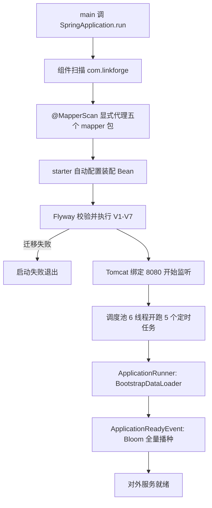

逐站核对（框架行为与项目行为的边界随步标注）：

1. `LinkForgeApplication.java:13-15`：`main` 调 `SpringApplication.run`，这是 Spring Boot 的启动总入口：建容器、扫 Bean、刷上下文、起服务器，最后跑 runner。语言与框架行为：此时还没有任何你的代码在跑。
2. `LinkForgeApplication.java:7`：`@SpringBootApplication` 触发组件扫描，把 `com.linkforge` 下带 `@Component`/`@Service`/`@RestController` 等注解的类注册成 Bean。
3. `LinkForgeApplication.java:10`：`@MapperScan` 显式列出五个 mapper 包。为什么需要：MyBatis 要为数据访问接口生成代理对象；扫描范围过宽会把 `ClickEventPublisher` 这种普通接口也误代理成 mapper（这行注释记录的事故）。跳过它：没有任何 mapper Bean，启动即失败。深讲 [java/10-07-annotations-reflection-proxy.md](java/10-07-annotations-reflection-proxy.md) 与 [41-mybatis-plus.md](41-mybatis-plus.md)。
4. classpath 上的 starter（web/redis/amqp/security/flyway）触发自动配置，装配 `RedisConnectionFactory`、`RabbitTemplate`、`SecurityFilterChain` 等框架 Bean。这是框架行为：配置来自 `application.yml` 的绑定。
5. Flyway 校验并执行 `src/main/resources/db/migration` 下的 V1–V7（`application.yml:13-19`，`spring.flyway.enabled=true`，`baseline-on-migrate: true` 让已有表的老库从基线起步）。为什么需要：后面每个 mapper 都假设表和唯一索引已存在（如 `V1__baseline_schema.sql` 里的 `uk_code`）。迁移失败等于启动失败：容器起不来，Tomcat 不会开始监听。
6. Tomcat 绑定 8080（`application.yml:93-94`）。据代码推断的顺序：Spring Boot 在上下文刷新收尾时才启动内嵌服务器，所以「端口出现在日志里」不代表 runner 与 ready 回调已跑完；之后的步骤失败，进程照样退出。
7. `SchedulingConfig.java:6-9` 的 `@EnableScheduling` 让 5 个 `@Scheduled` 定时任务上线（`application.yml:11-12` 配调度池 6 线程）：outbox 搬运、点击对账、webhook 投递、名单热重载、积压采样。任务清单见 [80-linkforge-architecture.md](80-linkforge-architecture.md) 的调度一节。
8. `BootstrapDataLoader.java:34-68`（`ApplicationRunner`）：bootstrap 开启时写入演示租户 demo 与用户 admin。`BootstrapDataLoader.java:41-44`：环境变量 `LINKFORGE_BOOTSTRAP_PASSWORD` 缺失直接抛 `IllegalStateException`，应用退出。为什么需要：本地没有注册流程时也要有一个能登录的账号。
9. `ApplicationReadyEvent` 触发 `CodeBloomFilter.load`（`CodeBloomFilter.java:44-75`）：全量播种短码。细节在 `CodeBloomFilter.java:58`：先把**空的**过滤器发布到 `filter` 字段，再逐码灌入（59-62），最后 `ready = true`（63）。为什么先发布：播种窗口内新建的短码会直接 `put` 进这个过滤器，不会因为「灌完才发布」而漏掉；`ready` 在灌完才置真，播种期间查询一律走 fail-open（见下）。播种异常则回退到 `filter=null, ready=false`（67-74），跳转路径照常走缓存与数据库。

边界与失效：

- 迁移失败 = 启动失败，这是把「表结构不对」挡在上线之前的设计。
- 数据库口令缺失：`SPRING_DATASOURCE_PASSWORD` 无默认值，占位符解析在数据源 Bean 创建时失败，比真正发起连接更早。
- Bloom 播种失败不是启动失败：`load` 捕获一切异常，代价只是每个请求多走一层缓存与数据库。

断点：`CodeBloomFilter.java:63`（`ready = true` 行），观察日志里的播种码数与耗时。
验证：`docker compose up -d` 后 `java -jar` 启动，日志按顺序找到 Flyway、Tomcat started、bloom seeded 三段。

## 链 2：注册与登录（JWT 签发）

一切管理接口的身份都从这里来。JWT（JSON Web Token）是一段自带签名的字符串，服务器签发后不再存它，靠验签识别用户。

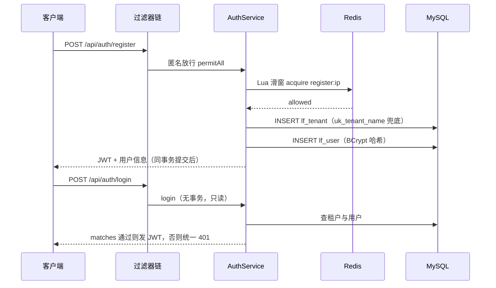

注册链逐站：

1. `AuthController.java:28-32`：`POST /api/auth/register`，`@Valid` 先做字段级校验（格式不对 400）。匿名放行来自 `SecurityConfig.java:41` 对 `/api/auth/**` 的 `permitAll`。
2. `AuthService.java:63-72`：`register` 带 `@Transactional`，第一件事是限流：键 `linkforge:rl:sw:register:{ip}`（`RateLimitKeys.sw` 拼前缀，`ClientIps.java:15-23` 解析 IP，`trustXff` 默认 false 即不信任 `X-Forwarded-For` 头，防伪造）。超限抛 `RateLimitedException`，出口在链 6。为什么 IP 维度：注册尚未有用户身份。
3. `AuthService.java:79-83`：插租户。同名并发注册靠唯一索引 `uk_tenant_name` 兜底（`V1__baseline_schema.sql:12`），撞上 `DuplicateKeyException` 转 409。
4. `AuthService.java:85-92`：插用户，`passwordEncoder.encode` 是 BCrypt（Bean 定义在 `SecurityConfig.java:89-92`）。BCrypt 是带盐的慢哈希，入库的是哈希不是明文。
5. `AuthService.java:94-95`：`JwtService.createToken`（`JwtService.java:27-37`）签发令牌，`subject` 放 userId，claims 放 tenantId 与 username，过期时间来自 `expire-hours` 配置。

登录链（`AuthService.java:41-56`）：查租户（42-46）→ 查用户（47-49）→ `passwordEncoder.matches`（50-53）→ 失败统一 401 文案 `invalid credentials`。为什么统一文案：区分「账号不存在」与「密码错误」等于帮攻击者枚举有效账号。登录无限流、无事务（纯只读，一次方法调用一条隐式事务就够了）。

事务边界：租户与用户在同一个事务里，用户插入失败整个回滚，孤儿租户不可能存在；限流调用发生在事务方法内部，但 Redis 失败时 limiter fail-open 放行（链 6），不阻断注册——两件事的性质不同，一个是数据正确性，一个是可用性。

断点：`AuthService.java:51`（`matches` 行），观察耗时到毫秒级即 BCrypt 生效；对比普通哈希的微秒级。
验证：同租户名注册两次，第二次 409；错误密码与不存在的用户都返回同一段 401 文案。

## 链 3：创建短链（幂等 + 撞码重试）

写路径只有一条 INSERT，却有两个并发问题：客户端重发同一个请求怎么办、两个请求同时抢一个码怎么办。

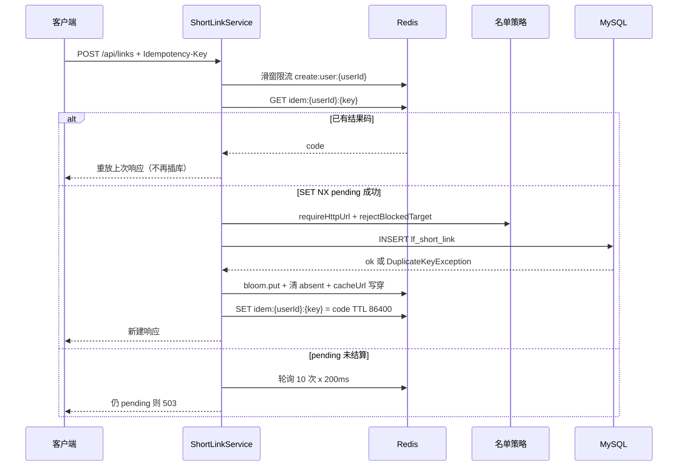

逐站核对：

1. `ShortLinkController.java:32-37`：`POST /api/links`，`@Valid` 校验请求体，`Idempotency-Key` 请求头可选。进入前已过 JWT 或 API Key 认证（链 8），`UserContext` 里有身份。
2. `ShortLinkService.java:92-100`：按用户限流，键 `create:user:{userId}`，默认 30 次/60 秒（`application.yml:171-172`）。
3. 幂等处理（`ShortLinkService.java:102-123`）。幂等指同一操作执行多次与一次效果相同。键名是 `{prefix}idem:{userId}:{key}`（103 行，prefix 即 `linkforge:rl:`）。三步状态机：
   - `replayIdempotentCreate`（131-142）：键里已有结果码则查行校验归属（`createdBy` 必须是本人，防拿别人的 key 探测），直接重放响应。
   - 键为空则 `SET NX "pending"`，5 秒过期（108-110）。抢到的成为「赢家」，进 `doCreate`；抢不到的是并发的输家。
   - 输家轮询 10 次、每次 200ms（113-119）等赢家结算；仍见 `pending` 则抛 503（122 行，注释说明原因：强造第二个响应可能给同一个 key 发两个码）。5 秒 pending 窗口只容忍赢家一次数据库往返，超窗宁可让客户端重试。
4. `doCreate`（144-203）的校验序列，顺序有意义——先便宜后贵：
   - `LinkValidations.requireHttpUrl`（146 行；`LinkValidations.java:26-38`）：必须 `http(s)://` 开头、无控制字符、`URI.create` 能解析。URI 严格解析在防 header 注入类攻击上比正则可靠。
   - `rejectBlockedTarget`（147 行；544-553）：名单 BLOCK 直接 400，消息固定为 `target domain is not allowed by policy`，不回显命中的域名（不给攻击者免费探测名单）。WARN 只计数不拦截。
   - `expireAt` 必须在未来（148-150）；自定义码过 `requireValidCustomCode`（151-154；`LinkValidations.java:40-47`，正则 `^[A-Za-z0-9_-]{4,16}$` 加保留码表）。
5. 撞码重试（170-192）。自定义码：单次 INSERT，撞唯一索引 `uk_code`（`V1__baseline_schema.sql:40`）即 409——你要的码被占了，让用户换。随机码：循环最多 `CODE_ATTEMPTS = 16` 次（62 行常量），每次重新 `ShortCodes.randomCode`（`ShortCodes.java:15-21`，62 字符字母表，码长默认 7）再插。为什么重试而不是 409：随机码冲突不是用户错误，是运气；7 位 62 进制空间约 3.5 万亿，16 次全撞意味着码池接近用尽，190-192 行转为普通失败。
6. `uk_code` 的角色要说准：它不是「性能优化」，是并发正确性的**兜底**。两个请求同时校验「码没被用」都通过时，数据库唯一索引保证只有一个插入成功，另一个收到 `DuplicateKeyException`。应用层的任何检查都存在检查与写入之间的窗口，唯一索引没有。深讲 [40-mysql.md](40-mysql.md)。
7. 缓存三连（194-196）：`codeBloom.put`（`CodeBloomFilter.java:90-95`，把新码记进 Bloom，否则 Bloom 的权威否定会 404 掉刚建的码）→ `clearAbsent`（619-628，删 `linkforge:absent:{code}` 负缓存，若它存在）→ `cacheUrl`（630-635）：写 L1（进程内 Caffeine）再写 Redis（L2），TTL = 3600 + 均匀随机 [0,300] 秒（`jitteredTtlSeconds`，585-590 行；jitter 防大量键同一时刻过期）。写穿指同时写 L1 与 L2 两层。
8. 幂等键回填结果码，TTL 86400 秒（198-201；`application.yml:175`），状态机从 `pending` 走到 `code`。

为什么整条链没有 `@Transactional`：成功路径唯一的写是一条 INSERT，语句本身原子；把幂等一致性交给 Redis 的 `pending → code` 状态机。对照必须用事务的地方——`recordClick` 的明细行与 outbox 行要同生共死（链 7），以及 `register` 的租户与用户（链 2）。深讲 [30-spring-core.md](30-spring-core.md)。

断点：`ShortLinkService.java:176` 或 `:185`（两个 `catch DuplicateKeyException`），用已存在的自定义码触发前者，用脚本并发创建触发后者。
验证：同 `Idempotency-Key` 连发两次返回同一 code；`CreateIdempotencyAndConcurrencyIT` 是自动化版本。

## 链 4：跳转 GET /r/{code}（门序列，项目的灵魂链）

全系统最热的路径，也是「为什么每一步都在」最密集的地方。入口放行后是 12 站：3 道快速否定（门 1-3），1 次缓存读加 1 次行读合并（门 4-5），1 组行态判定与缓存回填（门 6-7），4 个门禁出口（门 8-11），最后 B2 分类决定是否计点击（门 12）。

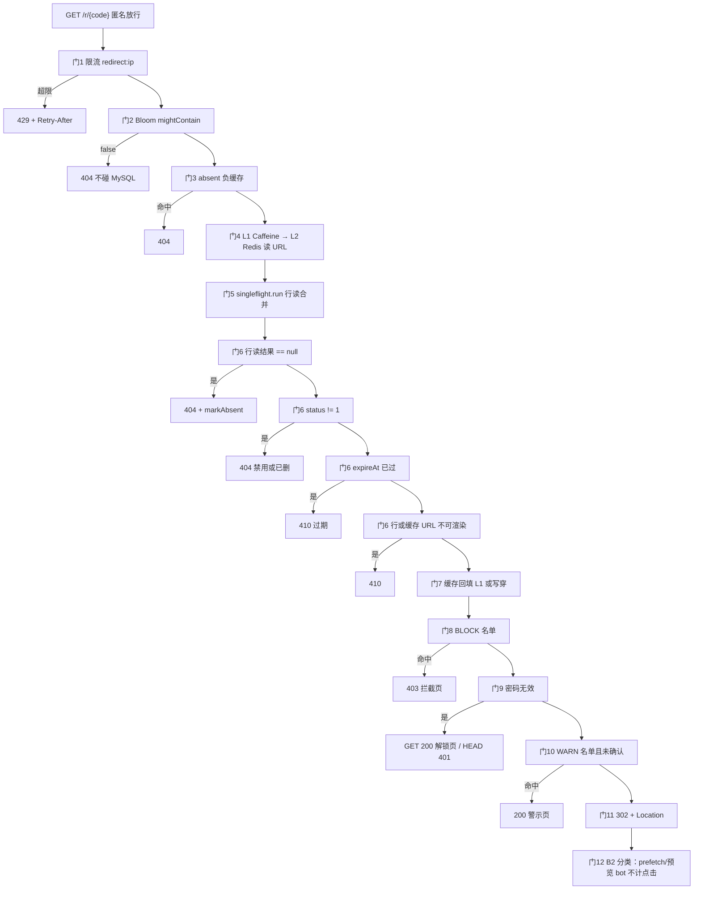

### 入口与放行

`SecurityConfig.java:42-44`：`GET`/`HEAD /r/**` 全部 `permitAll`（POST 解锁见链 5）。`RedirectController.java:36-41`：`redirect()` 调 `shortLinkService.resolveForGet(code, request)`（`ShortLinkService.java:340-352`），它先跑共享门序列 `resolveTarget`（368-467），拿到 `Redirect` 结果才做 B2 分类与记点击。

### 门 1：限流（371-377）

`rateLimiter.acquire` 键 `redirect:ip:{ClientIp}`，默认 300 次/60 秒（`application.yml:173-174`）。IP 取值默认用 socket 地址，`trustXff=false` 时不信任 `X-Forwarded-For`——该头客户端可随意伪造，信它等于限流失效（`ClientIps.java:10-14` 注释原文）。超限抛 `RateLimitedException` → 429 + Retry-After。为什么第一道：它是唯一保护后面所有层的门，也最便宜。跳过它：单 IP 可以无限刷穿 Bloom、缓存、数据库。深讲 [50-redis.md](50-redis.md)。

### 门 2：Bloom 否定即权威 404（382-385）

`codeBloom.mightContain(code)` 为 false 直接 404，不碰 MySQL（384 行计数 `linkforge.bloom.rejected`）。Bloom 过滤器是一个可能误报、绝不漏报的概率结构：说「没有」就一定没有，说「有」可能是误报。所以否定可以当权威，肯定必须继续走后面的门（`CodeBloomFilter.java:23-29` 注释）。三态 fail-open：配置关闭、还没播种完、播种失败时 `mightContain` 恒返回 true（81-87 行），等于这层门不存在，正确性交给后面的行。跳过这层：对随机码的恶意扫描全部打到数据库，这是缓存穿透的标准形态。深讲 [50-redis.md](50-redis.md) 与 [14-algorithms.md](14-algorithms.md)。

### 门 3：absent 负缓存（390-393）

`linkforge:absent:{code}` 有哨兵值即 404（`absentKnown`，592-603 行，异常 fail-open）。为什么 Bloom 之后还要这层：Bloom 只挡「从未创建」的码；被逻辑删除的码 Bloom 仍然报有（经典 Bloom 无法收回成员），Bloom 关闭时这层也不在。负缓存只记 **DB 确认过的不存在**（`markAbsent` 只在 411-416 行行读为 null 后调用），且**绝不**记禁用（404）与过期（410）的码——那些行还在，状态必须每请求生效（387-389 行注释）。TTL 60 + 抖动 [0,30] 秒（`application.yml:107-108`），短 TTL 是故意的：新码可能随时被创建。

### 门 4：L1 → L2 两级缓存读 URL（395-405）

先查进程内 Caffeine（`UrlLocalCache.java:40-47`，只缓存 URL 字符串，TTL 10 秒），未命中再查 Redis（401 行，`linkforge:code:{code}`）。为什么 L1：省一次 Redis 网络往返；为什么 L1 只放 URL：省下的往返只值这一个字段，不值得连行状态一起缓存。注意此处缓存**只优化读取，不做判定**——无论命中与否，第 5 门的行读照走。

### 门 5：singleflight 行读合并（410）

`singleFlight.run(code, () -> rowLoader.load(code))`。`ShortLinkRowLoader.load`（20-22 行）就是一次 `selectOne where code = ?` 的行读。SingleFlight（`SingleFlight.java:57-100`）把同一码的并发读合并成一次：第一个到达者是 leader，在自己的请求线程里执行 loader；后来者是 follower，等 leader 的 future，最多 500ms（`wait-timeout-ms`），超时就自己读（fail-open，计 `singleflight.timeout`）。实现要点：用 `putIfAbsent` 而非 `computeIfAbsent`——后者会在持有 ConcurrentHashMap 桶锁的状态下执行阻塞 loader，把无关键也卡死（25-27 行注释）。entry 在飞行结束后立即移除，这不是缓存，是去重器。为什么需要：热码的 N 个并发 GET 若各查一次库，缓存失效瞬间 DB 被打 N 倍，即缓存击穿。深讲 [13-concurrency.md](13-concurrency.md)。

### 门 6：行态判定，四个异常出口（411-432）

行是唯一真相，四个出口按顺序：

- 行 null（411-416）：Bloom 假阳性、被逻辑删除、Bloom 关闭的码，DB 说了算 → `markAbsent` 写负缓存（带抖动 TTL）→ 404。
- `status != 1`（417-419）：禁用或逻辑删除 → 404。逻辑删除指 `deleted` 标记位置 1 而行仍在表里（`ShortLink.java:26-27` 的 `@TableLogic`），所以码永久保留、不可复用。
- `expireAt` 已过（420-422）→ 410 Gone。过期与禁用语义不同：一个是时间自然到点，一个是人主动关闸。
- 不可渲染 → 410（426-428 行查**行里的** originalUrl，430-432 行查**缓存里的** originalUrl）。`LinkValidations.isRenderableUrl`（`LinkValidations.java:50-63`）拦空白、控制字符、解析不了的 URI。为什么两遍：行与缓存可能不一致，任何一边是脏数据都不能把请求送去 302 或 500，宁可 410。

### 门 7：缓存回填（436-441）

两处回填只在特定方向发生：仅 Redis 命中而 L1 未命中时，把已通过行门与渲染检查的值回填 L1（436-438）；L1 与 L2 都未命中时 `cacheUrl` 写穿两层（439-441）。注意顺序：回填在**行态判定之后**，脏值进不了缓存。

### 门 8-11：四态出口，顺序即安全（445-466）

对**行的** originalUrl（不是缓存值）评估 `phishingPolicy.evaluate`（`PhishingPolicy.java:52-57` → `TargetPolicy.evaluate`，`TargetPolicy.java:52-69`，后缀边界匹配加 IDN 归一化，BLOCK 优先于 WARN）。四态按固定顺序短路：

1. 门 8，BLOCK → `RedirectOutcome.Blocked`（446-449）→ `render` 输出 403 拦截页（`RedirectController.java:91-97`），无 Location、不回显目标。
2. 门 9，密码门（452-456）：行带 `accessPasswordHash` 且解锁 cookie 无效（`LinkAccessTokens.validate`，`LinkAccessTokens.java:54-75`，HMAC 常时比较）→ `Locked` → GET 返回 200 解锁页、HEAD 返回 401 无体（`RedirectController.java:98-105`）。
3. 门 10，WARN（457-465）：`?lf_continue=1` 且是 GET 才放行（458-460 行计数后落到门 11）；否则 `Warn` → 200 警示页，页面转义显示目标域名与继续链接（`GatePages.warn`，`GatePages.java:37-58`）。HEAD 探测永不放行（`resolveForProbe` 传 `warnContinueAllowed=false`，358-360 行）。
4. 门 11，放行（466）：`new RedirectOutcome.Redirect(link, originalUrl)`，URL 取缓存值优先——它与行已双双通过渲染检查。

**顺序为什么不能换**（当前源码：BLOCK 的 if 在 446，密码门在 452，WARN 在 457；旧版本文档曾写 446/454/459，以现状为准）：BLOCK 必须最先——名单拦掉的流量连警示页都不配看到，警示页会泄露目标域名。密码门次之——未授权者拿到的是解锁页而不是警示页。WARN 最后——它是软提示，提示了还可以继续。把 WARN 提到 BLOCK 前，名单域名会先渲染成警示页再谈拦截，拦截失去意义；把密码门排到 WARN 后，无密码访客先看到目标站点警示页，泄露「目标是什么」。深讲 [32-spring-security.md](32-spring-security.md)。

### 门 12：B2 分类与记点击（`resolveForGet` 342-349）

拿到 `Redirect` 后：`clickFilter.classify`（`ClickFilter.java:51-69`）识别自声明 prefetch 头（Sec-Purpose/Purpose 等精确匹配）与窄名单预览 bot。命中则 302 照给但**不计点击**，只计 `linkforge.click.skipped`——浏览器预取不该污染统计。其余走 `clickRecordService.recordClick`（同事务双写，链 7）并计 `linkforge.redirects`。为什么分类在门序列之后：先保证「该拦的拦了」，再决定「这次跳转算不算数」。

### 404/410/429 的异常出口总表

| 状态 | 触发门 | 信源 |
|------|--------|------|
| 429 | 门 1 限流 | Redis 滑窗 |
| 404 | 门 2 Bloom | 进程内过滤器，权威否定 |
| 404 | 门 3 absent | Redis 里 DB 确认过的不存在 |
| 404 | 门 6 行 null / status!=1 | DB 实时行 |
| 410 | 门 6 过期 / 门 6 不可渲染 | DB 实时行 |
| 410 | 门 6 缓存 URL 不可渲染 | L1/L2 缓存值 |

信源递进：进程内存 → 共享缓存 → 数据库。越靠前越便宜，越靠后越权威；每一层的否定都可能是上一层误判后的兜底。

断点：`ShortLinkService.java:371`（限流）、`:382`（Bloom）、`:410`（行读合并）、`:446`/`:452`/`:457`（三道门）；`SingleFlight.java:63-64`（leader/follower 分叉）；`RedirectController.java:85`（`render` 翻译处）。
验证：连发 300+ 次 GET 触发 429 看 Retry-After；`docker compose stop redis` 后跳转照常（限流、absent 探测、缓存写全部 fail-open）；同码并发 20 次，看 `linkforge.singleflight.shared` 计数上涨。

## 链 5：解锁 POST /r/{code}/unlock（两级限流 → BCrypt → cookie 签发）

密码门拦下的人从这里进来。目标：正确的密码换一张有签名的 cookie，错误的密码多花攻击者的钱。

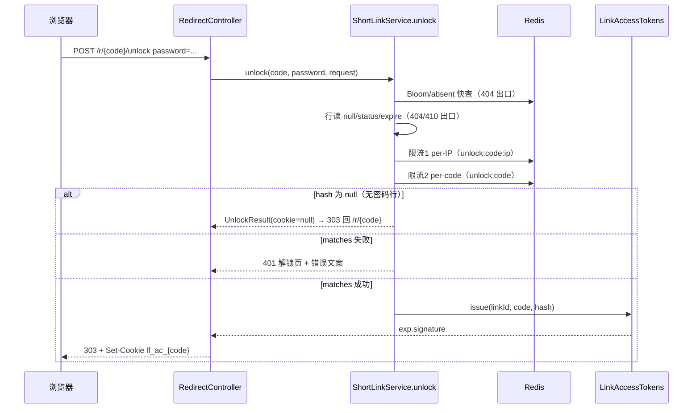

逐站核对：

1. `RedirectController.java:52-82`：匿名表单提交是设计决定（50-51 行注释），暴力破解防线在 service 里，这样限流不会被过滤器层的异常绕过。放行规则在 `SecurityConfig.java:45`（`POST /r/*/unlock` permitAll）。
2. 镜像门序列（`ShortLinkService.java:500-509`）：Bloom/absent/行 null/status/过期与跳转链同口径，404/410 从这里出。为什么镜像：攻击者同样能用解锁接口探测不存在的码。
3. 两级限流（512-526）：先按 IP（`unlock:code:{code}:ip:{ip}`，默认 5 次/300 秒）再按码（`unlock:code:{code}`，默认 50 次/300 秒），配置在 `application.yml:197-199`。两级的原因：单 IP 限流防一个人换码爆破，单码限流防僵尸网络分摊 IP。**顺序是先限流后 BCrypt**（494-497 行注释 D-Bw345-34）：BCrypt 是刻意设计成慢的哈希，每次校验毫秒级；若先做 BCrypt 再限流，爆破者能用错误的密码白嫖你的 CPU。跳过这层顺序：限流还在，但攻击成本从「你的 CPU 时间」变成「他的 CPU 时间」。
4. 无密码行短路（527-529）：`accessPasswordHash == null` 直接返回 `cookieValue=null` 的结果，controller 据此 303 回 `/r/{code}`（79-81 行），让用户从头走跳转链。
5. `passwordEncoder.matches`（530-534）：失败计 `linkforge.link.unlock{result=bad_password}`，controller 返回 401 解锁页带错误文案（`RedirectController.java:71-78`）。
6. 成功签发（535-537 → `LinkAccessTokens.issue`，46-51 行）：值形如 `{expEpochSeconds}.{Base64url签名}`，签名 = HMAC-SHA256(密钥, `linkId|code|exp|pwdVer`)。三个设计点：密钥从 JWT secret 派生（31-36 行），不新增环境变量；`pwdVer` 取**当前密码哈希**的 SHA-256 前 8 字节（81-89 行），改密码或清密码立即使所有已发 cookie 失效；验证用 `MessageDigest.isEqual` 常时比较（74 行），防时序侧信道逐字节猜签名。HMAC（Hash-based Message Authentication Code）是带密钥的签名：只有持密钥的服务器能算出合法值，浏览器伪造不了。
7. cookie 属性（`RedirectController.java:58-69`）：`HttpOnly`（JS 读不到，防 XSS 偷）、`SameSite=Lax`、`path=/r/{code}`（只随该码的请求发送）、`maxAge` 与签名里的 exp 同源。没有服务端会话表：无状态可水平扩展，撤销靠改密码。
断点：`ShortLinkService.java:531`（matches 行）与 `LinkAccessTokens.java:74`（isEqual 行），观察错误密码的 BCrypt 耗时。
验证：`PasswordLinkIT` 覆盖全程；手工可用 curl 提交表单后带 cookie 重访 `/r/{code}`。

## 链 6：限流与异常的统一出口

限流是横切关注点，异常出口是它的配套。这条链回答两个问题：Retry-After 的数字从哪来、过滤器里的错误为什么长得和 controller 的一样。

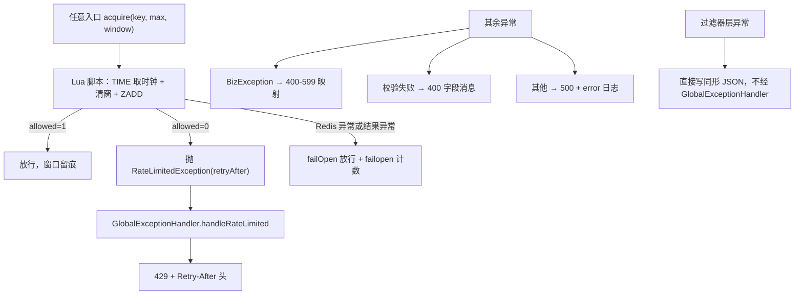

逐站核对：

1. `RedisRateLimiter.acquire`（`RedisRateLimiter.java:39-58`）执行 `sliding_window.lua`。滑窗日志算法：窗口内每个被放行的请求记一个成员，判断时先删窗口外旧成员再数。Lua 脚本逐行（`sliding_window.lua`）：4-5 行用 Redis `TIME` 做时钟——JVM 不传时间戳，多实例时钟漂移不会 skew 窗口；8 行清窗；9 行数成员；10-14 行未满则 `ZADD` 记录并返回 `{1, n+1, 0}`；15-17 行满了用最老成员的分数算剩余毫秒。为什么用 Lua：检查、记录、过期清理必须原子，否则并发请求会同时读到「未满」然后全部挤进窗口。深讲 [50-redis.md](50-redis.md)。
2. Retry-After 的值：Lua 返回的剩余毫秒向上取整，再封顶窗口秒数（`RedisRateLimiter.java:55-56`）。含义精确：不是「等窗口秒数」，而是「等窗内最老成员过期」。
3. `RateLimitedException`（`RateLimitedException.java:14-17`）继承 `BizException`，code 固定 429。`GlobalExceptionHandler.handleRateLimited`（`GlobalExceptionHandler.java:18-23`）加 `Retry-After` 头，响应体与普通 429 同形。
4. Redis 挂了怎么办：`failOpen`（98-104 行）放行并计 `linkforge.ratelimit.failopen{reason}`。为什么开而不是关：限流是保护机制，它自己故障时若拒绝所有人，就是把「可能的过载」变成「确定的不可用」；代价是 Redis 故障期间限流失效，用计数器暴露这个状态。
5. 其余异常出口（`GlobalExceptionHandler.java`）：`handleBiz`（25-29 行）把 `BizException` 的 code 映射为 400-599 的状态码（越界回退 400）；`handleValidation`（31-41 行）把 `@Valid` 失败转 400 加字段消息；`handleOther`（49-54 行）兜底 500 并打 error 日志。深讲 [31-spring-boot-mvc.md](31-spring-boot-mvc.md) 与 [java/10-06-exceptions.md](java/10-06-exceptions.md)。
6. 过滤器层的例外：过滤器在 `DispatcherServlet` 之前执行，`@RestControllerAdvice` 管不到。所以 `JwtAuthFilter.java:51-55` 自己写 401 JSON，`ApiKeyAuthFilter` 自己写 400/401/429（后文行号），`SecurityConfig.java:66-78` 的 entryPoint 与 accessDeniedHandler 写 401/403 JSON。三处都刻意用与 `ApiResponse` 相同的 JSON 形状：客户端不需要按「错误出自哪层」区分解析逻辑。

断点：`GlobalExceptionHandler.java:21`，观察 Retry-After 值与 Lua 返回的对应关系。
验证：`curl -D -` 看 429 响应头全貌；`docker compose stop redis` 后确认 302 照常且 `linkforge_ratelimit_failopen_total` 增长。

## 链 7：点击统计（Outbox → Relay → MQ → 幂等消费 → 聚合）

这条链回答「跳转 302 之后，这一击如何变成日报表里的一格，且不丢、不重」。

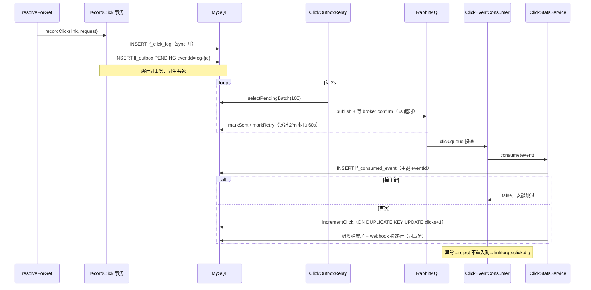

逐站核对：

1. `ClickRecordService.recordClick`（`ClickRecordService.java:40-74`，`@Transactional`）：sync 开先插 `lf_click_log` 明细（55-57），async 开再插 `lf_outbox` PENDING 行（59-73）。eventId 规则：sync 开用 `log-{自增id}`（明细行已存在，重放靠它去重）；sync 关用 UUID（无明细行，消费端补写）。Outbox 模式的核心：把「要发的消息」当数据库的一行，与业务写同事务提交，之后由后台搬运。为什么需要：跳转线程直接发 MQ，broker 抖一下要么丢点击要么拖慢 302；写库是快且必须成功的，发消息是慢且可失败的，把两者拆开。深讲 [51-rabbitmq-outbox.md](51-rabbitmq-outbox.md)。
2. 每 2 秒（`application.yml:158`）`ClickOutboxRelay.relay`（`ClickOutboxRelay.java:39-73`）：`selectPendingBatch(100)` 取 `status='PENDING' AND next_attempt_at<=NOW()` 的行（`OutboxMapper.java:13-16`，索引见 `V2__outbox.sql`）。attempts 已达 30（`relay-max-attempts`）→ `markFailed` 留档（48-54 行）；重放是人工 `UPDATE` 回 PENDING，不自动。为什么设上限：永久毒丸行不该永远占着搬运预算。
3. `RabbitClickEventPublisher.publish`（`RabbitClickEventPublisher.java:44-67`）：发消息并**同步等 broker confirm**，超时 5 秒（27 行常量）；nack、confirm 超时、不可路由（ReturnsCallback 收集的 correlationId，33-41 行）都抛异常。为什么等 confirm：RabbitTemplate 的 send 返回只代表进了网络缓冲，broker 落盘确认才是「发出去了」；relay 只有在 publish 不抛时才 `markSent`（`ClickOutboxRelay.java:57-58`），否则 row 保持 PENDING 重试。publisher-confirm 与 mandatory returns 的开启在 `application.yml:65-70`。
4. 失败退避：`markRetry` 把 `next_attempt_at` 写成 `DATE_ADD(NOW(), INTERVAL n SECOND)`（`OutboxMapper.java:24-26`），间隔 = `1 << min(attempts, 6)` 封顶 60 秒（`ClickOutboxRelay.java:75-78`）：1、2、4、8、16、32、60、60……用 DB 时钟算排程，JVM/DB 时区差不影响。深讲退避与时钟选择在 [51-rabbitmq-outbox.md](51-rabbitmq-outbox.md)。
5. 消费端（`ClickEventConsumer.java:22-27`，`@RabbitListener`）：干净返回即 ack；抛异常则按 `default-requeue-rejected: false`（`application.yml:76`）拒绝且不重入队，经死信交换机进 `linkforge.click.dlq`（`RabbitMqConfig.java:29-35` 声明 DLX/DLQ）。为什么拒绝不重入队：坏消息无限重试会烧死消费者，进 DLQ 留人查。
6. `ClickStatsService.consume`（`ClickStatsService.java:66-107`）用 `TransactionTemplate` 包一个短事务：先插 `lf_consumed_event`（主键就是 eventId，72-75 行）——撞主键说明消费过，`return false` 安静跳过（76-78 行）。这一步是幂等的落点：**MQ 至少一次投递（at-least-once）是常态，消费端用去重表把「处理两次」压成「处理一次」**。首次消费则：UUID 事件补写明细行（79-92）、`incrementClick`（93 行；`ClickDailyMapper.java:16-18`，`ON DUPLICATE KEY UPDATE clicks = clicks + 1`，日聚合表按天 upsert）、维度桶累加（96-99）、同一事务里 `webhookService.recordClickDelivery` 落一条 PENDING 投递行（104 行，链 9）。为什么 webhook 入队也在这事务：入队与去重同事务，一个 eventId 永远最多生成一条投递（D-Bw2-9）。
7. 对账兜底 `ClickLogReconciler`（`ClickLogReconciler.java:30-53`，30 秒一轮，仅 sync 与 async 同开时运行）：扫出未消费的明细（`ClickLogMapper.java:14-18`，左连去重表找空缺）用同款 `log-{id}` 重放。它不是主链路，是 relay 整体故障后的自动追平。
8. at-least-once 的推演：relay 在 publish 成功后、markSent 前崩溃 → 行仍 PENDING → 下一轮重发同一 eventId → 消费端去重表拦截 → 聚合只 +1。丢与重都被同一张表吸收。

断点：`RabbitClickEventPublisher.java:52`（confirm 等待行）；`ClickStatsService.java:76`（`catch DuplicateKeyException`），重复投同一事件两次，观察第二次直接跳过。
验证：`bash scripts/mq-drill.sh`（断 MQ → 302 照常 → 恢复 → outbox 追平）；对同一 eventId 消费两次，看 `lf_click_daily` 只 +1。

## 链 8：API Key 认证与配额

开放能力的关键思想：机器身份的能力必须小于人的身份。

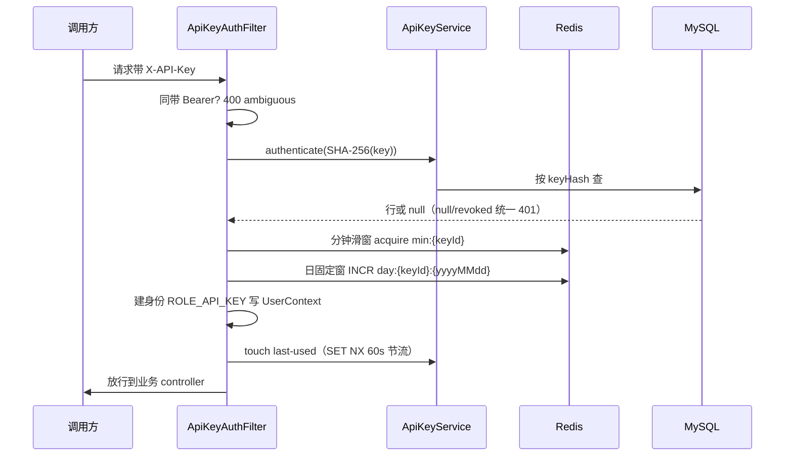

逐站核对：

1. 签发：`ApiKeyService.create`（`ApiKeyService.java:36-76`）生成 `lfk_{prefix8}_{secret}`（52-54 行），只存整串明文的 SHA-256（61 行，`keyHash`），明文只在创建响应出现一次（71 行）。为什么存哈希：数据库泄露时攻击者拿不到可用 key，与密码存 BCrypt 同理（这里用 SHA-256 是因为输入本身是高熵随机串，不需要慢哈希抗爆破）。
2. 过滤范围：`ApiKeyAuthFilter.shouldNotFilter`（`ApiKeyAuthFilter.java:56-62`）只检查 `/api/**` 与非健康 actuator；`/r/**` 与 `/actuator/health` 根本不进这个过滤器。无 key 头直接放行（67-71 行），交给后面的认证层。
3. 互斥（73-77 行）：同时带 `Bearer` 与 `X-API-Key` 回 400。为什么两头下注不行：两个身份可能不同人，静默选一个等于给了提权通道。
4. 验证（79-90 行）：`authenticate` 按 hash 点查（`ApiKeyService.java:101-104`），null 或已吊销统一 401、同文案（外层统一，指标 tag 区分原因）。
5. 配额（`ApiKeyAuthFilter.java:111-136`）：分钟滑窗（117-123 行，键 `sw min:{keyId}`，`RedisRateLimiter.acquire`）先查，日固定窗（124-134 行，键含 Asia/Shanghai 的 yyyyMMdd，`tryAcquireFixedWindow` 用 INCR+EXPIRE，`RedisRateLimiter.java:71-96`）后查，超限 429 且日窗的 Retry-After 算到零点秒数（129-132 行）。为什么两种窗口混用：自然日本来就是日历边界，固定窗没有突刺问题且实现最便宜；分钟窗是任意边界，固定窗会在边界处双倍突刺，滑窗精确。深讲 [50-redis.md](50-redis.md)。
6. 建身份（97-102 行）：`AuthUser` 用 key 的创建者身份，权限角色 `ROLE_API_KEY`，写进 `UserContext` 与 SecurityContext，业务层无感。
7. 触碰节流（150-160 行）：`SET NX 60s` 成功才 UPDATE `last_used_at`。为什么节流：高频调用下每次都 UPDATE 会把写放大到数据库。
8. 授权矩阵（`SecurityConfig.java:58-64`）：`/api/links/**` 允许 `ROLE_USER` 与 `ROLE_API_KEY`；`/api/keys/**`、`/api/webhooks/**`、actuator 仅 `ROLE_USER`；其余默认 `ROLE_USER`。key 是「能调业务面的机器身份」，永远不能管理 key 自身。深讲 [32-spring-security.md](32-spring-security.md)。

断点：`ApiKeyAuthFilter.java:127`（日固定窗行），跨零点前后各打一次观察计数键切换。
验证：把 `quotaPerMinute` 设 2 连发 3 次，第 3 次 429 且 Retry-After 合理；`ApiKeyIT` 是自动化版本。

## 链 9：Webhook 安全投递（二跳链）

Webhook 是「你的服务器主动 POST 对方的服务器」。它有两个安全要点：不把自己的出网能力变成攻击跳板（SSRF），让对方能验证消息真是你发的（HMAC 签名）。

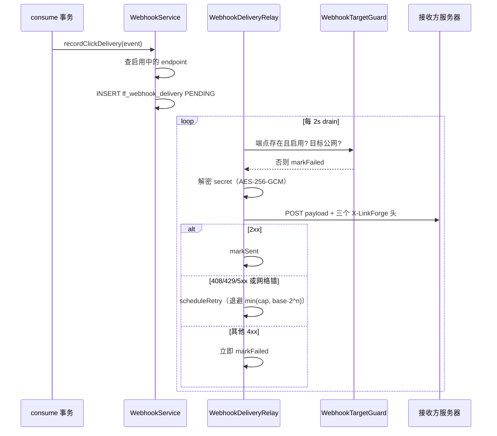

第一跳，配置与入队：

1. 配置入口 `WebhookController.java:30-39`（`PUT /api/webhooks/endpoint`，仅 JWT，`SecurityConfig.java:59` 把 API Key 挡在外面——泄露的 key 不能重定向别人的回调）。`WebhookService.upsert`（`WebhookService.java:52-83`）：先 `requireWebhookAvailable`（116-120 行，功能关或主密钥不可用直接 503），再 `targetGuard.check`（`WebhookTargetGuard.java:32-37`）。
2. SSRF 门禁（`WebhookTargetGuard.java:45-79`）：只许 http/https、拒绝 userinfo、host 必须解析、解析出的**每个** IP 都必须公网——环回、链路本地（含云元数据 169.254.169.254）、内网段、CGNAT、IPv6 ULA 全拒（81-118 行）。SSRF（Server-Side Request Forgery）指诱骗服务器去访问它本不该访问的地址；拦截发生在保存时与每次发送前两处。诚实边界（20-23 行注释）：resolve 与 connect 之间的 DNS 重绑定（TOCTOU）未解决。保存时 secret 明文只回一次，库里存 AES-256-GCM 密文（`WebhookSecretCipher.java:61-73`），主密钥来自环境变量、永不落库（35-55 行）。
3. 入队：`recordClickDelivery`（148-196 行）在消费去重事务内执行（链 7 第 6 步）。event id 加 `evt_` 前缀（161 行），payload 是 JSON：id/type/createdAt/data（167-176 行）。插 `lf_webhook_delivery` PENDING（178-187 行）。撞 `(endpoint_id, event_id)` 唯一键算重复入队，安静跳过（189-190 行）；其他插入失败**向上抛**，把整个消费事务滚回去（191-195 行）——统计与投递意图同生共死。

第二跳，投递（`WebhookDeliveryRelay`）：

4. 每 2 秒 `drain`（65-90 行）。主密钥不可用整批跳过（75-78 行）：不耗次数、不改状态，配好即恢复。为什么这样处理：没有密钥连签名都算不出来，重试纯属空转。
5. `deliver`（92-148 行）的判定序列：endpoint 没了或禁用 → FAILED（94-98 行）；目标被 SSRF 拦 → FAILED 并计 `linkforge.webhook.blocked`（99-104 行）；解密 secret 失败 → 重试（106-112 行）。然后 `java.net.http.HttpClient`（连接超时 2s、永不跟随重定向、请求超时 5s，59-62 行与 `application.yml:147-148`）POST，带三个头（116-124 行）：`X-LinkForge-Event-Id`、`X-LinkForge-Timestamp`、`X-LinkForge-Signature`。
6. 签名（`WebhookSigner.java:21-34`）：`v1=` + hex(HMAC-SHA256(secret, `时间戳 + "." + 原始body`))。对方收到后用同一 secret 重算并常时比较，时间戳容差 ±300 秒防重放。为什么签原始 body 而不是解析后的对象：签名必须在字节层面绑定内容，任何序列化差异都会导致验签失败。
7. 结果分诊（130-147 行）：2xx → `markSent`；408/429/5xx 与网络异常 → `scheduleRetry`；**其他 4xx → 立即 FAILED**。分诊逻辑：429 的语义是「现在不行，稍后可以」（临时态），值得退避重试；401/403/404 是对方明确拒绝（稳定态），重试只会骚扰且必然失败。
8. 退避与终态：`scheduleRetry`（155-167 行）attempts+1 后达 `max-attempts`（默认 8，`application.yml:144`）→ FAILED（本仓库的「死信」等价物）；否则 `backoff = min(3600, 10 · 2^attempts)` 秒（164 行；base 10s、cap 3600s），`markRetry` 写 `DATE_ADD(NOW(), ...)`（`WebhookDeliveryMapper.java:30-34`）。**时钟规则**（该 mapper 13-18 行注释）：排程列读写都用 DB 时钟。历史 bug 就出在这里——退避曾用 JVM 时钟字面值，JVM(+8) 与 MySQL(UTC) 的时区差把 20 秒拉成 8 小时，`WebhookRetryClockIT` 在 +8 时区的 fork 里把修复钉死。
9. 语义：at-least-once。多个 relay 可能重复投同一行，接收方按 `X-LinkForge-Event-Id` 去重。发送方不承诺恰好一次，因为「发送成功」与「对方收到」之间没有跨网络的原子事务。

断点：`WebhookDeliveryRelay.java:164`（backoffSeconds 计算行）与 `:136`（重试分诊行）。
验证：`WebhookDeliveryIT` / `WebhookRetryClockIT`；本地用 webhook.site 类服务收一条真实投递，按 README 伪代码验签。

## 链 10：测试如何钉住这些行为

链路的每一环在前九条里都被某个测试断言过。这条链是「证据链」。

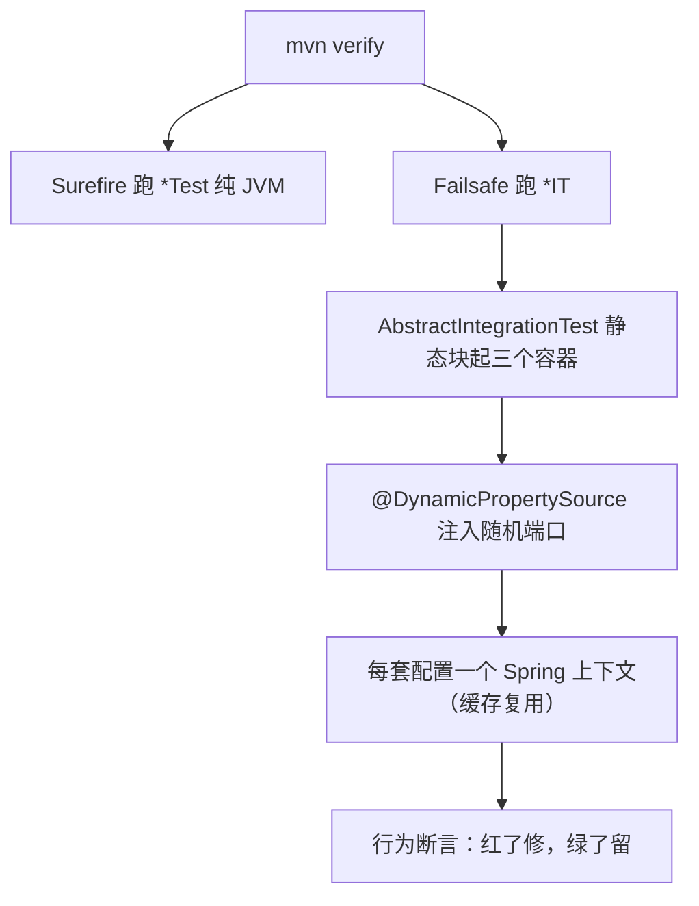

逐站核对：

1. `pom.xml` 里 Surefire 绑 `*Test`（单元测试，不起容器），Failsafe 绑 `*IT`（集成测试）。分离的理由：单元测试毫秒级，要能在每次保存后跑；集成测试分钟级，提交前跑。
2. `AbstractIntegrationTest.java:54-58` 静态块起三个 per-JVM 容器单例：MySQL 8.0、redis:7、rabbitmq:3.13。MySQL 带 `--max-connections=500`（39-43 行）：每个缓存的 Spring 上下文都持自己的 Hikari 连接池，默认 151 的连接上限在上下文变多后被打爆过——这是注释里记录的真实事故。
3. `@DynamicPropertySource`（60-71 行）把容器的随机端口注进 Spring 配置，多个测试类可并行共存。
4. 行为断言样例（均存在于 `src/test/java`）：`CreateIdempotencyAndConcurrencyIT`（幂等与并发）、`TenantIsolationIT`（越权 404）、`RateLimitIT`（429 顺序）、`BloomRedirectIT`（开关行为一致）、`LinkLifecycleIT`（缓存不能遮蔽行状态）、`ClickIdempotencyIT`（重放不双计）、`WebhookRetryClockIT`（时区 fork 单独跑）、`ApiKeyIT`、`WebhookDeliveryIT`。深讲 [60-testing-ci.md](60-testing-ci.md)。
5. 工作法「红先」：bug 先写成会红的测试复现，修复后变绿。红与绿都是证据：红证明 bug 存在，绿证明修复有效且防回归。

验证：本地 `mvn verify`（需要 Docker）；观察 `docker ps` 中的三个容器。

## 链 11：健康检查与监控数据

观测是链路的镜子：前十条链里的每个关键行为都有对应指标。

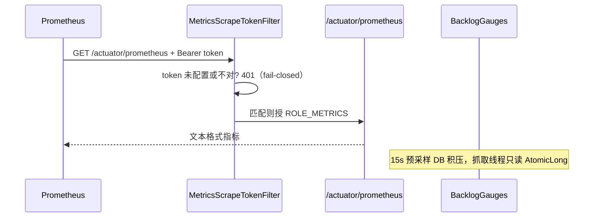

逐站核对：

1. `GET /actuator/health` 匿名可达（`SecurityConfig.java:40`）。Spring Boot 的健康聚合（框架行为）：数据源、Redis、RabbitMQ 各有 HealthIndicator，任一 DOWN 整体 503。为什么匿名：容器编排探针不带凭证。
2. `GET /actuator/prometheus` 由 `MetricsScrapeTokenFilter` 把守（`MetricsScrapeTokenFilter.java:33-65`）：配置里没有抓取令牌时**全 401**（fail-closed，49-55 行）——指标泄露比抓不到指标更糟，方向与健康检查相反。匹配则授 `ROLE_METRICS`（57-59 行），`SecurityConfig.java:62-63` 只让该角色进这个端点。
3. 业务指标地图（埋点处均在源码可见）：`linkforge.redirects`（`ShortLinkService.java:349`，仅记录型跳转）、`linkforge.click.skipped{reason}`（345 行）、`linkforge.bloom.*`（`CodeBloomFilter.java`）、`linkforge.singleflight.{loads,shared,timeout}`（`SingleFlight.java`）、`linkforge.ratelimit.{rejected,failopen}`（两处）、`linkforge.outbox.{sent,failed,pending}`、`linkforge.webhook.delivery{result}`、`linkforge.phishing.*`、`linkforge.link.unlock{result}`。
4. 积压三 gauge：`BacklogGauges.java:33-46` 用 `@Scheduled` 每 15 秒把三个 COUNT 写进 `AtomicLong`，抓取线程只读内存值。为什么不在抓取时查库：Prometheus 抓取失败会重试、会并发，把抓取延迟与 DB 查询耦合等于让监控放大故障。
5. 导出链：`ops/observability/prometheus.yml:2` 配 15s 抓取；Grafana 面板由 `ops/observability/grafana/provisioning` 自动装载。跳转 SLO 直方图的桶在 `application.yml:38-43`：5ms 到 1s 八档，只为 `http.server.requests` 开。

验证：`curl -H "Authorization: Bearer $TOKEN" localhost:8080/actuator/prometheus | grep linkforge`；Prometheus UI 查 `rate(linkforge_redirects_total[5m])`。

## 常见追问与「如果…会怎样」

- **缓存先于行读命中，行还有必要读吗？** 有。门 5 的行读无条件执行：禁用、过期、密码、名单四个判定全部只认行（426/445/452 行都以 `link.` 开头取值），缓存只优化 URL 字段。缓存永远不能遮蔽行的状态，这是 legacy-dirty 契约，`LinkLifecycleIT` 钉住。
- **relay 在 broker ack 后、markSent 前崩溃？** 行仍 PENDING，下一轮重发同一 eventId，消费端去重表吸收。at-least-once 不是缺陷是前提，前提成立全靠幂等消费。
- **两个过滤器同时建立身份？** `ApiKeyAuthFilter` 对「Bearer + X-API-Key」直接 400（`ApiKeyAuthFilter.java:73-77`）。
- **门禁顺序对调？** WARN 提到 BLOCK 前，名单域名会先渲染成警示页，泄露目标域名；密码门排到 WARN 后，无密码访客先看到目标警示页而不是解锁页。顺序本身就是安全设计（源码：BLOCK 446 → 密码 452 → WARN 457）。
- **Bloom 播种期间的请求？** `ready=false` 时 `mightContain` 恒 true（fail-open），请求走缓存与数据库，慢但不准 404。
- **改了短链密码，旧解锁 cookie 还能用吗？** 不能。cookie 签名绑定当前密码哈希的指纹（`pwdVer`），改密码即全量失效，无需撤销表。
- **Webhook 接收方一直返回 500？** 退避重试到第 8 次后 FAILED 留档；恢复接收后人工 `UPDATE` 回 PENDING 重放，或等下一次自然点击。

## 本章总结

十一条链覆盖启动、认证、写路径、读路径、解锁、异常出口、异步统计、开放能力、投递、测试与观测。每条链的断点与验证实验都设计为「你可以今天就去跑」。白板复述优先练链 4（门序列）与链 7（Outbox 时序），它们是项目面试的胜负手；链 4 的每一道门都能答出「跳过会怎样」，面试就有了纵深。

## 自测

1. 链 4 的门序列里，哪几道门能返回 404？各自信源是什么？
   答：门 2 Bloom（进程内过滤器，权威否定）、门 3 absent 负缓存（Redis 里 DB 确认过的不存在）、门 6 行读 null 与 status!=1（DB 实时行）。信源递进：进程内存 → 共享缓存 → 数据库。
2. 创建短链为什么不需要 `@Transactional`？
   答：成功路径唯一写是单条 INSERT（语句级原子）；幂等一致性由 Redis 的 `pending → code` 状态机承担。对照必须用事务的两处：`register` 的租户加用户、`recordClick` 的明细加 outbox，都是两条写要同生共死。
3. 断点打在 `SingleFlight.run` 的 follower 分支（`SingleFlight.java:79-99`）能看到什么？
   答：`existing.get(waitTimeoutMs)` 的三条路径——等待成功返回 leader 的结果（`shared` 计数）、超时或中断后自己读（`timeout` 计数）、leader 异常原样传播给 follower（`ExecutionException` 解包）。
4. API Key 的日配额为什么用固定窗口而分钟用滑窗？
   答：自然日本来就是日历边界，固定窗无突刺问题；分钟窗是任意边界，固定窗在窗口交界会双倍放行，滑窗按成员精确计数。
5. Webhook 投递对 401/403 为什么立即 FAILED 而对 429 重试？
   答：429 表达「现在不行，稍后可以」（临时态，退避后可能成功）；401/403/404 是对方明确拒绝（稳定态），重试必然失败且构成骚扰。
6. 解锁接口为什么先限流再算 BCrypt？
   答：BCrypt 刻意很慢，先算后限流等于让爆破者用错误密码免费消耗服务器 CPU；限流前置把成本挡在昂贵计算之外（`ShortLinkService.java:494-497` 注释原文）。

## 下一步

- 每条链背后的设计取舍论证见 [82-linkforge-decisions.md](82-linkforge-decisions.md)。
- 单条链涉及的机制深潜：限流与缓存 [50-redis.md](50-redis.md)、Outbox 与幂等 [51-rabbitmq-outbox.md](51-rabbitmq-outbox.md)、过滤器链与 JWT [32-spring-security.md](32-spring-security.md)、事务 [30-spring-core.md](30-spring-core.md)、唯一索引兜底 [40-mysql.md](40-mysql.md)、SingleFlight [13-concurrency.md](13-concurrency.md)、测试策略 [60-testing-ci.md](60-testing-ci.md)。
- 把链 4 讲成 10 分钟口头作文的素材见 [91-interview-project.md](91-interview-project.md)。
- 想对着真实异常场景演练排查，见 [94-scenario-drills.md](94-scenario-drills.md)。
