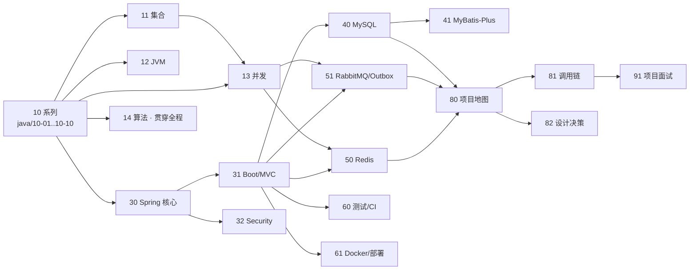

# LinkForge 学习资料库导航

本目录是面向 2027 年春招 Java 后端岗位的完整学习体系。它以 LinkForge（多租户短链 + 点击分析平台，Spring Boot 3.3.5 / Java 17）为贯穿项目：每个知识点先讲技术本身，再回到仓库真实代码对号入座。

仓库本体见 [../../README.md](../../README.md)。性能数字一律遵守其页头口径：现有压测数据测于旧版本，不代表 v2.0.0 现状。

## 使用方式

**如果你是初学者（推荐先读这段）**：

- 每周按 [00-roadmap.md](00-roadmap.md) 的周计划走，不要一口气读多个文档。
- 每份知识文档从「从一个问题开始」读起：先看不懂的问题场景，再看直觉与定义，然后逐个示例亲手跑一遍（复制进 `Xxx.java`，`javac --release 17 -encoding UTF-8 Xxx.java`，`java Xxx`）。
- 每篇末尾的「自测」一问一答用于验收：答不上就回正文对应小节，不要硬闯下一篇。
- 看不懂的术语先查 [93-glossary-review.md](93-glossary-review.md) 的术语表，再回原文。
- 文档里所有声称的输出都来自真实运行，由 `python docs/learning/verify_examples.py` 逐条校验；你自己跑示例时输出若有出入，优先怀疑环境（Windows 编码、JDK 版本），排查见 [22-tools.md](22-tools.md)。
- 卡住超过 30 分钟就记下来带去问（AI 或人），别硬磕——这是学习策略不是偷懒。

三种读法对应三种场景：

1. **串读（第一次学）**：按 [00-roadmap.md](00-roadmap.md) 的周计划推进。Java 语言基础按 [10-java-basics.md](10-java-basics.md) 的系列顺序读，其余文档按编号读全文，周末用该文档的「自测」验收。
2. **按靶场查（读代码时）**：读 [80-linkforge-architecture.md](80-linkforge-architecture.md) 建立地图，读代码时用 [81-linkforge-flows.md](81-linkforge-flows.md) 对照调用链，卡在某个设计就用 [82-linkforge-decisions.md](82-linkforge-decisions.md) 查取舍。
3. **按面试查（冲刺期）**：从 [90-interview-knowledge.md](90-interview-knowledge.md) 的薄弱域进入，回到对应知识文档补深；项目追问用 [91-interview-project.md](91-interview-project.md)；算法用 [92-interview-coding.md](92-interview-coding.md)；场景排障练 [94-scenario-drills.md](94-scenario-drills.md)；面试前一周只过 [93-glossary-review.md](93-glossary-review.md)，出发前用 [95-final-selftest.md](95-final-selftest.md) 做全卷验收。

## 文档地图

### Java 语言基础系列（`java/` 目录，10 号的展开）

| 篇 | 文档 | 一句话 |
|----|------|--------|
| 10 | [10-java-basics.md](10-java-basics.md) | 系列总览与学习导航（先读这个） |
| 10-01 | [类型与引用](java/10-01-types-and-references.md) | 变量里装的是值还是线索，参数传递的真相 |
| 10-02 | [类与多态](java/10-02-oop.md) | 类、封装、继承、接口与动态绑定 |
| 10-03 | [相等性与 String](java/10-03-equality-and-strings.md) | == 与 equals、hashCode 契约、字符串池、不可变设计 |
| 10-04 | [包装类型与拆箱](java/10-04-wrappers-and-boxing.md) | 自动装箱、缓存区间、拆箱 NPE |
| 10-05 | [泛型与擦除](java/10-05-generics.md) | 编译期检查与运行期擦除、通配符 PECS |
| 10-06 | [异常体系与设计](java/10-06-exceptions.md) | checked/unchecked 的取舍与全局处理器 |
| 10-07 | [注解、反射与动态代理](java/10-07-annotations-reflection-proxy.md) | Spring 魔法的三个零件，手写代理 |
| 10-08 | [Lambda 与 Stream](java/10-08-lambda-stream-optional.md) | 函数式接口、惰性管道、Optional 边界 |
| 10-09 | [枚举与日期时间](java/10-09-enum-datetime-bigdecimal.md) | 枚举带属性、java.time 选型、BigDecimal 陷阱 |
| 10-10 | [Java 17 新语法](java/10-10-java17.md) | record、sealed、文本块、模式匹配与版本边界 |

### 主线文档

| 编号 | 文档 | 一句话 | 优先级 |
|------|------|--------|--------|
| 00 | [00-roadmap.md](00-roadmap.md) | 20 周逐周计划与阶段验收 | 必读 |
| 01 | [01-job-market.md](01-job-market.md) | 岗位调研样本与知识缺口分析 | 必读 |
| 02 | [02-capability-matrix.md](02-capability-matrix.md) | 能力矩阵：P0–P3 / L0–L4 / 验收标准 / 状态 | 活文档 |
| 10 | [10-java-basics.md](10-java-basics.md) | Java 基础系列导航（内容在 java/ 十篇） | P0 |
| 11 | [11-java-collections.md](11-java-collections.md) | 集合框架与 HashMap 原理 | P0 |
| 12 | [12-jvm.md](12-jvm.md) | JVM 内存、GC 与类加载 | P0 |
| 13 | [13-concurrency.md](13-concurrency.md) | 并发与多线程 | P0 |
| 14 | [14-algorithms.md](14-algorithms.md) | 算法训练计划与题型方法 | P0 |
| 20 | [20-network.md](20-network.md) | 计算机网络与 HTTP | P0 |
| 21 | [21-os.md](21-os.md) | 操作系统基础 | P1 |
| 22 | [22-tools.md](22-tools.md) | Maven、Git、Linux 排查命令 | P0 |
| 30 | [30-spring-core.md](30-spring-core.md) | IoC、DI、Bean、AOP、事务 | P0 |
| 31 | [31-spring-boot-mvc.md](31-spring-boot-mvc.md) | Spring Boot、MVC 与 REST API 设计 | P0 |
| 32 | [32-spring-security.md](32-spring-security.md) | Spring Security、JWT 与 Web 安全 | P1 |
| 40 | [40-mysql.md](40-mysql.md) | MySQL 索引、事务与优化 | P0 |
| 41 | [41-mybatis-plus.md](41-mybatis-plus.md) | MyBatis 与 MyBatis-Plus | P0 |
| 50 | [50-redis.md](50-redis.md) | Redis 与缓存设计 | P0 |
| 51 | [51-rabbitmq-outbox.md](51-rabbitmq-outbox.md) | RabbitMQ、Outbox 与幂等消费 | P0 |
| 60 | [60-testing-ci.md](60-testing-ci.md) | 测试分层与 CI | P1 |
| 61 | [61-docker-deploy.md](61-docker-deploy.md) | Docker、部署与可观测性 | P1 |
| 62 | [62-design-patterns.md](62-design-patterns.md) | 设计模式与工程原则 | P2 |
| 70 | [70-distributed.md](70-distributed.md) | 分布式与微服务概念 | P2 |
| 80 | [80-linkforge-architecture.md](80-linkforge-architecture.md) | 项目地图：技术栈、模块、数据模型 | 必读 |
| 81 | [81-linkforge-flows.md](81-linkforge-flows.md) | 核心调用链逐步追踪 | 必读 |
| 82 | [82-linkforge-decisions.md](82-linkforge-decisions.md) | 设计决策与故障案例 | 必读 |
| 90 | [90-interview-knowledge.md](90-interview-knowledge.md) | 知识面试题库（含追问） | 冲刺 |
| 91 | [91-interview-project.md](91-interview-project.md) | 项目追问树与简历表达 | 冲刺 |
| 92 | [92-interview-coding.md](92-interview-coding.md) | 代码题卡（提示→复杂度→参考实现） | 冲刺 |
| 93 | [93-glossary-review.md](93-glossary-review.md) | 术语表与复习清单 | 冲刺 |
| 94 | [94-scenario-drills.md](94-scenario-drills.md) | 工程场景演练：故障排查 20 题 | 冲刺 |
| 95 | [95-final-selftest.md](95-final-selftest.md) | 最终自测综合卷（五部分+达标线） | 冲刺 |

## 知识依赖图

## 能力分级约定

| 维度 | 取值 | 含义 |
|------|------|------|
| 优先级 P0 | 基础必备 | 面试必考，必须达到目标层级 |
| 优先级 P1 | 高频重点 | 常见追问与故障分析的基础 |
| 优先级 P2 | 进阶加分 | 有余力再深入 |
| 优先级 P3 | 定向拓展 | 按目标岗位选学 |
| 层级 L0–L4 | 听说过 → 能讲取舍 | 每个知识点在 [02-capability-matrix.md](02-capability-matrix.md) 里有明确目标层级 |

目标不是全到 L4。P0 基础到 L2–L3，LinkForge 核心流程到 L3。

## 质量与维护

- 本目录自带两道校验：
  - `python docs/learning/check.py`：站内链接、仓库路径引用真实性、占位符、知识文档自测节与行数下限。
  - `python docs/learning/verify_examples.py`：把文档里「代码块 + 输出块」配对的 Java 示例逐个用 `javac --release 17` 编译运行，比对文档声称的输出（含"预期编译错误/运行异常"两类）。需要 JDK 在 PATH。新增或修改示例后请运行它。
- [02-capability-matrix.md](02-capability-matrix.md) 的「状态」列是活文档：只有完成对应文档的自测并通过验收标准，才允许把状态改为「已掌握」。
- 本目录是学习资料，不是产品文档：不改它不触发 CI 语义变化，但仍不提交业务代码改动。
- 与 `记录追踪/06-学习/` 的关系：那份本地手册（不入仓库）是本体系的底稿来源之一，已被本目录扩展并取代；本地手册保留作历史参考。
