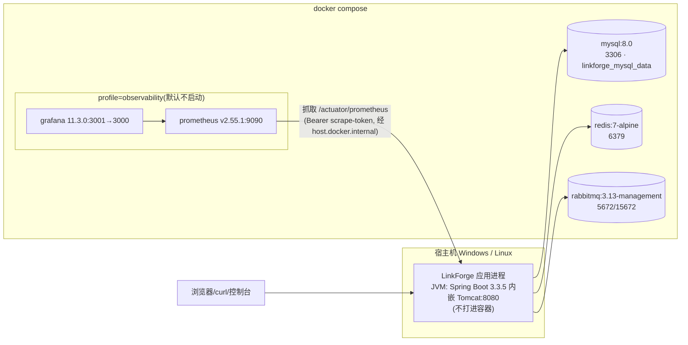
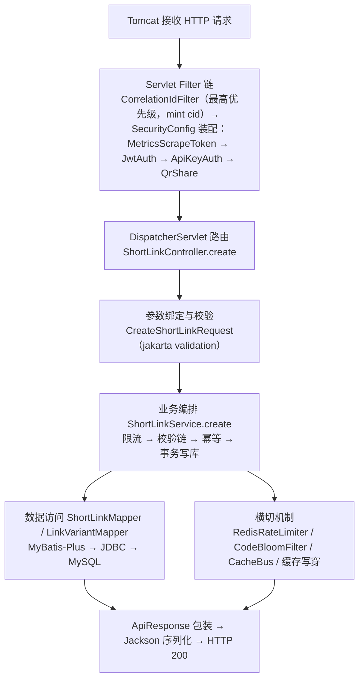

# 02 · 架构地图：代码怎么组织，谁连着谁

> 本文回答四个问题：系统跑起来由什么组成（运行架构）、代码按什么结构组织（包与类）、数据放在哪里（DB/Redis/MQ 地图）、一条请求从进来到出去经过谁（链路归属）。
> 证据口径：`README` = 根目录 README.md（文档证据）；`代码` = 源码文件路径（直接证据）；标「推断」的尚待课程阶段逐类核实。

## 1. 运行架构：宿主机 JVM + 三个依赖容器



要点（`README` + `docker-compose.yml`）：

- **应用在宿主机上跑**（`java -jar target/linkforge-3.0.0.jar`），Compose 只管三个依赖 + 可选观测栈；Prometheus 抓宿主机应用靠 `host.docker.internal:host-gateway`（compose :68-69）。
- 三个依赖都有 healthcheck；MySQL 首次初始化约 5 分钟，等到 healthy 再启动应用。
- 应用进程内还有第四种「运行单位」：**调度线程池**（`spring.task.scheduling.pool.size=6`），跑 outbox relay、webhook relay、对账器、Bloom rebuild、积压采样、清理任务（`application.yml:6-12`）。
- 进程间通信只有三条标准协议：JDBC（MySQL）、RESP（Redis/Lettuce + pub/sub）、AMQP（RabbitMQ）。没有服务间 RPC，这是单体的干净之处。

## 2. 代码组织：包结构

```text
com.linkforge
├── LinkForgeApplication          启动类
├── bootstrap/                    BootstrapDataLoader：演示租户幂等初始化
├── common/                       无业务语义的公共支撑
│   ├── exception/                BizException、RateLimitedException、GlobalExceptionHandler
│   ├── ratelimit/                RedisRateLimiter、RateLimitKeys、RateLimitDecision
│   ├── result/                   ApiResponse、PageResponse
│   ├── util/                     ClientIps
│   └── web/                      CorrelationIdFilter（请求关联 id，S/N 波）
├── config/                       LinkForgeProperties、MybatisPlusConfig、RedisConfig、
│                                 SchedulingConfig、OpenApiConfig、RabbitMqConfig
├── security/                     SecurityConfig、JwtService、JwtAuthFilter、ApiKeyAuthFilter、
│                                 UserContext、AuthUser、MetricsScrapeTokenFilter、
│                                 QrShareAuthFilter、QrSharePrincipal
├── auth/                         会话域（批次 2a）：RefreshToken、SessionService（轮换/撤销/改密）、mapper/
├── user/                         认证与团队域：controller（Auth/Team）/ service（AuthService、
│                                 TeamService）/ mapper / entity（含 TenantInvitation）/ dto
├── apikey/                       API Key 域：controller / service / mapper / entity / dto
├── link/                         短链核心域（最大的包）
│   ├── controller/               ShortLinkController、RedirectController、
│   │                             BloomAdminController、HealthController
│   ├── service/                  ShortLinkService、RedirectOutcome、QrMaterialService、
│   │                             MaliciousHostSyncService（feed 同步，批次 3b）
│   ├── support/                  23 个支撑类（缓存、Bloom、singleflight、门禁、CSV、QR、
│   │                             LinkTags、MatchRule、ImportIdempotencyLease、恶意名单快照…）
│   ├── mapper/ entity/ dto/
├── stats/                        点击统计域
│   ├── controller/ dto/ entity/ mapper/
│   ├── mq/                       ClickEvent、ClickEventPublisher、RabbitClickEventPublisher、
│   │                             ClickEventConsumer
│   ├── service/                  ClickRecordService、ClickOutboxRelay、ClickStatsService、
│   │                             ClickLogReconciler
│   └── support/                  ClickDimensions、AbReport（A/B 拟合诊断 + 适用性门，批次 3b/S1）
├── webhook/                      Webhook 域：controller / service / mapper / entity /
│                                 support(Signer、SecretCipher、TargetGuard、PinnedHttpSender、
│                                 AggregateWindows)
├── observability/                BacklogGauges、HttpUriTagAllowList
└── retention/                    SentRowCleanup
```

分层归属：`controller`（HTTP 边界）→ `service`（业务编排）→ `mapper`（数据访问）→ `entity/dto`（数据形状）；`support`/`common`/`config` 是被复用的机制层；`mq`、`retention`、`observability` 是基础设施触角。每个域（user/apikey/link/stats/webhook）自带完整三层 + 自己的 support，域之间通过少数 service 互调（如跳转链调 `ClickRecordService`，消费链调 `WebhookService`，详见第 4 节）。

主源码共 **150 个 Java 文件**（tag 3.0.0 实测；v2.0.0 时点 120 个），测试 115 个文件。完整「类 → 课程」映射见 [reference/class-coverage-matrix.md](reference/class-coverage-matrix.md)。

## 3. 数据地图

### 3.1 MySQL（17 张业务表 + flyway_schema_history）

| 表 | 用途 | 版本来源 |
|----|------|----------|
| `lf_tenant` / `lf_user` | 租户与用户（BCrypt 口令、tenant_role；V11 起加 token_version、must_change_password 两列） | V1（+ V11 两列、V12 角色回填） |
| `lf_refresh_token` | refresh 会话行：只存 SHA-256 哈希、family 轮换链、撤销原因 | V11 |
| `lf_tenant_invitation` | 租户邀请：只存令牌哈希、单次接受、7 天过期 | V12 |
| `lf_short_link` | 短链主表（`uk_code` 唯一索引、逻辑删除、大小写敏感短码；V13 加 tags 单列） | V1 + V4（列排序规则）+ V7（access_password_hash）+ V13（tags） |
| `lf_link_variant` | A/B 变体（`uk_link_variant`，variant_key 内联 bin 排序；V13 加 match_rule JSON 列） | V10（+ V13 match_rule） |
| `lf_malicious_host` | 恶意主机 feed 落表（host 唯一；判定走内存快照，不逐请求查表） | V14 |
| `lf_webhook_flush_state` | 每 endpoint 一行：聚合冲刷序号 flush_seq（M3） | V15 |
| `lf_click_log` | 点击明细（含 event_id 标记、variant 列） | V1 + V2（event_id）+ V10（variant） |
| `lf_click_daily` | 按天聚合（UV 按 IP 去重） | V3 |
| `lf_click_dim_daily` | 维度聚合（device/referer_host/os/browser/variant） | V3 + V10 |
| `lf_consumed_event` | 消费幂等去重（唯一索引） | V3 |
| `lf_outbox` | 事务性发件箱（event_id UK、status、attempts、next_attempt_at） | V2 |
| `lf_api_key` | API Key（key_hash 唯一、scope） | V5 + V8 |
| `lf_webhook_endpoint` / `lf_webhook_delivery` / `lf_webhook_agg_buffer` | Webhook 端点（AES-GCM 密文）/ 投递行 / 聚合缓冲 | V6 + V9 |

逐列的完整 schema 全息图在课程 4.2 与 [reference/class-coverage-matrix.md](reference/class-coverage-matrix.md) 同期的数据库节展开。

### 3.2 Redis 键空间

| 键/频道 | 类型 | 用途 | 证据 |
|---|---|---|---|
| `linkforge:code:{code}` | STRING | 正缓存：短码 → URL，TTL 3600+抖动300 | `README`、application.yml:112-114 |
| `linkforge:absent:{code}` | STRING("1") | 空值缓存：DB 确认不存在，TTL 60+抖动30 | `README`、application.yml:117-118 |
| `linkforge:rl:sw:{logical}` | ZSET | 滑动窗口日志（限流） | `RateLimitKeys.java`（代码） |
| 幂等键 `linkforge:rl:idem:{userId}:{key}` | STRING | 创建幂等两段式（pending 5s → `v3:<指纹>:<code>` 终值 24h） | `ShortLinkService`（代码） |
| 导入幂等键 `linkforge:rl:idem-import:{userId}:{key}` | STRING | CSV 导入：在途租约 `pending:{owner}:{fileSha256}`（TTL 120s）→ 结算 JSON（M5） | `ShortLinkService`、`ImportIdempotencyLease`（代码） |
| `linkforge:bloom:put` | pub/sub 频道 | 创建后广播 Bloom put | `README`、`CacheBus` |
| `linkforge:l1:invalidate` | pub/sub 频道 | 写路径广播 L1 失效 | `README`、`CacheBus` |

### 3.3 RabbitMQ 拓扑

| 元素 | 名称 | 证据 |
|---|---|---|
| Exchange | `linkforge.click.exchange` | `README` 架构图（文档） |
| Queue | `linkforge.click.queue` | progress.md 运维命令（文档） |
| 死信 | `linkforge.click.dlq`（消费错误不回队） | `application.yml:81` + progress 决策 #14 |
| 确认 | publisher confirm=correlated、returns=mandatory | `application.yml:72-75` |

拓扑 bean 级细节（binding、DLX 参数）由课程 10.1 以 `config/RabbitMqConfig.java` 为准。

## 4. 核心链路的类归属（谁调用谁）

| 链路 | 主角（按调用顺序） | 协作 |
|---|---|---|
| 注册/登录 | `AuthController` → `AuthService`（双桶限流 + dummy BCrypt）→ `UserAccountMapper`/`TenantMapper`；`JwtService` 签发 access、`SessionService.startSession` 新开 refresh family | `RedisRateLimiter`（注册限流、登录双桶） |
| 会话续期/撤销 | `AuthController.refresh/logout/logout-all/change-password` → `SessionService`（用户行锁内轮换/撤销，锁序 租户→用户→refresh 行） | `RefreshTokenMapper`、`UserAccountMapper.incrementTokenVersion` |
| 团队协作 | `TeamController` → `TeamService`（租户行锁先行、锁内复核 ADMIN 与最后 ADMIN 护栏）→ `TenantInvitationMapper`/`UserAccountMapper`；接受邀请回 `SessionService.issueLoginResponse` | `ApiKeyMapper.revokeAllForUser`（重置时永久撤销成员全部 Key） |
| 管理面认证 | `CorrelationIdFilter`（链首，mint cid）→ `JwtAuthFilter`（Bearer，每请求回查用户行）或 `ApiKeyAuthFilter`（X-API-Key，回查 Key 与属主） → `UserContext`；认证存储故障两过滤器同回稳定 503 | `ApiKeyService`（hash 点查） |
| 创建短链 | `ShortLinkController` → `ShortLinkService.create` → 校验族（`LinkValidations`/`TargetPolicy`（含恶意 feed 快照）/`UtmMerger`/`LinkTags`/`MatchRule` 写时校验/variants 校验）→ `ShortLinkMapper` + `LinkVariantMapper` | `RedisRateLimiter`、幂等键（指纹信封 v3）、`CodeBloomFilter`、`CacheBus` |
| 跳转 | `RedirectController` → `ShortLinkService.resolveTarget/resolveForProbe/resolveAndRecord`：`CodeBloomFilter` → absent → `UrlLocalCache`(L1) → Redis(L2) → `ShortLinkRowLoader`+`SingleFlight` → 状态/过期 → `TargetPolicy`（本地名单 + 恶意 feed）→ `LinkAccessTokens` → `ClickFilter` → `MatchRule.filterCandidates` 收窄 → `VariantPicker` → `ClickRecordService.recordClick` | `GatePages`（三种页面） |
| 点击管道 | `ClickRecordService`（同事务明细+outbox） → `ClickOutboxRelay` → `RabbitClickEventPublisher` → `ClickEventConsumer` → `ClickStatsService`（幂等+聚合）+ `ClickDimensions` + `WebhookService`（投递意图） | `OutboxMapper`、`ClickLogMapper`… |
| Webhook 投递 | `WebhookDeliveryRelay` → `WebhookTargetGuard` + `PinnedHttpSender` → `WebhookSigner` 签名 HTTP POST | `WebhookDeliveryMapper` |
| 定时任务族 | `ClickOutboxRelay`、`WebhookDeliveryRelay`、`WebhookAggregateFlusher`、`ClickLogReconciler`、`SentRowCleanup`、`BacklogGauges`（采样）、`CodeBloomFilter` rebuild、`PhishingPolicy` 名单热加载、`MaliciousHostSyncService` feed 同步（默认关） | 共享 6 线程调度池 |

以上归属以 README 文档证据 + 文件清单为底；**方法级调用与行号在对应课程里以源码为准**，差异（若有）登记到 [reference/issues-and-discrepancies.md](reference/issues-and-discrepancies.md)。

## 5. 一个请求的进程内路径（把包结构「串」起来）

以「带 JWT 的用户创建短链」为例，一条请求穿过进程的完整路径（每步的类都会在对应课程里逐个讲）：



请求之外还有第二条「时间轴路径」：调度线程池里的定时任务（Outbox Relay、Webhook Relay、对账、清理、采样）不经过 Filter 链与 MVC，直接从 service/mapper 层开始执行。**读代码时永远先问「谁调到这里的」：是 HTTP 入口还是 @Scheduled**，两者的异常处理语义完全不同（Filter 抛异常到不了 GlobalExceptionHandler，见模块 2.1/5.1）。

异步侧的归属同样要分清：跳转请求在事务里写 Outbox 行后就返回 302；后续 Relay→MQ→消费→聚合全部发生在别的线程、别的时刻。把「一次 302 的同步路径」和「一条点击的异步旅程」分开画，是理解本项目的关键一刀（交互版见 00-system-architecture 图）。

### 4.1 同步与异步的边界速查

读本项目代码最容易犯的错，是把「请求线程里发生的事」和「调度线程里发生的事」混成一条时间线。速查表：

| 事件 | 线程 | 触发 | 失败时的表现 | 详见 |
|------|------|------|--------------|------|
| 认证过滤器链 | 请求线程（Tomcat） | 每个 HTTP 请求 | 401/403 JSON | 5.1 |
| 限流（登录/创建/跳转） | 请求线程 | 方法入口 | 429 + Retry-After | 9.1 |
| 跳转判定链 1-12 步 | 请求线程 | GET /r/{code} | 404/410/403/200 页面 | 7.1 |
| 同事务双写（明细+Outbox） | 请求线程 | 302 前一刻 | fail-open：302 保持 | 11.1 |
| Outbox → MQ 投递 | 调度线程 | 每 2s 轮询 | 行保持 PENDING 退避 | 10.2 |
| 消费/聚合/维度/投递意图 | MQ 监听线程 | 消息到达 | 异常进 DLQ | 10.3 |
| Webhook HTTP 投递 | 调度线程 | 每 2s 轮询 | 退避重试至 FAILED | 13.2 |
| 对账补偿 | 调度线程 | 每 30s（仅 sync 开） | 只 warn 不中断 | 11.3 |
| Bloom rebuild / 名单热载 / 积压采样 / SENT 清理 | 调度线程 | 24h/30s/15s/1h | 打指标不中断 | 14.3 |

两条铁律：请求线程里的失败直接决定 HTTP 响应（所以有 fail-open 兜底）；调度线程里的失败只影响最终一致性窗口（所以用重试与对账兜底）。跨越这条边界的数据只通过数据库行传递（Outbox、投递行、消费去重表），不通过内存。

## 6. Spring 容器视角的几个关键事实

- Bean 装配以**构造器注入**为主；`@ConfigurationProperties(prefix="linkforge")` 把 19 组业务配置绑进 `LinkForgeProperties`（3.0.0 新增 auth、maliciousFeed、idempotency 三组，代码证据）。
- `@MapperScan` 只扫 mapper 包——历史教训：扫太宽会把 `ClickEventPublisher` 接口误注册成 MyBatis mapper（progress 决策 #13）。
- MyBatis-Plus 只有分页插件一个拦截器；逻辑删除字段 `deleted`（application.yml:91-96）。
- 调度开关在代码（`@EnableScheduling`），线程容量在配置（yml）——「开关与容量分离」的实例。
- Redis 侧只有两个自产 Bean：`stringRedisTemplate` 与 `redisMessageListenerContainer`（订阅挂载早于 Bloom 全量装载，防丢广播，`README`）。

## 7. 表的读写分工（谁写谁读，一表一行）

| 表 | 主要写入者 | 主要读取者 | 时点特征 |
|----|-----------|-----------|----------|
| lf_tenant / lf_user | 注册、bootstrap、团队管理（角色/状态/重置） | 登录、认证过滤器（每请求回查状态/角色/token_version）、API Key 代身份 | 低频写、每次请求读 |
| lf_refresh_token | 登录开 family、refresh 轮换、各类撤销 | refresh 时按哈希锁读 | 会话真相源；撤销与轮换同锁串行 |
| lf_tenant_invitation | ADMIN 创建/撤销 | 接受时按哈希读 + 条件 UPDATE 抢占 | 单次消费，接受即写 accepted_* |
| lf_malicious_host | feed 同步 upsert（默认关） | 启动/同步后整表装入内存快照 | 表只是落盘，判定不读它 |
| lf_webhook_flush_state | Flusher drain 事务内递增 | 同事务锁读 | 每 endpoint 一行，序号随事务回滚 |
| lf_short_link | 创建/更新/删除 | 跳转行读（singleflight 包裹）、管理面 | 写少读多（跳转热路径） |
| lf_link_variant | 创建/更新整表替换（整集同刻 created_at） | 跳转抽签、详情视图、A/B 报告读当前配置 | 与主链同事务写 |
| lf_click_log | 跳转同事务（sync 开）+ 消费者回填（sync 关） | 明细分页、UV 统计、对账扫描 | 高频写 |
| lf_outbox | 跳转同事务 | Outbox Relay 轮询（批量） | 只增改状态，SENT 定期清理 |
| lf_click_daily / lf_click_dim_daily | 消费者 upsert | stats/breakdown 查询 | 只增计数 |
| lf_consumed_event | 消费者幂等插入 | 消费者去重、对账扫描 | 主键即幂等锁 |
| lf_api_key | 管理 API | 每请求 hash 点查 | 吊销即时生效（无认证缓存） |
| lf_webhook_endpoint | 管理 API | 消费者（投递意图）、Relay（投递） | 每租户一行 |
| lf_webhook_delivery | 消费者事务内落意图 | Webhook Relay 轮询 | 指数退避重试 |
| lf_webhook_agg_buffer | AGGREGATE 入桶 upsert | Flusher 封窗冲刷后删除 | 短生命周期行 |

这张表是模块 4、10、11 的索引：每一行「写入者→读取者」的组合，背后都是一条有名字的调用链和一段事务边界设计。特别注意三行「写少读多/高频写/幂等锁」的不同设计取向——它们解释了为什么本项目同时用到了写穿缓存、批量轮询和唯一索引兜底三种手段。

## 8. 去哪里看运行中的系统

| 想看 | 入口 |
|---|---|
| 控制台 | `http://localhost:8080/`（静态单文件，走同一套 API） |
| API 文档 | `http://localhost:8080/swagger-ui/index.html`（prod 关闭） |
| 健康检查 | `/actuator/health`（db/redis/rabbit 分项） |
| 指标 | `/actuator/prometheus`（需 scrape-token；未配置 = fail-closed 401） |
| Grafana | `http://localhost:3001`（profile=observability） |
| RabbitMQ 管理台 | `http://localhost:15672` |

## 8. 下一步

- 想按顺序吃透 → [03-curriculum-roadmap.md](03-curriculum-roadmap.md)
- 想先看系统总架构图 → [diagrams/archify/html/00-system-architecture.html](diagrams/archify/html/00-system-architecture.html)（Phase B 产出后可用）
