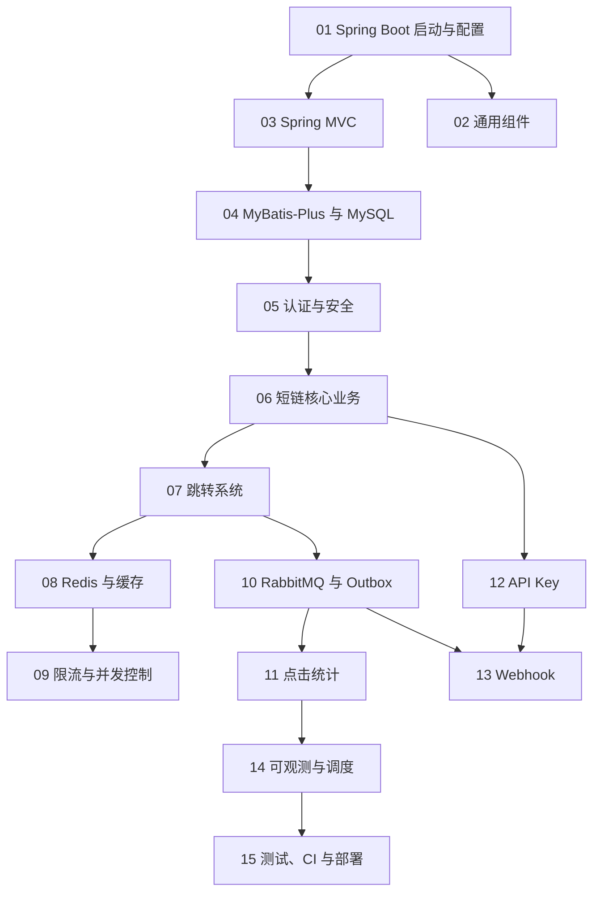

# 03 · 课程总路线（Curriculum Roadmap）

> 本教材共 15 个模块、42 节课、14 个综合专题。每节课都按统一模板写：学习目标 → 前置知识 → 涉及源码 → 类的定位 → 核心源码详解 → 技术原理补充 → 可视化 → 真实执行过程 → 为什么这样设计 → 总结 → 课后练习（带解析）→ 与后续课程的联系。
> 模块 00（全景认知）由三篇总览文档承担：[01-project-overview.md](01-project-overview.md)、[02-architecture-map.md](02-architecture-map.md) 与本文。

## 0. 怎么用这份路线

- **主线**（零基础到能改代码）：按模块 01 → 15 顺序学，每课 30–90 分钟。
- **跳读**：已有 Spring 基础的读者可跳过 01/02/03 的基础段，直接从模块 05 开始，但每课的「本节涉及的源码」仍建议通读。
- **验收**：每课末尾的练习先自己答，再对照解析。模块学完用 [reference/progress.md](reference/progress.md) 勾进度。
- **配图**：每课引用 `diagrams/archify/html/*.html` 的交互图（浏览器打开），Obsidian 里看同名 Mermaid 备用图或 `exports/` 导出。

## 1. 模块总览与依赖

## 2. 模块 01：Spring Boot 工程与启动（3 课）

| 课 | 文件 | 内容要点 | 主要源码 |
|----|------|----------|----------|
| 1.1 Maven 工程与 pom | [modules/01-spring-boot/01-maven-pom.md](modules/01-spring-boot/01-maven-pom.md) | pom 结构、依赖管理、build-info、failsafe 双执行 | `pom.xml` |
| 1.2 启动类、IoC 与依赖注入 | [modules/01-spring-boot/02-bootstrap-ioc-di.md](modules/01-spring-boot/02-bootstrap-ioc-di.md) | `LinkForgeApplication`、组件扫描、构造器注入实例 | `src/main/java/com/linkforge/LinkForgeApplication.java`、`config/*` |
| 1.3 配置体系与 Profile | [modules/01-spring-boot/03-configuration-profiles.md](modules/01-spring-boot/03-configuration-profiles.md) | 多文档 yml、`@ConfigurationProperties`、Profile 差异 | `src/main/resources/application.yml`、`config/LinkForgeProperties.java` |

## 3. 模块 02：项目通用组件（2 课）

| 课 | 文件 | 内容要点 |
|----|------|----------|
| 2.1 统一响应与全局异常 | [modules/02-common/01-unified-response-exceptions.md](modules/02-common/01-unified-response-exceptions.md) | `ApiResponse`/`PageResponse`、`BizException` 家族、`GlobalExceptionHandler` 全映射、参数校验 |
| 2.2 日志与工具类 | [modules/02-common/02-logging-utils-clientip.md](modules/02-common/02-logging-utils-clientip.md) | 日志实践、`ClientIps`（XFF 不信任默认）、`CsvFormat` |

## 4. 模块 03：Spring MVC 与 HTTP 处理（2 课）

| 课 | 文件 | 内容要点 |
|----|------|----------|
| 3.1 Controller 与 REST 设计 | [modules/03-spring-mvc/01-controllers-rest.md](modules/03-spring-mvc/01-controllers-rest.md) | 全部 Controller 盘点、参数绑定、状态码约定（404/409/410/429）、Jackson |
| 3.2 请求生命周期与 Filter | [modules/03-spring-mvc/02-request-lifecycle-filters.md](modules/03-spring-mvc/02-request-lifecycle-filters.md) | DispatcherServlet、Filter 位置、静态控制台、multipart |

## 5. 模块 04：MyBatis-Plus 与 MySQL（3 课）

| 课 | 文件 | 内容要点 |
|----|------|----------|
| 4.1 Entity/Mapper/CRUD | [modules/04-mybatis-mysql/01-entities-mappers-crud.md](modules/04-mybatis-mysql/01-entities-mappers-crud.md) | 全部实体、BaseMapper、LambdaQueryWrapper、逻辑删除、分页插件 |
| 4.2 Flyway 与 schema | [modules/04-mybatis-mysql/02-flyway-migrations.md](modules/04-mybatis-mysql/02-flyway-migrations.md) | V1–V10 逐版本、baseline、唯一索引兜底设计 |
| 4.3 事务 | [modules/04-mybatis-mysql/03-transactions.md](modules/04-mybatis-mysql/03-transactions.md) | `@Transactional`、事务边界、同事务双写的伏笔 |

## 6. 模块 05：用户体系与 Spring Security（3 课）

| 课 | 文件 | 内容要点 |
|----|------|----------|
| 5.1 安全过滤器链 | [modules/05-security/01-security-filter-chain.md](modules/05-security/01-security-filter-chain.md) | `SecurityConfig` 全链、放行清单、CSRF/session、401 JSON |
| 5.2 JWT 签发与校验 | [modules/05-security/02-jwt-auth.md](modules/05-security/02-jwt-auth.md) | `JwtService`、`JwtAuthFilter`、失败路径 |
| 5.3 UserContext 与授权 | [modules/05-security/03-usercontext-authz.md](modules/05-security/03-usercontext-authz.md) | ThreadLocal 生命周期、tenant_role（ADMIN/MEMBER）、越权 404 语义 |

## 7. 模块 06：短链核心业务（4 课）

| 课 | 文件 | 内容要点 |
|----|------|----------|
| 6.1 数据模型 | [modules/06-short-link/01-data-model.md](modules/06-short-link/01-data-model.md) | `ShortLink`/`LinkVariant` 实体、DTO 族、大小写敏感短码 |
| 6.2 创建短链全流程 | [modules/06-short-link/02-create-flow.md](modules/06-short-link/02-create-flow.md) | 校验链、幂等键两段式、撞码重试、门禁 BLOCK、UTM 合并、variants 整表替换 |
| 6.3 生命周期与 CSV | [modules/06-short-link/03-crud-lifecycle-csv.md](modules/06-short-link/03-crud-lifecycle-csv.md) | list/detail/PATCH/disable/enable/delete、缓存写穿+双删、CSV 导入导出 |
| 6.4 QR 物料与 UTM | [modules/06-short-link/04-qr-utm-materials.md](modules/06-short-link/04-qr-utm-materials.md) | ZXing 渲染、签名分享链、UTM 写时合并 |

## 8. 模块 07：短链跳转系统（3 课）

| 课 | 文件 | 内容要点 |
|----|------|----------|
| 7.1 跳转判定链 | [modules/07-redirection/01-decision-chain.md](modules/07-redirection/01-decision-chain.md) | 12 步总顺序、每步失败语义、GET/HEAD 差异 |
| 7.2 密码门与域名门禁 | [modules/07-redirection/02-password-and-domain-gates.md](modules/07-redirection/02-password-and-domain-gates.md) | 解锁流程、签名 cookie、B9 BLOCK/WARN、`GatePages` |
| 7.3 A/B 权重分流 | [modules/07-redirection/03-variants-split.md](modules/07-redirection/03-variants-split.md) | `VariantPicker` 抽签、与门禁的顺序、统计分桶 |

## 9. 模块 08：Redis 与缓存优化（4 课）

| 课 | 文件 | 内容要点 |
|----|------|----------|
| 8.1 Redis 使用面与键空间 | [modules/08-redis-cache/01-keys-and-ttl.md](modules/08-redis-cache/01-keys-and-ttl.md) | `StringRedisTemplate`、全部键清单、TTL 抖动 |
| 8.2 L1/L2 与写穿双删 | [modules/08-redis-cache/02-l1-l2-write-through.md](modules/08-redis-cache/02-l1-l2-write-through.md) | Caffeine、`UrlLocalCache`、`CacheBus` 广播失效 |
| 8.3 空值缓存与 Bloom | [modules/08-redis-cache/03-negative-cache-bloom.md](modules/08-redis-cache/03-negative-cache-bloom.md) | absent 缓存边界、`CodeBloomFilter`、rebuild、多实例广播 |
| 8.4 singleflight | [modules/08-redis-cache/04-singleflight.md](modules/08-redis-cache/04-singleflight.md) | 并发合并、超时跟车、`forget` 时机 |

## 10. 模块 09：限流与并发控制（2 课）

| 课 | 文件 | 内容要点 |
|----|------|----------|
| 9.1 滑动窗口限流 | [modules/09-rate-limit/01-sliding-window-lua.md](modules/09-rate-limit/01-sliding-window-lua.md) | Lua 逐行、Redis TIME、Retry-After、fail-open |
| 9.2 幂等键与配额 | [modules/09-rate-limit/02-idempotency-and-quotas.md](modules/09-rate-limit/02-idempotency-and-quotas.md) | 创建幂等、API Key 双闸、固定窗口日配额 |

## 11. 模块 10：RabbitMQ 与 Outbox（3 课）

| 课 | 文件 | 内容要点 |
|----|------|----------|
| 10.1 拓扑与确认机制 | [modules/10-rabbitmq-outbox/01-topology-confirm.md](modules/10-rabbitmq-outbox/01-topology-confirm.md) | Exchange/Queue/DLX、correlated confirm、mandatory returns |
| 10.2 Outbox 与 Relay | [modules/10-rabbitmq-outbox/02-outbox-relay.md](modules/10-rabbitmq-outbox/02-outbox-relay.md) | `ClickOutboxRelay`、批量/退避/FAILED、手工重放 |
| 10.3 消费幂等与死信 | [modules/10-rabbitmq-outbox/03-consumer-idempotency-dlq.md](modules/10-rabbitmq-outbox/03-consumer-idempotency-dlq.md) | `ClickEventConsumer`、`lf_consumed_event`、回填明细、DLQ |

## 12. 模块 11：点击统计系统（3 课）

| 课 | 文件 | 内容要点 |
|----|------|----------|
| 11.1 点击记录管道 | [modules/11-statistics/01-click-record-pipeline.md](modules/11-statistics/01-click-record-pipeline.md) | `ClickRecordService` 同事务双写、B2 过滤、fail-open |
| 11.2 聚合与维度 | [modules/11-statistics/02-aggregation-dimensions.md](modules/11-statistics/02-aggregation-dimensions.md) | `lf_click_daily`/`lf_click_dim_daily`、UV、`ClickDimensions` 规则 |
| 11.3 统计 API 与对账 | [modules/11-statistics/03-stats-api-reconciler.md](modules/11-statistics/03-stats-api-reconciler.md) | StatsController 全端点、`ClickLogReconciler`、对账 SQL |

## 13. 模块 12：API Key 开放能力（1 课）

| 课 | 文件 | 内容要点 |
|----|------|----------|
| 12.1 API Key 全流程 | [modules/12-api-key/01-apikey-full.md](modules/12-api-key/01-apikey-full.md) | 明文一次性返回、SHA-256 哈希、`ApiKeyAuthFilter`、双 scope、配额 |

## 14. 模块 13：Webhook（3 课）

| 课 | 文件 | 内容要点 |
|----|------|----------|
| 13.1 端点配置与密钥加密 | [modules/13-webhook/01-endpoints-and-cipher.md](modules/13-webhook/01-endpoints-and-cipher.md) | endpoint CRUD、AES-256-GCM `WebhookSecretCipher` |
| 13.2 投递、签名、重试与聚合 | [modules/13-webhook/02-delivery-signing-retry.md](modules/13-webhook/02-delivery-signing-retry.md) | 投递行生成、`WebhookSigner`、退避状态机、DB 时钟、AGGREGATE digest 双模式 |
| 13.3 SSRF 防护 | [modules/13-webhook/03-ssrf-and-aggregate.md](modules/13-webhook/03-ssrf-and-aggregate.md) | `WebhookTargetGuard`+`PinnedHttpSender` 钉死 rebinding、IPv6 内嵌 IPv4、与 B9 分工 |

## 15. 模块 14：可观测性与调度任务（3 课）

| 课 | 文件 | 内容要点 |
|----|------|----------|
| 14.1 Actuator 与 Micrometer | [modules/14-observability/01-actuator-micrometer.md](modules/14-observability/01-actuator-micrometer.md) | 端点暴露、健康组件、tag 白名单 |
| 14.2 业务指标与 Grafana | [modules/14-observability/02-metrics-gauges-grafana.md](modules/14-observability/02-metrics-gauges-grafana.md) | 指标全表、`BacklogGauges` 采样解耦、看板面板 |
| 14.3 定时任务地图 | [modules/14-observability/03-scheduled-tasks-map.md](modules/14-observability/03-scheduled-tasks-map.md) | 全部 @Scheduled 任务、线程池隔离、`SentRowCleanup` |

## 16. 模块 15：测试、CI 与部署（3 课）

| 课 | 文件 | 内容要点 |
|----|------|----------|
| 15.1 测试金字塔 | [modules/15-testing-deployment/01-test-pyramid.md](modules/15-testing-deployment/01-test-pyramid.md) | 319 例构成、Testcontainers 基类、红先纪律 |
| 15.2 Maven 与 CI | [modules/15-testing-deployment/02-maven-ci.md](modules/15-testing-deployment/02-maven-ci.md) | surefire/failsafe、时区 fork、GitHub Actions |
| 15.3 Compose 与故障演练 | [modules/15-testing-deployment/03-compose-and-drills.md](modules/15-testing-deployment/03-compose-and-drills.md) | 5 个 service、4 个 drill 脚本、prod profile |

## 17. 综合业务专题（advanced/）

模块学完后按需进入。每篇 = 业务背景 + 相关类清单 + 完整调用链 + 配图 + 正常/异常流程 + 设计取舍。

1. [注册与登录全链路](advanced/01-registration-login.md)
2. [创建短链全链路](advanced/02-create-short-link.md)
3. [短链管理全链路](advanced/03-short-link-management.md)
4. [匿名跳转 302 全链路](advanced/04-redirect-302.md)
5. [缓存命中与未命中](advanced/05-cache-hit-and-miss.md)
6. [密码短链解锁](advanced/06-password-unlock.md)
7. [点击记录与 Outbox](advanced/07-click-record-outbox.md)
8. [MQ 消费与幂等](advanced/08-mq-consume-idempotency.md)
9. [统计与对账补偿](advanced/09-stats-reconcile.md)
10. [API Key 认证](advanced/10-api-key-auth.md)
11. [Webhook 投递与重试](advanced/11-webhook-delivery-retry.md)
12. [依赖故障处理（Redis/MySQL/RabbitMQ）](advanced/12-dependency-failure-handling.md)
13. [性能与一致性分析](advanced/13-performance-and-consistency.md)
14. [项目面试讲解指南](advanced/14-interview-guide.md)

## 18. 参考资料区（reference/）

- [类覆盖矩阵](reference/class-coverage-matrix.md)：120 个主源码类 → 课程去向。
- [功能覆盖矩阵](reference/feature-coverage-matrix.md)：每个功能 → 课程/类/调用链/配图。
- [图表覆盖矩阵](reference/diagram-coverage-matrix.md)：每张 Archify 图 → 类型/课程/证据/校验。
- [术语表](reference/technical-glossary.md)、[代码导航索引](reference/code-navigation-index.md)、[进度](reference/progress.md)、[差异与问题登记](reference/issues-and-discrepancies.md)。

## 19. 与旧资料（docs/learning/）的关系

`docs/learning/` 是上一版「知识点学习库」（Java 基础、JVM、Spring、MySQL、Redis 到面试题库），它按技术学科组织；本教材按**项目源码**组织，围绕 LinkForge 的类与调用链展开。两者互补：补语言基础用旧库（如 `java/10-01..10-10` 系列），学本项目用本教材。口径冲突时以仓库当前源码与本教材为准，差异登记在 [reference/issues-and-discrepancies.md](reference/issues-and-discrepancies.md)。
