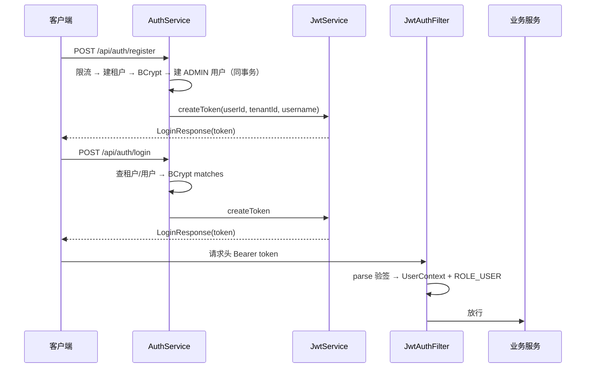

# 专题 1 · 注册与登录全链路

> 模块课把这条链路拆成了碎片：5.1 讲过滤器链、5.2 讲 JWT、5.3 讲 UserContext。本专题把它们拼回一张图：一个新用户从「注册」到「拿着 token 调第一个业务接口」，中间每一步发生在哪个类、哪条线程、失败时谁负责回答。

## 1. 业务背景：一次注册 = 一个租户 + 一个 ADMIN + 一个 token

用户故事。萧北第一次打开 LinkForge 的控制台，没有任何账号。他填了租户名、用户名、密码，点注册。几毫秒后他拿到一个 token，直接开始建短链。他不需要任何人的审批，因为注册请求本身就在系统里造出了一个属于他的数据边界（租户）和这个边界里的第一个管理员（他自己）。

登录是同一条路的返程。老用户的租户和账号已经在库里，系统只需要确认「密码对得上」，再把同样的 token 发给他。之后的每一个业务请求都靠这个 token 自证身份。

> **3.0.0 口径注**：本专题正文写于 v2.0.0（token 24 小时、无会话层）。批次 2 已把会话层整个重做：access 缩到 1 小时、新增 refresh 会话族与每请求回查、租户有了邀请与成员。本专题保留注册/登录的凭据核验部分（仍然准确），已修订的段落逐处标注；会话族与团队的完整机制见 [专题 15](15-auth-sessions-and-teams.md)。

这条链路值得单独讲，有三个原因。其一，它横跨四个包（user、security、common、config），是全项目「认证」与「授权」的分界处。其二，token 的出生（注册/登录）与消费（JwtAuthFilter）是同一枚硬币的两面，分开讲会丢掉「负载里有什么、角色从哪来」这条暗线。其三，注册写库（两个实体、一个事务）、登录只读，两条路径的安全设计恰好互补，对照着看才看得懂取舍。

## 2. 相关类清单

| 类 | 角色 | 模块课 |
|----|----|----|
| `AuthController` | HTTP 入口，`@Valid` 校验请求体 | [5.2](../modules/05-security/02-jwt-auth.md) |
| `AuthService` | 注册（建租户+建用户+签 token）与登录（验密码+签 token） | [5.3](../modules/05-security/03-usercontext-authz.md) |
| `JwtService` | 唯一碰 JWT 的类：createToken 签发、parse 校验 | [5.2](../modules/05-security/02-jwt-auth.md) |
| `JwtAuthFilter` | 每请求解析 Bearer，建立身份与角色 | [5.1](../modules/05-security/01-security-filter-chain.md)、[5.2](../modules/05-security/02-jwt-auth.md) |
| `SecurityConfig` | 放行清单、角色矩阵、401/403 出口、PasswordEncoder Bean | [5.1](../modules/05-security/01-security-filter-chain.md) |
| `UserContext` / `AuthUser` | 请求级身份快照与其载荷 | [5.3](../modules/05-security/03-usercontext-authz.md) |
| `GlobalExceptionHandler` | 把 BizException/校验异常翻译成 HTTP 状态码 | [5.1](../modules/05-security/01-security-filter-chain.md)（`common` 包职责见 2.1 课） |
| `RedisRateLimiter` | 注册/登录限流的执行者（登录为 IP + 账号双桶） | [5.3](../modules/05-security/03-usercontext-authz.md)（算法见 9.1 课） |
| `SessionService`（auth 包） | 批次 2 新增：登录/注册后签发 refresh 会话族、轮换与撤销 | [专题 15](15-auth-sessions-and-teams.md) |
| `TeamService`（user.service） | 批次 2 新增：邀请接受与成员管理，登录态的另一个来源 | [专题 15](15-auth-sessions-and-teams.md) |

以下源码路径均省略前缀 `src/main/java/com/linkforge/`。

## 3. 完整调用链

### 3.1 注册（同步，全程一条 Tomcat 工作线程）

```
POST /api/auth/register
  → SecurityFilterChain：/api/auth/** 放行（SecurityConfig.java:42）
  → AuthController.register（AuthController.java:28-32）@Valid 触发 Bean Validation
  → AuthService.register（AuthService.java:100-139，@Transactional）
      ├─ IP 限流 acquire（键 register:{ip}，默认 5 次/600 秒，application.yml rate-limit 段）
      ├─ 超限 → RateLimitedException → 429 + Retry-After
      ├─ tenantMapper.insert → 撞唯一索引 → 409 "tenant name already exists"
      ├─ BCrypt encode 密码 → userAccountMapper.insert
      ├─ tenantRole = "ADMIN"（注释 D-C1-13）
      └─ jwtService.createToken（tv=0，JwtService.java:38-44）
  → 事务提交（tenant + user 两行同生共死，javadoc :95-99）
  → 控制器接 startSession 开会话族 → LoginResponse(access, refreshToken, ...)
```

### 3.2 登录（同步；核验只读，会话签发单独一笔事务）

```
POST /api/auth/login
  → SecurityFilterChain 放行（SecurityConfig.java:42）
  → AuthController.login（AuthController.java:32-37）@Valid
  → AuthService.login（AuthService.java:51-98，只管凭据核验）
      ├─ IP 桶限流 login:{ip}，5 次/600 秒（:53-59，批次 1 新增）
      ├─ 账号桶限流 login-acct:{tenant}:{username}（小写归一），5 次/600 秒（:62-72）
      ├─ 按租户名查租户、按租户+用户名查用户（:74-81）
      ├─ 每条路径恰好一次 BCrypt matches：账号不存在/停用时对 DUMMY_PASSWORD_HASH 跑（:82-88）
      ├─ 任一不合 → 同一个 401 "invalid credentials"（:89-91）
      └─ createToken（带 tv claim）→ LoginResponse（:92-97）
  → 控制器接 SessionService.startSession 开新会话族（lf_refresh_token 一行）
  → LoginResponse(access 1h, refreshToken, mustChangePassword)
```

批次 1 之前的登录既无限流、也存在计时侧信道（租户不存在直接 401 不跑哈希），两个缺口分别由双桶与哑哈希补上，取舍见第 8 节修订后的取舍三。refresh 的轮换与登出不在本专题展开，见 [专题 15](15-auth-sessions-and-teams.md) 第 3.2 节。

### 3.3 之后的每个业务请求（同步）

```
GET /api/links?page=1（带 Authorization: Bearer）
  → MetricsScrapeTokenFilter 放行（非 prometheus 路径）
  → JwtAuthFilter.doFilterInternal（JwtAuthFilter.java:66-88）
      ├─ 有 Bearer 头 → jwtService.parse 验签+查过期；坏 token 直写 401 "invalid token"
      ├─ 回查用户行（authenticate :107-160，批次 2 新增）：行不存在/停用或 tv claim 与
      │   token_version 不等 → 不置认证、链继续（受保护路径由 entry point 回 401）
      ├─ must_change_password=1 且路径非豁免 → 直写 403 PASSWORD_CHANGE_REQUIRED
      ├─ 身份字段取行不取 claim → AuthUser 进 UserContext、ROLE_USER 进 SecurityContext
      └─ finally 双清 ThreadLocal 与 SecurityContext
  → ApiKeyAuthFilter 放行（无 X-API-Key 头）
  → 角色矩阵命中 USER（SecurityConfig.java:63）→ Controller → 服务层 UserContext.get()
```

线程标注：本专题三条链路全部同步，没有线程切换。唯一的状态生命周期边界是「请求结束」，finally 双清保证线程回池时无残留（机制见 [5.3](../modules/05-security/03-usercontext-authz.md)）。

## 4. 可视化

阅读顺序：

1. [10-auth-sequence](../diagrams/archify/html/10-auth-sequence.html)：本专题主图。一条时间线分三段，A 段对应 3.1 与 3.2（注册/登录签发），B 段对应 3.3（JWT 过滤器链，含 401 分支与 finally 双清），C 段是 X-API-Key（本专题不讲，见 12.1 课）。ApiKeyAuthFilter 在图上是卡片而非泳道，读 B 段时跳过它即可。
2. [03-package-map](../diagrams/archify/html/03-package-map.html)：user 包 9 文件与 security 包的依赖方向，注册链路涉及的类都在这两个包里。

diagrams/mermaid/ 目录没有 auth 专用备用图（只有点击、创建、跳转三张）。Obsidian 环境可用下面这张内嵌图：



## 5. 源码详解：只看跨类协作的节点

**节点一：注册的 409 兜底是唯一索引，不是先查后插。** `AuthService.register` 的 javadoc（`AuthService.java:95-99`）写明：租户与第一个用户在一个事务里创建，用户插入失败会连租户一起回滚，避免孤儿租户占住唯一名；并发下的重名由唯一索引兜底，`DuplicateKeyException` 翻译成 409。这与短码分配的 `uk_code` 兜底是同一个设计哲学（回看 [6.2](../modules/06-short-link/02-create-flow.md) 第 5.5 节）：数据库约束是并发下唯一的真相。

**节点二：BCrypt 只出现在两个时刻。** 注册时 `encode`（`AuthService.java:100-139`），登录时 `matches`（`:84-88`，账号不存在时对哑哈希跑，保证每条路径恰好一次）。Bean 定义在 `SecurityConfig.java:96-99`。密码哈希从不进 token，token 负载里是 userId、tenantId、username 三个身份字段加一个 `tv` 版本 claim（`JwtService.java:38-44`，批次 2 新增，见 [专题 15](15-auth-sessions-and-teams.md) 节点一）。权限信息（角色、tenantRole）不进负载，改权限不需要重新签发（回看 [5.2](../modules/05-security/02-jwt-auth.md) 第 5.2 节）。

**节点三：角色是校验方授予的，不是签发方写入的。** `createToken` 不写任何角色；`JwtAuthFilter` 解析成功后固定授予 `ROLE_USER`（`JwtAuthFilter.java:46-48`）。链层只认这个角色；`tenant_role` 的 ADMIN/MEMBER 是业务数据，由服务层回库判定（回看 [5.3](../modules/05-security/03-usercontext-authz.md) 第 5.5 节）。

**节点四：401 有三个来源，文案各不相同。** 排障入口，详见第 7 节表格。框架行为层面的原因：Filter 在 DispatcherServlet 之前，`@RestControllerAdvice` 够不着，所以 JwtAuthFilter 只能就地写 JSON（回看 [5.1](../modules/05-security/01-security-filter-chain.md) 第 5.7 节、[5.2](../modules/05-security/02-jwt-auth.md) 第 9 节）。

## 6. 正常流程：一次成功的注册加一次登录加一个业务请求

| 时刻 | 线程 | 动作 | 证据 |
|----|----|----|----|
| t0 | Tomcat 工作线程 W1 | POST /api/auth/register 进过滤器链，permitAll 放行 | `SecurityConfig.java:42` |
| t1 | W1 | `@Valid` 校验通过（tenantName/username 3-64 字符集，password 8-64） | `RegisterRequest.java:11-23` |
| t2 | W1 | Redis 滑动窗口计数 register:{ip}，未超 5 次/600 秒 | `AuthService.java:66-69` |
| t3 | W1 | 开事务；tenantMapper.insert 成功（租户名未占用） | `AuthService.java:75-84` |
| t4 | W1 | BCrypt encode 密码（约几十毫秒），userMapper.insert，role=ADMIN | `AuthService.java:86-95` |
| t5 | W1 | createToken 签发 access token（v2.0.0 为 24 小时；3.0.0 为 1 小时 + tv claim），控制器再接 startSession 开会话族 | `JwtService.java:38-44`、`AuthController.java:39-45` |
| t6 | W1 | 事务提交，两行落库；响应 200 + LoginResponse | `AuthService.java:100-139` |
| t7 | W1（次日） | POST /api/auth/login，双桶限流通过，查租户命中且 status=1 | `AuthService.java:53-81` |
| t8 | W1 | 查用户命中，BCrypt matches 通过 | `AuthService.java:82-91` |
| t9 | W1 | 新 access + 新会话族签发，响应 200 | `AuthService.java:92-97`、`SessionService.java:103-114` |
| t10 | W2（可能是另一条线程） | GET /api/links 带 Bearer；parse 验签通过，用户行回查通过（tv 对齐） | `JwtAuthFilter.java:66-82、107-160` |
| t11 | W2 | AuthUser 进 UserContext，ROLE_USER 进 SecurityContext | `JwtAuthFilter.java:145-159` |
| t12 | W2 | 角色矩阵放行，Controller 与服务层读到身份 | `SecurityConfig.java:63` |
| t13 | W2 | finally 双清，W2 回池无残留 | `JwtAuthFilter.java:55-58` |

t10 换成 W2 是刻意的：STATELESS 架构下 token 自证身份，不依赖任何会话粘性，两次请求落在哪条线程都一样。

## 7. 异常流程：每个失败分支

| 触发条件 | 返回 | 副作用 | 出处 |
|----|----|----|----|
| 注册请求体不合校验（租户名/用户名不是 3-64 位 `[A-Za-z0-9_-]`，密码不在 8-64） | 400，字段级 message | 无（未进服务层） | `RegisterRequest.java:11-23`，`GlobalExceptionHandler` 的 MethodArgumentNotValidException 分支 |
| 同一 IP 600 秒内第 6 次注册 | 429 + Retry-After | Redis 限流键仍在窗口内 | `AuthService.java:100-110` |
| 租户名已被占用（含并发撞行） | 409 "tenant name already exists" | 无（事务尚未写过其他行） | `AuthService.java:116-123` |
| 用户插入等其他 DB 异常 | 500 | 事务回滚，租户行一并撤销 | `AuthService.java:95-99` javadoc 的设计承诺 |
| 登录同 IP 600 秒内超 5 次 | 429 + Retry-After | IP 桶计数 | `AuthService.java:53-59`（批次 1） |
| 登录同账号 600 秒内超 5 次（跨 IP 撞库） | 429 + Retry-After | 账号桶计数（租户+用户名小写归一） | `AuthService.java:62-72`（批次 1） |
| 登录时租户不存在或停用 | 401 "invalid credentials" | 仍跑一次哑哈希 matches | `AuthService.java:74-91` |
| 登录时用户不存在、停用或密码错误 | 401 "invalid credentials"（同一文案） | 同上，每条路径恰好一次 BCrypt | `AuthService.java:82-91` |
| 受保护路径无凭据 | 401 `{"message":"unauthorized"}` | 无 | `SecurityConfig.java:72-76`（来源一） |
| Bearer 坏（签名/格式/过期） | 401 `{"message":"invalid token"}` | 无 | `JwtAuthFilter.java:51-54`（来源二） |
| X-API-Key 无效或吊销 | 401 `{"message":"invalid api key"}` | 无 | 来源三，内部细节见 12.1 课与 [5.2](../modules/05-security/02-jwt-auth.md) 第 8 节 |

三个 401 的 message 不同，看响应体就能定位拒绝层。登录失败统一文案是防枚举：租户不存在与密码错误对外的返回完全一样，唯一泄露渠道是响应时间（见第 8 节取舍三）。

## 8. 设计取舍

**一、注册即建租户的隔离模型。** 每次注册产生一个新租户，创始人是 ADMIN（`AuthService.java:100-139`，D-C1-13）。租户是数据边界：短链按 createdBy 或 tenantId 圈视野，越权返回 404（回看 [5.3](../modules/05-security/03-usercontext-authz.md) 第 5.6 节）。v2.0.0 时没有邀请、没有租户加入流程；批次 2b 补上了 bearer 邀请与成员管理，租户从一人一岛变成团队（[专题 15](15-auth-sessions-and-teams.md) 第 3.3 节）。（推断：教学项目选了最小可用的多租户模型，注册开放、无审批，代价是租户数量不受控，靠 IP 限流 5 次/600 秒压住。）

**二、BCrypt 的时机放在必须付钱的位置。** 注册付一次 encode，登录付一次 matches，每个凭据每请求至多一次慢哈希。短链访问密码复用同一 Bean（回看 [7.2](../modules/07-redirection/02-password-and-domain-gates.md) 第 5.1 节）。慢是特性，所以所有高匿名入口都把限流排在 BCrypt 之前（unlock 两级限流，`ShortLinkService.java:767-780`）。

**三、登录限流与计时侧信道（v2.0.0 缺口，批次 1 已修复）。** 本专题初版如实记录过两个缺口：登录没有 IP 限流；租户不存在时直接 401 不跑 BCrypt，测响应时间可区分「租户名是否存在」。批次 1 双双补上：IP 桶 + 账号桶各 5 次/600 秒（账号桶治跨 IP 撞同一账号，键用小写归一防大小写变体分桶），账号不存在/停用时对预计算的 `DUMMY_PASSWORD_HASH` 跑一次 `matches`，每条失败路径恰好一次慢哈希（`AuthService.java:41-49、53-91`）。[5.3](../modules/05-security/03-usercontext-authz.md) 第 6 节保留缺口的历史记录，现状以本段为准。

**四、refresh token（v2.0.0 无，批次 2 已引入）。** 初版的取舍是 24 小时 token、过期即重登。批次 2 改为 access 1 小时（expireHours 默认 1）+ refresh 30 天会话族：轮换、重用侦测、登出与全会话撤销都有了服务端状态，会话从「一张长期通行证」变成「短期通行证 + 可撤销的会话登记」。完整机制与取舍见 [专题 15](15-auth-sessions-and-teams.md) 第 8 节。

**五、重名冲突统一交给唯一索引。** 租户名、短码两处都没有「先查后插」。查询与插入之间有时间窗，唯一索引才是并发下的真相。这与专题「创建短链」的取舍四互为印证。
