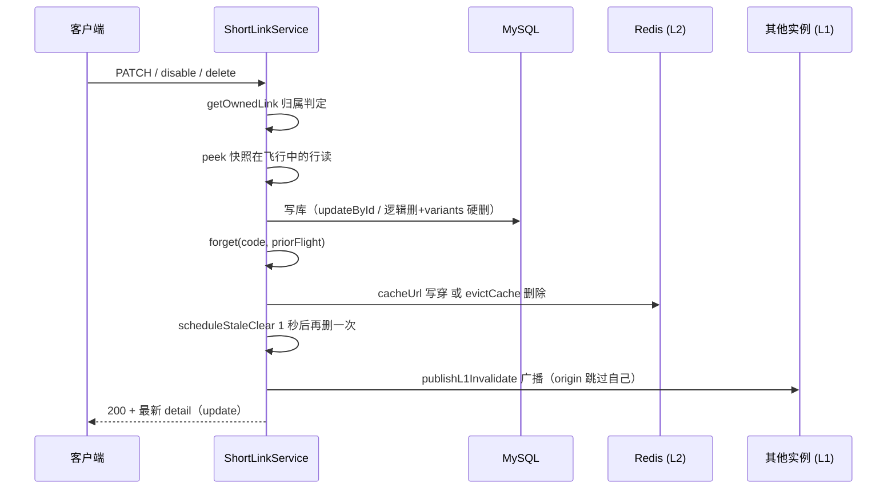

# 专题 3 · 短链管理全链路

> 模块课 6.3 把 list、detail、update、启停、delete 六个方法逐个讲完。本专题把它们拼回一条管理面的统一叙事：六个 HTTP 入口怎么共享同一套归属判定、同一套视野规则，以及每条写路径上形状完全相同的缓存收尾组合拳。

## 1. 业务背景：管理面的六分法与一条纪律

用户故事。运营同学的某条投放链出了三件事：目标页换了域名，要把 `originalUrl` 改掉；活动提前结束，要先把链停掉止血；确认不再需要后，把它从列表里清走。她依次调用了 PATCH、disable、delete 三个接口。她不知道的是，这三个动作在服务层走的是同一段收尾代码，任何一段没跑对，跳转面就会在缓存 TTL（最长 3600 秒加抖动）内继续把用户送往旧地址。

管理面与跳转面是同一个 `ShortLinkService` 的两副面孔。跳转面（专题 4）服务匿名访客，判定快、不鉴权、只读行；管理面服务登录用户与 API Key，每个入口第一件事都是确认「这条链归你管」。六个入口分两类：list 与 detail 是纯读，PATCH、disable、enable、delete 是写，写的每一处都遵守同一条纪律，任何改变跳转行为的落库，都要把三级缓存里的旧值处理干净。

这条链路值得单独讲，因为它是全项目「防漂移」纪律最密集的地方。归属判定收敛在一个方法里，视野规则收敛在一个方法里，收尾序列在三个写方法里逐字重复而不抽象成公共函数。为什么重复、收敛各自的理由是什么，是本专题的主线。

## 2. 相关类清单

| 类 | 角色 | 模块课 |
|----|----|----|
| `ShortLinkController` | 六个 HTTP 端点（:50-97），全部透传给 service | [6.3](../modules/06-short-link/03-crud-lifecycle-csv.md) |
| `ShortLinkService.list/pageOwn` | 分页列表，视野条件拼进 WHERE（:482-509） | [6.3](../modules/06-short-link/03-crud-lifecycle-csv.md) 第 5.1 节 |
| `ShortLinkService.detail` | 唯一填充 variants 的读路径（:883-885） | [6.3](../modules/06-short-link/03-crud-lifecycle-csv.md) 第 5.2 节 |
| `ShortLinkService.update` | 最长的写方法：校验前置 + 单事务落库（:887-983） | [6.3](../modules/06-short-link/03-crud-lifecycle-csv.md) 第 5.3 节 |
| `ShortLinkService.setStatus/delete` | 两个轻写与一个事务双删（:993-1018） | [6.3](../modules/06-short-link/03-crud-lifecycle-csv.md) 第 5.4 节 |
| `ShortLinkService.getOwnedLink` | 归属判定唯一入口（:1368-1382） | [6.3](../modules/06-short-link/03-crud-lifecycle-csv.md)、[11.3](../modules/11-statistics/03-stats-api-reconciler.md) |
| `ShortLinkService.isTenantWide` | TENANT scope 键的视野开关（:1384-1386） | [6.3](../modules/06-short-link/03-crud-lifecycle-csv.md)、[12.1](../modules/12-api-key/01-apikey-full.md) |
| `UpdateShortLinkRequest` | 三态字段：null 不动、空数组清空、clearAccessPassword 显式表态 | [6.1](../modules/06-short-link/01-data-model.md) |
| `cacheUrl/evictCache/scheduleStaleClear` | 写穿、失效、延迟双删三件套（:1444-1477） | [8.2](../modules/08-redis-cache/02-l1-l2-write-through.md) |
| `SingleFlight.peek/forget` | 写路径的时序纪律（提交前快照、提交后两参删除） | [8.4](../modules/08-redis-cache/04-singleflight.md) 第 5.4 节 |
| `CacheBus` | L1 失效广播（Redis pub/sub） | [8.2](../modules/08-redis-cache/02-l1-l2-write-through.md) 第 5.6 节 |
| `ShortLinkMapper.selectAllCodes` | 绕过逻辑删的 Bloom 播种（:13-23） | [6.3](../modules/06-short-link/03-crud-lifecycle-csv.md) 第 5.4 节 |

源码路径前缀 `src/main/java/com/linkforge/` 省略，`ShortLinkService.java` 位于 `link/service/` 包。

## 3. 完整调用链

六个入口的安全前置完全一致：请求经 JwtAuthFilter 或 ApiKeyAuthFilter 建立身份，角色矩阵放行 `/api/links/**` 给 USER 或 API_KEY（`SecurityConfig.java:63`）。之后六个入口分道：

```
GET /api/links?page=1&size=20
  → ShortLinkController.list（ShortLinkController.java:50-54）
  → ShortLinkService.list（:482-485）分页参数收口（page 最小 1，size 限 1..100 默认 20）
  → pageOwn（:487-509）isTenantWide 决定按 tenantId 还是 createdBy 过滤
  → selectPage → toDetail 逐行转换（variants 恒为 null）→ PageResponse

GET /api/links/{code}
  → detail（:883-885）= toDetailWithVariants(getOwnedLink(code))，多发一次 variant 表查询

PATCH /api/links/{code}
  → update（:887-983）：
      意图收集（:889-900）→ 互斥与前置校验（:901-914，含 variants 整组校验与 tags 归一）→ 取行（:915）
      → 字段应用（:917-939）→ peek（:940）
      → 单事务（:946-971，批次 1 L-M1）：清密 SET NULL（:948-955）→ 清标签 SET NULL（:957-964）
        → updateById（:965）→ variants 先删后插（:966-970），任一步失败全回滚
      → forget（:972）→ cacheUrl 写穿（:975）→ scheduleStaleClear（:976）→ publishL1Invalidate（:979）

POST /api/links/{code}/disable 与 /enable
  → disable（:985-987）/ enable（:989-991）→ setStatus(code, 0 或 1)（:993-1001）
      getOwnedLink → 改 status 与 updatedAt → peek（:995）→ updateById（:996）→ forget（:997）
      → evictCache（:998）→ scheduleStaleClear（:999）→ publishL1Invalidate（:1000）

DELETE /api/links/{code}
  → delete（:1006-1018，javadoc :1002-1005）
      getOwnedLink → peek（:1008）→ 事务内双删（:1009-1013：主行逻辑删 + variants 硬删）
      → forget（:1014）→ evictCache（:1015）→ scheduleStaleClear（:1016）→ publishL1Invalidate（:1017）
```

三条写路径的收尾序列逐字相同，差别只有两处：update 用 `cacheUrl` 写穿（新 URL 已知且合法），setStatus 与 delete 用 `evictCache` 纯失效（行失效后任何被缓存的 URL 都是谎言）。CSV 导出（`exportOwnCsv` :538 起）复用 `pageOwn`，与 list 同视野；CSV 导入在 [6.3](../modules/06-short-link/03-crud-lifecycle-csv.md) 第 5.8 节专讲，本专题不重复。

## 4. 可视化

阅读顺序：

1. [05-database-erd](../diagrams/archify/html/05-database-erd.html)：本专题主图。看 `lf_short_link` 与 `lf_link_variant` 两张表的关系，重点对比两表的删除语义：主行有 `deleted` 列（逻辑删），variant 表没有（硬删，C3-N3），这就是 delete 必须事务双删的数据库层原因。`uk_code` 唯一索引在图上挂在 code 列，已删行仍占着它。
2. [02-function-map](../diagrams/archify/html/02-function-map.html)：link 包服务层方法清单，确认 update/setStatus/delete 三处收尾调用的是同一组函数。

Obsidian 环境可用下面这张内嵌图看写路径的时序：



## 5. 源码详解：只看跨类协作的节点

**节点一：归属判定只有两个形状，越权统一 404。** 列表走 `pageOwn`（:487-509），视野条件拼进 WHERE，别人的行根本不会从数据库出来。单条走 `getOwnedLink`（:1368-1382），先按 code 查行，再按身份比对：TENANT scope 比 `tenantId`，其余身份比 `createdBy`。查不到与不属于返回同一个 404 文案 "short link not found"，不给枚举者任何信息。detail 的这层校验被三个 stats 端点原样继承（回看 [11.3](../modules/11-statistics/03-stats-api-reconciler.md)），管理面没有第二套权限代码。

**节点二：TENANT scope 键看全租户。** `isTenantWide`（:1384-1386）只有一行，注释 D-C1-12 写明口径：TENANT scope 的 API Key 见整个租户，JWT 用户与 USER scope 的 Key 只见自己创建的行。同一个 `pageOwn` 在两种身份下产生两条不同的 SQL，`getOwnedLink` 产生两套比对条件。管理员的 JWT 并不比 MEMBER 看得多，视野扩张只随 API Key 的 scope 走，不随租户角色走（回看 [12.1](../modules/12-api-key/01-apikey-full.md)）。

**节点三：写路径的组合拳是五步，顺序不可换。** update 的 :937-939 注释把前两步钉死：`peek` 必须在提交前快照，这样提交后的 `forget`（两参删除）永远杀不到「提交后才起飞、必然读到新行」的飞行（A10 audit N1，机制在 [8.4](../modules/08-redis-cache/04-singleflight.md) 第 5.4 节）。中间是写库本体。之后三步各防一种竞态：写穿或失效让本实例与 Redis 立即持有新状态；延迟双删（1 秒后，常量 `STALE_WRITEBACK_CLEAR_MS = 1000` 在 :97，单线程 `cache-evictor` 在 :128-132）清掉并发读者可能迟到的旧值回填；广播让其他实例的 L1 立即作废。广播只在写路径本尊发一次（:977-978，D-C2-16），延迟遍绝不补发。

**节点四：删除是逻辑删，码位永久保留。** `deleteById` 走 MyBatis-Plus 逻辑删，`deleted` 置 1，`uk_code` 不释放，码永远不可复用（javadoc :1002-1003 原文 "the code stays reserved"）。variants 是硬行，没有逻辑删列，注释 :1003-1005 要求它们「must not outlive the link」，所以两个 DELETE 同事务提交，缓存清理留在事务外。Bloom 侧的另一半在 [6.3](../modules/06-short-link/03-crud-lifecycle-csv.md) 第 5.4 节讲过：经典 Bloom 无法撤销元素，`selectAllCodes`（`ShortLinkMapper.java:13-23`）刻意绕过 `@TableLogic` 播种，已删码保持 Bloom 阳性，由行读的 `deleted=0` 过滤后 404。

**节点五：PATCH 的整组语义。** `UpdateShortLinkRequest` 的字段三态：null 表示不动，空数组表示清空回单目标（D-C3-6，:55-57 注释），非空数组表示整组替换。`update` 先收集意图（:889-900），可更新维度全空抛 400 "nothing to update"；`clearAccessPassword` 与 `accessPassword` 互斥（:901-903）；variants 整组校验在任何取行之前（:909-910，D-C3-7），校验失败连数据库都不碰。清密码是本方法最反直觉的一段：MyBatis-Plus 的 updateById 默认跳过 null 字段，直接把哈希置 null 再 update 什么都不会发生，所以走 `LambdaUpdateWrapper` 显式 SET NULL（:948-955，注释点名 D-Bw345-32）。事务形状在批次 1 变过（L-M1）：清密、清标签、主行 updateById 与 variants 先删后插现在同属一个 `TransactionTemplate` 单元（:946-971），任一步失败全回滚——旧口径「variants 是独立小事务、主行不在其中」已作废，那正是 L-M1 点名的半成品状态（「URL 改了但 variants 还是旧的」）；缓存收尾仍在事务外，与 delete 同形。

**节点六：启停不检查当前状态。** `setStatus`（:993-1001）对已启用的链再发 disable、对已停用的链再发 enable 都不会报错，副作用只是一次 updateById 与一轮缓存收尾。（推断：启停是幂等操作，重复执行的最终状态一致，多一次缓存收尾的代价小于先查后写的复杂度。）停用后的链在 detail 仍返回 200、列表仍可见（status=0），物料导出仍含此行，只有跳转面把它当 404（回看专题 4 第 7 节）。

## 6. 正常流程：一条链的修正日

| 时刻 | 入口 | 服务层动作 | 缓存侧效果 |
|----|----|----|----|
| t0 | GET /api/links | pageOwn 按 createdBy 过滤，返回分页列表 | 纯读，不碰缓存 |
| t1 | GET /api/links/aB3xK9m | getOwnedLink 归属通过，toDetailWithVariants 填 variants | 纯读 |
| t2 | PATCH originalUrl | 意图收集、合并 UTM、requireHttpUrl 与 B9 门禁、取行 | peek 快照（:940） |
| t3 | （t2 续） | 单事务提交：SET NULL 跳过（未清密码）、updateById、variants 替换 | forget（:972） |
| t4 | （t2 续） | cacheUrl 写穿新 URL | 本实例 L1 与 Redis 立即持新值（:975） |
| t5 | （t2 续） | 1 秒后 scheduleStaleClear 再删一次 | 竞态回填的旧值被清（:976） |
| t6 | （t2 续） | publishL1Invalidate | 其他实例 L1 作废（:979） |
| t7 | POST /disable | setStatus：peek → updateById(status=0) → forget | evictCache 删干净（:998） |
| t8 | GET /api/links/aB3xK9m | detail 仍 200，status=0 | 跳转面此时 404 |
| t9 | POST /enable | setStatus(code, 1)，同一序列 | evictCache 后下一个跳转读重建缓存 |
| t10 | DELETE /api/links/aB3xK9m | 事务双删提交，deleted=1 | evictCache + 双删 + 广播（:1015-1017） |
| t11 | GET /api/links | 列表不再出现该行；detail 与跳转均 404 | 码位被 uk_code 永久占用 |

t4 到 t6 的三步就是 [8.2](../modules/08-redis-cache/02-l1-l2-write-through.md) 第 5.7 节的「约 1 秒最终一致窗口」：广播丢失时上界是各对端的 L1 TTL（10 秒），L2 删除失败时上界是 3600 秒。

## 7. 异常流程：每个失败分支

| 触发条件 | 返回 | 副作用 | 出处 |
|----|----|----|----|
| 任何管理入口身份丢失（UserContext 空） | 401 | 无（纵深防御，过滤器层已拦） | `ShortLinkService.java:1388-1394` |
| 单条入口的码不存在 | 404 "short link not found" | 无 | `getOwnedLink` :1368-1382 |
| 单条入口的码属于别人（JWT/USER key） | 404（同一文案，防枚举） | 无 | `getOwnedLink` 内比对 |
| TENANT key 访问其他租户的码 | 404 | 无 | `getOwnedLink` 内比对 |
| PATCH 请求体无可更新维度 | 400 "nothing to update" | 无 | :895-900 |
| PATCH 同时带 accessPassword 与 clearAccessPassword | 400（互斥） | 无 | :901-903 |
| PATCH expireAt 是过去时间 | 400 | 无 | :904-906 |
| PATCH variants 非法（重复 key、权重越界等） | 400 | 无（取行之前已拒，:909-910） | `validateVariants` |
| PATCH URL 非法 | 400 | 无 | `requireHttpUrl`（update :920 调用） |
| PATCH 合并后 URL 命中 B9 BLOCK | 400 "target domain is not allowed by policy"（不回显域名） | 打点 phishing.gate | `rejectBlockedTarget` :1272-1282 |
| PATCH/disable/enable/delete 的码不存在或非己有 | 404 | 无（写路径取行是第一个动作） | :915、:994、:1007 |
| delete 已逻辑删的码 | 404（getOwnedLink 查不到 deleted=1 行） | 无 | 逻辑删语义 |
| update 清密码写库（LambdaUpdateWrapper） | 正常继续 | 显式 SET NULL，绕过 updateById 的 null 跳过策略（单事务内） | :948-955 |
| 写路径后 Redis L2 写失败 | 不影响业务写 | 打点 cache.failopen{op=l2_set}，L1 仍持有值 | `cacheUrl` :1444-1455 |
| 写路径后 Redis L2 删失败 | 不影响业务写 | 打点 failopen{op=l2_delete}，陈旧条目等 TTL 自灭 | `evictCache` :1457-1467 |
| 广播发布失败 | 不影响业务写 | 对端 L1 陈旧最多到各自 L1 TTL（10 秒） | `CacheBus.java:57-68` |
| API Key 调管理接口超过配额 | 429 | 配额键计数 | 过滤器层（[12.1](../modules/12-api-key/01-apikey-full.md)） |

注意副作用列的分布：所有 4xx 都发生在任何写之前（update 的取行排在全部校验之后，:915），失败请求连缓存尾段都摸不到。三个 fail-open 分支是仅有的「业务写成功但缓存动作失败」的路径，它们的共同设计是绝不因缓存失败回滚已提交的业务写。

## 8. 设计取舍

**一、归属判定收敛到一个方法，视野规则收敛到一个方法。** `getOwnedLink` 与 `isTenantWide` 各只有一个实现，stats 端点、QR 物料、CSV 导出全部复用。代价是单条读路径多一次全字段比对，收益是权限规则只有一处可改。（推断：列表不用 getOwnedLink 是分页与总数的需要，WHERE 拼接才能让 count 与 rows 同源。）

**二、收尾序列逐字重复三处而不抽象。** update、setStatus、delete 的尾段是同一段代码的三份拷贝（:972-979、:997-1000、:1014-1017），D-C2-16 注释就写在其中一份里。抽公共方法当然可行，但一致性动作与业务写分离后，「改写路径的人是否记得处理缓存」就从肉眼可见变成需要约定。三处重复是可审计性换 DRY 的明确取舍（推断，依据是注释 :977-978 对「在哪广播」的较真程度）。

**三、删除保留码位，是把短码当不可再生资源。** 逻辑删加 uk_code 不释放意味着被删的自定义码永远无法被任何人重建。收益有两个：外发出去的旧链接不会被新主人劫持（语义安全性），以及已删码保持 Bloom 阳性使判定路径不依赖开关状态。代价是码空间只减不增，对教学项目的量级无感（推断）。

**四、PATCH 用三态字段而非补丁方法。** 一个端点承担改 URL、改标题、改过期、设密、清密、换 variants 全部能力，靠 null 与显式布尔（clearAccessPassword）区分「不动」与「清空」。备选方案是六个小端点，代价是 clearAccessPassword 这类「表态型」操作需要额外发明动词。三态语义的复杂度被压在 DTO 注释（`UpdateShortLinkRequest.java:31-32、55-57`）与 update 开头的互斥检查里。

**五、disable 用失效、update 用写穿，方向跟着值走。** 值仍是合法 URL 时（update），写穿让下一次读立即热；值已成为谎言时（disable/delete），任何缓存里的旧值都是错的，只删不写。`cacheUrl` 与 `evictCache` 是一对刻意分开的反操作（:1444-1467），从调用点一眼能读出语义。（推断：enable 也走 evictCache 而非写穿，因为启用前 Redis 里多半没有该码的缓存，写穿一个刚复活的 URL 收益趋零，删一次更便宜。）
