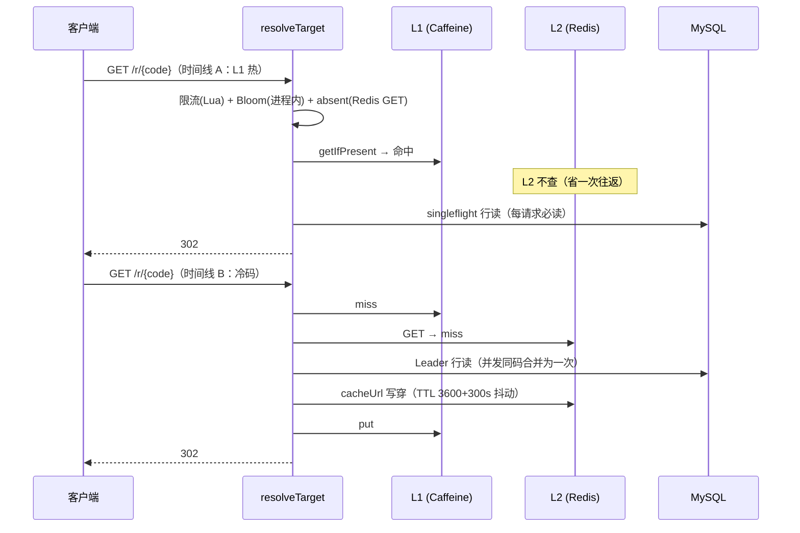

# 专题 5 · 缓存命中与未命中双时间线

> 模块 8 的四课拆了键空间、写穿双删、Bloom 与空值缓存、singleflight。本专题把它们拼成一次跳转里的四条时间线：热点码全命中、冷码全未命中、脏行与旧缓存的分叉、Redis 故障的降级。看懂这四条线，这个项目的缓存体系就没有秘密了。

## 1. 业务背景：缓存体系回答的四个问题

用户故事。运营同学的一条活动链被公众号推爆，一秒内几千次点击打到同一个码。同一时刻，另一台实例刚重启，它的内存缓存是空的；再同一时刻，扫描器正拿着一本字典逐个试不存在的码。三种流量打进同一个方法 `resolveTarget`，系统要同时对它们做对三件事：别为热点码浪费一次 Redis 往返、别为冷码浪费一次数据库全量读、别为幽灵码浪费任何一次数据库读。

更苛刻的是第四件事。缓存里可能躺着旧值：写路径刚改完 URL，某个实例的 L1 还没收到广播；行可能已经变脏：管理员改了目标但迁移工具写坏了它。缓存体系必须保证这些陈旧与脏污永远改变不了判定结果。

所以这个项目的缓存有一句总纲：缓存只许加速，不许改判定。行是权威，Redis 省的是 URL 字段读取、不存在码的数据库 miss、同码并发的重复行读（README :391 的口径，回看 [8.1](../modules/08-redis-cache/01-keys-and-ttl.md) 第 9 节）。本专题的四条时间线，就是这句总纲在四种现场的样子。

## 2. 相关类清单

| 类 | 角色 | 模块课 |
|----|----|----|
| `ShortLinkService.resolveTarget` | 12 步判定主干（:601-712），四条时间线都发生在它身上 | [7.1](../modules/07-redirection/01-decision-chain.md) 第 5.4 节 |
| `RedisRateLimiter` | 第 1 步限流，滑窗 Lua，故障 fail-open（:48-53） | [9.1](../modules/09-rate-limit/01-sliding-window-lua.md) |
| `CodeBloomFilter` | 第 2 步，进程内，负答案权威（:1078-1081） | [8.3](../modules/08-redis-cache/03-negative-cache-bloom.md) |
| `absentKnown/markAbsent` | 第 3 步空值缓存，Redis 哨兵键（:1404-1442） | [8.3](../modules/08-redis-cache/03-negative-cache-bloom.md) 第 5.1 节 |
| `UrlLocalCache` | 第 4 步 L1，Caffeine，最大 1 万条，写后 10 秒过期 | [8.2](../modules/08-redis-cache/02-l1-l2-write-through.md) 第 5.1 节 |
| `StringRedisTemplate`（L2） | 第 5 步，键 `linkforge:code:{code}`，TTL 3600+300 秒抖动 | [8.1](../modules/08-redis-cache/01-keys-and-ttl.md) 第 5.2 节 |
| `SingleFlight` + `ShortLinkRowLoader` | 第 6 步行读，并发同码合并（:649） | [8.4](../modules/08-redis-cache/04-singleflight.md) |
| `cacheUrl/evictCache` | 写穿与失效一对（:966-989） | [8.2](../modules/08-redis-cache/02-l1-l2-write-through.md) 第 5.3 节 |
| `jitteredTtlSeconds` | TTL 抖动公式 base + uniform[0, jitter]（:918-924） | [8.1](../modules/08-redis-cache/01-keys-and-ttl.md) 第 5.3 节 |
| `TargetPolicy` + `PhishingPolicy` | 第 9/11 步 B9 门禁，判行的 URL | [7.2](../modules/07-redirection/02-password-and-domain-gates.md) 第 5.5 节 |

源码路径前缀 `src/main/java/com/linkforge/` 省略，`ShortLinkService.java` 位于 `link/service/` 包。

## 3. 完整调用链：命中与未命中各一条

两条时间线共用 12 步骨架（专题 4 第 3 节有全表），下面只展开缓存相关的第 2 到 6 步与回填段。

```
时间线 A：热点码全命中（L1 热，本实例近期访问过）
GET /r/aB3xK9m
  ├─ 1 限流：Redis Lua 一次（redirect:ip:{ip}，:604-610）
  ├─ 2 Bloom 正答：进程内查位数组，零网络（:615-618）
  ├─ 3 空值缓存未命中：Redis GET linkforge:absent:{code} 一次（:623-626，实现在 :931）
  ├─ 4 L1 命中：Caffeine getIfPresent 返回 URL，零网络（:631-632）
  ├─ 5 L2 不查：L1 命中时 if (!servedFromLocal) 直接跳过（:633-644）
  ├─ 6 singleflight 行读：MySQL 一次 selectOne（:649，SingleFlight.run）
  ├─ 7-8 行校验：状态、过期、行 URL 与缓存 URL 可渲染（:656-671）
  ├─ 回填：L2 命中且通过校验 → L1 回填（:675-677）
  ├─ 9-11 门禁：B9 判行的 URL（:684）、密码门（:691）、WARN（:696）
  ├─ 12 抽签：pickVariant 查 variant 表一次（:708 → :715-721），无 variants 返回 null
  └─ 302（Location 取主 URL 或抽中变体，:709-711）

时间线 B：冷码全未命中（实例刚重启，首个请求）
GET /r/aB3xK9m
  ├─ 1-3 限流、Bloom 正答、空值缓存未命中（同上）
  ├─ 4 L1 未命中（:631，打点 l1.miss）
  ├─ 5 L2 未命中：Redis GET 返回 null，打点 cache.l2{result=miss}（:633-644）
  ├─ 6 singleflight：首个请求当 Leader 行读，同码并发者跟车（:649）
  ├─ 7-8 行校验通过 → 双回填：cacheUrl 把 URL 同时写进 L1 与 L2（:678-680 → :966-977）
  │      L2 TTL = 3600 + uniform[0,300] 秒（:967-968）
  └─ 门禁与 302 同时间线 A；下一个请求起，本实例回到时间线 A
```

幽灵码的时间线（Bloom 误报或已删码）在 7 节表格里展开：Bloom 正答放行后，行读返回 null，`markAbsent` 写 60+30 秒哨兵（:650-654 → :939-952），此窗口内重复请求在第 3 步就被挡住。

## 4. 可视化

阅读顺序：

1. [13-cache-hit-miss-sequence](../diagrams/archify/html/13-cache-hit-miss-sequence.html)：本专题主图。时间线 A 与 B 各是一段泳道：命中线看 L1 命中后 L2 分叉被跳过、行读照走；未命中线看 L1/L2 双 miss 后 singleflight 合并、行读、`cacheUrl` 预热回灌。图上行分叉的两个终端（`markAbsent` 404 与预热 302）对应第 7 节表的两行。
2. [12-redirect-decision](../diagrams/archify/html/12-redirect-decision.html)：备查。四条时间线外层的 12 步骨架与失败终态在那张图上。

Obsidian 环境可用下面这张内嵌图对照两条时间线：



## 5. 源码详解：只看跨类协作的节点

**节点一：全命中的真实开销清单。** 「缓存全热」不等于零开销。每个点击的固定成本是四次查询：限流滑窗 Lua 一次（:604-610）、空值缓存 GET 一次（:623-626）、行读一次（:649）、variant 表查询一次（`pickVariant` :708 → :715-721，无分流链返回 null 但查询照发，口径见 [7.3](../modules/07-redirection/03-variants-split.md)）。其中两次 Redis 往返、两次 MySQL 索引级查询。L1 命中省掉的只有 L2 那一次 Redis GET（:633 的 if 跳过，注释 :629-630 明写 "a hit saves a Redis round-trip but the row below is still read per request"）。教读者读性能时，这是「缓存命中率」与「每请求成本」必须分开算的实证。

**节点二：未命中是一条四级台阶，每级有各自的兜底。** Bloom 挡「从未创建」（负答案权威，直接 404，:612-614 注释）；空值缓存挡「DB 近期确认不存在」（哨兵 `"1"`，:926-952，TTL 60+30 抖动）；L1 挡「本实例 10 秒内读过」（`expireAfterWrite`，`UrlLocalCache.java:40-43`）；L2 挡「全集群 1 小时内读过」（3600+300 抖动）。四级全 miss 才落到行读，而行读有 singleflight 合并，N 个并发同码只打一次库（[8.4](../modules/08-redis-cache/04-singleflight.md) 第 5.2 节）。每一级的故障都不阻断下一级：Bloom 未就绪返 true、空值探针异常返 false、L2 异常打点继续（:636-640）。

**节点三：脏行与旧缓存，行权威的三处落地。** 其一，URL 可渲染校验先验行再验缓存值（:663-671，注释 :663-664 点名 legacy-dirty 契约），行脏必 410，陈旧缓存值掩盖不了。其二，B9 门禁判的是行的 URL（:684，注释 :682-683），不是缓存值。其三，抽签结果压过缓存 URL（:705-711，D-C3-8/10），分流链的 Location 永远来自抽签。回填同样有纪律：只有「L2 命中且已通过行门与渲染校验」的值才回填 L1（:675-677，Bw1-N1 注释），缓存全 miss 才 `cacheUrl` 预热（:678-680）。脏行与脏缓存值永远进不了 L1，这是第 8 步之后「缓存只加速」仍然成立的保障。

**节点四：预热写的是两处，失效删的也是两处。** `cacheUrl`（:966-977）先 L1 `put`（:969）再 L2 `SET ... EX ttl`（:971），TTL 抖动只向上（:918-924，防同批过期雪崩）。跳转读路径的回填（:679）与创建尾段的预热（doCreate :269）、update 的写穿（:515）共用这一个方法，所以「谁在灌缓存」只有三个调用点可查。失效方向的 `evictCache`（:979-989）与延迟双删是写路径的搭档，本专题的读视角只需知道：读到的一切 URL 值，要么来自写穿，要么来自本节这两段回填，没有第三种来源。

## 6. 正常流程：两条时间线的时刻表

时间线 A（热点码全命中，本实例 L1 热）：

| 时刻 | 位置 | 动作 | 证据 |
|----|----|----|----|
| a0 | Redis | 限流 Lua 计数并放行（redirect:ip:{ip}，默认 300 次/60 秒） | `ShortLinkService.java:604-610` |
| a1 | 进程内 | Bloom 正答（码在位数组里） | :615-618 |
| a2 | Redis | absent 键不存在，未命中 | :623-626 |
| a3 | 进程内 | L1 命中，拿到 URL，打点 l1.hit | :631-632、`UrlLocalCache.java:76-83` |
| a4 | MySQL | singleflight 行读（Leader 或跟车），行状态 1 未过期 | :649-661 |
| a5 | 进程内 | 行 URL 与缓存 URL 均可渲染；L2 值已过双校验，回填 L1 | :663-677 |
| a6 | 进程内 | 门禁全过，返回 Redirect | :684-711 |
| a7 | MySQL | pickVariant 查 variant 表，无分流返回 null | :708-711 |
| a8 | — | render 输出 302 + Location | `RedirectController.java:86-90` |

时间线 B（冷码全未命中，实例重启后首个请求）：

| 时刻 | 位置 | 动作 | 证据 |
|----|----|----|----|
| b0-b2 | Redis/进程内 | 限流放行、Bloom 正答、absent 未命中 | :604-626 |
| b3 | 进程内 | L1 miss（重启后为空），打点 l1.miss | :631 |
| b4 | Redis | L2 GET 返回 null，打点 cache.l2{result=miss} | :633-644 |
| b5 | MySQL | Leader 行读，同码并发者在此跟车（600 毫秒等待上限） | :649、`SingleFlight.java:57-100` |
| b6 | 进程内 | 状态、过期、行 URL 校验全过 | :656-671 |
| b7 | Redis | cacheUrl 预热：L2 SET，TTL 在 [3600, 3900] 秒内抖动 | :678-680、:966-977 |
| b8 | 进程内 | L1 put（预热的第一半） | :969 |
| b9 | — | 门禁与 302；下一个同码请求回到时间线 A | :684-711 |

b5 与 b7 之间隐藏着一个并发窗口：行读进行中到达的请求会跟车同一架飞行（shared 打点），它们各自的门禁与抽签仍独立执行（:645-648 注释的一致性界：跟车者最多旧一个查询延迟）。

## 7. 异常流程：Redis 全挂的降级时间线

把 Redis 从判定链里逐个拔掉，看每一步退到哪。这就是 `scripts/fault-drill.sh` 的 redis 段验证的场景（回看 [15.3](../modules/15-testing-deployment/03-compose-and-drills.md)）：

| 步骤 | Redis 挂时的行为 | 出口与证据 |
|----|----|----|
| 限流（:604-610） | Lua 执行抛异常 → failOpen 返回 allowed=true | `RedisRateLimiter.java:48-53`（定义 :98），副作用：限流失效，429 在故障期间不可能发生 |
| Bloom（:615-618） | 不受影响（进程内位数组） | `CodeBloomFilter.java:186-200` |
| 空值缓存（:623-626） | GET 抛异常 → 打日志返回 false（视为未命中） | `absentKnown` :930-936（D-Bw1-12） |
| L1（:631） | 不受影响（进程内） | `UrlLocalCache.java:76-83` |
| L2 GET（:633-644） | 抛异常 → cached 置 null 继续，打点 cache.failopen{op=l2_get} | :636-640（D-C4-15） |
| 行读（:649） | 正常（MySQL 未挂），singleflight 合并照常 | `SingleFlight.java:57-100` |
| 回填（:678-680） | cacheUrl 的 L1 put 成功，L2 SET 抛异常 → 打点 failopen{op=l2_set} | :969-976，本实例 L1 仍有值 |
| 广播（写路径侧） | 发布失败吞掉打点，对端 L1 陈旧最多到各自 TTL | `CacheBus.java:57-68` |
| 稳态 | 跳转全程 302，无一次 500；代价是限流失效加每 10 秒一次的全量重灌 | 故障演练断言的验收点 |

Redis 恢复后无需任何干预：下一次回填或写路径写穿自然把键重灌，空值缓存与限流窗口照常重建。

对照组：MySQL 挂。行读是权威且无降级路径，Leader 抛出的异常经 singleflight 原样传播给所有跟车者（`SingleFlight.java:90-99`），请求 500。这个不对称是设计出来的：缓存挂了退回数据库是「多付钱办事」，数据库挂了无处可退，因为判定所需的状态只存在于行里。

幽灵码的时间线（Bloom 误报、逻辑删码、Bloom 关闭三种成因）：

| 触发条件 | 返回 | 副作用 | 出处 |
|----|----|----|----|
| Bloom 负答（码从未创建） | 404，不碰 MySQL、不碰缓存键 | 打点 bloom.rejected | :1078-1081 |
| Bloom 正答但行读为 null（首次） | 404 | markAbsent 写哨兵，TTL 60+30 秒 | :650-654、:939-952 |
| 同一幽灵码 60-90 秒内重复请求 | 404，行读不再发生 | 打点 cache.absent.hit | :623-626 |
| 已删码（Bloom 恒阳性） | 404，每 60-90 秒付一次行读 | 无累积污染 | `ShortLinkMapper.java:13-23` |
| Bloom 未就绪/关闭 | 走 absent + 行读路径（`BloomDisabledAtStartupIT.java:78-97` 验证行读不增长） | 无 | `CodeBloomFilter.java:186-200` |

## 8. 设计取舍

**一、行权威：每请求必读 DB 行。** 四级缓存齐全，:649 照走。`UrlLocalCache` 的 javadoc（:17-24）承诺命中绝不跳过行读，:645-648 给出一致性界（跟车者最多旧一个查询延迟，远小于 1 秒双删窗口）。换来的是禁用、改密、改目标在下一个请求立即生效。专题 4 的取舍一与这里是同一枚硬币。

**二、缓存值分了可靠性等级。** Bloom 负答是权威（可以 404），正答只是提示（放行去下一级）；absent 哨兵是 DB 确认过的共享事实；L1/L2 的 URL 值永远要过行校验。四级结构不是性能堆叠，是「证据强度递减、兜底关系递进」的分层（推断，依据是 :612-614 与 :663-664 两段注释对「权威」与「提示」的用词差异）。

**三、三类 miss 三个组件，边界写在 javadoc 里。** 击穿（热点键失效瞬间 N 个并发）归 singleflight，穿透（永不存在的码）归 Bloom 加空值缓存，雪崩（同批键同时过期）归 TTL 抖动。`SingleFlight` 的 javadoc（:16-42）拒绝把它变成缓存，`markAbsent` 的注释（:650-652）拒绝收纳禁用与过期的行。每个组件只背一口锅，反例推演见 [8.4](../modules/08-redis-cache/04-singleflight.md) 练习 4。

**四、fail-open 全线朝「多付钱办事」退化。** L2 读失败退行读、空值探针失败当未命中、限流失败放行、L2 写失败保 L1。所有降级的代价都是钱（多一次查询、暂时失去限流），不是错误状态。唯一的 500 来自 MySQL 本身挂掉，因为那里没有更贵的后备了。读这套代码时，「这个 catch 之后系统处于什么状态」比「有没有 catch」重要得多。

**五、Redis 不缓存整行。** 只省 URL 字段意味着行里的状态、过期、密码哈希永远以 DB 为准（README :391 的口径）。若缓存整行，四级台阶会变三级，但禁用与改密的生效时间被 L2 的 3600 秒 TTL 绑架，「下一个请求立即生效」的契约即破。提速与一致性之间，这个项目每次都把票投给后者，然后想办法把提速的损失一级级补回来（Bloom、absent、L1、singleflight 就是四张补票）。
