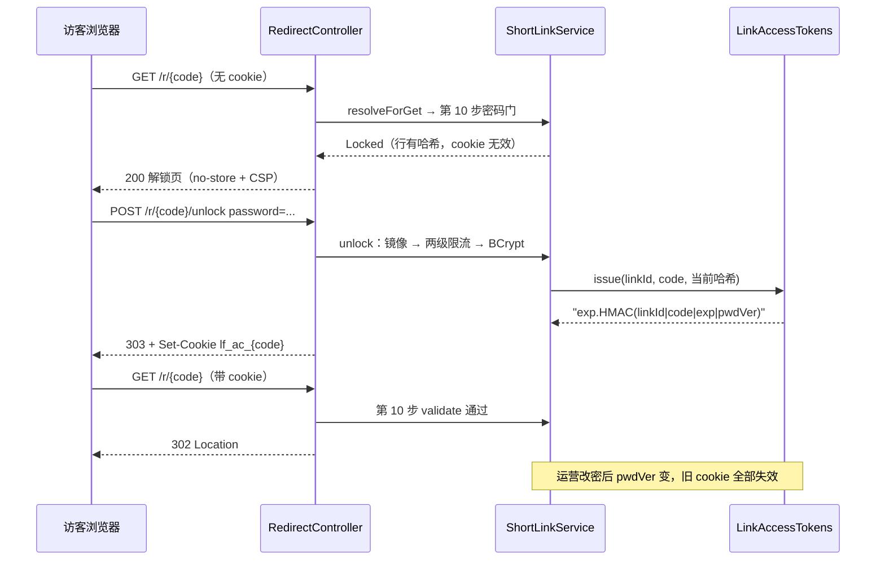

# 专题 6 · 密码短链解锁全链路

> 模块课 7.2 拆了 B3 的存储、两级限流、签名 cookie 与 B9 名单。本专题把「一次受保护访问」从头走到尾：200 解锁页、POST unlock 的顺序纪律、cookie 的签发与校验、改密后旧 cookie 如何全量失效。全程没有服务器会话，安全状态全部压进一枚签名 cookie。

## 1. 业务背景：给链接上锁，而不是给资源上锁

用户故事。运营同学要把一份内部报价单发给客户，但担心链接被转发后无限扩散。她创建短链时填了 `accessPassword`。客户点开链接，看到的是一个输入密码的页面，输入正确密码后跳到报价单。之后一小时内客户反复访问都不再需要输密码。运营中途改了一次密码，客户手里那个「已解锁」的浏览器状态立刻失效，要重新输新密码。

这套体验背后是一个明确的口径：保护入口不保护资源。系统保护的是「跳转能力」，不是行数据本身。解锁页从头到尾不显示目标 URL（`GatePages.unlock` 只回显短码），行数据的读写由管理 API 的归属判定守着（`getOwnedLink`，回看专题 3 第 5 节节点一）。访客拿不到任何可以绕过密码门的资源表示。

实现上的第二个口径是无状态。没有会话表、没有撤销表、没有 Redis 锁，解锁状态就是一枚 HMAC 签名 cookie，签名的输入绑定「当前密码哈希的指纹」。密码一改，全部旧 cookie 立即失效，撤销问题被转译成「签名输入是否还成立」。这条链路值得单独讲，因为它把「限流、慢哈希、签名、恒时比较」四件安全工具排在了一个互相咬合的顺序里，动任何一步都会破坏另一步的前提。

## 2. 相关类清单

| 类 | 角色 | 模块课 |
|----|----|----|
| `SecurityConfig` | `POST /r/*/unlock` 匿名放行（:46），GET/HEAD `/r/**` 放行（:43-44） | [7.2](../modules/07-redirection/02-password-and-domain-gates.md) |
| `RedirectController.redirect` | 受保护 GET 的入口，Locked 渲染 200 解锁页（:36-41、:98-105） | [7.1](../modules/07-redirection/01-decision-chain.md) 第 5.2 节 |
| `RedirectController.unlock` | 表单提交点：Set-Cookie 加 303（:52-82） | [7.2](../modules/07-redirection/02-password-and-domain-gates.md) 第 5.3 节 |
| `ShortLinkService.resolveTarget` | 第 10 步密码门：读行、读 cookie（:691-695） | [7.2](../modules/07-redirection/02-password-and-domain-gates.md) 第 5.2 节 |
| `ShortLinkService.unlock` | 解锁本体：镜像跳转路径 → 两级限流 → BCrypt → 签发（:753-792） | [7.2](../modules/07-redirection/02-password-and-domain-gates.md) 第 5.3 节 |
| `ShortLinkService.accessCookie` | 从请求 cookie 里找 `lf_ac_{code}`（:724-736） | [7.2](../modules/07-redirection/02-password-and-domain-gates.md) 第 5.2 节 |
| `ShortLinkService.encodeAccessPassword` | BCrypt 编码，4-64 字符（:809-819） | [7.2](../modules/07-redirection/02-password-and-domain-gates.md) 第 5.1 节 |
| `LinkAccessTokens` | 无状态签名器：issue/validate/pwdVer（:22-112） | [7.2](../modules/07-redirection/02-password-and-domain-gates.md) 第 5.4 节 |
| `GatePages` | 解锁页 HTML 与 CSP（:13、:61-83） | [7.2](../modules/07-redirection/02-password-and-domain-gates.md) 第 5.7 节 |
| `RedisRateLimiter` | 两级限流的执行者（滑动窗口） | [9.1](../modules/09-rate-limit/01-sliding-window-lua.md) |
| `ShortLinkService.update` | 改密/清密的写路径，pwdVer 失效机制的另一半（:488-503） | 专题 3 第 5 节节点五 |

源码路径前缀 `src/main/java/com/linkforge/` 省略，`ShortLinkService.java` 位于 `link/service/` 包。

## 3. 完整调用链

四段链路，前三段是同一个访客的连续动作，第四段是运营者的改密。

```
段 A：受保护 GET（无 cookie）
GET /r/aB3xK9m
  → SecurityFilterChain 放行（SecurityConfig.java:43-44）
  → RedirectController.redirect（:36-41）
  → resolveForGet → resolveTarget（:601-712）走 12 步
      ├─ 第 1-9 步与普通链一致（限流、Bloom、缓存、行读、状态、URL 校验、B9 BLOCK）
      └─ 第 10 步密码门（:691-695）：行有 accessPasswordHash 且 cookie 无效
          → 打点 linkforge.locked → 返回 Locked
  → render（RedirectController.java:98-105）：GET 输出 200 + 解锁页（no-store、CSP、nosniff）

段 B：POST /r/{code}/unlock（匿名表单）
  → SecurityFilterChain 放行（SecurityConfig.java:46，精确到 /r/*/unlock）
  → RedirectController.unlock（:52-82，javadoc :50-51：限流与 BCrypt 活在 service 层）
  → ShortLinkService.unlock（:753-792）
      ├─ 镜像跳转路径（:754-763）：Bloom/空值缓存 → singleflight 行读 → 禁用 404、过期 410
      ├─ IP 级限流（:767-773，键 unlock:code:{code}:ip:{ip}，默认 5 次/300 秒）→ 429
      ├─ 码级限流（:774-780，键 unlock:code:{code}，默认 50 次/300 秒）→ 429
      ├─ 无密码链短路（:781-783）→ UnlockResult(link, null)
      ├─ BCrypt matches（:784-788）→ 失败返回 UnlockResult(link, null)，不抛异常
      └─ 成功（:789-791）：打点 unlock{result=ok} → linkAccessTokens.issue(...)
  → controller 组装 Set-Cookie（:59-65）并以 303 跳回 /r/{code}（:66-69）

段 C：携带 cookie 的后续 GET
  → 12 步判定链照走，第 10 步密码门：
      accessCookie(request, code) 找到 lf_ac_{code}（:724-736）
      validate(cookieValue, linkId, code, 当前行哈希) 返回 true（LinkAccessTokens.java:54-75）
  → 门过，继续第 11 步 WARN 与第 12 步抽签 → 302

段 D：改密使旧 cookie 失效
  PATCH /api/links/{code} {"accessPassword": "newpass9"}
  → update：encodeAccessPassword 产新 BCrypt 哈希（:488-490、:809-819）→ updateById 落库
  → 写路径缓存尾段（专题 3）；密码门读的是行，无需清任何缓存（:689-690 注释）
  → 下一次 GET：validate 用新哈希重算 pwdVer，旧 cookie 签名对不上（:71-74）→ Locked
```

## 4. 可视化

阅读顺序：

1. [12-redirect-decision](../diagrams/archify/html/12-redirect-decision.html)：本专题主图。第 10 步「密码门」节点是段 A 的终点；图上的 unlock 回流（303 → 带 cookie 重走 GET）对应段 B 到段 C 的衔接。段 D 在图外：它改变的是第 10 步读到的行数据，不是判定链本身。
2. [13-cache-hit-miss-sequence](../diagrams/archify/html/13-cache-hit-miss-sequence.html)：备查。段 A 与段 C 的第 2-6 步（缓存与行读）在那张图上展开。

Obsidian 环境可用下面这张内嵌图看四段衔接：



## 5. 源码详解：只看跨类协作的节点

**节点一：密码门是行权威的，与缓存无关。** 第 10 步的两个条件是「与」关系：行里有 `accessPasswordHash`，且 `validate` 失败（:691-695）。行来自第 6 步的 singleflight 行读，每个请求新鲜读出，所以设密、改密、清密都在下一个请求立即生效（注释 :689-690 原文 "no cache TTL involved"）。对照 URL 字段的写穿双删三件套：密码字段根本不进缓存，一致性是免费的。`validate` 对 null cookie 直接 false（`LinkAccessTokens.java:55-57`），找不到 cookie 也是 false，两个「没有」不区分。

**节点二：unlock 的顺序纪律是四道闸，BCrypt 排最后。** 先镜像跳转路径（:754-763），让不存在的码、禁用与过期的链在限流之前就拿到与跳转面一致的 404/410，攻击者无法用 unlock 探测「限流键背后是否真有这条链」。然后 IP 级限流（:767-773）挡单点高频，码级限流（:774-780）挡分布式低速（换 IP 也会撞上码级总额 50 次/300 秒）。两级都过才碰 BCrypt（:784-788），javadoc（:749-751）一句话写明动机：brute force 绝不能换来 BCrypt 的 CPU（D-Bw345-34）。注意 BCrypt 失败不抛异常，返回 `cookieValue == null` 的 `UnlockResult`，HTTP 层的 401 由 controller 翻译，meter 按结果分桶（rate_limited / bad_password / ok）。

**节点三：cookie 的结构与校验。** 值是 `过期秒.Base64url(HMAC-SHA256(key, linkId|code|exp|pwdVer))`（issue :46-51，payload :77-79）。`pwdVer` 是当前密码哈希的 SHA-256 前 8 字节（:81-89）。校验（validate :54-75）四步：格式（点分且不在两端，:58-61）、未过期（:62-70）、用「当前行哈希」重算 HMAC（:71-73）、`MessageDigest.isEqual` 恒时比较（:74）。恒时比较是 Java 语言点：逐字节比较的耗时差可被测量，攻击者据此逐字节猜签名；`isEqual` 的耗时只与长度相关。HMAC 密钥由 JWT 密钥派生（构造器 :31-36，信息串 `linkforge:link-access:v1` 在 :25），javadoc :19-21 写明理由：不加新环境变量，轮换 JWT 密钥顺带吊销全部解锁 cookie（D-Bw345-36）。

**节点四：cookie 属性与 303。** controller 把签发结果装进 `ResponseCookie`（:59-65）：`Path=/r/{code}` 把作用域收窄到本链、`HttpOnly` 挡 JS 读取、`SameSite=Lax` 让跨站 POST 不携带它、`maxAge` 与签名 TTL 同源（`ttlSeconds` :42-44，配置默认 3600 秒，`application.yml:221-226`）、`Secure` 跟随请求是否 HTTPS。303（:66-69）的语义是「表单已处理，去别处再发一次 GET」，浏览器随后带 cookie 重走判定链。真正的 302 由 render 的 Redirect 分支给出，303 与 302 各司其职。

**节点五：改密即失效，清密即开门。** 改密（`update` 的 setPassword 分支 :488-490）换掉行里的哈希，`validate` 用新哈希算出的 `pwdVer` 与旧 cookie 签名里的指纹不同，HMAC 对不上，全部旧 cookie 立即失效（D-Bw345-35，javadoc :17-18）。无需撤销表。清密（clearAccessPassword 显式 SET NULL，:496-503）走的是另一个分支：密码门第一个条件（行有哈希）不再成立，链对所有人开放，旧 cookie 是否有效已无关紧要。两个动作一个撤销凭据、一个拆除门本身，教学上值得并排记。

## 6. 正常流程：从上锁到解锁再到失效

| 时刻 | 角色 | 动作 | 证据 |
|----|----|----|----|
| t0 | 运营 | 创建链带 accessPassword="abc12345"，4-64 字符校验后 BCrypt 入行 | `encodeAccessPassword` :809-819 |
| t1 | 访客 | GET /r/{code}，判定链走到第 10 步，行有哈希且无 cookie | :691-695 |
| t2 | 系统 | 打点 linkforge.locked，render 输出 200 + 解锁页 | `RedirectController.java:98-105` |
| t3 | 访客 | 提交表单 POST /r/{code}/unlock（password 表单字段） | :52-56 |
| t4 | 系统 | 镜像检查过、IP 限流 1/5、码级限流 1/50、BCrypt matches 通过 | `ShortLinkService.java:754-788` |
| t5 | 系统 | 打点 unlock{result=ok}，issue 签发 cookie 值 | :789-791、`LinkAccessTokens.java:46-51` |
| t6 | 系统 | Set-Cookie（Path/HttpOnly/Lax/maxAge/Secure）+ 303 跳回 | `RedirectController.java:59-69` |
| t7 | 访客 | 浏览器对 /r/{code} 发新 GET，第 10 步 validate 通过 | :691-695、`LinkAccessTokens.java:54-75` |
| t8 | 系统 | WARN/抽签照走，输出真正的 302 + Location | :696-711、:86-90 |
| t9 | 访客 | 一小时内重复访问，t7-t8 直通，不再见解锁页 | cookie TTL 3600 秒 |
| t10 | 运营 | PATCH 改密，新 BCrypt 哈希落库 | :488-490 |
| t11 | 访客 | 下一次 GET：validate 的 pwdVer 对不上，回到 t2 的解锁页 | :71-74 |

t8 之后解锁页与警示页都不计点击：Locked 与 Warn 不是 Redirect，`resolveForGet` 的 instanceof 守卫（:567）挡住了记账路径，统计只看到真正 302 的请求。

## 7. 异常流程：每个失败分支

| 触发条件 | 返回 | 副作用 | 出处 |
|----|----|----|----|
| 解锁表单密码错误 | 401 + 错误解锁页（文案「密码错误 / Wrong password」） | 打点 unlock{result=bad_password}；两级限流计数已消耗 | `RedirectController.java:71-78`、`ShortLinkService.java:784-788` |
| 密码空或缺表单字段 | 401（同上，matches 被短路，不跑 BCrypt） | 同上 | :784-785 |
| 同 IP 对同码 300 秒内第 6 次 | 429 + Retry-After | 打点 unlock{result=rate_limited} | :767-773 |
| 单码全局 300 秒内第 51 次（换 IP 也撞） | 429 + Retry-After | 同上；分布式爆破挡板 | :774-780 |
| HEAD 打受保护链（无 cookie 或 cookie 无效） | 401，无正文 | 打点 linkforge.locked | `render` :99-104（withBody=false） |
| 解锁的码不存在或 Bloom 负答 | 404 | 无 | :754-755 |
| 解锁的链已禁用 | 404（与跳转面口径一致） | 无 | :758-760 |
| 解锁的链已过期 | 410 "short link expired" | 无 | :761-763 |
| 对无密码链提交 unlock | 303 跳回，无 Set-Cookie | 两级限流计数已消耗（先于判定执行） | :781-783、:79-81 |
| 改密后持旧 cookie 访问 | 200 解锁页（validate false） | 无 | :691-695、`LinkAccessTokens.java:71-74` |
| cookie 过期（exp <= 当前秒） | 200 解锁页 | 无 | :68-70 |
| cookie 畸形（无点分、数字解析失败） | 200 解锁页 | 无 | :58-67 |
| 受保护 GET 本身 | 零持久副作用 | 只打点 locked（:693），不写任何表 | :691-695 |
| cookie 名冲突/多 cookie | 取第一个名为 lf_ac_{code} 的值 | 无 | `accessCookie` :724-736 |

读这张表注意两个不对称。其一，错密码与限流超限的状态码不同（401 对 429），客户端能区分「再试一次」与「等窗口」，但区分不了「密码错」与「码不存在」（后者是 404，是能区分的；真正的不可区分在登录链路，回看专题 1 第 7 节）。其二，两级限流在密码正确与否判定之前执行，所以正确密码也会消耗配额：连续输错 5 次后，第 6 次即使输对也是 429，这是「宁可错挡不可漏放」的口径。（推断：300 秒窗口对真人重输足够宽松，对爆破者足够昂贵。）

## 8. 设计取舍

**一、保护入口不保护资源。** 解锁页、403 拦截页都不回显目标 URL，访客在通过密码门之前拿不到任何资源表示；资源本体（行数据）由管理面的归属判定守着，与这套匿名门禁完全正交。代价是体验上多一次往返（先 200 解锁页再 POST 再 303 再 GET），收益是门禁与资源解耦，改门禁不动资源层。（推断：这套口径让 unlock 可以完全匿名化，无需引入任何访客身份概念。）

**二、无状态签名 cookie 加 pwdVer 指纹。** 服务端零存储零查询，撤销被收窄成「改密即全量失效」。pwdVer 取 8 字节而非完整哈希，是因为它只需区分「同一行的不同密码版本」，不承担抗碰撞义务（推断，依据是 payload 长度与指纹用途的权衡）。对照方案（会话表）有精确撤销能力，但要引入存储、查询与过期管理，对一个 TTL 只有 1 小时的凭据是过度设计。

**三、限流先于 BCrypt，且两级键覆盖两种攻击形态。** BCrypt 的慢是特性，先限流保证超限请求连慢哈希的门都摸不到（D-Bw345-34）。IP 级挡单点、码级挡分布式，两级窗口同 300 秒但额度差十倍（5 对 50），给同码多访客的正常场景留了余量。控制器 javadoc（:50-51）点明限流活在 service 层的原因：过滤器层的异常永远不会绕过它。

**四、无 CSRF token 的风险口径。** unlock 是匿名表单，没有 CSRF token，防线只剩 `SameSite=Lax`（跨站 POST 不携带 cookie）。真实风险要看副作用方向：伪造的跨站 unlock 请求至多让受害者浏览器多拿一枚「本就可用密码换到的」解锁 cookie，攻击者必须先知道密码，而知道密码的人本可以直接解锁。解锁动作不修改任何数据、不产生持久服务端状态，CSRF 的经典危害（以受害者身份写数据）在这里不成立。（推断：教学项目按「低危、Lax 缓冲足够」处理，生产系统应补 token 或改用 SameSite=Strict 评估。）

**五、HEAD 401 与 GET 200 的分叉。** 同一个 Locked 结果，GET 给 200 加页面（人要看表单），HEAD 给 401（程序只看状态码，HTTP 规定 HEAD 无正文）。`render` 用一个 `withBody` 布尔把两种表达收敛在一处（:98-105），监控拨测可以只凭状态码判断「这条链受保护」而无需解析 HTML。差异压在参数里，没有第二套判定代码，与专题 4 的三入口收敛是同一个手法。
