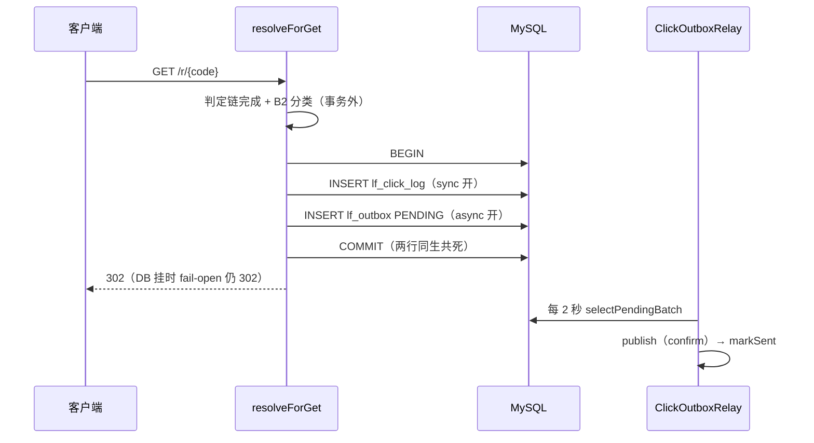

# 专题 7 · 点击记录与 Outbox

> 模块课 11.1 拆了 `ClickRecordService` 的 91 行，10.1/10.2 拆了这行离手之后的运输。本专题把散在三处的时间线拼回一起：从 302 判定完成的那一毫秒起，到 `lf_click_log` 与 `lf_outbox` 两行同事务落库，再到四个开关组合如何改写这条时间线。异常方向有两条：数据库挂与序列化炸，它们的结局刻意相反。

## 1. 业务背景：一次跳转的三个承诺

用户故事。访客点了一条短链，判定链走完，302 已经捏在手里。接下来的几毫秒里，系统要同时兑现三个承诺：

1. **跳转不被记录拖累。** 点击记录是副功能，数据库挂了它必须让路，用户照样拿到 302（fail-open）。
2. **记下的点击不因 MQ 宕机而丢。** 事件要进 RabbitMQ 做异步聚合，但跳转热路径不发 MQ。发这件事被降级成「同事务里多插一行」，行留下，MQ 恢复后再发（Transactional Outbox）。
3. **同一次点击最终恰好计一次。** 这靠 eventId 的出生规则埋下伏笔，兑现机制在消费端（专题 8）。

README 的设计句（`README.md:410`）：热路径不直接触碰 RabbitMQ，跳转产生点击后在同一 DB 事务内写同步明细与 Outbox。三个承诺全部压在一个 91 行的类和一次事务提交上。

## 2. 相关类清单

| 类 | 角色 | 模块课 |
|----|----|----|
| `ShortLinkService.resolveForGet` | 调用侧：B2 过滤 + fail-open catch（:565-585） | [11.1](../modules/11-statistics/01-click-record-pipeline.md) |
| `ClickFilter.classify` | B2 过滤，prefetch/预览爬虫跳过记录（:51-69） | [11.1](../modules/11-statistics/01-click-record-pipeline.md) 第 5.5 节 |
| `ClickRecordService` | 唯一写手，同事务双写（:40-75） | [11.1](../modules/11-statistics/01-click-record-pipeline.md) |
| `ClickEvent` | MQ 契约十字段，eventId 语义注释（:9-13） | [10.1](../modules/10-rabbitmq-outbox/01-topology-confirm.md) 第 5.7 节 |
| `ClickLog` / `Outbox` | 两种行：明细实体（event_id 列）与 outbox 实体（三状态常量 :25-28） | [11.1](../modules/11-statistics/01-click-record-pipeline.md)、[10.2](../modules/10-rabbitmq-outbox/02-outbox-relay.md) |
| `OutboxMapper` | 状态 SQL 四条；本时间线只用 `insert` | [10.2](../modules/10-rabbitmq-outbox/02-outbox-relay.md) 第 5.4 节 |
| `LinkForgeProperties.Mq` + `application.yml:177-178` | sync/async 两个开关的默认值 | [11.1](../modules/11-statistics/01-click-record-pipeline.md) 第 6 节 |
| `V2__outbox.sql` | `lf_outbox` DDL 与 event_id 列注释（:5-21） | [10.2](../modules/10-rabbitmq-outbox/02-outbox-relay.md) 第 5.3 节 |
| `ClickOutboxRelay` | 下游抽水机，每 2 秒一轮（:37-43），本专题只做边界 | [10.2](../modules/10-rabbitmq-outbox/02-outbox-relay.md) 第 5.5 节 |

源码路径前缀 `src/main/java/com/linkforge/` 省略；`ClickRecordService` 位于 `stats/service/` 包，`ClickEvent` 位于 `stats/mq/` 包。

## 3. 完整调用链：302 之后的一秒

```
GET /r/{code}
  ├─ 判定链 12 步完成，产出 RedirectOutcome.Redirect（专题 4）
  ├─ B2 分类：clickFilter.classify(request)（ShortLinkService.java:568）
  │     命中跳过 → 打点 click.skipped → 直接 return 302（:569-572，不进事务）
  ├─ try：clickRecordService.recordClick(...)（:574）
  │     Spring 代理开事务
  │     ├─ 提取：ip/ua/referer，UA 与 Referer 截断 512（ClickRecordService.java:42-45）
  │     ├─ sync 开 → 插 lf_click_log，自增 id 回填（:56-58）
  │     ├─ async 开 → eventId = "log-{id}"（id 为 null 则 UUID，:61-63）
  │     │     userId 取 UserContext，匿名即 null（:64）
  │     │     ClickEvent 十字段构造 + toJson 序列化（:65-70）
  │     │     插 lf_outbox：PENDING、attempts=0（:71-73）
  │     └─ 方法返回，代理提交，两行同落库
  ├─ catch (DataAccessException)：打点 fail-open → 302 照常（:575-581）
  ├─ 打点 linkforge.redirects（:582）
  └─ 302 返回；MQ 全程零接触

  t≤2 秒后：ClickOutboxRelay 捞 PENDING 行发布进 RabbitMQ（专题 8 接棒）
```

sync × async 两个开关（`application.yml:177-178`，生产默认都开）组合出四种行为，三个数据面各有依赖：

| sync | async | 行为 | 明细 | 聚合 totalClicks | UV |
|------|-------|------|------|-----------------|-----|
| 开 | 开（默认） | 明细 + outbox 同事务，eventId=`log-{id}` | 实时 | 经 MQ 最终一致 | 实时 |
| 开 | 关 | 只写明细，无人消费 | 实时 | 恒为 0 | 实时 |
| 关 | 开 | 只写 outbox，eventId=UUID | 消费后回填 | 经 MQ 最终一致 | 最终一致 |
| 关 | 关 | 方法体什么都不写 | 无 | 0 | 0 |

下游还有两个运输侧开关（relay-enabled、listener auto-startup，`application.yml:179` 与 :79），它们不改变这张矩阵的写入行为，只决定已写的行何时被搬运，口径见 10.2 课第 9 节。

## 4. 可视化

阅读顺序：

1. [14-click-pipeline-dataflow](../diagrams/archify/html/14-click-pipeline-dataflow.html)：本专题主图。「一次点击」节点如何分叉成 `lf_click_log` 行与 `lf_outbox` 行，B2 过滤位于事务之前，两条路在 `lf_consumed_event` 汇合（汇合段归专题 8）。
2. [04-core-class-relations](../diagrams/archify/html/04-core-class-relations.html)：核对 `ClickRecordService` 与 `ClickOutboxRelay` 之间没有箭头，只有表行解耦。
3. Mermaid 备用：[click-pipeline](../diagrams/mermaid/click-pipeline.md)。

Obsidian 环境可用下面这张内嵌图对照主时间线：



## 5. 源码详解：五个跨类节点

**节点一：同事务双写的事务形状。** `@Transactional` 标在方法上（`ClickRecordService.java:40`），事务边界是代理的方法边界，不是方法体里某一行。方法里最多两次 INSERT：sync 开插明细（:56-58），async 开插 outbox（:60-74）。两行必须同生共死：明细有了事件没有，统计丢一次；事件有了明细没有（sync 开时），消费端聚合出没有明细支撑的点击。类注释（:33-39）自称 "the only writers are this transaction"——这张表的全部写入者就是这一个事务，这是后面所有推演的地基。

**节点二：eventId 的出生规则。**

```java
            String eventId = logRow.getId() != null
                    ? "log-" + logRow.getId()
                    : UUID.randomUUID().toString();
```
（`ClickRecordService.java:61-63`）

sync 开着时，:57 的 insert 已让 MyBatis-Plus 回填自增主键（`Outbox.java:14-15` 同款 `IdType.AUTO` 机制，ClickLog 实体同理），eventId 定为 `log-{id}`。契约注释（`ClickEvent.java:9-13`）写明它的用途：实时消费与对账重放对同一次点击算出同一个键，去重天然成立。sync 关着时没有明细行可挂靠，退化为一次性 UUID，生成一次就持久化在 outbox 行里，`uk_outbox_event_id` 唯一键（`V2__outbox.sql:14`）兜住重复写入。userId 在 ：64 从 ThreadLocal 取，匿名点击是 null；明细表没有这一列，它只进 MQ 事件。

**节点三：payload 序列化与 IllegalStateException。**

```java
    private String toJson(ClickEvent event) {
        try {
            return objectMapper.writeValueAsString(event);
        } catch (JsonProcessingException ex) {
            throw new IllegalStateException("click event serialization failed", ex);
        }
    }
```
（`ClickRecordService.java:77-83`）

`lf_outbox.payload` 是 MySQL JSON 列（`V2__outbox.sql:8`），写入的是容器 `ObjectMapper` 序列化出的字符串（带 JavaTimeModule，`LocalDateTime` 才写得动）。十个字段的简单 POJO 几乎不可能序列化失败，真失败只能是代码或配置 bug，重试没有意义，所以包装成 `IllegalStateException` 直接炸。它发生在事务内，整件事（明细 + outbox）一起回滚；它不是 `DataAccessException`，会穿透调用方的 catch，302 变 500。

**节点四：fail-open catch 的三步原理。**

```java
            try {
                clickRecordService.recordClick(redirect.link(), request, redirect.variantKey());
            } catch (DataAccessException ex) {
                // fail-open (D-C5-1/6): the 302 must not depend on the click write; the tx
                // inside recordClick has already rolled back when we get here, so the catch
                // sits outside any transaction and the jump still counts as a redirect.
                meterRegistry.counter("linkforge.click.record.failopen").increment();
                log.warn("click record failed for {}: {}", code, ex.getClass().getSimpleName());
            }
            meterRegistry.counter("linkforge.redirects").increment();
```
（`ShortLinkService.java:573-582`）

第一步，事务在哪里结束。INSERT 失败时，`recordClick` 的代理回滚事务并把异常抛出方法外。执行流到达 ：575 的 catch 时，事务已回滚完毕、连接已归还，注释 ：576-578 的 "the tx has already rolled back" 就是这个意思。第二步，catch 为什么在调用方。写在 recordClick 内部、事务未结束时吞异常，代理看到正常返回会去提交一个已经回滚的事务，拖出误导性错误；放在调用方，catch 天然在事务外。第三步，只捕 `DataAccessException`。它是 Spring 翻译后的数据库异常，覆盖「MySQL 挂、锁超时、连接池枯竭」这类环境故障；`IllegalStateException` 不在此列，bug 型异常要打爆在请求路径上。兜底动作：:579 打 `linkforge.click.record.failopen`，:580 只记异常类名，:582 照常计跳转。

**节点五：B2 过滤在事务之前。** `clickFilter.classify(request)` 在 ：568 执行，返回非空 Optional 就 ：571 直接 return，根本不进 try 块。位置的含义有三层：被跳过的跳转拿到与普通请求完全相同的 302，对爬虫不暴露识别（`ClickFilter.java:12-16` 的 javadoc 口径，回看 11.1 第 5.5 节）；跳过发生在事务外，一行都不写，白付一次事务开销都省了；跳过口径很窄（prefetch 头与配置清单里的预览爬虫），curl、App WebView 都算点击，消费侧落进 device=bot 桶（11.2 的分桶规则）。识别为 bot 不等于不计数，这是 B2 过滤与维度 bot 桶的分界。

## 6. 正常流程：双写时刻表

场景：匿名访客点了一条带 A/B 分流的链，抽中 `red` 桶，两开关全开。

| 时刻 | 位置 | 动作 | 证据 |
|------|------|------|------|
| t0 | 进程内 | 判定链完成，Redirect 就绪，variantKey=`red` | 专题 4 第 3 节 |
| t1 | 进程内 | B2 分类未命中，进入 try | `ShortLinkService.java:568-573` |
| t2 | MySQL | 事务开启；UA/Referer 截断，明细行组装 | `ClickRecordService.java:42-55` |
| t3 | MySQL | INSERT lf_click_log，自增 id 回填（如 4821） | :56-58 |
| t4 | 进程内 | eventId=`log-4821`，ClickEvent 十字段构造，toJson | :61-70 |
| t5 | MySQL | INSERT lf_outbox（PENDING，attempts=0），事务提交 | :71-73 |
| t6 | 进程内 | failopen 未触发，`linkforge.redirects` 加一 | `ShortLinkService.java:582` |
| t7 | — | 302 返回；MQ 一根汗毛没碰 | 同上 |
| t8 | MySQL→MQ | ≤2 秒后 relay 捞行、publish、markSent | `ClickOutboxRelay.java:37-60` |

t5 与 t8 之间，这次点击以两种形态存在：明细行（给人看、算 UV）和 outbox 行（给机器运）。两条路最终在消费端的去重表汇合，那是专题 8 的开场。

## 7. 异常流程：两个故障方向，两种结局

**方向一：MySQL 挂（环境故障，fail-open）。** 把故障点按事务内的位置拆开：

| 故障点 | 发生什么 | 结局 | 证据 |
|--------|----------|------|------|
| t3 明细 INSERT 失败 | 异常穿出代理，事务回滚（outbox 还没插） | catch 打点 fail-open，302 照常 | `ShortLinkService.java:575-581` |
| t5 outbox INSERT 失败 | 明细已插入但事务回滚，明细行一并消失 | 同上，两行同生共死 | `ClickRecordService.java:40` 的边界 |
| 提交本身失败 | 代理回滚，同上 | 同上 | 同上 |
| 恢复后 | 无需干预，下一个点击正常双写 | 积压不存在（故障期点击本就没记） | 推断：无补偿逻辑读这张表的失败侧 |

fail-open 的代价说得出口：故障期的点击统计缺失。明细与 outbox 都没写成，没有「半行」残留，也就没有需要追平的东西。

**方向二：序列化失败（bug 型异常，传播）。** `toJson` 抛 `IllegalStateException`（:77-83）时两开关全开，异常发生在 ：70，先于 outbox INSERT，事务回滚，明细行同样消失。但调用方的 catch 只捕 `DataAccessException`，这个异常穿透，`resolveForGet` 向上抛，请求 500。两个方向的不对称是设计出来的：环境故障重试有意义、吞掉换主流程可用；bug 重试无意义，静默吞掉只会留下「跳转正常、统计全空」的假象（11.1 练习 4 的推演）。

**对照：MQ 挂。** 本专题的时间线里 MQ 根本不出现，跳转与双写照常，outbox 行堆积为 PENDING。这条故障的完整行为矩阵（Relay 退避、Reconciler 让位、恢复追平）是专题 8 与专题 9 的主场。

## 8. 设计取舍

**一、热路径不碰 MQ。** 发 MQ 是网络调用，RabbitMQ 一抖跳转就抖；Outbox 把「发」推迟到另一个线程，热路径只剩本地 DB 写（`README.md:410`）。代价是每次跳转多一次 INSERT 加一次事务提交，P2 性能排查确认同步明细写是热路径最重的一步（11.1 第 6 节口径）。项目选择付这笔钱，买「跳转与 MQ 完全解耦」。

**二、catch 在事务外才成立。** fail-open 不是「catch 住就行」：catch 必须位于事务边界之外，才不会面对「已回滚的事务还能不能继续用」的泥潭。`@Transactional` 的边界在代理方法上，所以 catch 只能写在调用方（推断的完整推演，代码注释 ：576-578 给出了结论句）。这条原理可迁移：任何「失败后主流程照走」的兜底，先问事务边界在哪。

**三、两个开关而不是一个。** 四种组合对应四种部署现实：全开是完整形态；sync-only 适合不要 MQ 的最小部署（代价是 totalClicks 恒 0）；async-only 把明细降为最终一致；全关是纯跳转。配置即架构，演练脚本靠运行时拨开关测故障（`outbox-drill.sh:44-51` 用 sync 关起独立实例）。

**四、明细行与 outbox 行都写，宁可重复存储。** 明细行支撑 UV 的精确去重（COUNT(DISTINCT ip) 只能扫明细，专题 9），outbox 行支撑异步聚合。两行冗余换来两个数据面各自最短的路径（推断：从 11.3 对 UV 与 totalClicks 来源表的分析反推）。

**五、eventId 在写入时刻决定。** 幂等键不是消费端现造的，而是热路径自增 id 一出生就定下（:61-63），穿过 outbox payload、MQ 消息、去重表三站不变。把键的生成尽量提前、来源尽量原始（决策 #10 口径，10.2 第 5.2 节引用），实时与对账两条路才有对上的可能。
