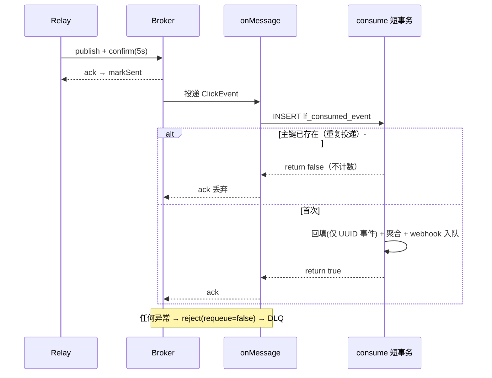

# 专题 8 · MQ 消费与幂等

> 专题 7 结束在 outbox 行被 Relay 搬走。本专题接手后半程：publish 怎么等 broker 确认，消息怎么进队列，`@RabbitListener` 怎么进 `consume` 的短事务，同一次点击的三条到达路径怎么收敛成一次计数，失败的消息怎么改道死信。幂等三要素各删一个会怎样，本专题第 5 节逐条推演。

## 1. 业务背景：at-least-once 之后的世界

投递语义是 at-least-once：重复不可避免。重复至少有三个来源。其一，Relay 在 publish 成功之后、markSent 落库之前崩溃，行还是 PENDING，重启后重发。其二，多实例部署时两个 Relay 同一毫秒各跑一次 `selectPendingBatch`，REPEATABLE READ 下都能读到同一批 PENDING 行，同一行可能被发布两次（10.2 第 5.6 节口径）。其三，MQ 自身重投。

消除重复的责任落在消费端。README 的口径（`README.md:412`）：多实例 at-least-once，消费端 eventId 幂等兜底（`lf_consumed_event` 唯一索引 + 按天累加 `lf_click_daily`）。本专题回答三个问题：同一 eventId 来两次凭什么只计一次；毒消息为什么一次失败就进 DLQ；这套机制少一个零件会坏在哪。

## 2. 相关类清单

| 类 | 角色 | 模块课 |
|----|----|----|
| `RabbitMqConfig` | 6 常量 + 6 bean：主链 exchange/queue/binding、死信链、converter（:17-62） | [10.1](../modules/10-rabbitmq-outbox/01-topology-confirm.md) 第 5 节 |
| `RabbitClickEventPublisher` | confirm 式发布，ack 之后才返回（:43-67） | [10.1](../modules/10-rabbitmq-outbox/01-topology-confirm.md) 第 5.6 节 |
| `application.yml:70-81` | confirm/returns/mandatory 三行 + listener 两行 | [10.1](../modules/10-rabbitmq-outbox/01-topology-confirm.md) 第 5.5 节 |
| `ClickEventConsumer` | 全项目唯一 `@RabbitListener`，28 行薄壳（:22-27） | [10.3](../modules/10-rabbitmq-outbox/03-consumer-idempotency-dlq.md) 第 5.1 节 |
| `ClickStatsService.consume` | 手工短事务四段体（:66-113），本专题主角 | [10.3](../modules/10-rabbitmq-outbox/03-consumer-idempotency-dlq.md) 第 5.3 节 |
| `ConsumedEvent` + `lf_consumed_event` | 主键即去重锁（`V1__baseline_schema.sql:70-73`） | [10.3](../modules/10-rabbitmq-outbox/03-consumer-idempotency-dlq.md) 第 5.2 节 |
| `ClickEvent` | eventId 确定性语义（:9-13），幂等体系的根 | [10.1](../modules/10-rabbitmq-outbox/01-topology-confirm.md) 第 5.7 节 |
| `WebhookService.recordClickDelivery` | consume 事务末尾的 webhook 入队（:247-277） | [13.2](../modules/13-webhook/02-delivery-signing-retry.md) 第 5.1 节 |

## 3. 完整调用链：从 relay 到 ack，外加死信分叉

```
ClickOutboxRelay（每 2 秒一轮，专题 7 的 t8）
  ├─ selectPendingBatch(100)：status=PENDING 且到期，ORDER BY id（OutboxMapper.java:14-17）
  ├─ attempts ≥ 30 → markFailed，本轮跳过（ClickOutboxRelay.java:48-54）
  └─ publish 五步（RabbitClickEventPublisher.java:44-67）
        ① CorrelationData(eventId)
        ② convertAndSend → exchange，路由键 click.recorded
        ③ future.get(5s) 等 ack；nack → 抛
        ④ returnedIds 命中 → 不可路由，抛
        ⑤ 中断/超时/执行异常 → 包装抛出
     成功 → markSent（OutboxMapper.java:19-20，WHERE 仅 id，口径见第 8 节）

broker：消息进 linkforge.click.queue（durable，队列声明死信参数 RabbitMqConfig.java:31-34）

监听容器（auto-startup，application.yml:79）
  └─ converter 反序列化（坏 JSON 在进方法前炸）
      → ClickEventConsumer.onMessage（ClickEventConsumer.java:23-27）
          → consume 四段体（ClickStatsService.java:70-112）
                ① 占坑：INSERT lf_consumed_event 主键；DuplicateKey → return false（:71-78）
                ② 回填：UUID 事件补明细行并打 eventId 标记（:79-93）
                ③ 聚合：lf_click_daily +1，维度桶 4 次 upsert，variant 可选（:94-105）
                ④ webhook 入队（:110）→ return true
          干净返回 → 容器 ack，消息删除
          任何异常 → 容器 reject(requeue=false)（application.yml:81）
                     → 队列死信参数 → click.dlx / click.dead → linkforge.click.dlq
```

## 4. 可视化

阅读顺序：

1. [07-rabbitmq-topology](../diagrams/archify/html/07-rabbitmq-topology.html)：六个 AMQP bean 全部落图。主链 exchange/queue/binding 的节点对应 `RabbitMqConfig.java:24-40`，死信链对应 ：42-55，`click.queue → click.dlx → click.dlq` 的改道边就是第 7 节异常链的几何。
2. [15-outbox-lifecycle](../diagrams/archify/html/15-outbox-lifecycle.html)：outbox 行的 PENDING→SENT 与 PENDING→(retry)→FAILED 每条边对应 `ClickOutboxRelay.java:48-65` 的一个分支；markSent 之前崩溃的重复窗口（第 1 节来源一）就在 PENDING→PENDING 自环上。
3. Mermaid 备用：[click-pipeline](../diagrams/mermaid/click-pipeline.md) 的 RELAY 与 CONSUME 段。



## 5. 源码详解：五个节点

**节点一：publish 的五步与四个失败出口。** 类注释（`RabbitClickEventPublisher.java:16-21`）钉死契约：nack、不可路由、确认超时都抛异常，让 relay 保持 PENDING 重试而不是静默丢点击。`CorrelationData` 用 eventId 当关联 ID（:45），confirm 回填、returns 记账、报错定位对上同一条业务消息。核心判定段逐字如下：

```java
            CorrelationData.Confirm confirm = correlation.getFuture()
                    .get(CONFIRM_TIMEOUT.toSeconds(), TimeUnit.SECONDS);
            if (confirm == null || !confirm.isAck()) {
                throw new IllegalStateException("broker nacked event " + event.getEventId());
            }
            if (returnedIds.remove(correlation.getId())) {
                throw new IllegalStateException("unroutable event " + event.getEventId());
            }
```
（`RabbitClickEventPublisher.java:52-59`）

不可路由的检测分两半：`publisher-returns: true` 加 `template.mandatory: true`（`application.yml:73-75`）让 broker 把投不出去的消息退回原文，`@PostConstruct` 的回调把退件的 correlationId 记进并发集合（:33-41），publish 拿到 ack 后查集合，`remove` 返回 true 同时完成查询与清账。次序有讲究：不可路由的消息同样会收到 ack（broker 确实「处理」了它），confirm 证明收了、returns 才发现投不出去。5 秒超时（:27）保护的是共享调度线程：`Future.get` 无限等会把 6 线程池里的线程逐个占死（`application.yml:12`）。

**节点二：薄门 onMessage 与容器语义。** 消费者 28 行（`ClickEventConsumer.java:22-27`），javadoc（:10-14）三句话是消费端契约：干净返回 ack；异常拒绝不重回队列进 DLQ；重复 eventId ack 但不再计数。参数直接声明为 `ClickEvent`，容器用 `RabbitMqConfig.java:57-62` 复用容器 `ObjectMapper` 的 converter 反序列化（消息头 `__TypeId__` 指明目标类）。坏 JSON 或类型不匹配的异常发生在进方法之前，效果等同 onMessage 抛异常，一样进 DLQ。容器行为由两行配置决定：

```yaml
        auto-startup: ${LINKFORGE_MQ_LISTENER_AUTO_STARTUP:true}
        default-requeue-rejected: ${LINKFORGE_MQ_DEFAULT_REQUEUE_REJECTED:false}
```
（`application.yml:79-81`）

`default-requeue-rejected: false` 是 DLQ 链能生效的前提：容器捕获消费者异常后发 `basic.reject(requeue=false)`，broker 按队列参数改道死信。这行若缺席（默认 true），消息回队头立刻再消费再抛，热循环烧 CPU。

**节点三：consume 的手工短事务。** 这个类没用 `@Transactional`，构造器里注入 `PlatformTransactionManager` 自己 new 了 `TransactionTemplate`（`ClickStatsService.java:53`）。回调体就是事务边界（:70），四段一体：占坑、回填、聚合、webhook 入队。占坑段逐字如下：

```java
            try {
                ConsumedEvent row = new ConsumedEvent();
                row.setEventId(event.getEventId());
                row.setConsumedAt(LocalDateTime.now());
                consumedEventMapper.insert(row);
            } catch (DuplicateKeyException ex) {
                return false;
            }
```
（`ClickStatsService.java:71-78`）

主键值由代码手动提供，实体的 `IdType.INPUT`（`ConsumedEvent.java:14-16`）与 outbox 的 `IdType.AUTO`（`Outbox.java:14-15`）形成对照：一个不自增、由业务键占坑，一个靠数据库生成。javadoc（:56-60）给出原子性理由："a crash between them can neither double count nor silently drop a click"。拆开事务的两种死法：去重提交了、聚合没提交，这条点击永远被去重表挡住，静默丢失；聚合提交了、去重没提交，重复投递再次完整聚合，双重计数。MySQL 对 duplicate key 只回滚失败语句（:59-60 注释的依据），占坑是事务第一个语句，撞主键时事务以空操作干净提交，`return false` 是「重复已确认」不是失败——consumer 打 counted=false 后照常 ack。回填段只对 UUID 事件生效（:79 条件），重建的明细行在 ：91 打上自己的 eventId，这个标记是三要素之三。

**节点四：幂等三要素，少一个会怎样。** 同一次点击（双开关全开）有三条到达路径：MQ 实时、relay 重发、Reconciler 重放（专题 9）。三要素各堵一路：

| 要素 | 位置 | 堵哪路 | 删掉它的具体后果 |
|------|------|--------|------------------|
| 去重表主键 INSERT | `ClickStatsService.java:71-78` | MQ 层重复 | relay 在 markSent 前崩溃重发，两次都完整聚合，`lf_click_daily` +2 |
| 确定性 eventId `log-{id}` | `ClickRecordService.java:61-63`、`ClickEvent.java:9-13` | 实时与对账撞车 | 改随机 UUID 后 Reconciler 按 `CONCAT('log-', l.id)` 找不到去重行，同步明细被重放成 `log-{id}` 事件，二次计数 |
| 回填行 event_id 标记 | `ClickStatsService.java:91` | 回填与重放错认 | sync 关闭时回填行 event_id 为 NULL，扫描条件 `l.event_id IS NULL` 放行，重放二次计数 |

三要素的分工：要素一管「同一消息来两次」，要素二管「两个独立系统对同一次点击算出同一个键」，要素三管「回填行别被对账错认」。三条路径两两可能撞车，缺任何一个都会在某种路径组合下计两次（10.3 第 5.4 节推演口径）。

**节点五：webhook 入队搭幂等便车。** 占坑成功的点击在同一事务末尾调 `recordClickDelivery`（`ClickStatsService.java:110`），落一条 PENDING 投递行。重放事件在 ：76-78 早退，永远走不到 ：110，所以一个 eventId 不可能入队两次（:106-109 注释引用决策 D-Bw2-9）。`recordClickDelivery` 内部有四个出口（`WebhookService.java:247-277`）：feature 关直接 return（:248-252）；无 enabled endpoint 算正常（:257-259）；撞 `uk_webhook_endpoint_event` 捕获 DuplicateKey 打点吞掉（:270-271）；其他异常重新抛出（:272-276）。出口四最关键：非重复失败向上传播，整个 consume 事务回滚，统计与投递意图「要么都成功要么都没有」，消息进 DLQ 等重投。

## 6. 正常流程：一条消息与它的分身

时间线 A（首发成功）：

| 时刻 | 动作 | 证据 |
|------|------|------|
| r0 | relay 捞到 PENDING 行，attempts=0 < 30 | `ClickOutboxRelay.java:45-47` |
| r1 | readValue 还原 ClickEvent，publish 五步，confirm ack | :56-60、`RabbitClickEventPublisher.java:44-66` |
| r2 | markSent：status=SENT，sent_at=NOW() | `OutboxMapper.java:19-20` |
| r3 | broker 按绑定投进 click.queue，容器推给 onMessage | `RabbitMqConfig.java:37-40`、`ClickEventConsumer.java:23` |
| r4 | 占坑成功，聚合 +1，维度 4 桶，webhook 入队，return true | `ClickStatsService.java:71-111` |
| r5 | 容器 ack，消息删除；debug 日志 counted=true | `ClickEventConsumer.java:25-26` |

时间线 B（同一 eventId 再来一次）：r4 的占坑 INSERT 撞主键，:76-78 捕获返回 false，事务以空操作提交，onMessage 打 counted=false 后干净返回，容器 ack。`lf_click_daily` 纹丝不动。`ClickIdempotencyIT.java:71-87` 在服务层连喂三次同一事件验证的就是这条线（断言口径见 10.3 第 8 节）。

## 7. 异常流程：DLQ 与毒消息

消费异常的改道链只有三步：异常穿出 onMessage → 容器按 `application.yml:81` 发 `basic.reject(requeue=false)` → broker 按队列死信参数（`RabbitMqConfig.java:31-34`）投 `click.dlx`、路由键 `click.dead`，落 `linkforge.click.dlq`（:47-55）。按异常来源逐分支看出口：

| 异常来源 | 事务状态 | 消息去向 | 数据后果 |
|----------|----------|----------|----------|
| 坏 JSON / 类型不匹配（进方法前） | 未进事务 | DLQ | 无任何写入 |
| DB 断连（占坑 INSERT 失败，非重复） | 回滚 | DLQ | 无写入；重投后从占坑重来 |
| webhook 入队非重复失败（:272-276） | 回滚（日表 +1 也回滚） | DLQ | 数据库回到消费前状态，重投不丢不重 |
| 去重撞主键 | 空操作提交 | ack 丢弃 | 不计数（这不是异常，是幂等正常工作） |
| readValue 反序列化 outbox payload 失败（relay 侧） | 无事务 | 不发出去，行退避重试 | 30 次后 FAILED（`ClickOutboxRelay.java:61-65`） |

毒消息（poison message）是必然失败的消息：payload 损坏、加字段后旧消息反序列化失败、某行数据触发的必然 NPE。消费端没有重试计数器，一次失败即隔离进 DLQ，换来的主链吞吐稳定与失败现场保存。对照同仓库 webhook 投递的 8 次退避（13.2 第 5.5 节），差异根源在失败性质：远端 HTTP 抖动值得退避，消费失败多是代码或数据问题，快速隔离换人工更有利（推断：代码未注释此取舍，从失败模式分布推出）。

DLQ 的运营面（10.3 第 5.5 节口径）：`linkforge.click.dlq` 没有消费者，人工是唯一出口。排障顺序是先看消息体定位异常、修 bug，再从 RabbitMQ management 插件或 shovel 把消息搬回主队列。DB 恢复后 DLQ 里的消息不会自动复活；重投后 consume 从占坑完整走一遍，去重行已随当时的事务回滚，能重新插入，不丢也不重（10.3 剧本三口径）。

多实例与崩溃窗口的两个补偿事实：`markSent` 的 WHERE 只有 `id = #{id}`（`OutboxMapper.java:19-20`），重复执行只是把 SENT 写成 SENT，幂等无害；两个 relay 并发发布同一行会制造重复消息，但那正被要素一消化。这个无守卫写法与 webhook 侧三条 mark 全带 `AND status='PENDING'`（`WebhookDeliveryMapper.java:27-39`）的对照是登记在案的口径（issues §4.10）：差异根源在写者数量与在途时长，outbox 行只有 relay 一个写者。

## 8. 设计取舍

**一、手工 TransactionTemplate 而不是 @Transactional。** 边界由代码显式划在 lambda 里，强调「去重 + 聚合是一个不可再分的短单元」；catch DuplicateKey 发生在回调内部，异常没有越过任何事务边界，提交干净。注解式也能写对，但边界固定成整个方法；手工模板还有个实际收益：Reconciler 逐行循环调 `consume`，每行各自成短事务，长事务风险小（推断：附加理由是从调用形态推出的，代码注释只写了 MySQL 语句级回滚）。短是刻意的：事务内毫秒级几个写，锁持有时间极短，不阻塞统计读。

**二、INSERT 即锁。** 占坑不用「先 SELECT 再 INSERT」，直接插主键让唯一索引裁决，撞了捕获 `DuplicateKeyException` 早退。并发下「查了再插」有窗口，INSERT 冲突是数据库原子判定的；与决策 #11 否决的「ON DUPLICATE KEY UPDATE 探测」对照，判断标准是返回值是否承担语义（计数场景丢弃返回值，探测场景信不得，Connector/J matched rows 口径见 11.2 第 5.2 节）。DB 主键比内存去重、Redis SETNX 强在与业务数据同一个存储、同一个事务。

**三、确定性 eventId。** at-least-once 消重的前提是「同一件事在不同路径算出同一个键」。`log-{id}` 从热路径自增 id 出生，实时消费与对账重放共用（`ClickEvent.java:9-13`）；UUID 模式靠持久化在 outbox 行内保持稳定。幂等键的生成时机尽量提前、来源尽量原始（10.3 第 9 节口径）。

**四、重复交给成本最低的位置。** 发布端无论怎么努力都消不掉「发布成功、确认丢失」的窗口；分布式锁或 SELECT FOR UPDATE 会把复杂度塞进关键区。一次主键 INSERT 是全部方案里最便宜的消重，所以项目让重复发生、把责任推给消费端（`README.md:412`）。这是「谁成本低谁兜底」的典型分派。

**五、DLQ 只存不消费。** `linkforge.click.dlq` 没有消费者，也不设二次重试。主链吞吐因此不被坏消息拖累，失败现场完整保留（推断：从「DLQ 无消费者、人工处理」的配置事实反推的设计意图）。代价是死信需要人工巡检，没有任何自动救济；去重表 `lf_consumed_event` 也因此没有清理任务，永久增长，每行约 64 字节主键加时间戳（10.3 第 5.5 节的估算口径），这是「永远去重」买下的存储成本。
