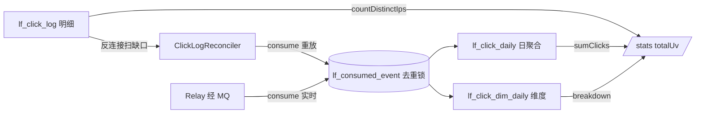

# 专题 9 · 统计与对账补偿

> 专题 7 写下两行存根，专题 8 消费掉消息。本专题收尾：看板上的每个数字从哪张表读出来，UV 为什么依赖 sync 双写，Reconciler 怎么扫出「同步写了但没人聚合」的明细行补上，断 MQ 期间各组件排成什么矩阵，恢复后靠什么口径宣布追平。

## 1. 业务背景：看板数字从哪来，缺了谁补

管理员打开看板，`GET /api/links/{code}/stats` 返回 totalClicks、totalUv 和一条按日曲线。四个数来自两张表：totalClicks 读聚合表 `lf_click_daily`（经 MQ 的最终一致值），totalUv 与按日 UV 读明细表 `lf_click_log`（精确 COUNT(DISTINCT ip)）。两条来源的写入者不同，于是出现一个必须回答的问题：MQ 断了，聚合表停滞，明细表还在涨，谁把账追平。

答案是双通道：主通道 Relay 抽 outbox 行经 MQ 进 consume（专题 8）；备通道 `ClickLogReconciler` 每 30 秒扫「明细有、消费记录没有」的行，直接调同一个 consume。两条通道汇合在去重表的主键上，谁先到谁计数。README 的对账口径（`README.md:414`）：Reconciler 默认 30 秒一轮、仅 sync 开启时运行；sync 关闭时追平完全由 outbox 通道承担。

## 2. 相关类清单

| 类 | 角色 | 模块课 |
|----|----|----|
| `StatsController` | 三端点唯一入口，先 detail 归属校验（:33-65） | [11.3](../modules/11-statistics/03-stats-api-reconciler.md) 第 5.1 节 |
| `ClickStatsService`（读半边） | stats/breakdown/clicks 的 SQL 编排（:116-153） | [11.3](../modules/11-statistics/03-stats-api-reconciler.md) |
| `ClickDailyMapper` | incrementClick upsert（:16-22）、sumClicks（:24-25）、selectRange（:27-31） | [11.2](../modules/11-statistics/02-aggregation-dimensions.md) 第 5.2 节 |
| `ClickDimDailyMapper` | 维度 upsert 与 selectBreakdown | [11.2](../modules/11-statistics/02-aggregation-dimensions.md) |
| `ClickLogMapper` | selectUnconsumed 反连接（:14-18）、countDistinctIps（:20-24） | [11.3](../modules/11-statistics/03-stats-api-reconciler.md) 第 5.4 节 |
| `ClickLogReconciler` | 门禁、扫描、重放三段（:30-53），本专题主角 | [11.3](../modules/11-statistics/03-stats-api-reconciler.md) 第 5.4 节 |
| `SentRowCleanup` | outbox SENT 行 7 天清理（:52-72） | [10.2](../modules/10-rabbitmq-outbox/02-outbox-relay.md) 第 5.7 节 |
| `scripts/mq-drill.sh` / `outbox-drill.sh` | 断 MQ 演练的两份验收口径 | [15.3](../modules/15-testing-deployment/03-compose-and-drills.md) |

## 3. 完整调用链：三条读链与一条补偿链

```
读链（实时性各不相同）
GET /stats        → detail 归属校验（StatsController.java:36）
                    → sumClicks（lf_click_daily，全历史聚合，ClickDailyMapper.java:24-25）
                    → countDistinctIps（lf_click_log，窗口 [from, 明日 0 点)，ClickLogMapper.java:20-24）
                    → selectRange + selectDailyUv 两 Map → 逐日补零循环（ClickStatsService.java:137-140）
GET /stats/breakdown → 白名单校验（StatsController.java:49-51）→ lf_click_dim_daily 按 dim_type 切片
GET /clicks        → MyBatis-Plus 分页扫 lf_click_log，只投影 4 字段（ClickStatsService.java:144-153）

补偿链（每 30 秒，ClickLogReconciler.java:30-53）
  ├─ 门禁：async && sync 都开才跑（:33-35）
  ├─ 扫描：selectUnconsumed(500)（:37 → ClickLogMapper.java:14-18）
  │     LEFT JOIN lf_consumed_event ON c.event_id = CONCAT('log-', l.id)
  │     WHERE c.event_id IS NULL AND l.event_id IS NULL
  ├─ 重放：new ClickEvent("log-{id}", ...) → clickStatsService.consume(...)（:40-43）
  └─ 双层 catch：行级 warn 继续（:44-46），整轮失败放弃等下轮（:51-53）
```

## 4. 可视化

阅读顺序：

1. [14-click-pipeline-dataflow](../diagrams/archify/html/14-click-pipeline-dataflow.html)：本专题主图。「consume」节点同时接 live 与 reconcile 两条入边，去重锁是汇合点；三张统计表与去重表的写入方向全在图上。
2. [08-scheduled-tasks](../diagrams/archify/html/08-scheduled-tasks.html)：Relay 的 2s/3s 与 Reconciler 的 30s/15s 并列，两个搬运工共享 6 线程调度池（`application.yml:12`）。
3. [05-database-erd](../diagrams/archify/html/05-database-erd.html)：核对四张表、两个唯一键与 `lf_click_log.event_id` 的逻辑引用。
4. Mermaid 备用：[click-pipeline](../diagrams/mermaid/click-pipeline.md)。



## 5. 源码详解：五个节点

**节点一：三表一锁的表间关系。** 一次被消费的点击最多写 9 行（明细 1 + 日聚合 1 + 维度最多 5 + 去重 1 + webhook 意图 1；sync 开且无 variant 时 7 行）：明细（仅 UUID 事件回填）、1 行日聚合、4 行固定 UA 维度加命中 variant 时的 1 行（C3）、1 行去重、租户有 enabled endpoint 时的 1 条 webhook 投递意图。聚合的承重墙是一条 upsert：

```java
    @Insert("INSERT INTO lf_click_daily(tenant_id, link_id, code, stat_date, clicks) "
            + "VALUES(#{tenantId}, #{linkId}, #{code}, #{statDate}, 1) "
            + "ON DUPLICATE KEY UPDATE clicks = clicks + 1")
    int incrementClick(...);
```
（`ClickDailyMapper.java:16-22`，参数列表节选）

桶行不存在就建、存在就加，SQL 级原子，返回值被丢弃（与决策 #11 否决的探测用法分界，11.2 第 5.2 节口径）。四张表的粒度与写入者：

| 表 | 粒度 | 承重唯一键 | 写入者 |
|----|------|-----------|--------|
| `lf_click_log`（明细） | 每次点击一行 | 主键自增；event_id 列是标记位（`V2__outbox.sql:18-21`） | 热路径 sync 分支，或消费者回填（`ClickStatsService.java:79-93`） |
| `lf_click_daily`（日聚合） | 每链每天一行 | `uk_daily_link_date`（`V1__baseline_schema.sql:66`） | 仅 consume 的 upsert（`ClickDailyMapper.java:16-22`） |
| `lf_click_dim_daily`（维度） | 每链每天每维度每桶 | 四元组 `uk_dim_link_date_value`（`V3__click_dim_daily.sql:15`） | 仅 consume（`ClickStatsService.java:97-105`） |
| `lf_consumed_event`（去重） | 每 eventId 一行 | 主键（`V1__baseline_schema.sql:70-73`） | 仅 consume 占坑（:71-78） |

聚合表与去重表没有别的写入者，这是「对账必须重放 consume 而不能直接 UPDATE 统计表」的全部理由：绕过 consume 就绕过了维度桶、webhook 入队与去重的一致性。

**节点二：UV 的前提。** UV 是窗口内不同 IP 数：`SELECT COUNT(DISTINCT ip) FROM lf_click_log ...`（`ClickLogMapper.java:20-24`），精确值，没有近似结构。它依赖明细表有行。双开关全开时明细实时写入，UV 实时。sync 关闭时明细改由消费者回填（:79-93），UV 退化为最终一致但仍可用（`README.md:413` 口径）。sync-only（async 关）时反过来，UV 正常而 totalClicks 恒 0——聚合表的唯一写入者是 consume，没人消费就没人写。读侧的 Service javadoc（`ClickStatsService.java:122-125`）把这层依赖写在注释里。days 参数钳制在 1..90（`StatsController.java:37`），给明细表上的 COUNT DISTINCT 扫描范围封顶。breakdown 的维度口径单独一句：javadoc（`StatsController.java:44`）写明 "Dimension clicks are not UV"，桶之和可以大于 UV，一个 UV 可以换设备多点几次。

**节点三：Reconciler 的门禁，为什么 sync 关时必须让位。** `if (!async || !sync) return;`（`ClickLogReconciler.java:33-35`）。两个方向各有硬理由。sync 关时，热路径不产明细行，唯一存在的明细是消费者回填的，它们在 ：91 打了 UUID 标记，扫描条件 `l.event_id IS NULL`（`ClickLogMapper.java:16`）本来就会把它们全部排除——循环一无所获，跑下去只是空转轮询，而这一模式下的追平职责已移交给 outbox 通道（`README.md:414` 的原文）。async 关时更根本：部署者明确不要 MQ 聚合，consume 产出的数字无人承诺可读（11.1 矩阵第三行），安全网不该替部署意图干活。类注释（:14-20）自述边界："this loop is skipped entirely while the sync write is off"。

**节点四：扫描与重放。** 扫描 SQL 逐字如下：

```java
    @Select("SELECT l.* FROM lf_click_log l "
            + "LEFT JOIN lf_consumed_event c ON c.event_id = CONCAT('log-', l.id) "
            + "WHERE c.event_id IS NULL AND l.event_id IS NULL "
            + "ORDER BY l.id LIMIT #{limit}")
    List<ClickLog> selectUnconsumed(@Param("limit") int limit);
```
（`ClickLogMapper.java:14-18`）

反连接找出「明细有、消费记录没有」的行，两个 IS NULL 各挡一路重复：`c.event_id IS NULL` 排除已被任何通道消费过的行；`l.event_id IS NULL` 补刀排除消费者回填的行（回填行的消费记录是 UUID，与 `log-{id}` 探针永远 join 不上，第一个条件挡不住它）。`ORDER BY l.id LIMIT 500`（:37）按主键序分批，故障积压时多轮追平。重放构造（:40-43）手工 new ClickEvent，eventId 就是 `log-{id}`，与实时链路同一键；userId 置 null，明细表没存这个字段，重放无从恢复，代价只是 webhook payload 少一项。重放与实时并发赛跑时，两者只会有一个插进去重表（主键即锁），后到的早退。四种情形都收敛到恰好计一次：live 已消费则早退；live 未消费则本轮计；本轮失败行留扫描结果下轮再来；并发则主键裁决。双层 catch 的含义：行级 catch（:44-46）保证一行毒数据不拖垮整批；外层 catch（:51-53）兜扫描 SQL 本身的失败，整轮放弃等下轮。对账循环自己永远不该死，也不该把一批坏行变成死循环。

**节点五：对账 SQL 实操。** 运维手上就三条 SQL。第一，看缺口：`SELECT COUNT(*) FROM lf_click_log l LEFT JOIN lf_consumed_event c ON c.event_id = CONCAT('log-', l.id) WHERE c.event_id IS NULL AND l.event_id IS NULL;`（即 selectUnconsumed 去 LIMIT 的形状，`ClickLogMapper.java:14-18`）。第二，重放 FAILED 的 outbox 行：`UPDATE lf_outbox SET status='PENDING', next_attempt_at=NULL WHERE status='FAILED';`（`README.md:412` 的标准答案；status 拨回让 relay 捞起，next_attempt_at 置 NULL 跳过退避，消费端幂等吸收已算过的部分）。第三，核对两边应相等（`README.md:415`）：明细中被消费的 `log-{id}` 数应等于聚合 totalClicks。演练脚本用的探针 SQL 同型：`outbox-drill.sh:70-71` 按状态数 outbox 行、:96 按 DISTINCT ip 算 UV。SENT 行的退场由 `SentRowCleanup` 管（`SentRowCleanup.java:63-69`），只删终态，PENDING/FAILED 永不删。

## 6. 正常流程：三条读链与一轮对账

三个端点的取数全景（实时性由写入侧决定）：

| 端点 | 数字 | 来源表与 SQL | 实时性 |
|------|------|--------------|--------|
| /stats | totalClicks | `lf_click_daily`，sumClicks 点查（`ClickDailyMapper.java:24-25`） | 经 MQ 最终一致 |
| /stats | totalUv | `lf_click_log`，countDistinctIps（`ClickLogMapper.java:20-24`） | sync 开实时；sync 关最终一致 |
| /stats | daily 曲线 | selectRange + selectDailyUv 两 Map，缺日补零（`ClickStatsService.java:137-140`） | 同上两行 |
| /stats/breakdown | 五维桶 | `lf_click_dim_daily` 按 dim_type SUM（11.2 写入、11.3 读出） | 经 MQ 最终一致 |
| /clicks | 明细分页 | `lf_click_log`，只投影 clickedAt/ip/userAgent/referer（:144-153） | sync 开实时；sync 关最终一致 |

一轮对账（正常态多为空转）：

| 时刻 | 动作 | 证据 |
|------|------|------|
| 启动 +15 秒 | 首轮 reconcile（fixedDelay 30 秒，上一轮结束后再计时） | `ClickLogReconciler.java:30-31` |
| 门禁 | 两开关全开，继续；否则整轮 return | :33-35 |
| 扫描 | selectUnconsumed(500)，反连接走表达式 join，无索引可用，靠 LIMIT 控量 | `ClickLogMapper.java:14-18` |
| 重放 | 逐行 consume，每行一个独立短事务 | `ClickLogReconciler.java:38-47` |
| 收尾 | 有重放打 info 日志 reconciled N rows | :48-50 |

正常态下 live 通道已把每行消费记录写好，反连接一个都扫不出来，对账是免费的巡逻。它只在故障期才开始干活。

## 7. 异常流程：断 MQ 期间的行为矩阵与恢复追平

故障幕（RabbitMQ 停机，双开关全开），逐组件：

| 组件 | 故障期行为 | 证据 |
|------|-----------|------|
| 跳转 | 全部 302，不受任何影响 | `mq-drill.sh:52-56` 的 PASS 口径 |
| 双写 | 明细行 + outbox 行照常各积一行 | 专题 7 的时间线 |
| Relay | 每 2 秒醒来发布失败，markRetry 退避 `min(60, 2^n)`，行堆 PENDING | `ClickOutboxRelay.java:61-65`、:75-78 |
| 对账器 | 不让位（双开关仍开），每 30 秒扫出未消费明细直接 consume，聚合表在 MQ 恢复**之前**就开始增长 | `ClickLogReconciler.java:33-37` |
| UV / 明细 | 实时，无缺失 | `ClickLogMapper.java:20-24` |
| totalClicks | 经备通道最终一致地追 | 上一行 |

sync 关闭的变体（outbox-drill 剧本）：故障期明细为 0、outbox 积 PENDING、UV 为 0，全部数据押在 outbox 行上，恢复后由消费回填补齐。

恢复幕的时间线（MQ 重新健康之后）：

| 阶段 | 动作 | 机制 |
|------|------|------|
| 1 | Relay 抽走积压 outbox 行，批 100/2 秒 | `ClickOutboxRelay.java:45`、`application.yml:180-181` |
| 2 | 对账器继续每轮 500 行扫缺口 | `ClickLogReconciler.java:37` |
| 3 | 两通道抢同一批行的消费权，主键裁决只计一次：live 先到则重放早退；重放先到则 live 早退 | `ClickStatsService.java:71-78` |
| 4 | Relay 30 次重试耗尽标 FAILED 的行，对账器持续扫到消费为止 | `OutboxMapper.java:22-23`、11.3 练习 3 口径 |
| 5 | 聚合、明细（sync 关时）、SENT、UV 各自收敛，PASS | 见下 |

两份 drill 的 PASS 行是追平的验收口径：

- `mq-drill.sh:46`（基线 N 收敛）、:56（故障期 M 次 302）、:74（`PASS recovery: stats converged to N+M (reconcile caught up)`）。
- `outbox-drill.sh:83`（`PASS outage: ... outbox PENDING=M, hot-path detail=0, relay attempts>=1`）、:98（`PASS recovery: aggregate=M, consumer-written detail=M, outbox SENT=M, UV>=1`）。

第二份脚本覆盖 sync 关闭模式：聚合、消费回填的明细、SENT、UV 四个数各自收敛到 M（:89-97 的四个断言段）。积压规模对追平时长的关系是线性的：N 行积压约需 max(N/500 轮 × 30 秒, N/100 轮 × 2 秒) 量级（推断：按两通道各自的批上限与节奏纸面推算，实际以重放消耗为准）。

## 8. 设计取舍

**一、最终一致性的边界画在「承诺收敛」而不「承诺实时」。** totalClicks 从不承诺实时，承诺的是 drill 那句 converged：故障恢复后追平（`mq-drill.sh:74`）。UI 上「看到晚几秒」与「永久少一笔」被明确分开，前者是模式代价，后者被双通道加去重杜绝。读代码时先找这条边界，再看实现，顺序不能反。

**二、安全网重放主路径，不另写聚合 SQL。** Reconciler 调同一个 consume（`ClickLogReconciler.java:40-43`），不直接 UPDATE 统计表。另写 SQL 等于把幂等与维度逻辑复制一份，两处必然漂移；直接 UPDATE 绕过去重锁与 webhook 入队的一致性。重放主路径是安全网的正确姿势（11.3 第 9 节口径）。

**三、门禁让位是边界写进代码。** sync 关时备通道无事可做（回填行带标记，扫描天然排除），让位避免空转轮询；async 关时尊重部署意图。把「这个循环适用于什么部署」从口头约定变成 ：33-35 的两个条件，误用空间为零。

**四、一次点击两个存根，买的是通道冗余。** 明细行与 outbox 行是同一点击的两份记录，平时冗余，故障时各自撑起一条通道：outbox 行撑 live 重发，明细行撑对账重放。代价是每跳多一次写加 7 天的 outbox 保留（`SentRowCleanup.java:64`）。删掉任何一个存根，双通道塌成单通道，恢复故事只剩一半。

**五、UV 选精确去重，用窗口钳制付账。** COUNT(DISTINCT ip) 随窗口线性变贵，90 天钳制（`StatsController.java:37`）就是给这个代价封顶；聚合表存不了「窗口内 IP 集合」，所以 UV 不走预聚合（推断：从两表分工反推）。单链单租户的规模下精确值比 HyperLogLog 的近似更对，量级上去才值得换。
