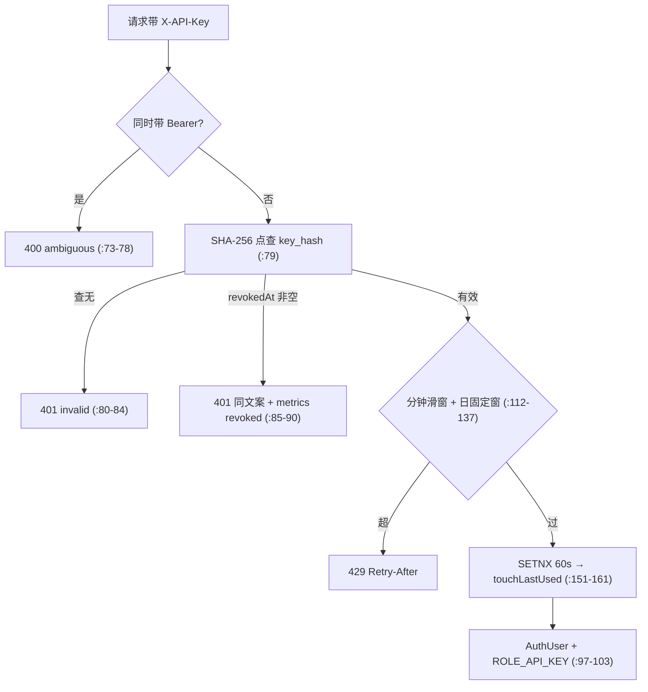

# 专题 10 · API Key 认证全链路

> 模块 12 把 apikey 包的 5 个文件逐个讲过。本专题把它们串成一条完整的生命线：一把 key 怎么被铸造（明文只出现一次、库里只有哈希），怎么被使用（X-API-Key 进来后过混发检查、哈希点查、scope 判定、双闸配额，最后以创建者身份加 ROLE_API_KEY 进业务层），怎么被管理（列表不含秘密、撤销下一个请求立即生效），以及每个分支的异常出口。配额被 Redis 故障击穿时会发生什么，本专题第 8 节给出取舍口径。

## 1. 业务背景：一把程序凭据的边界

API Key 是给程序用的凭据，JWT 是给真人会话用的凭据。两者的信任级别不同，项目用两条规则划界（`ApiKeyController.java:21-22` 与 `WebhookController.java:19-22` 的决策号 D-Bw2-4/16）：key 能用数据面（`/api/links/**`），永远摸不到管理面（`/api/keys/**`、`/api/webhooks/**`、actuator）。

key 的行为身份是「创建者的代理」（`ApiKey.java` 类注释，决策号 D-Bw2-3）：请求以 key 的 user_id 落库，审计口径与 JWT 统一。scope 只有 USER 与 TENANT 两档，TENANT 只扩视野不换身份。这组约束决定了全链路的形状：认证必须每次点查数据库（撤销即时生效），配额必须每 key 独立（不能共享限流桶），越界面必须 403（不是 401）。

本专题只覆盖 key 自己的链路。key 通过认证后进的业务面（建链、查列表、改短链）是专题 2 与专题 3 的内容，TENANT scope 对查询范围的改写在专题 3 里与 JWT 视角对照过。key 与 webhook 管理面的对立（key 是 403、JWT 是 200）是模块 13 的安全前提：回调地址是点击数据的总开关，程序凭据摸不到。

## 2. 相关类清单

| 类 | 角色 | 模块课 |
|----|----|----|
| `ApiKeyService` | 造钥、点查、撤销（create :39-94、authenticate :119-122、revoke :105-115） | [12.1](../modules/12-api-key/01-apikey-full.md) 第 5.1/5.3/5.4 节 |
| `ApiKeyAuthFilter` | X-API-Key 认证六步与配额双闸（:65-108、:112-137），本专题主角 | [12.1](../modules/12-api-key/01-apikey-full.md) 第 5.5-5.7 节 |
| `ApiKeyController` | `/api/keys` 三端点，全部 requireUser（:31-53） | [12.1](../modules/12-api-key/01-apikey-full.md) 第 5.2 节 |
| `ApiKeyDtos` | Created（明文唯一出口，:29-41）与 View（无明文无哈希，:43 起） | [12.1](../modules/12-api-key/01-apikey-full.md) 第 5.2 节 |
| `ApiKeyMapper` | BaseMapper + touchLastUsed（:16-17，JVM 时钟入参） | [12.1](../modules/12-api-key/01-apikey-full.md) 第 5.8 节 |
| `ApiKey` 实体 | lf_api_key 四个教学级字段：scope、keyPrefix、keyHash（唯一索引）、revokedAt | [12.1](../modules/12-api-key/01-apikey-full.md) 第 4 节 |
| `SecurityConfig` | 角色矩阵 ：63-68：links 收双角色，keys/webhooks 仅 USER | [12.1](../modules/12-api-key/01-apikey-full.md) 第 4 节 |
| `RedisRateLimiter` | 分钟滑窗与日固定窗的实现，Redis 故障 fail-open（:44-50、:98-104） | [9.2](../modules/09-rate-limit/02-idempotency-and-quotas.md) |
| `ApiKeyIT` / `TenantApiKeyIT` | 6 个生命周期测试与 4 个 scope 测试 | [12.1](../modules/12-api-key/01-apikey-full.md) 第 8 节 |

配置段 `application.yml:146-152`：默认配额 120/分钟与 10000/天，硬帽 1000 与 100000，每用户活跃 key 上限 10。

## 3. 完整调用链：铸造、认证、吊销三条线

```
铸造（JWT only）
  POST /api/keys → SecurityConfig 矩阵放行 USER → requireUser()（ApiKeyController.java:47-53）
    → ApiKeyService.create 五段（:39-94）
        ① scope 归一化，非 USER/TENANT 抛 400（:40-44）
        ② TENANT 门：tenant_role 必须是 ADMIN，否则 403（:45-51）
        ③ 活跃数上限 400（:52-58）、配额硬帽 400（:59-65）
        ④ randomBase62 造 lfk_{8位}_{32位}，SHA-256 hex 落库（:67-81）
        ⑤ Created 回明文一次（:83-93，:87 是全系统唯一出口）

使用（每个带 X-API-Key 的请求；行号为 3.0.0 的 ApiKeyAuthFilter.java）
  ApiKeyAuthFilter.doFilterInternal（:75-171）
        无头 → 放行进匿名链
        混发 Bearer → 400 ambiguous（:84-89）
        sha256Hex 点查 key_hash → 查无 → 401 invalid（:94-99）
        回查 owner 行（批次 2a 新增，:100-101）：DB 故障 → 503（S4-5，:102-112）
        revokedAt 非空 → 401 同文案 + metrics revoked（:114-131；owner 处于改密墙内时回 403，M7 墓碑分支）
        owner 不存在/停用/已移除 → 401 owner_inactive（:136-141，成员移除靠这一条让 key 死亡）
        owner must_change_password=1 → 403 PASSWORD_CHANGE_REQUIRED（:145-149，M7 改密墙）
        withinQuota 双闸 → 不过直写 429（:175-199）
        ok 打点 + SETNX 节流 touchLastUsed（:151-153 → :214-227）
        AuthUser(apikey:{prefix}) + ROLE_API_KEY 进链，finally 双清（:155-170）

管理（JWT only）
  GET /api/keys → listOwn 只回 View（:96-102）
  DELETE /api/keys/{id} → revoke 写 revokedAt（:105-115）
    之后第一个带该 key 的请求在 ：85-90 被 401，无缓存可失效

配额两闸的 Redis 键形状（ApiKeyAuthFilter.java:114、:118-119、:128）
  分钟：{keyPrefix}apikey:min:{keyId}        滑动窗口（Lua ZSET，60 秒）
  日：  {keyPrefix}apikey:day:{keyId}:{yyyyMMdd}  固定窗口（INCR+EXPIRE，86400 秒）
  键前缀取 rate-limit.key-prefix，与跳转限流共用一个命名空间
```

## 4. 可视化

1. [04-core-class-relations](../diagrams/archify/html/04-core-class-relations.html)：看 security 域的 ApiKeyAuthFilter 与 apikey 域的 ApiKeyService 卡片，以及它们到 RedisRateLimiter、lf_api_key 的支撑边。认证六步里每一步的落点都能在这张图上找到对应类。
2. [05-database-erd](../diagrams/archify/html/05-database-erd.html)：lf_api_key 全列与 key_hash 唯一索引，点查的物理基础。
3. 认证决策流：



## 5. 源码详解：三个关键节点

**节点一：铸造与哈希落库。** create 的第四段（`ApiKeyService.java:67-81`）是明文唯一一次存在的地方：`plaintext = "lfk_" + prefix8 + "_" + secret32`，SecureRandom 从 62 字符表取字（`randomBase62`，:144-150）。落库的只有 `sha256Hex(plaintext)`（:77，实现在 ：152-164），keyPrefix 存前 8 位明文供界面辨认。DTO 的注释把契约写成两句话：Created 是「the ONLY place the plaintext key is ever returned」（`ApiKeyDtos.java:29`），View 是「no plaintext, no hash, ever」（:43）。用户丢了明文只能吊销重造，服务端没有恢复手段。

**节点二：Filter 的势力范围。** `shouldNotFilter`（`ApiKeyAuthFilter.java:55-62`）决定哪些请求会见到六步认证：`/api/**` 全查；`/actuator/**` 除 health 外也查；`/r/**` 与 health 不查。actuator 进范围的理由写在类注释（:53-54）里：带 key 访问 actuator 应当得到「干净的 403」（矩阵白名单拒绝），而不是先被别的过滤器打成 401。health 保持开放，探针不带凭据。这条边界让第 7 节的 403 分支成为可测行为（`ApiKeyIT.java:120-131` 断言 key 摸三个面全 403、health 200）。

**节点三：authenticate 的点查与快慢哈希选型。** 认证就是「把请求里的明文再哈希一遍，拿摘要当条件查」：

```java
public ApiKey authenticate(String plaintextKey) {
    return apiKeyMapper.selectOne(new LambdaQueryWrapper<ApiKey>()
            .eq(ApiKey::getKeyHash, sha256Hex(plaintextKey)));
}
```
（`ApiKeyService.java:119-122`）

能这么做靠 SHA-256 的确定性：同一明文永远得到同一摘要，key_hash 的唯一索引让这次查询是一次点查。注释（:117-118）写明返回约定：已吊销的 key 也原样返回，让 Filter 有机会打 revoked 标签。对比 `lf_user.password_hash` 的 BCrypt：BCrypt 带随机盐，同一密码两次编码结果不同，只能逐行取出再比对，索引用不上。key 是 40 个随机 Base62 字符，熵高到不需要慢哈希抗字典攻击，快哈希加唯一索引才是对的工具（选型表见 12.1 第 5.3 节）。

**节点四：withinQuota 的双闸分工。** 分钟闸走滑动窗口（`ApiKeyAuthFilter.java:118-124`），键形如 `linkforge:rl:apikey:min:{keyId}`，超限的 Retry-After 按窗口内最老记录算到过期还有几秒；日闸走固定窗口（:125-135），键里编进 Asia/Shanghai 的 `yyyyMMdd`，Retry-After 是距午夜的秒数。两道闸治两种滥用：分钟闸拦突发（脚本失控打满），日闸拦总量（被当免费代理）。key 行存 null 配额时回退 yml 默认 120/10000（:115-116）。两个闸的底层 `RedisRateLimiter` 在 Redis 故障时 fail-open（:44-50 的 catch 与 ：98-104 的 failOpen），配额不因依赖故障把全站 key 拒之门外，代价记进 `linkforge.ratelimit.failopen` 计数器。

**节点六：owner 回查与改密墙（批次 2a / 修复波 M7）。** key 以创建者身份行事，所以创建者的状态就是 key 的状态。批次 2a 给过滤器加了 owner 行回查（`ApiKeyAuthFilter.java:100-101`）：owner 被停用或逻辑移除，下一个请求就 401（metrics `owner_inactive`）——成员移除（[专题 15](15-auth-sessions-and-teams.md)）不逐行碰 key，全靠这一条让 key 自然死亡。修复波 M7 再加一堵与 JWT 侧字节一致的墙（:54-56 的 FORCED_CHANGE_BODY、:145-149）：owner 处于 must_change_password 时活 key 直接 403；已撤销的 key 在这个窗口里也回 403 而非 401（:114-131 的墓碑分支：持有人证明自己持有那把死 key，「先改密」不泄露任何新信息），owner 改完密后同一把死 key 回到统一 401。配套的另一半在管理面：管理员重置会永久撤销该成员全部 key（`TeamService.resetPassword`），且 must-change 期间 ApiKeyService 拒绝铸新 key（`ApiKeyService.java:67`）。回查的 DB 故障不许冒充凭据结论： catch 住 DataAccessException 后回与 JwtAuthFilter 同体的稳定 503（:102-112，S4-5），日志只带 keyId。

**节点五：touchLastUsed 的 SETNX 写放大控制。** 认证通过后（`ApiKeyAuthFilter.java:95`）才走 `touchLastUsed`（:151-161）：先 `setIfAbsent`（即 SET NX EX）抢 `linkforge:apikey:touch:{id}`，60 秒 TTL 内只有抢到的那个请求执行一次 `UPDATE lf_api_key SET last_used_at = ...`（`ApiKeyMapper.java:16-17`）。没有这道闸，每次认证多一次数据库写，高频 key 会把 lf_api_key 写成热点行；用本地内存节流则多实例各写各的，节流失效。整段包在 try/catch 里，失败只打 warn（:158-160），last_used_at 是统计字段，丢一次不影响认证正确性。时区口径也在这里：mapper 注释写明业务列收 JVM 时钟入参（D-Bw2fix-1），与 webhook 的 sent_at 同一规则。

## 6. 正常流程：一把 key 的一生

| 时刻 | 动作 | 证据 |
|------|------|------|
| t0 | 用户甲用 JWT 创建，响应拿到明文一次 | `ApiKeyService.java:83-93`；测试 `ApiKeyIT.java:50-89` 断言格式与库里只有哈希 |
| t1 | 甲用 key 建短链，六步全过，落库 created_by = 甲的 user_id | `ApiKeyAuthFilter.java:97-103`；`ApiKeyIT.java:73-80` |
| t2 | 高频调用中，SETNX 保证每 key 每分钟至多一次 last_used_at UPDATE | `ApiKeyAuthFilter.java:151-161`、`ApiKeyMapper.java:16-17` |
| t3 | GET /api/keys 列表只回 name/prefix/scope/配额/lastUsedAt/revokedAt | `ApiKeyService.java:96-102`、`ApiKeyDtos.java:43` 起 |
| t3b | 配额 3/分钟的 key 第 4 次请求 429，Retry-After 是真实剩余秒；别的 key 与 JWT 不受影响 | `ApiKeyAuthFilter.java:118-124`；测试 `ApiKeyIT.java:134-163` |
| t4 | 甲撤销：写 revokedAt，幂等（重复撤销直接 return） | `ApiKeyService.java:105-115` |
| t5 | 下一个带该 key 的请求立刻 401，测试断言文案与「no auth cache」 | `ApiKeyAuthFilter.java:85-90`；`ApiKeyIT.java:92-106` |

TENANT scope 的视野差在服务层生效：`isTenantWide` 只认 `AuthUser.getApiKeyScope()` 为 TENANT 的请求（`ShortLinkService.java:906-908`），TENANT key 见全租户短链，USER key 与 JWT 只见自己，跨租户一律 404（`TenantApiKeyIT.java:119-160` 断言口径）。

看板侧这条链留下两组指标：`linkforge.apikey.auth{result=ok|invalid|revoked|ambiguous}` 是认证分母与拒绝原因，`linkforge.apikey.quota.rejected{window=minute|day}` 是配额拒绝。两个指标的比值直接回答「key 请求失败在身份还是配额」。

## 7. 异常流程：逐分支出口表

| 分支 | 状态码 | 代码位置 | 对外与对内的差别 |
|------|--------|----------|------------------|
| 混发 Bearer + X-API-Key | 400 | `ApiKeyAuthFilter.java:73-78` | 文案 `ambiguous credentials`；metrics result=ambiguous（D-Bw2-2：key 永不走 Authorization 头，避免非 JWT 的 bearer 串被 JwtAuthFilter 误报 401） |
| 创建时 scope 空白 | 按 USER 处理 | `ApiKeyService.java:40-41` | 归一化而非报错；非 USER/TENANT 的值才 400（:42-44） |
| 哈希查无（伪造/垃圾串） | 401 | :80-84 | 文案 `invalid api key`；metrics result=invalid |
| 已吊销 | 401 | `ApiKeyAuthFilter.java:114-131`（3.0.0 行号） | 对外与 invalid 完全同文案，metrics result=revoked（Bw2-N3：不泄露「曾有效」清单，排障靠标签）；例外：owner 处于改密墙内时回 403（M7 墓碑分支，见节点六） |
| owner 被停用/移除（批次 2a 回查） | 401 | :136-141 | 对外同文案，metrics result=owner_inactive |
| owner 处于强制改密（M7） | 403 | :145-149 | `PASSWORD_CHANGE_REQUIRED`，与 JWT 墙字节一致；管理员重置同时永久撤销该成员全部 key，见 [专题 15](15-auth-sessions-and-teams.md) 节点六 |
| 认证存储 DB 故障（S4-5） | 503 | :102-112 | `authentication store unavailable`，与 JwtAuthFilter 同体；不是凭据结论，不授任何身份 |
| 分钟配额超 | 429 | :118-124 | Retry-After 为窗口真实剩余秒；metrics quota.rejected window=minute |
| 日配额超 | 429 | :128-135 | Retry-After 为距午夜秒数（至少 1）；window=day |
| key 摸 /api/keys、/api/webhooks、actuator | 403 | `SecurityConfig.java:64、:67-68` | 身份有效但角色不符，是授权失败不是认证失败；health 例外保持开放（`ApiKeyAuthFilter.java:55-62`） |
| 活跃 key 达上限 / 配额超硬帽 | 400 | `ApiKeyService.java:55-65` | 建钥被拒，先吊销一把才能再建 |
| 撤销别人的或不存在的 key | 404 | :106-109 | 同文案 `api key not found`，不泄露存在性 |
| 重复撤销 | 200 | :110-112 | 幂等返回，不报错 |
| Redis 挂（配额两闸） | 放行 | `RedisRateLimiter.java:44-50、:75-80、:98-104` | fail-open 继续认证，`linkforge.ratelimit.failopen` 计数可见 |
| Redis 挂（touch 的 SETNX） | 放行 | `ApiKeyAuthFilter.java:158-160` | 只丢 last_used_at 的一次更新，warn 日志，认证不受影响 |

两行 fail-open 的方向一致：Redis 在这条链上只承担「配额」与「统计」两类可损失职责，所以它的故障被降级成放行加计数，而不是 500。对照矩阵见专题 12 第 5 节。

分支四、五的 429 文案与 Retry-After 头由 `writeQuotaExceeded` 统一写出（`ApiKeyAuthFilter.java:139-142`）。分支表里最值得停的是吊销行：没有认证缓存意味着撤销的生效延迟是零，测试用「撤销后下一个请求立刻 401」把这条钉死（`ApiKeyIT.java:100-102`）。

状态码的语义分层也要读出来：400 是请求本身错（混发），401 是身份不成立（无效、已吊销），403 是身份成立但角色不配（key 摸管理面），429 是身份成立但今日份用完。四档各管一段，排障时看状态码就能定位到分支。Filter 直写响应体（`writeJson`，:144-148）而不是抛异常，因为过滤器层的异常进不了 `GlobalExceptionHandler`，这一点类注释（:36-37）写明：body 形状手工对齐全局异常处理器。

## 8. 设计取舍

**一、每请求点查数据库，不建认证缓存。** 撤销即时生效是强保证，缓存就有失效窗口。代价是每次 key 认证付一次走唯一索引的点查，主键级查询在本项目的量级下可负担（推断：代码未写性能依据，取舍理由从「无任何缓存失效逻辑 + 测试钉死即时性」反推）。对照 webhook secret 用 AES-GCM 可逆加密：key 认证只需比对，哈希即可；签名需要明文，才必须可逆（13.1 第 5.5 节口径）。

**二、TENANT scope 扩的是视野，不是身份。** key 始终以创建者身份落库（D-Bw2-3），TENANT 只让查询范围覆盖全租户（`ShortLinkService.java:906-908`）。这把权限模型压成两维：谁在行动（user_id）与看得到什么（scope）。加第三种 scope 时服务层只需要多一个判定分支，矩阵与审计不用动（推断：从常量只有两个值与判定写法推出）。

**三、能力白名单防横扩。** `/api/links/**` 收 USER 与 API_KEY 两个角色，其余一切 `/api/**` 只认 USER（`SecurityConfig.java:63-64`）。泄露的 key 的爆炸半径因此限于数据面：能读能建短链，不能造新 key、改 webhook 回调地址、看 actuator 指标。矩阵没写的一律拒绝，这比「逐面加黑名单」在新增端点时安全（推断：动机从 12.1 第 9 节与 SecurityConfig 注释归纳）。

**四、同文案不同标签。** invalid 与 revoked 对外不可区分，攻击者无法靠 401 文案维护「哪些 key 曾有效」的清单；运维从 Prometheus 的 result 标签拿到真实原因。这是「信息给内部、语义给外部」的纪律，与 webhook blocked target 的统一文案（13.3 第 5.2 节）是同一思想的两处落点。

**五、配额故障 fail-open 而不是 fail-closed。** Redis 挂时两道闸放行而不是拒绝所有 key 请求。方向与 webhook 主密钥缺失的 fail-safe（降级为关）相反：配额失效的损失是超量使用，可事后对账；认证失效的损失是全站 key 不可用。判断标准是「坏掉时哪边错得更贵」（推断：项目未注释该原则，方向从 RedisRateLimiter 与 WebhookSecretCipher 的相反行为归纳，完整矩阵见专题 12）。
