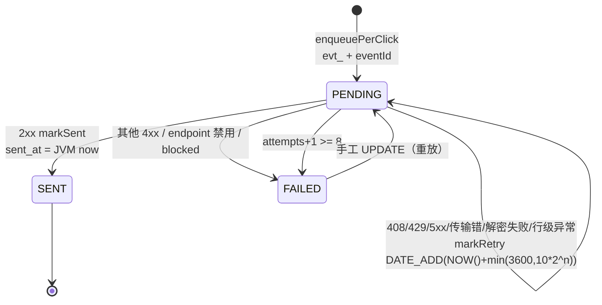

# 专题 11 · Webhook 投递与重试全链路

> 专题 8 结束在 consume 事务末尾的那次 webhook 入队。本专题接手之后半程：一条 PENDING 投递行怎么被 relay 捞起、签名、过 SSRF 三层防护、从钉死的通道 POST 出去；失败后 408/429/5xx 怎么退避、其他 4xx 为什么首败即终态；主密钥缺失时管理面 503 而投递意图照落的二级降级；AGGREGATE 模式从缓冲桶到 digest 的时间线。8 次重试的每一步对应 `WebhookDeliveryRelay` 的一个分支，第 7 节逐分支列表。

## 1. 业务背景：把「至少一次」推过 HTTP

webhook 的投递语义是 at-least-once（`WebhookDeliveryRelay.java:32-33` 类注释）：多个 relay 实例可能投同一行，接收方按 event id 去重。这个语义不是选择而是必然：HTTP 没有与数据库共享事务的能力，发送方永远无法确知「响应丢失的那次尝试」对方到底收没收到。项目把能保证的都保证了（意图与统计同事务、签名防篡改、目标钉死防 rebinding），把不能保证的诚实交出去（重复靠接收方去重）。

`lf_webhook_delivery` 的三个状态构成本仓库的死信等价物（`WebhookDelivery.java:16-17` 注释原话）：PENDING 是在途，SENT 是终态成功，FAILED 是终态放弃。FAILED 不自动重放，重放是一条手工 UPDATE 回 PENDING。这套状态机与 outbox 的 PENDING/SENT/FAILED 同构，但每一条 mark SQL 都多了 `AND status = 'PENDING'` 守卫，原因在第 5 节节点五。

## 2. 相关类清单

| 类 | 角色 | 模块课 |
|----|----|----|
| `WebhookService.recordClickDelivery` | consume 事务末尾的四个出口（:247-277） | [13.2](../modules/13-webhook/02-delivery-signing-retry.md) 第 5.1 节 |
| `WebhookService.enqueuePerClick` | 投递行与 8 字段 payload（:280-305） | [13.2](../modules/13-webhook/02-delivery-signing-retry.md) 第 5.2 节 |
| `WebhookDeliveryRelay` | 三道门禁 + deliver 五分支 + scheduleRetry（:63-166），本专题主角 | [13.2](../modules/13-webhook/02-delivery-signing-retry.md) 第 5.3-5.5 节 |
| `WebhookDeliveryMapper` | 扫批（:23-25）与三个带 PENDING 守卫的 mark（:27-39） | [13.2](../modules/13-webhook/02-delivery-signing-retry.md) 第 5.6 节 |
| `WebhookSigner` | `v1=` + hex(HMAC-SHA256(secret, ts + "." + body))（:21-34） | [13.2](../modules/13-webhook/02-delivery-signing-retry.md) 第 5.7 节 |
| `WebhookTargetGuard` / `PinnedHttpSender` | SSRF 两层校验与钉死解析 | [13.3](../modules/13-webhook/03-ssrf-and-aggregate.md) |
| `AggregateWindows` / `WebhookAggregateFlusher` / `WebhookAggregateBufferMapper` | AGGREGATE 窗口网格、封窗与 digest 分片 | [13.2](../modules/13-webhook/02-delivery-signing-retry.md) 第 5.9 节 |
| `WebhookRetryClockIT` | 时区 fork 里钉死双时钟口径（:127-198） | [13.2](../modules/13-webhook/02-delivery-signing-retry.md) 第 5.8 节 |

配置段 `application.yml:153-173`：relay 批 50、tick 2 秒、max-attempts 8、退避 base 10 秒上限 3600 秒、连接 2000ms 请求 5000ms。

## 3. 完整调用链：从一次点击到一条 HTTP POST

```
点击 → outbox → MQ → consume 短事务（专题 8）
  事务末尾 recordClickDelivery（WebhookService.java:247-277）
    出口一 feature 关 → return，不补发（S1-a）
    出口二 无 enabled endpoint → return
    出口三 DuplicateKey → 打点吞掉（uk_webhook_endpoint_event 已有同事件）
    出口四 其他异常 → 重抛，整个 consume 事务回滚进 DLQ（S1-d）
    PER_CLICK → enqueuePerClick（:280-305）：evt_{eventId} + 8 字段 payload，PENDING
    AGGREGATE → bufferAggregateClick（:313-326）：JVM 时钟算窗 → upsert 桶 → 达阈值封窗

WebhookDeliveryRelay.drain（每 2 秒，WebhookDeliveryRelay.java:63-88）
    门一 feature/relay 开关（内存判断，:67-69）
    门二 主密钥不可用 → 整批跳过，不碰行不耗 attempts（S1-c，:73-76）
    门三 selectPendingBatch(50)：PENDING 且退避到期，ORDER BY id（Mapper :23-25）
  每行 deliver（:90-147）
    endpoint 没了/禁用 → markFailed "endpoint disabled"（:92-96）
    resolveForSend 违规 → markFailed "blocked target"，日志不回显地址（:99-108，D-C4-8）
    decrypt 失败 → scheduleRetry（:110-116，给运维修密钥的窗口）
    签名三头 + PinnedHttpSender 发送（:118-129）
    2xx → markSent（JVM 时钟 sent_at，:135-138）
    408/429/5xx → scheduleRetry（:140-141）
    其他 4xx → markFailed，重试无意义（:142-146）
  行级异常 → scheduleRetry 兜底，毒行不阻塞同批（N7，:78-87）

scheduleRetry（:154-166）
    attempts+1 ≥ 8 → markFailed 终态
    否则 markRetry：next_attempt_at = NOW() + min(3600, 10×2^n)（DB 时钟）
```

## 4. 可视化

1. [16-webhook-delivery-lifecycle](../diagrams/archify/html/16-webhook-delivery-lifecycle.html)：PENDING→SENT/FAILED 状态机与退避标注。第 7 节异常表的每一行在这张图上是一条边，mark 三语句的 PENDING 守卫是图上「转移只能从 PENDING 出发」的几何含义。
2. [07-rabbitmq-topology](../diagrams/archify/html/07-rabbitmq-topology.html)：投递行的上游。consume 异常回滚的那批消息经 DLX 落 linkforge.click.dlq，见专题 8 第 7 节。
3. 状态机：



## 5. 源码详解：五个节点

**节点一：consume 钩子的原子性。** recordClickDelivery 的 javadoc（`WebhookService.java:235-246`）把契约写全：入队只看 endpoint 存在且 enabled，secret 是发送时才需要的，所以主密钥缺失照样落 PENDING（S1-b）；非重复的插入失败让整个 consume 事务回滚（S1-d），统计与投递意图同生共死。重复（撞 `uk_webhook_endpoint_event`）是唯一被吞的异常：并发路径已经入过队，这次点击的投递意图已存在。重放事件在专题 8 的占坑处早退，走不到这里，一个 eventId 不可能入队两次。

**节点二：eventId 与最小 payload。** eventId 规则是 `"evt_" + 原事件 eventId`（:282）。原 eventId 要么是 `log-{id}` 要么是 UUID（专题 8 第 5 节），前缀做命名空间隔离，digest 事件的 `digest-{endpointId}-{windowStart}` 不与它撞车。payload 只有 8 个字段（id/type/createdAt/linkId/code/clickedAt/device/refererHost），没有 IP、没有完整 User-Agent（README :523 口径）：这是把数据推到租户自己的服务器，推得越多泄露面越大。

**节点三：deliver 的五个分支。** 分支顺序就是开销顺序：endpoint 点查（:91-96）、SSRF 解析校验（:99-108）、解密（:110-116）、签名发送（:118-129）、按状态码分流（:130-146）。解密失败按可重试处理值得停一步：密钥错了重试也不会成功，但运维可能在几个 tick 内修好，立即 FAILED 会把可恢复故障变成需要手工重放的终态；scheduleRetry 的上限保证行不会无限循环（13.2 第 5.4 节口径）。

**节点四：退避公式与总量。** scheduleRetry 全文 13 行，是状态机的执行器：

```java
private void scheduleRetry(WebhookDelivery delivery, Integer statusCode, String error) {
    int attempts = (delivery.getAttempts() == null ? 0 : delivery.getAttempts()) + 1;
    LinkForgeProperties.Webhook cfg = properties.getWebhook();
    if (attempts >= cfg.getMaxAttempts()) {
        deliveryMapper.markFailed(delivery.getId(), statusCode, error);
        meterRegistry.counter("linkforge.webhook.delivery", "result", "failed").increment();
        log.warn("webhook delivery {} -> FAILED after {} attempts ({})", delivery.getId(), attempts, error);
        return;
    }
    long backoffSeconds = Math.min(cfg.getBackoffMaxSeconds(), cfg.getBackoffBaseSeconds() * (1L << attempts));
    deliveryMapper.markRetry(delivery.getId(), backoffSeconds, statusCode, error);
    meterRegistry.counter("linkforge.webhook.delivery", "result", "retry").increment();
}
```
（`WebhookDeliveryRelay.java:154-166`）

公式 `min(backoffMaxSeconds, base × 2^attempts)`（:163），默认 10 秒起步、8 次上限：20、40、80、160、320、640、1280 秒。第 8 次尝试失败时 attempts 到 8 进 FAILED。全程约 42 分钟窗口内 8 次 HTTP 尝试。3600 秒的上限在默认参数下碰不到（10×2^8=2560），它是给运维调大 max-attempts 的场景兜底。markRetry 的 `next_attempt_at = DATE_ADD(NOW(), INTERVAL n SECOND)`（`WebhookDeliveryMapper.java:31-33`）用 DB 时钟写入，selectPendingBatch 用 `<= NOW()` 用 DB 时钟比较，一列一时钟。

**节点五：mark 三语句的 PENDING 守卫。** 三个 mark 的 WHERE 全部带 `AND status = 'PENDING'`（`WebhookDeliveryMapper.java:28、:33、:38`），int 返回值是影响行数。对照 outbox 的同名三语句只有 `WHERE id = #{id}`（`OutboxMapper.java:19-27`）。差异的根源是在途时长与 tick 周期的比值：webhook 的 HTTP 投递最长 7 秒（连接 2s + 请求 5s），跨过 2 秒 tick，同一行可能同时有两份在途尝试，加上手工重放这个第二写者，守卫让状态转移线性化，输家影响行数为 0。outbox 行只有 relay 一个写者且「拉取→发布→mark」在同一轮内同步完成（推断：差异原因从配置数值与调用形态推出，代码注释未明说；对照见 10.2 第 5.4 节）。

**节点六：AGGREGATE 的 digest 时间线。** 模式为 AGGREGATE 时点击不落投递行，落 `lf_webhook_agg_buffer` 的（endpoint，窗口，链接）桶。窗口起点由调用方用 JVM 时钟算 epoch 秒后写入（`WebhookService.java:314` 的 `System.currentTimeMillis()/1000` 加 `AggregateWindows.windowStartOf` 的 `ZoneId.systemDefault()` 网格），封窗扫描的过期判定却用 DB 的 `UNIX_TIMESTAMP()`（`WebhookAggregateBufferMapper.java:65`）。这是全项目唯一的混合点：window_start 的值是 JVM 时钟算的，判过期却拿它与 DB 时钟比。mapper 注释（:15-18）把归因写明：业务数据（clickedAt）天然活在 JVM 时钟上，网格只能跟着它走。偏离的代价是窗口边界可能偏移几个时区差，但桶是幂等 upsert、digest 带 windowStart 可对账，误差被登记而不是放大（推断：后果分析为本专题推断，注释只写了规则本身）。封窗双触发：阈值 inline flush 跑在 consume 已持有的事务里（`WebhookService.java:321-325`），5 秒 sweep 扫 DB 侧过期窗口。digest 按 500 桶分片、每片一个 `digest-...-partN` eventId、超 10 片截断并在最后一片带 `truncated: true`（13.2 第 5.9 节口径）。

## 6. 正常流程：接收方抖动 30 秒

| 时刻 | 动作 | 证据 |
|------|------|------|
| t0 | 点击被消费，占坑成功，事务末尾落投递行 evt_log-123，PENDING attempts=0 | `WebhookService.java:282-304` |
| t0+2s | drain 选中，三道门全过，解析公网 IP，解密成功，签名发出 | `WebhookDeliveryRelay.java:63-129` |
| t0+3s | 接收方返回 500，scheduleRetry：attempts=1，markRetry 写 +20 秒（DB 时钟） | :140-141、:154-165 |
| t0+23s | 再选中，仍 500，attempts=2，退避 40 秒 | 同上 |
| t0+63s | 接收方恢复，返回 200，markSent：SENT、attempts=3、sent_at=JVM now | :135-138 |
| t0+7d | SentRowCleanup 用 JVM 时钟 cutoff 删掉这条 SENT 行 | `SentRowCleanup.java:61-65` |

这条时间线就是 `WebhookRetryClockIT` 第一个测试的剧本（:127-159）：桩返回 500 一次，断言 `next_attempt_at` 与 DB 的 `NOW()` 相差在 [0,20] 秒内；旧实现下这个差值曾是 28800 秒（JVM+8 与 DB UTC 的偏差把 20 秒退避拖成 8 小时）。测试跑在 `pom.xml:235-247` 的独立时区 fork 里（`-Duser.timezone=Asia/Shanghai`），MySQL 容器保持 UTC，人为制造最大偏差，回归保护是永久性的。

## 7. 异常流程：重试状态机全分支

| 分支 | 触发 | 状态转移 | 代码位置 |
|------|------|----------|----------|
| 传输失败 | IOException（连接拒绝、RST） | PENDING 退避，last_error 为异常类名 | `WebhookDeliveryRelay.java:130-132` |
| 请求超时 | 超过 5000ms，归入 Failed | PENDING 退避 | :130-132 |
| 408 / 429 / 5xx | 接收方「稍后可能恢复」 | PENDING 退避，last_error=`http {code}` | :140-141 |
| 其他 4xx | 401/403/404/410 等「明确拒绝」 | FAILED 首败即终态 | :142-146 |
| 第 8 次失败 | attempts+1 ≥ max-attempts | FAILED，last_error 留最后原因 | :157-161 |
| endpoint 禁用/删除 | 点查为 null 或 enabled=false | FAILED `endpoint disabled` | :92-96 |
| 目标违规 | resolveForSend 任一 IP 过不了黑名单 | FAILED `blocked target`，meter linkforge.webhook.blocked，日志不回显 | :99-108 |
| 解密失败 | 主密钥被换或密文损坏 | PENDING 退避（给运维修密钥的窗口） | :110-116 |
| 行级异常 | payload 数据触发的意外异常 | PENDING 退避（毒行不阻塞同批，N7） | :78-87 |
| 入队重复 | 撞 uk_webhook_endpoint_event | 吞掉，事务正常提交 | `WebhookService.java:270-271` |
| 入队其他失败 | 任何非重复异常 | consume 事务回滚，消息进 DLQ | :272-276 |
| 主密钥缺失（三级） | 管理面 503；入队照落 PENDING；relay 整批跳过不耗 attempts | 见下段 | `WebhookService.java:194-198`、`WebhookDeliveryRelay.java:73-76` |

主密钥缺失的两级降级值得单独成段，因为它不是一条分支而是三条路各让一步。管理面（保存与轮换 endpoint）被 `requireWebhookAvailable` 拒成 503（`WebhookService.java:194-198`），配置操作是可重做的，硬拒无害。入队面不看密钥（:248-252 只看 feature 开关），投递意图照落 PENDING，点击事件一旦错过就永远错过，所以入队不设密钥门槛。投递面整批跳过（`WebhookDeliveryRelay.java:70-76`），不碰行不耗 attempts，密钥配好后行自动开始流动。分界线是数据的不可再生性（13.1 第 5.6 节口径）。注意第三级只挡「密钥不存在」：密钥存在但错了时门禁放行，行在解密分支反复退避直到 FAILED（第 6 节练习 3 的场景）。

FAILED 行的救济是手工 SQL：`UPDATE lf_webhook_delivery SET status='PENDING' WHERE id=...`，与 outbox 的重放同款（README :412 口径）。重放安全的前提是接收方按 event id 去重，这正是 at-least-once 契约的另一半。

408/429/5xx 与其他 4xx 的分组标准值得一句话钉死：前一组的共同点是「服务端暂不可用或限流，稍后可能恢复」，后一组的共同点是「请求本身有问题，重试无意义」。这个划分让接收方用一个状态码就能控制发送方的行为，是 webhook 协议的行业共识（GitHub 与 Stripe 的 webhook 同款语义）。接收方想停止投递，正确做法是把 endpoint 禁用（走 :92-96 分支）或回 410，而不是让发送方烧完 8 次。

## 8. 设计取舍

**一、退避排程用 DB 时钟，不用 JVM 时钟。** 这个规则是 bug 换来的：JVM 与 MySQL 容器时区不同是常态，JVM 时钟写调度列曾把退避拖长 8 小时（`WebhookRetryClockIT.java:27-38` 案底）。把「调度归 DB、记账归 JVM」写成 mapper 注释与 IT 断言，比寄希望于运维对齐时区可靠。AGGREGATE 的 window_start 是全项目唯一的混合点，第 5 节节点六已给出归因与残余误差。

**二、at-least-once 加接收方去重，不追恰好一次。** 恰好一次需要收发双方共享事务，跨网络 HTTP 做不到。发送方把「可能重复」写进类注释（:32-33），接收方用 X-LinkForge-Event-Id 去重（README 给了三步验证伪代码）。这与 MQ 消费侧的 lf_consumed_event 主键是同一思想的两端：谁消重成本低谁兜底。

**三、FAILED 不自动重放。** 8 次后停止，防止坏目标永久消耗 relay 预算，也防止告警被重复 warn 淹没。行不删除，last_error 与 last_status_code 保留全部现场，重放是一条 UPDATE。对照 MQ 消费端的毒消息一次进 DLQ：webhook 失败多是远端抖动值得退避，消费失败多是代码或数据问题值得快速隔离（推断：差异从两类失败的分布推出，与专题 8 第 7 节口径一致）。

**四、条件更新作状态守卫。** 「查一下再改」在并发下有窗口，把状态条件放进 UPDATE 的 WHERE，数据库行锁让检查与写入原子完成。写者超过一个就要加守卫，outbox 的单写者才省得掉（10.2 第 5.4 节对照）。

**五、payload 最小化。** 8 个字段，无 IP 无完整 UA。webhook 是把点击数据推到租户自己的服务器，推送内容每多一项，数据库备份、日志、接收方泄露面的每一环都多一项。需要明细的租户走统计 API（推断：动机从 README :523 与字段表的对照归纳）。
