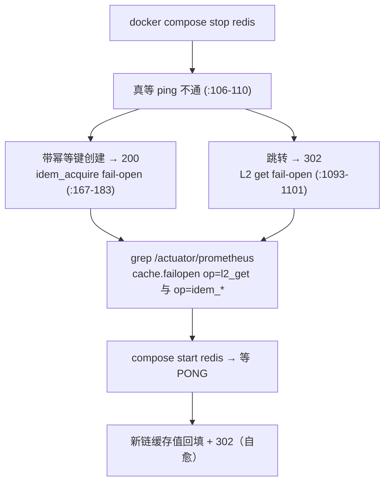

# 专题 12 · 依赖故障处理总表

> 前面各专题分别讲过一处 fail-open：专题 4 的跳转链、专题 5 的 L2、专题 8 的消费回滚、专题 11 的投递退避。本专题把所有依赖故障的处理收进一张总表：Redis 停机时每个组件各走到哪行、留下哪个指标；MySQL 全挂与只读的 500 与 302 之别；RabbitMQ 停机时 outbox 停积而 302 不动；webhook 端点挂掉时的退避与 FAILED。最后对照 fault-drill.sh 三段的 PASS 口径，把「代码应该这样」变成「这台机器上此刻确实这样」。

> **3.0.0 口径注**：本专题的 ShortLinkService 行号已按现行版本（1,503 行）逐处更新。3.0.0 新增两类故障语义已补入第 5 节节点七与第 7 节总表：认证存储（用户行/Key 行回查）故障时两个认证过滤器 fail-closed 回稳定 503（S/N 波 S4-5）；CSV 导入的在途租约在 Redis 故障时 fail-open 无租约执行（审计 M5）。

## 1. 业务背景：fail-open 的方向从哪来

302 跳转是产品的生命线。项目的设计原则藏在一次点击的写入路径里：跳转主链路不依赖任何一侧的「写成功」——不依赖 Redis 写（缓存与限流都可绕过）、不依赖 MQ 写（点击先落本地 outbox）、甚至不依赖点击记账本身（`ShortLinkService.java:1035-1042` 的 catch 注释写明「the 302 must not depend on the click write」）。每个依赖因此被分成三类：热路径上的加速器（坏了降级放行）、异步管道（坏了原地积压等恢复）、安全边界（坏了停在安全的一侧，fail-safe）。

方向判断的成本口径：配额失效的损失是超量使用，可事后对账，所以 Redis 限流 fail-open；签名密钥缺失的损失是伪造签名不可察觉，所以 webhook 主密钥 fail-safe 降级为关。本专题第 8 节把这个判断写成总原则。

观察这套设计有两个入口。代码入口是 grep `failopen`：所有降级点都强制打点，`ShortLinkService` 一处类就有十余个计数点（3.0.0 又添了导入租约一组）。运维入口是 fault-drill.sh：它把第 7 节总表的四行变成可在自己机器上复现的 PASS 行。两个入口在本专题合拢：第 5 节讲代码为什么这样写，第 6 节讲怎么验证它真的这样跑。

## 2. 相关类清单

| 类/脚本 | 角色 | 模块课 |
|----|----|----|
| `RedisRateLimiter` | 滑窗与固定窗的 fail-open（:44-50、:75-80、:98-104） | [9.1](../modules/09-rate-limit/01-sliding-window-lua.md) |
| `ShortLinkService`（读路径） | L2 get fail-open :1093-1101、absent 判定 :1404-1415、行读 :1110 | [8.2](../modules/08-redis-cache/02-l1-l2-write-through.md) |
| `ShortLinkService`（写路径） | cacheUrl :1444-1455、evictCache :1457-1467、idem 三出口 :178/:221/:476 | [8.2](../modules/08-redis-cache/02-l1-l2-write-through.md) |
| `CodeBloomFilter` | 未加载/加载失败/禁用一律放行（:186-192），load 失败回到 fail-open 态（:105-112） | [8.3](../modules/08-redis-cache/03-negative-cache-bloom.md) |
| `CacheBus` | 广播失败只打点，对端陈旧等 L1 TTL（:57-68） | [8.2](../modules/08-redis-cache/02-l1-l2-write-through.md) |
| `ApiKeyAuthFilter` | 配额双闸的 fail-open 依赖（:112-137） | [12.1](../modules/12-api-key/01-apikey-full.md) 第 5.7 节 |
| `JwtAuthFilter` / `ApiKeyAuthFilter`（回查） | 认证存储故障 → 稳定 503（S4-5），见第 5 节节点七 | [专题 17](17-correctness-waves.md) |
| `ImportIdempotencyLease` + `ShortLinkService.acquireImportLease` | 导入租约的 fail-open（:694-707 一组计数） | [专题 16](16-link-power-features.md) 节点八 |
| `ClickRecordService` / `ClickOutboxRelay` | 同事务双写 + 退避抽水（relay :44-78） | [10.2](../modules/10-rabbitmq-outbox/02-outbox-relay.md) |
| `SingleFlight` | 行读合并与异常重抛（:90-98），决定「MySQL 全挂 → 500」的传播路径 | [8.4](../modules/08-redis-cache/04-singleflight.md) |
| `WebhookDeliveryRelay` | 主密钥门禁与投递退避（:63-88、:154-166） | [13.2](../modules/13-webhook/02-delivery-signing-retry.md) 第 5.3 节 |
| `WebhookSecretCipher` | fail-safe 对照：主密钥坏配置降级为关（构造器 :35-51、isAvailable :57-59） | [13.1](../modules/13-webhook/01-endpoints-and-cipher.md) 第 5.5 节 |
| `GlobalExceptionHandler` | 兜底 500（:72-77），行读失败的终点 | [3.1](../modules/03-spring-mvc/01-controllers-rest.md) |
| `scripts/fault-drill.sh` | redis / webhook / mysql-ro 三段演练（:97-252） | [15.3](../modules/15-testing-deployment/03-compose-and-drills.md) 第 5.8 节 |
| `scripts/mq-drill.sh` / `scripts/outbox-drill.sh` | MQ 断链两剧本（mq-drill :21-74、outbox-drill :62-98） | [15.3](../modules/15-testing-deployment/03-compose-and-drills.md) 第 5.6-5.7 节 |

## 3. 故障传播图：一次跳转经过的每一站

```
GET /r/{code}
  ① RedisRateLimiter（Redis）     挂 → fail-open 放行，meter ratelimit.failopen
  ② CodeBloomFilter（进程内）     未就绪/失败 → 恒 true 放行（不依赖 Redis 写入）
  ③ absentKnown（Redis）          挂 → 读不到当 miss，继续走 ④（:1404-1415）
  ④ L1（进程内 Caffeine）         与外部依赖无关
  ⑤ L2 get（Redis）               挂 → fail-open 置空，继续行读（:1093-1101）
  ⑥ 行读（MySQL，singleflight）   挂 → 异常穿出 → 500（:1110，无 catch）
      行读到 → 状态/过期/URL 校验 → B9 → 密码门 → variants → 302 决策
  ⑦ recordClick（MySQL 写，事务） 失败 → 事务外 catch，302 照常（:1035-1042）
      事务内：明细行 + lf_outbox 行（RabbitMQ 一根汗毛没碰）
  ⑧ ClickOutboxRelay（RabbitMQ）  挂 → markRetry 退避，行积 PENDING，302 无感
  ⑨ consume → webhook 入队（MySQL 写） → ⑩ WebhookDeliveryRelay（HTTP 出站）
      端点挂 → 退避 8 次 → FAILED；主密钥缺 → 整批跳过
```

六与七的不对称是本专题最重要的 nuance：⑥是正确性仲裁（行不存在就 404，不存在「放行」这个选项），没有 fail-open；⑦是记账，丢一次可由对账补，所以 fail-open。fault-drill 第三段测的正是这个不对称（第 7 节）。补充两个边界事实：HEAD 探测走同一条链但从不记账（`resolveForProbe`，`ShortLinkService.java:1047-1051`），所以只读库下 HEAD 同样 302（fault-drill :236-237 断言）；密码门、B9 门禁与 variants 抽签读的都是行数据，依赖 ⑥ 存活，行读失败时它们一起不可达。

读这张图的方法是拿一支笔沿 ①到⑩ 走一遍，每站问两个问题：这一站坏了，用户看到的下一个状态是什么？留下的证据是哪个计数器或哪张表？两个答案都能在本专题定位到行号，本专题的完整性就用这个标准衡量。

图上还有一条隐藏边值得指出：⑩ 的投递行是 ⑨ 的 consume 写的，所以 RabbitMQ 故障除了让 ⑧ 积压，还让 ⑩ 的供给整条暂停——webhook 的恢复追平因此是双跳的（先追 outbox 再追投递），fault-drill 的 webhook 段只覆盖第二跳，第一跳由 outbox-drill 的恢复段覆盖。

## 4. 可视化

1. [01-runtime-deployment](../diagrams/archify/html/01-runtime-deployment.html)：宿主机 JVM 居中，三个依赖容器在侧，观测栈在外圈。本专题每个 fail-open 站点都在这张图的应用框内，redis/mysql/rabbitmq 三个容器就是三段演练的操作对象。
2. [08-scheduled-tasks](../diagrams/archify/html/08-scheduled-tasks.html)：MQ 断链期间的积压由图上的 ClickOutboxRelay 节点消化，恢复后的追平由 ClickLogReconciler 节点补齐。
3. 故障降级流（redis 段）：



## 5. 源码详解：三类依赖的处理差异

**节点一：Redis 挂，成群的 fail-open 站点。** 限流侧 `RedisRateLimiter.acquire` 的 catch 返回放行决策（:44-50），`tryAcquireFixedWindow` 同样放行（:75-80），统一打点 `linkforge.ratelimit.failopen{reason=error|null}`（:98-104）。缓存侧三个操作各自吞异常：L2 读（`ShortLinkService.java:1093-1101`，op=l2_get）、L2 写（:1444-1455，op=l2_set）、L2 删（:1457-1467，op=l2_delete），语义都是「少了加速器，正确性无损」。空值缓存的标记与清除同路（op=absent_mark :1428、absent_clear :1440），读失败按 miss 处理的方向是安全的：一个不存在的 code 由此多付一次 DB 读而不是被错误放行，代价只是热路径上的一次行读。幂等三件套在创建链上：拿不到租约当拿到（op=idem_acquire :167-183，注释写明代价是故障期两个并发同键创建可能都跑）、回放读不到当没建过（op=idem_get :217-224）、结算失败只丢幂等键（op=idem_settle :465-478，链接已提交）。3.0.0 的导入租约（M5）同族：获取/窥视/释放/结算失败一律 fail-open 无租约执行（op=idem_import_lease 及后缀变体，:694-707 起一组），故障期同 key 并发导入可能双跑——与创建侧的取舍同向，靠 settle 结果缓存兜顺序重放。Bloom 是进程内的，但它的对齐广播走 Redis：put 广播失败不重试（`CacheBus.java:57-68`），对端陈旧到 L1 TTL 或下次 rebuild。key 配额与 touch 的两处见专题 10 第 7 节。

**节点二：MySQL 挂，两个方向的 500 与 302。** 全挂时行读 :1110 抛 DataAccessException，SingleFlight 原样重抛（`SingleFlight.java:90-98`），`resolveForGet` 的 catch 只罩 recordClick（:1035-1042），异常穿到 `GlobalExceptionHandler` 的兜底分支返回 500（:72-77）。行读没有 fail-open：它是「这个 code 到底指向哪」的唯一事实源，绕过它无处可去。只读库（read_only=1）不是全挂：SELECT 全部正常，只有 INSERT/UPDATE 失败，于是点击记账在事务外被 catch（:1035-1042，meter `linkforge.click.record.failopen`），302 保持，创建类写操作失败，详情与统计的读照常 200。fault-drill 第三段按这个口径断言（第 7 节表）。管理面没有降级：MySQL 挂时 `/api/keys`、`/api/webhooks`、`/api/links` 的写与读全部不可用，这是「正确性数据无降级替代」的自然结果。

**节点三：RabbitMQ 挂，积压而不丢失。** recordClick 的事务里只有 MySQL 写（明细 + outbox 行，`ClickRecordService.java:56-75`），MQ 从不在跳转热路径上。relay 每轮 `publish` 等 confirm 5 秒（`RabbitClickEventPublisher.java:27`），失败 markRetry 退避 `min(60, 2^n)`（`ClickOutboxRelay.java:61-65、:75-78`），30 次后 FAILED。停机期间 outbox 行按每跳转一次一行的速度堆积，PENDING 不设上限，恢复后每 tick 搬 100 行追平。恢复段的实际执行者是两道工序：relay 把积压行搬进 MQ，`ClickLogReconciler` 按自己的节奏比对明细与聚合并补差额（mq-drill.sh 恢复段等的 `totalClicks=N+M` 就是这两道工序的产物）。唯一会变成 FAILED 的是毒行（payload 损坏），人工重放是它的出口（10.2 第 5.7 节口径）。mq-drill.sh 与 outbox-drill.sh 分别验证「正常同步写」与「关同步写的更坏情形」（15.3 第 5.6-5.7 节口径）。

**节点四：webhook 端点挂，退避到 FAILED。** 接收方 5xx/超时按 `min(3600, 10×2^n)` 退避 8 次后 FAILED，期间跳转全程 302（`WebhookDeliveryRelay.java:140-146`、:154-166）。主密钥缺失的三级反应（管理面 503、入队照落 PENDING、relay 整批跳过不耗 attempts）是专题 11 第 7 节的口径，本专题只把它登记进矩阵。

**节点五：消费侧的 MySQL 写失败，回滚而不吞。** MySQL 只读期间，一次点击走到 consume 时，占坑 INSERT 或聚合 UPDATE 会失败。消费端没有 fail-open：异常穿出 onMessage，容器 reject(requeue=false)，消息进 DLQ（`application.yml:81`）。这个方向与热路径相反，因为消费侧的每一笔写都是「正确性数据」：吞掉异常等于静默丢点击。救济靠 at-least-once 的重投与人工重放（专题 8 第 7 节口径）。同一台只读库上，跳转 302 与消费进 DLQ 同时发生，两边各自做对了自己的事。

**节点六：Bloom 的 fail-open 不是一根开关，是一个状态机。** `CodeBloomFilter` 的降级态有三个入口：禁用（load 直接过，:82-86）、种子加载失败（filter 置 null、ready 置 false，:105-112）、重建失败（恢复上一个 filter 引用，:165-171）。查询端对三种态一律回答 true 放行（`mightContain` :186-192），空值缓存与行读兜住放行后的多查。两个细节防止「降级中变雪崩」：重建采用先发布再播种，播种窗口内新建的码直接进新 filter，不会丢（:151-153 注释引用审计 A9 S1）；重建失败恢复旧 filter 而不是降级到空，一个已加载的 filter 永不因重建失败而消失（:166-168 注释原话）。对照同文件 CacheBus 的广播：Bloom 对自己的 put 消息刻意不跳过 origin（:74-75），因为 put 幂等，跳过只多一个丢消息的口子，与 L1 失效广播的 origin 跳过（8.2 第 5.6 节）方向相反，各自的理由都写在注释里。

**节点七：认证存储挂，fail-closed 的稳定 503（3.0.0 新增，S4-5）。** 批次 2 起两个认证过滤器每请求回查 MySQL（JwtAuthFilter 查用户行、ApiKeyAuthFilter 查 key 行与属主行）。这条回查坏掉时不能 fail-open（放行 = 凭据纪律归零），也不能把驱动异常原样抛成 500（把「依赖故障」伪装成「服务器错误」，还会泄异常细节）。S/N 波 S4-5 的定稿是第三种：两个过滤器统一回稳定 503 `{"code":503,"message":"authentication store unavailable","data":null}`（`JwtAuthFilter.java:37` 的共享常量，ApiKeyAuthFilter 复用），不授任何身份，日志只带 userId/keyId 不带凭据。它与节点二的 500 分工明确：500 是「正确性仲裁无路可走」，503 是「认证依赖暂时不可用、请重试」，客户端能据此区分该不该重试。

## 6. 正常流程：fault-drill 怎么跑

前提（`fault-drill.sh:27-37`）：.env 存在、jar 已构建、compose 的 mysql/redis/rabbitmq 在跑；缺一即 fail。脚本自起一个 8083 端口的专用实例，快重试参数（max-attempts 3、退避 1-2 秒、relay 500ms）加私有目标放行（:74-82），并自铸 webhook 主密钥与抓取 token（:41-48）。三段共享一个 trap 清理（:54-70）：杀应用、按端口杀 5xx 桩、拉回 redis、清 read_only，现场还原由脚本结构保证。每段先验证破坏生效（redis 真停了、stub 真 500、read_only 真开了），再验证降级行为，恢复段验证自愈。SKIP 语义让缺件不报废演练：没有 PowerShell 跳过 webhook 段（:146-148），.env 没有 MYSQL_ROOT_PASSWORD 跳过只读段（:217-219）。MQ 断链不在本脚本里，由 mq-drill.sh（trap 保底重启 rabbit）与 outbox-drill.sh（自起 8082 实例、关同步写）覆盖。

以 redis 段为样本，一轮演练的完整时间线：

| 步骤 | 动作 | 证据 |
|------|------|------|
| p0 | 基线：redis 正常时建链 A、跳转 302 | `fault-drill.sh:98-101` |
| p1 | 破坏：compose stop redis，真等 ping 不通 | :103-110 |
| p2 | 降级验证：带幂等键创建仍 200，跳转仍 302 | :113-117 |
| p3 | 证据验证：/actuator/prometheus 里 l2_get 与 idem_* 两个 failopen 计数各出现 | :118-122 |
| p4 | 恢复：start redis 等 PONG | :126-130 |
| p5 | 自愈验证：新链 C 的 L2 缓存值回填、跳转 302 | :131-142 |
| p6 | 第二段（有 PowerShell 时）：5xx 桩起、配 endpoint、点击、断言 FAILED\|3\|500 与期间 302 | :144-214 |
| p7 | 第三段（有 root 口令时）：read_only 开、断言写失败读存活、关、断言写恢复 | :216-252 |
| p8 | trap 兜底：无论从哪步退出，应用被杀、redis 被拉回、read_only 被清 | :54-70 |

p3 是这套演练最有教学价值的一步：状态码 302 也可能来自「缓存本来就没建」，只有 failopen 计数出现才证明请求真的走过了降级分支。行为对加证据在，两件事一起断言。想把这一步用进自己的项目，只需要约定一个「降级必打点」的规则，其余照抄脚本结构。

Redis 段之后的两段换靶子不换节奏。webhook 段的破坏不是停容器而是起一个全 500 的桩（PowerShell HttpListener，:149-164），断言从「行为不变」升级为「状态机走到正确的终态」：投递行必须以 `FAILED|3|500` 结束（:206-210），且重试期间至少采到一次 302（:198-201）。mysql-ro 段的破坏是一条 SQL（`SET GLOBAL read_only=1`，:225-227），断言的是写失败、读存活、恢复可写的三角。三段合起来，第 7 节总表的六行断言全部有了现场版本。

## 7. 异常流程：总表与 PASS 口径

| 依赖 | 组件 | 故障行为 | 指标 | 演练断言 |
|------|------|----------|------|----------|
| Redis | 限流（跳转+创建+key 配额） | fail-open 放行 | `linkforge.ratelimit.failopen` | 无专项，含在 302/200 断言内 |
| Redis | L2 读/写/删 | fail-open 继续行读 | `cache.failopen{op=l2_get\|l2_set\|l2_delete}` | redis 段 grep l2_get（:119-120） |
| Redis | 幂等租约/回放/结算 | fail-open 继续创建 | `cache.failopen{op=idem_acquire\|get\|settle}` | redis 段 grep idem_*（:121-122） |
| Redis | 导入在途租约（M5） | fail-open 无租约执行，同 key 并发可能双跑（顺序重放仍靠 settle 兜） | `cache.failopen{op=idem_import_lease*}` | 无专项 |
| MySQL（认证存储） | 两过滤器回查（用户行/Key 行） | fail-closed：稳定 503 `authentication store unavailable`，不授身份（S4-5） | 无专项 meter（日志只带 userId/keyId） | 无专项 |
| Redis | 空值缓存 | 读 miss、写跳过 | `cache.failopen{op=absent_mark\|absent_clear}` | 无专项 |
| Redis | CacheBus 广播 | 丢消息，对端陈旧 ≤ L1 TTL 10 秒 | `l1.invalidate.publish{result=error}` | 无专项 |
| Redis | Bloom 对齐广播 | put 丢失，靠 rebuild 兜底 | 无（幂等 put 本身无失败面） | 无专项 |
| MySQL 全挂 | 行读（跳转正确性） | 异常穿出 → 500 | 无专项 meter | 无（脚本用只读不用全停） |
| MySQL 只读 | 点击记账 | 事务外 catch，302 保持 | `linkforge.click.record.failopen` | mysql-ro 段 GET/HEAD 302（:233-237） |
| MySQL 只读 | 创建/管理面写 | 失败（BizException/500） | 无专项 meter | mysql-ro 段创建非 2xx（:228-232） |
| MySQL 只读 | 详情/统计读 | 正常 200 | 无 | mysql-ro 段 ：238-241 |
| MySQL 只读 | outbox/webhook 入队 | consume 事务回滚 → 消息进 DLQ | 无专项 meter | 无专项（热路径 302 不受影响） |
| MySQL 只读 | last_used_at / 明细回填等低频写 | 随各自事务失败，warn 日志 | 无专项 meter | 无专项 |
| RabbitMQ | relay publish | markRetry 退避，行积 PENDING | `linkforge.outbox.sent/failed` 无失败计数，看日志 deferred | mq-drill 段 M 次 302 + 恢复收敛 N+M |
| RabbitMQ | 消费侧 | 无新消息可消费，统计停更 | 无 | mq-drill/outbox-drill 恢复段收敛断言 |
| RabbitMQ | webhook 入队（挂在 consume 末尾） | 随消费一起停，投递意图积在 outbox 不在 delivery 表 | 无专项 | outbox-drill 恢复段含明细回填断言 |
| Redis | key 配额与 touch（专题 10） | 配额 fail-open 放行，touch 丢一次 | `linkforge.ratelimit.failopen` | 无专项 |
| Webhook 端点 | relay 投递 | 退避 8 次 → FAILED | `linkforge.webhook.delivery{result=retry\|failed}` | webhook 段 `FAILED\|3\|500` + 期间 302（:206-213） |
| Webhook 主密钥 | 管理面/入队/投递 | 503 / 照落 PENDING / 整批跳过 | `linkforge.webhook.relay.skipped{reason=master_key_unavailable}` | 无专项 |
| 观测栈挂 | Prometheus 抓取/Grafana | 应用不受影响，指标只停采 | 无（应用侧无感知） | 无专项；fault-drill 的 metrics() 依赖抓取 token 而非观测栈在线 |

fault-drill 的 PASS 行逐条对应：redis 段三行 PASS（:123、:124、:142），webhook 段两行（:212、:213），mysql-ro 段两行（:242、:251）。webhook 段的 `NONBLOCK` 检查（:211）专门防「relay 快到没来得及采样 302 就 FAILED」，降级窗口必须被观察到才算数。

排障时这张表的读法是从指标倒推故障：Grafana 上先看 `cache.failopen` 与 `ratelimit.failopen` 是否同时上涨（Redis 侧故障的特征是它们成组出现），再看 `click.record.failopen` 与创建接口的错误率（MySQL 侧），再看 outbox relay 的 deferred 日志（MQ 侧）。一个 failopen 计数上涨而行为指标（302 率、创建成功率）不动，就是「降级在工作」的正常故障态；行为指标跟着动，才是事故。

表的边界也要登记。至少四类故障不在表内：webhook 目标的 DNS 故障（表现为解析失败 blocked 或连接失败，走专题 11 的退避分支）；宿主机磁盘满（应用写日志失败，本项目没有处理）；时钟漂移（WebhookRetryClockIT 防的 JVM/DB 偏差是「配置性偏差」，运行中的 NTP 抖动不在防护内）；应用自身的 OOM 与线程池耗尽。故障处理总表只覆盖「外部依赖单点故障」这一族，其余故障族各有自己的专题（推断：边界为本专题划定的诚实登记，代码与脚本均未声称覆盖）。

恢复顺序在这套设计里不需要编排。三个依赖任意次序恢复、任意间隔恢复，系统都收敛：管道的每一环都在轮询（relay 每 2 秒、sweep 每 5 秒、对账按固定节奏），恢复的一侧自动接上，没有「必须先起 MySQL 再起 Redis」的启动依赖。演练脚本的恢复段也利用了这一点：只负责把服务拉回，收敛交给轮询者自己。这是「异步管道轮询化」换来的隐藏收益（推断：从四个脚本恢复段均不做顺序编排归纳）。

## 8. 设计取舍

**一、fail-open 的总原则：主链路 302 不依赖任何一侧写成功。** 落实为一条分界线：正确性判定（行读、状态判定）没有降级替代，失败就 500；加速与记账可以绕过或事后补，失败就降级加打点。第 3 节传播图里 ⑥ 与 ⑦ 的不对称就是这条线的形状。反向的 fail-safe 只出现在「静默继续会掩盖安全问题」的地方：webhook 主密钥缺失宁可功能关，metrics 抓取 token 为空宁可 401（15.3 第 5.4 节口径）。给这套原则一个检验句：把任何一个依赖换成停机，主链路的用户可见行为要么不变、要么变成一个诚实的错误码，绝不能变成错误的数据。

**二、残余不一致诚实登记，不假装消除。** 广播丢失对端 L1 最多陈旧 10 秒（L1 TTL），L2 删除失败陈旧最多 3600 秒（L2 TTL），幂等故障期同键可能建两条链，FAILED 行要手工重放，MQ 积压恢复后靠 relay 与 Reconciler 追平。每一项都有上界、有自愈或人工出口、有指标可见。README 的口径是「最终一致窗口约 1 秒、上限为 TTL」（8.2 第 5.7 节引）。登记的方式是写进注释、README 与演练断言，而不是留给下一个人踩坑（推断：登记行为本身是从注释密度归纳出的项目习惯）。

**三、演练证明部署现场，不是证明代码。** 单测与 IT 在 Testcontainers 里证明降级逻辑存在，fault-drill 在真实 compose 栈上证明「这台机器此刻这样」，两者的差别是后者的断言里包含破坏生效的前置验证（第 6 节）。指标断言比状态码断言深一层：不仅行为对，「为什么对」的证据（failopen 计数）也验了（推断：从脚本 ：118-122 同时断言状态码与 meter 的结构归纳）。四个脚本共享「前置、破坏、降级验证、自愈验证、清理」的节奏，这个模板可以迁移到任何项目（15.3 第 8 节口径）。

**四、积压优于丢弃，追平优于补偿。** 四条异步管道（outbox、webhook 投递、消费聚合、对账）在依赖故障时全部选择原地停留：行保持 PENDING、消息进 DLQ、聚合缺增量。没有一条选择「先记内存等恢复再写」，因为内存态在进程重启时蒸发，而 MySQL 行不会。代价是恢复后有一段追平窗口，演练脚本的恢复段就是给这个窗口量的（推断：原则从四条管道的同构行为归纳）。

**五、skip 而不是 fail。** 演练脚本的平台缺件（PowerShell、root 口令）触发 SKIP 跳段而不是整体失败。与 SKIP 相对的是 fail-fast：环境前置（.env、jar、compose 栈）缺失立即退出。前者是可选项缺失，后者是必要项缺失，两种语义不能混（推断：从两个分支的报错措辞与位置归纳）。这条纪律与 fail-open 同源：可选能力的缺失降级为「少测一段」，必要能力的缺失才值得整个退出。
