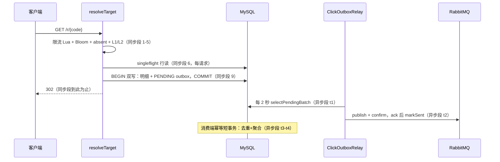

# 专题 13 · 性能与一致性分析

> 专题 4/5 拆了跳转判定链与缓存时间线，专题 7/8/9 拆了点击管道的三段运输。本专题把散在各处的两本账并排放在一起：一本是「每条数据路径的一致性账」，回答哪些数据什么时候可信；一本是「跳转热路径的开销账」，回答每个 302 到底花了什么钱。两本账最后合成三笔一致性-性能交换的取舍账。本专题不发明任何新性能数字，第 3 节引用的历史数字全部带时期口径。

## 1. 一致性模型总表

先立住两个词。强一致点指「从这个时刻起，任何读方都能看到这次写」的位置，本项目里它几乎总是 MySQL 事务的提交时刻，或 Redis 单键 Lua 的执行完成时刻。最终一致窗口指「写已发生、但某个读方还可能读到旧值」的最长时间，它由某段异步运输的节拍决定。兜底指窗口内真的读到旧值时，系统靠什么保证判定结果仍然正确。

表里所有窗口数字（1 秒双删、10 秒 L1、60+30 秒 absent、3600+300 秒 L2、3 秒初始加 2 秒节拍的 relay）都是配置默认值，不是实测延迟；窗口的「上界」是配置，实际观测到的延迟通常更短。把上界当承诺、把默认值当实测，是读这类表最常见的两种误读。

| 数据路径 | 强一致点在哪 | 最终一致窗口 | 由什么兜底 | 锚点 |
|----|----|----|----|----|
| 短链行本身（创建/更新/删除） | MySQL 事务提交 | 无（行是唯一权威） | 唯一索引兜并发；短码分配靠 uk_code 重试（决策 #16） | `ShortLinkService.java` doCreate、[6.2](../modules/06-short-link/02-create-flow.md) |
| 管理 API 读到的列表 | MySQL 查询 | 无 | 直接读库，不走缓存 | [6.3](../modules/06-short-link/03-crud-lifecycle-csv.md) |
| 跳转判定的状态/过期/密码 | 每请求读 DB 行 | 无 | 行权威三处落地：行校验、B9 判行 URL、抽签压过缓存 | `ShortLinkService.java:645-671`、[7.1](../modules/07-redirection/01-decision-chain.md) 第 9 节 |
| L2 缓存里的 URL 值（Redis） | 写穿 `cacheUrl` 提交 | 约 1 秒（写穿 + 延迟双删，决策 #17），上界 L2 TTL 3600+300 秒 | 行校验先验行再验缓存值，脏值必 410 | `ShortLinkService.java:966-989`、[8.2](../modules/08-redis-cache/02-l1-l2-write-through.md) |
| L1 缓存里的 URL 值（Caffeine） | 本实例 put | 写后 10 秒过期；跨实例靠 CacheBus 广播失效，广播失败时陈旧到各自 TTL | 同上：行校验兜底，L1 命中绝不跳过行读 | `UrlLocalCache.java:40-43`、`CacheBus.java:57-68` |
| 空值缓存（absent 哨兵） | markAbsent 的 Redis SET | TTL 60+30 秒 | create 路径 clearAbsent 清哨兵；禁用/过期的行绝不进此缓存 | `ShortLinkService.java:926-964`、[8.3](../modules/08-redis-cache/03-negative-cache-bloom.md) |
| 限流计数（滑窗 ZSET） | 单键 Lua 执行完成，多实例共享 Redis | 无（Redis 正常时） | Redis 故障 fail-open 放行，代价是故障期窗口失效，有指标可见 | `RedisRateLimiter.java:39-58`、[9.1](../modules/09-rate-limit/01-sliding-window-lua.md) |
| 创建幂等键（Redis SETNX 两段式） | pending 键的 SETNX | pending 5 秒超时，终值 24 小时 | 胜者崩溃后 pending 过期自愈；Redis 宕时 fail-open，幂等合同临时失效。3.0.0：终值信封升 `v3:`，指纹 create-v2 含密码 HMAC，同 key 异体 409（M4，[专题 16](16-link-power-features.md)） | 决策 #15、[专题 2](02-create-short-link.md) |
| 导入幂等（settle 缓存 + 在途租约） | settle 的 Lua CAS 写入 | 租约 120 秒 TTL；终值同创建键 24 小时 | 同文件在途 409、异文件 409；Redis 宕 fail-open 回到 settle-only。**崩溃恢复不在合同内**（M5 闸门口径，[专题 17](17-correctness-waves.md) 第 7 节） | `ImportIdempotencyLease.java`、[专题 16](16-link-power-features.md) |
| 会话族（lf_refresh_token） | 轮换/撤销事务提交（用户行锁串行化） | 无（提交即全局生效：access 靠 tv claim 在每请求回查时失效） | 锁序 租户→用户→refresh 全局统一；版本号只走原子自增（M1） | `SessionService.java`、[专题 15](15-auth-sessions-and-teams.md) |
| 团队写操作（角色/状态/重置） | 租户行锁内的当前读判定 + 同事务写入 | 无 | 最后 ADMIN 护栏以锁内 locking current read 为准，RR 旧快照不再参与判定（M2） | `TeamService.java`、[专题 15](15-auth-sessions-and-teams.md) |
| 邀请认领（lf_tenant_invitation） | 条件 UPDATE 认领的提交（与建账号同事务） | 无 | 并发双认领只有一个 UPDATE 影响 1 行，输家整单回滚不留孤儿账号 | `TeamService.java:188-194`、[专题 15](15-auth-sessions-and-teams.md) |
| /stats 三读（totalUv/按日 clicks/按日 UV） | 只读 REPEATABLE_READ 快照事务的建立时刻 | 快照内零窗口（三读同一批点击）；breakdown 仍最终一致、不进快照 | 三读全走明细表同窗口（批次 1 口径统一），UV>clicks 在单响应内不可能 | `ClickStatsService.java:77-79、164-183`、[专题 9](09-stats-reconcile.md) |
| A/B 报告 | 同 stats 的窗口桶读 | 与 breakdown 同级最终一致 | 适用性门先行：不可证稳定/条件路由时返回 NOT_APPLICABLE 而非拟合数（S1） | `AbReport.java`、[专题 16](16-link-power-features.md) |
| 恶意主机判定快照 | snapshot.refresh() 成功返回的时刻 | feed 周期（默认 6 小时）+ 一次刷新 | 先应用后声称：refresh 失败不推进 last_success、判定用旧快照（S3）；开关关时快照钉空 | `MaliciousHostSyncService.java:120-157`、[专题 16](16-link-power-features.md) |
| Webhook 聚合 drain | 单个 (endpoint, 窗口) drain 事务提交 | 封窗触发（阈值或 5 秒 sweep） | 锁行读 + 只删锁行 + flush_seq 命名空间：无未发先删（M3） | `WebhookAggregateFlusher.java:149-171`、[专题 11](11-webhook-delivery-retry.md) |
| 点击明细 lf_click_log（sync 开） | 双写事务提交 | 无 | 提交即存在；DB 挂时 fail-open 不记录（放弃一致性保可用） | `ClickRecordService.java:40-74`、[专题 7](07-click-record-outbox.md) |
| 点击明细（sync 关） | 消费端回填事务提交 | 约 relay 轮询节拍 + 消费延迟（默认初始 3 秒、每 2 秒一轮） | outbox 行持久化，eventId 持久在行里，恢复后必追平 | D-A7-4、`ClickOutboxRelay.java:37-43` |
| 聚合计数 lf_click_daily / 维度桶 | 消费端「去重+回填+upsert」短事务提交 | relay 节拍 + MQ 运输，正常路径秒级 | 确定性 eventId 幂等去重；断 MQ 自动追平；对账器全量兜底。3.0.0 注：/stats 的 totalClicks 已改读明细求和（批次 1），本表仍是对账等式的聚合侧与 breakdown 的读源 | 决策 #22、`ClickStatsService.java:57-75`、[专题 9](09-stats-reconcile.md) |
| 精确 UV | 同明细（COUNT(DISTINCT) 扫 lf_click_log） | 同明细 | 明细行是唯一来源，不另设近似结构 | [专题 9](09-stats-reconcile.md) |
| Outbox 行状态（PENDING→SENT） | markSent/markRetry 的 SQL 提交 | 与 relay 轮询节拍同级 | confirm 语义：broker ack 才标 SENT；失败 2^n 秒退避、上限 60 秒 | [10.2](../modules/10-rabbitmq-outbox/02-outbox-relay.md)、[专题 8](08-mq-consume-idempotency.md) |
| Webhook 投递 | consume 去重事务内插入 PENDING 投递行 | 投递轮询 + 重试退避；聚合模式再叠加 digest 封窗（默认 60 秒或 100 次） | at-least-once 投递按 eventId 去重；失败退避到终态 FAILED，不吞 | D-Bw2-9、`WebhookService.java:32`、[13.3](../modules/13-webhook/03-ssrf-and-aggregate.md) |

### 1.1 故障时的一致性表现

总表描述的是依赖健康时的样子。一致性模型还得回答另一半：某个依赖挂掉时，各条路径退到哪里。这张矩阵把三类故障（Redis 停服、MySQL 故障、RabbitMQ 断链）对着三条主路径各走一遍，全部行为都有脚本或测试实证（[15.3](../modules/15-testing-deployment/03-compose-and-drills.md) 的 fault-drill 与 outbox-drill）。

| 路径 | Redis 停服 | MySQL 故障 | RabbitMQ 断链 |
|----|----|----|----|
| 跳转判定 | 302 照常：限流 fail-open 放行、absent 当未命中、L2 读失败降级、L1 与 Bloom 不受影响 | 判定本身在 DB 读处失败：行读异常传播，请求 500（无降级路径） | 不受影响（热路径零 MQ 接触） |
| 点击记账 | 不受影响（写的是 MySQL） | 事务回滚，调用点 catch 打点 fail-open，302 照常返回，该次点击不记录 | 不受影响（outbox 行照写，积压为 PENDING） |
| 统计聚合 | 不受影响（消费在 MySQL 侧） | 写 API 失败；已提交数据不受影响 | 投递暂停，PENDING 积压；恢复后按 2 秒节拍追平，outbox-drill 实证 |
| Webhook 投递 | 不受影响（投递状态在 MySQL） | 同上 | 二跳投递行已持久化，等消费追平后照发 |
| 创建幂等 | SETNX fail-open：降级可观测，宕机期间同一 Idempotency-Key 可能重复建链 | 创建失败（写路径无降级） | 不受影响 |

这张矩阵的读法：每一格里「可用性」和「一致性」谁让路，都是显式决策，不是意外。Redis 挂时全链路选可用性，代价（限流失效、幂等临时失效、缓存全冷）各有指标可见；MySQL 挂时判定无降级（无处可退），但记账 fail-open 保住 302；MQ 断链时热路径毫无感觉，统计延迟但不丢。三列合起来就是 C5 收口那句话的完整含义：主链路 302 不依赖 Redis、点击写库、Webhook 任何一侧写成功（`README.md:650`）。

读这张表有三个公共纪律。

第一，凡是「判定类」数据（状态、过期、密码、门禁、限流），强一致点一律压在 DB 行或 Redis 单键原子操作上，缓存最多是 URL 提示，永远改不了判定结果。第二，凡是「统计类」数据（明细、聚合、UV、Webhook），强一致点让给可用性：写失败不拖累主流程，靠持久化行加幂等键把窗口内的丢失和重复都消化掉。第三，统计侧有一条可验证的闭合等式：聚合总数 = 明细行数 = 已消费事件数。对账器就是靠这个等式兜底的，progress.md 里 3506=3506 的实证与 mq-drill 的 25=25、104=104 是它的多次重演（[专题 9](09-stats-reconcile.md)）。这张表里的每一行，都能在这三个纪律里找到自己的位置。

## 2. 跳转热路径的开销解剖

把 `GET /r/{code}` 在返回 302 之前花掉的钱逐项摆开。判断「省不掉还是可省」的标准只有一条：省掉它会不会破坏已写明的契约（[7.1](../modules/07-redirection/01-decision-chain.md) 练习 4 的口径）。

### 2.1 同步段（每个请求都付）

下表的前五项对应 12 步判定链的第 1 到 5 步（[7.1](../modules/07-redirection/01-decision-chain.md) 第 5.4 节），第 6 项是第 6 步，第 7 项是第 12 步，第 9 项在判定链完成之后、302 返回之前（[专题 7](07-click-record-outbox.md) 的双写时刻表）。也就是说，这张表基本覆盖了一个 GET 请求的全部同步开销，读完它，这个请求的钱就数完了。

| # | 开销项 | 何时付 | 省不掉/可省 | 理由与锚点 |
|---|--------|--------|-------------|------------|
| 1 | 限流 EVALSHA（1 次 Redis 往返） | 每请求 | 省不掉 | 它是安全门，砍掉等于限流失效。Redis 挂时 fail-open「免费」放行，但代价是故障期没有限流，且打点 `ratelimit.failopen` 留痕。`ShortLinkService.java:604-610`、`RedisRateLimiter.java:39-58` |
| 2 | Bloom 位数组查询（进程内，零网络） | 每请求 | 省不掉，近乎免费 | Guava 进程内结构。负答案直接 404，省掉后面所有钱；正答案只是提示。`ShortLinkService.java:615-618` |
| 3 | 空值缓存 GET（1 次 Redis 往返） | 每请求 | 理论可省，项目保留 | 每个请求都要付一次 GET 确认「不在哨兵里」。合并进 L2 查询能省一次往返，但会让空值缓存失去独立兜 Bloom 误报与漏广播的单一职责（[8.3](../modules/08-redis-cache/03-negative-cache-bloom.md) 第 9 节「两个都要」）。`ShortLinkService.java:623-626` |
| 4 | L1 内存查询（Caffeine，零网络） | 每请求 | 省不掉，近乎免费 | L1 命中时的价值就是省掉第 5 项。`ShortLinkService.java:631-632` |
| 5 | L2 往返（1 次 Redis GET） | 仅 L1 未命中 | 可省 | L1 热时 if 直接跳过（:633 分支，注释 :629-630 明写省一次 Redis 往返）。本实例 10 秒内见过这个码就付不着。`ShortLinkService.java:633-644` |
| 6 | DB 行读（1 次 MySQL 主键查询） | 每请求 | 省不掉，主动选择 | 行是状态/过期/密码/门禁的唯一权威（决策 #8，审计 L8 同判）。热路径上唯一一次 MySQL 读，砍它就是砍判定正确性。`ShortLinkService.java:649` |
| 7 | variant 表查询 | 每请求（无分流链也发） | 可省，项目未做 | 无 variants 的链照样发一次查询返回 null（[7.3](../modules/07-redirection/03-variants-split.md) 口径）。可为无分流链短路，这是已知的优化空间，没有实测证明它值得做。`ShortLinkService.java:708、:715-721` |
| 8 | （有密码时）BCrypt 验证 | 解锁提交时 | 省不掉 | 慢哈希是特性：验证方的计算量是算法自带的，爆破者每次猜也要付同样代价（[7.2](../modules/07-redirection/02-password-and-domain-gates.md) 第 5.1 节）。验证之前先过两级限流（`ShortLinkService.java:767-776`），把「校验本身被打成 CPU DoS」的路堵住 |
| 9 | （记录时）双写事务：2 次 INSERT + 1 次提交 | 非预取的 GET | 可省（有开关），默认付 | sync 开插明细、async 开插 outbox，同生共死。历史压测口径下它是吞吐支配项（第 3 节）。`ClickRecordService.java:40-74` |
| 10 | Micrometer 计数打点 | 每请求 | 省不掉，近乎免费 | 进程内原子加，无网络。`ShortLinkService.java:582` |

### 2.2 并发维度：singleflight 省的是什么

singleflight 不省单个请求的开销，省的是并发放大。同码 N 个并发只打一次库：首个请求当 Leader 执行行读，其余跟车共享结果，500 毫秒等待上限钉死最坏延迟，超时者退化成自己读（`SingleFlight.java:57-100`、[8.4](../modules/08-redis-cache/04-singleflight.md) 第 9 节）。它解决的具体场景是「热点码缓存失效的瞬间，N 个请求同时打到第 6 步」。Leader 在自己的请求线程上同步执行，没有额外线程池（javadoc :22-23 的 "no extra pool, no async hand-off"）；写路径提交后用 peek 加 forget 两步删除在途键，把与后到飞行的竞争避开（A10 审计 N1，[8.4](../modules/08-redis-cache/04-singleflight.md) 第 9 节）。注意它不跨实例：另一台进程的同码并发各飞各的，这是进程内实现的诚实边界（javadoc 自述，A10 交接口径）。

想在运行时观察这张开销表，指标是对应物：`linkforge.l1.hit/.miss` 对第 4、5 项，`linkforge.singleflight.loads/.shared` 对并发维度，`linkforge.cache.failopen` 对 L2 降级，`linkforge.click.record.failopen` 对第 9 项的失败侧（`README.md:609-619` 的指标参考表）。这些计数器只能证比例和降级是否发生，不能当延迟数据用；延迟直方图在 `http.server.requests` 的 SLO 桶里，观测栈的接法见 [14.2](../modules/14-observability/02-metrics-gauges-grafana.md)。

### 2.3 异步段（点击数据何时可见）

跳转返回 302 的那一刻，这次点击已经以两种形态持久化（双写开），但它要经过四段运输才出现在统计里：

```
t0  双写事务提交（明细行 + PENDING outbox 行）
t1  relay 轮询捞批：初始延迟 3 秒，之后每 2 秒一轮，批量 100 行
    （D-A7-3；ClickOutboxRelay.java:37-43）
t2  publish + correlated confirm：broker ack 才 markSent
    失败 markRetry，2^n 秒退避，上限 60 秒
t3  消费端幂等短事务：去重插入 lf_consumed_event
    ＋（sync 关时）明细回填 ＋ 按天 upsert（clicks=clicks+1）
    （决策 #22；ClickStatsService.java:57-75）
t4  维度桶推进：device/referer_host/os/browser/variant 同事务
    （11.2 课；variant 只在抽中时写入）
```

正常路径下，一次点击从 302 到统计可见的延迟量级是「relay 节拍（0 到 2 秒）+ 消费处理」，平均一两秒。断链时这个窗口没有上界（断多久积压多久），但语义不变：PENDING 行持久等待，恢复后按 2 秒节拍追平，一行不丢。outbox-drill 的断链段（302 照常、PENDING 累积、恢复后 aggregate=明细=SENT）就是这个延迟构成的实证（D-A7-5，[专题 8](08-mq-consume-idempotency.md)）。

这四段里只有两段可调：relay 的初始延迟、轮询间隔与批量由 `LINKFORGE_MQ_RELAY_*` 配置（默认 true/100/2000/3000，A7 配置清单）；退避上限 60 秒写死在实现里。节拍调小只缩短可见延迟，不改变「最终一致」这个定性。

关键认识：这段延迟是设计出来的，不是性能缺陷。热路径一行 MQ 代码都没有（`README.md:410` 的设计句，[10.1](../modules/10-rabbitmq-outbox/01-topology-confirm.md)）。把它当「统计慢」去优化（比如同步等待消费完成），等于把账二里省出来的可用性又赔回去。

Webhook 的二跳管道在这条延迟链的末端再叠一层。投递行在消费端去重事务内插入（D-Bw2-9），由 WebhookDeliveryRelay 轮询发出；聚合模式下还要等 digest 封窗（默认 60 秒或 100 次触发，超 500 条拆续篇，迟到的点 `late:true`）。租户在聚合模式看到的推送延迟是「点击延迟链 + 投递轮询 + digest 封窗」三者之和，其中只有封窗是租户自己选的（[13.3](../modules/13-webhook/03-ssrf-and-aggregate.md)）。

这段运输还有一个与主链不同的性质：投递失败会退避重试、终态 FAILED，而重试的每一轮都不堵 302，也不堵消费。fault-drill 的 webhook 段（目标 5xx，投递退避重试至 FAILED，跳转全程 302）验证的就是这个隔离性（[专题 12](12-dependency-failure-handling.md)）。

### 2.4 可视化

阅读顺序：

1. [13-cache-hit-miss-sequence](../diagrams/archify/html/13-cache-hit-miss-sequence.html)：同步段第 1 到 6 项的泳道图，命中与未命中两条线。
2. [14-click-pipeline-dataflow](../diagrams/archify/html/14-click-pipeline-dataflow.html)：异步段四步运输的数据流，两行落库到两条消费路的分叉与汇合。
3. [15-outbox-lifecycle](../diagrams/archify/html/15-outbox-lifecycle.html)：Outbox 行状态机与 relay 退避，异步段延迟的来源。

Obsidian 环境可用下面这张内嵌图对照同步段与异步段的分界：



## 3. 已知的历史性能事实

> 时期注（`README.md:15` 与 `README.md:632`、`docs/bench.md` 页头 Bw345-F2，三处同一口径）：本节全部数字是 **Windows 历史实测**（2026-10-24，提交 `df904f8`，Windows 10 + Docker Desktop/WSL2，**固定窗口限流时期**，早于 A7 Outbox / A9 Bloom / A10 singleflight / B7/B8 缓存 / B6 滑窗，也早于当前 tip）。它们**不代表当前版本，也不是 Linux 性能**。B10 Linux bench 仍未跑（`docs/backlog.md`）。引用任何一条都必须带上这句话。

| 场景 | 数字（历史实测） | 口径 | 解释 |
|------|------------------|------|------|
| GET /api/health 基线 | 888.8 QPS，P50 9.9ms | 同时期注 | 无 DB 写。说明 wrk→NAT→应用→Redis 的链路与 Spring MVC 本身远快于业务路径，瓶颈不在框架 |
| 跳转 default（双写开） | 13.3 QPS，P50 678ms | 同时期注 | 与 no-sync 对比得出支配项结论，见下 |
| 跳转 no-mq（关异步发布） | 11.6 QPS | 同时期注 | 与 default 相当（波动内），证明 MQ 发布当时几乎不占热路径。此时期发布走旧直发路径；A7 之后热路径连 MQ 都不碰，只会更干净 |
| 跳转 no-sync（关同步明细） | 276.1 QPS，P50 31.4ms | 同时期注 | 与 default 相比约 21 倍。同步明细提交是当时吞吐的支配项 |
| 跳转 c50 正式段 | 14.9 QPS，364 次 >2s 超时 | 同时期注 | 写排队放大尾延迟，与支配项结论一致；无读写连接错误 |
| 创建 POST /api/links | 13.5 QPS，P50 1.25s，0 非 2xx | 同时期注 | 创建同样走一次 MySQL 提交，天花板与跳转一致 |
| Redis 缓存命中率 | 该 30 秒段内 hits +497、misses +0 | 同时期注，段内数字 | 预热后纯命中、回源零次。这是「那一段的命中率」，不是常态承诺 |
| sync 关 + Outbox 单插入 | 20.1 QPS / 605 次 / 30s，0 非 2xx | 同时期注（progress.md A7 节，relay 关隔离测量） | 对照 default 13.3：即使关掉明细写、只留 outbox 单插入，仍有一次持久化提交。结论写为「每跳一次持久化插入换断链零丢失」 |

为什么慢，`docs/bench.md` 的解读已经写明，本专题只复述不改写。这些数字的主导因素是本机 Docker Desktop for Windows 的卷存储路径，单次 MySQL 提交约 600ms 是存储路径特性，不是设计缺陷的证据。同一仓库在 GitHub Actions 的 ubuntu runner 上，15 个含大量写库的集成测试 5.6 秒跑完（`docs/bench.md` 解读第 5 条），佐证 Linux 卷上单次提交是毫秒级。

这组数字只有一种合法用法：报结构结论，不报绝对成绩。no-sync 与 default 的 21 倍差距证明的是「同步明细写是热路径支配项」这个结构事实，它不依赖那台机器。绝对数字（13.3、276.1）离开当时的机器与环境没有意义，报出来就是误导。三组数字构成一条完整的推理链：基线（888.8）排除框架、对照组（13.3 对 276.1）定位支配项、创建接口（13.5）交叉验证支配项是「一次 MySQL 提交」而不是跳转逻辑本身。

顺带修正一个容易读歪的地方。600ms 一次提交不是 MySQL 慢，也不是这个项目的 SQL 慢，是当时那条存储链路（容器 wrk → 宿主应用 → WSL2 卷上的 MySQL）慢。所以「跳转 13.3 QPS」这句话在别的机器上没有预测力；但「每请求一次提交是支配项」在架构意义上到处有效，这正是它值得写进教材的原因。

本教材的硬纪律：不引用任何具体 QPS 或毫秒数字作为当前性能；上面表格之外不补任何新数字；不推算「Linux 上大概能到多少」。当前 tip 的热路径还多了密码门、域名名单门禁、滑窗 ZSET，这些步的代价没有任何实测，答案只能等 B10 复跑（`README.md:632` 的声明原文）。

命中率那一行也值得单独说一句。段内 100% 说明的是「预热后的热点段零回源」，它证明的是 L1/L2 的设计在热点场景下如预期工作，而不是「这个系统永远不用回源」。冷码、重启后的第一个请求、Redis 清空之后，都要走[专题 5](05-cache-hit-and-miss.md) 时间线 B 的未命中台阶。引用时把「该 30 秒段内」这个限定词带上，这句话才成立。

## 4. 一致性-性能交换的三笔账

前面两节是「现状描述」：一致性在哪、开销在哪。这一节换成决策视角：每个岔路口当时有哪些走法，项目选了哪条，付了什么代价。三笔账覆盖的恰好是热路径的读、写、统计三个面，面试里最常见的三个「为什么这么设计」都能落到这里。

### 账一：每请求读行 vs 缓存放行

项目怎么选：每个请求都读一次 DB 行，缓存只省 URL 字段读取（决策 #8；`UrlLocalCache` javadoc :17-20 承诺命中绝不跳过行读）。为什么：禁用、过期、改密、门禁名单都要求下一个请求立即生效。若缓存整行，这些判定的生效时间被 L2 的 3600 秒 TTL 绑架，[8.1](../modules/08-redis-cache/01-keys-and-ttl.md) 写明的契约全部作废。代价：每请求一次 MySQL 主键查询，DB 成为读路径的必经成员，DB 挂时读路径无降级（行是唯一权威，无处可退，[专题 5](05-cache-hit-and-miss.md) 第 7 节）。项目的补偿方式不是降低一致性，而是把其他开销一级级省回来：Bloom 省幽灵码的库读、absent 省误报的重复库读、L1 省 L2 往返、singleflight 省并发放大。推断：这四级补票各自对应的正是「行读之外的每类浪费」，补票与权威分层是同一张设计图纸的两半。

如果反过来选（缓存放行）：热路径的 MySQL 读归零，[专题 5](05-cache-hit-and-miss.md) 的时间线 A 会缩短一步，但 [7.1](../modules/07-redirection/01-decision-chain.md) 练习 4 列出的三处契约（javadoc 承诺、密码门依赖行、一致性界）全部作废，禁用链在 TTL 内继续 302。这笔账项目在决策 #8 里就否了，审计 L8 行复判过一次，结论相同。

### 账二：同事务双写 vs 异步丢失

选项空间有三档。直发 MQ：热路径最轻，但 MQ 抖动传染跳转、断链丢事件。同事务双写：明细实时、断链零丢失，热路径多一次 INSERT 加一次提交。关 sync 纯 outbox：热路径再省一次 INSERT，明细降为最终一致（D-A7-4 的语义）。项目怎么选：默认双写（D-A7-2），同时保留 sync/async 双开关矩阵让部署方按现实降级（[专题 7](07-click-record-outbox.md) 第 3 节）。为什么默认付这笔钱：点击统计是唯一不能悄悄丢的业务数据，而它又必须不拖累 302，同事务双写是同时满足两者的最短路径。代价在历史压测口径下被量化过：支配吞吐的就是这次提交（13.3 对 276.1，均历史口径）；即使关掉 sync 只写 outbox，也还剩一次持久化插入（20.1 QPS 的 A7 记录，同时期口径）。项目的表态很明确：宁可热路径付一次提交，不拿断链零丢失换吞吐。

如果反过来选（直发 MQ）：A7 之前的代码正是这么写的，热路径省一次 INSERT，但 MQ 的延迟与故障直接进 302 的关键路径，断链期间发出的点击永久丢失，对账等式从此对不上。D-A7-2 把直发删掉，不是加了个优化，是把一个错误位置上的网络调用搬走了。

### 账三：精确 UV vs 近似估计

项目怎么选：UV 用 COUNT(DISTINCT ip) 直接扫明细表，不建任何近似结构（[专题 9](09-stats-reconcile.md)）。替代方案是 HyperLogLog 这类基数估计器：内存固定，代价是自带百分之一上下误差。为什么选精确：这条统计链的全部可信度押在一个可验证的等式上（聚合 = 明细 = 已消费事件）。一旦 UV 来自估计器，等式闭合从「逐数可对」退化成「误差范围内可对」，对账器这层兜底就失去了判定力。代价：明细存储随点击线性增长，UV 查询成本随明细量上升。项目接受这个代价换可验证性。推断：这与账一同属一个原则，progress.md 审计 L8 行那句「正确性优先于该读优化」在统计侧的投影。

三笔账合成一句话：这个项目每次把票投给正确性，然后想办法把性能损失一级级补回来。账一的补票是缓存四级，账二的补票是开关矩阵与演练脚本，账三的补票是干脆不补（明细就是权威）。先定正确性、再补性能的顺序，比任何单独的数字都更能说明这个项目的设计判断。

## 5. 与面试的组合讲法

这一节是第 2、3、4 节的出口：账算完了，哪些能对外说、怎么说。原则只有一条，和本教材的引用纪律同源：说出口的每句话都要能指到文件（`docs/bench.md`、`docs/progress.md`、`README.md:632`），指不到的就不说。

**能报的数字，每条都要带口径。** 测试构成 508（226 单测 + 280 集成 + 2 时区 fork，3.0.0 冻结口径；本专题初版的 319 是 v2.0.0 时点数）。Windows 历史窗数字要整组一起报（基线 888.8、13.3 对 276.1、P50 678ms 对 31.4ms、命中率段内 100%），报之前先说时期：2026-10-24、Windows + Docker Desktop/WSL2、固定窗口限流时期、早于当前 tip、B10 未跑。A7 的 20.1 QPS 同时期注。

**不能报的。** 任何当前 tip 或 Linux 的吞吐数字；「万级」「高并发已压测通过」这类未实测定性；把命中率 100% 说成常态；把 c50 的 14.9 QPS 单独摘出来报（它是写排队恶化下的数字，脱离对照组没有意义）；BCrypt 的具体毫秒数当系统实测（那是算法属性，不是压测结论）。

**怎么报才诚实：三段式。** 先给结构结论，再给历史证据，最后主动交代为什么没有当前数字。示例：「同步明细写是我跳转热路径的支配项，这是 Windows 历史压测的结论：关掉它 13.3 变 276.1 QPS，P50 从 678ms 降到 31ms。那组数字测于 2026-10-24 的 Windows + WSL2 环境，单次提交约 600ms 是当时存储路径的特性，Linux CI 上同一批写库测试是毫秒级提交。我把它当结构证据用，不当成绩用；当前 tip 的实测在 backlog 的 B10 项里，还没有跑。」这段话里每个事实都能在 `docs/bench.md` 与 `docs/progress.md` 里指到原文。追问的展开话术在 [专题 14](14-interview-guide.md)，两专题的口径完全一致。

被追问时的三种常见局面：

| 追问 | 应答要点 |
|----|----|
| 「那你现在的 QPS 是多少」 | 不给数字。答「B10 没跑，我不编一个」；顺势讲结构：热路径每请求一次行读加一次双写事务，门禁都进了热路径，这些只有实测能回答 |
| 「关掉明细写不就快 21 倍」 | 21 倍是历史口径下的倍数。答「关掉省的是一次 MySQL 提交，但明细就只剩消费端回填这条最终一致路；outbox 单插入那次记录是 20.1（同时期口径），不是 276，因为持久化提交本身还在」 |
| 「你缓存命中率 100% 啊」 | 答「那是预热后 30 秒段内 hits +497、misses +0，说明热点段零回源；冷码和重启后第一个请求走完整的未命中台阶」。把段内数字的限定词背出来 |


## 6. 本专题总结

- 一致性总表一句话：判定类数据强一致点在 DB 行，统计类数据强一致点让给可用性、用持久化行加幂等键兜底，对账等式是统计侧的可验证底线。
- 热路径同步段的省不掉项只有三个：限流往返、行读、双写事务（第三个有开关），其余要么近乎免费要么只在未命中时付。variant 查询是唯一已识别且未做的可省项。异步段的秒级可见性是设计出来的，不是缺陷。
- 历史性能数字只有一种合法用法：带时期口径，报结构结论（同步明细写支配、MQ 发布不占热路径、创建与跳转共享同一存储天花板），不报绝对成绩。当前 tip 的热路径门禁没有实测，任何新数字都要等 B10。
- 三笔账的共同句式：项目每次把票投给正确性，然后用 Bloom、absent、L1、singleflight、Outbox、对账器把钱省回来。读懂这个顺序，就读懂了这套代码里所有「看起来慢」的地方。
- 与其他专题的分工：本专题讲「账」，各模块课讲「实现」，[专题 12](12-dependency-failure-handling.md) 讲故障矩阵的完整版。三处口径一致：行权威、双写同事务、数字带时期。
