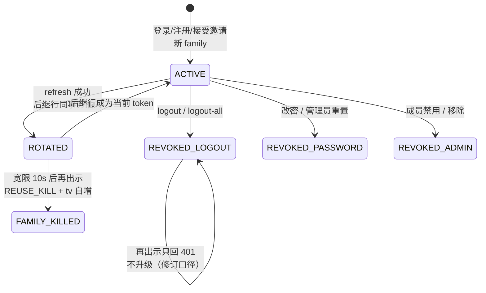

# 专题 15 · 会话族与团队协作（批次 2）

> [专题 1](01-registration-login.md) 讲的是 v2.0.0 的认证：24 小时 JWT、过期即重登、注册即孤岛租户。批次 2 把这三件事全部推翻重做：access token 缩到 1 小时，背后站一个可轮换、可撤销、可侦测盗用的 refresh 会话族；每个请求都要回库复核身份；租户从「一人一岛」变成有邀请、有成员、有角色的团队。本专题讲这套新地基的完整生命周期，深讲细节与模块课 5.x 的分工是：模块课讲单类实现，本专题讲跨类的会话状态机与锁序。

## 1. 业务背景：为什么无状态 JWT 不够用了

v2.0.0 的 JWT 是纯无状态的：签发之后服务器不存任何东西，token 在 24 小时内不可撤销。三个现实问题把它逼到墙角：

1. **改密、禁用、踢人都不即时生效。** token 里写了什么，24 小时内就认什么。管理员把一个成员禁用了，他的 token 还能用到明天。
2. **没有多设备会话的概念。** 「退出所有设备」无从谈起——没有「会话」这个实体，就没有可撤销的对象。
3. **租户里只有创始人一个人。** 注册造租户的模型（[专题 1](01-registration-login.md) 第 8 节取舍一）没有加入路径，团队协作不存在。

批次 2 的答案是把「会话」做成一等公民存进数据库（`lf_refresh_token`），access token 退化为一张 1 小时的短期通行证，每次使用都要回库对一眼证件照（用户行）。代价是认证从零状态变成每请求一次点查——这笔账在 [专题 13](13-performance-and-consistency.md) 的一致性总表里有对应条目。

## 2. 相关类清单

| 类 | 角色 | 深入 |
|----|----|----|
| `SessionService`（auth 包，388 行） | 会话族全生命周期：签发/轮换/登出/改密，本专题主角 | 本专题第 5 节 |
| `RefreshToken` / `RefreshTokenMapper`（auth 包） | `lf_refresh_token` 行与轮换/撤销 SQL（只存 SHA-256） | 本专题第 3 节 |
| `AuthService`（user.service） | 凭据核验：登录双桶限流 + 哑哈希，注册不变 | [专题 1](01-registration-login.md) 第 3 节（3.0.0 修订） |
| `AuthController`（user.controller） | /api/auth 七端点，登录/注册后接 `startSession` 发会话 | 本专题第 3 节 |
| `JwtAuthFilter`（security） | 每请求回查：status / token_version / must_change 三项复核 + 改密墙 | 本专题第 5 节节点三 |
| `JwtService`（security） | 签发带 `tv` claim 的 access token，缺 claim 读 0 | [5.2](../modules/05-security/02-jwt-auth.md) |
| `TeamService`（user.service，450 行） | 邀请与成员管理，M2 锁序与 M7 凭据连坐都在这里 | 本专题第 5 节节点四、五 |
| `TeamController`（user.controller） | /api/tenant 六端点（邀请 3 + 成员 3） | 本专题第 3 节 |
| `TenantInvitation` / `TenantInvitationMapper`（user 包） | `lf_tenant_invitation` 行与单次认领的条件 UPDATE | 本专题第 5 节节点四 |
| `V11` / `V12` 迁移 | token_version、must_change_password 两列 + 两张新表 | [4.2](../modules/04-mybatis-mysql/02-flyway-migrations.md) |

以下源码路径均省略前缀 `src/main/java/com/linkforge/`。

## 3. 完整调用链

### 3.1 登录：核验与签发分家

```
POST /api/auth/login
  → AuthService.login（AuthService.java:51-98，只管凭据）
      ├─ IP 桶 acquire：login:{ip}，5 次/600 秒（:53-59）
      ├─ 账号桶 acquire：login-acct:{tenant}:{username} 小写归一，5 次/600 秒（:62-72）
      ├─ 查租户/用户；不存在或停用 → 用 DUMMY_PASSWORD_HASH 照样跑一次 matches（:82-88）
      └─ 任一不合 → 同一个 401 "invalid credentials"（:89-91）
  → AuthController.login（AuthController.java:32-37）
      └─ sessionService.startSession(userId, request)（SessionService.java:103-114）
            用户行锁内复核仍 active → 新 family_id（UUID）→ 插 lf_refresh_token
            原始 refresh 只在响应里出现一次，库存 SHA-256（prepare :310-330）
  → LoginResponse(access 1h 带 tv claim, refreshToken, mustChangePassword)
```

注册路径同构：`AuthService.register` 建租户+ADMIN 的部分没变（[专题 1](01-registration-login.md) 第 3.1 节），控制器同样在返回前接 `startSession`（`AuthController.java:39-45`）。

### 3.2 轮换：refresh 的一生

```
POST /api/auth/refresh（permitAll，refresh token 本身就是凭据）
  → JwtAuthFilter.shouldNotFilter 跳过（JwtAuthFilter.java:52-63：refresh/logout/accept-invitation 三端点不验 access）
  → SessionService.refresh（SessionService.java:133-196）
      ├─ IP 限流 refresh:{ip} 5/600（凭据型公开入口同档，logout/accept-invitation 同理）
      ├─ 无锁 peek 按 hash 找行，只为决定锁谁的行（:145-150，结果不作数）
      ├─ 事务内：selectForUpdate 锁用户行 → selectByHashForUpdate 重读 token 行
      ├─ 行已撤销 → 进重用判定矩阵（第 5 节节点二）
      ├─ 行过期 / 用户不 active → 401 同文案
      ├─ rotate CAS 标记旧行（revoke_cause=ROTATED, revoked_at=now）
      ├─ 同 family 插后继行，旧行 replaced_by_id 指向它
      └─ 用锁内读到的 token_version 签新 access（buildResponse :332-341）
```

### 3.3 团队：邀请与成员管理

```
POST /api/tenant/invitations（TeamController.java:37，requireAdmin）
  → TeamService.createInvitation（TeamService.java:104-121）
      32 字节随机 token → 只存 SHA-256 → 响应给 /?invite={raw} 链接（7 天，invitation-expire-days）
GET  /api/tenant/invitations        未决邀请列表（已接受/已撤销/已过期不出现）
DELETE /api/tenant/invitations/{id} 撤销（写 revoked_at）
POST /api/auth/accept-invitation（permitAll，邀请 token 即凭据）
  → TeamService.acceptInvitation（TeamService.java:162-196，@Transactional）
      先烧限流预算（accept-invitation:{ip} 5/600）→ 按 hash 查邀请
      → 任一不合（不存在/已撤销/已接受/已过期）→ 同一个 401 "invalid invitation"
      → 插用户行（角色 = invited_role；撞 uk_tenant_username → 409 且邀请不消耗）
      → invitationMapper.accept 条件 UPDATE 认领，返回 0 = 并发输家 → 401 回滚整单
      → sessionService.issueLoginResponse：新账号直接以登录态落地
GET   /api/tenant/members                 成员列表
PATCH /api/tenant/members/{userId}        改角色/启停（最后 ADMIN 护栏）
DELETE /api/tenant/members/{userId}       逻辑移除（资产留租户）
POST  /api/tenant/members/{userId}/reset-password  管理员重置（临时密码只回一次）
```

## 4. 可视化

批次 2 没有对应的 Archify 图（图 10-auth-sequence 冻结在 v2.0.0 口径，时效结论见 [diagram-coverage-matrix](../reference/diagram-coverage-matrix.md)）。Obsidian 环境用内嵌图对照轮换与重用判定：



## 5. 源码详解：五个节点

**节点一：token_version 是 access 的远程kill switch。** V11 给 `lf_user` 加了两列：`token_version INT DEFAULT 0` 与 `must_change_password TINYINT DEFAULT 0`。`JwtService.createToken` 把签发时的版本号写进 `tv` claim（`JwtService.java:38-44`）；V11 之前签的老 token 没有 claim，读作 0，与列默认对齐，自然活完剩余寿命而不是部署即死（V11 注释原文）。版本号只许走原子 SQL 自增（`UserAccountMapper.incrementTokenVersion`），全代码没有一处读-改-写整行——这是修复波 M1 的纪律（见 [专题 17](17-correctness-waves.md)）。

**节点二：重用判定矩阵——只有 ROTATED 超宽限才升级。** refresh 行被撤销后再被出示，`isReuseKill`（`SessionService.java:218-222`）只看两个条件：`revoke_cause = ROTATED` 且 `revoked_at + 10s < now`。四格矩阵：

| 出示的行 | 结局 | 理由（源码注释口径） |
|----|----|----|
| ROTATED，宽限 10 秒内 | 401，family 不动 | 客户端并发刷新/重试的良性竞态（`SessionService.java:56-58`） |
| ROTATED，宽限外 | **整 family 撤销（REUSE_KILL）+ token_version 自增** + 401 | 令牌已被合法轮换退休，此时出示者非偷即持有赃物（RFC 9700 盗用信号） |
| LOGOUT / ADMIN / PASSWORD / REUSE_KILL | 只回 401，**不升级** | 撤销已是处置本身；再出示多半是没学到撤销的诚实旧客户端。升级会让「一次登出 + 任意旧客户端重试」把用户所有设备连坐踢下线（批次 2a 修订，LogoutIT 逼出来的口径，注释 :205-216 明载） |
| 不存在 / 已过期 | 401 | 与上面全部同文案同状态，对外无枚举预言机（类注释 :40-43） |

升级动作有个事务细节值得单独看：family 撤销必须**先提交、后抛 401**。代码把 kill 写在事务里、异常留到 `tx.executeWithoutResult` 返回之后才抛（`SessionService.java:166-175` 的注释与 `reuseKilled` 标志位），在事务内抛异常会把 kill 一起回滚——这是「处置与报错不能同事务回滚」的典型坑。

**节点三：JwtAuthFilter 的每请求回查与改密墙。** 过滤器验签通过后不再直接信任 claim：`authenticate`（`JwtAuthFilter.java:107-160`）按 subject 回库读用户行，身份字段（tenantId、username）一律取行、不取 claim。三项复核：行不存在或 status≠1 → 不置认证（链继续，受保护路径由 entry point 回 401，permitAll 路径不受牵连——批次 2 方案自审 A1 的语义）；`tv` claim 与行内 token_version 不等 → 同上；`must_change_password=1` 且路径不在豁免集 → 直接 403 `PASSWORD_CHANGE_REQUIRED`。豁免集（:41-44）是 change-password、logout、logout-all、refresh 与 health：清标志与结束会话的路不能被标志自己堵死。回查的 DB 故障是第四种结局——稳定 503（S/N 波 S4-5），见 [专题 17](17-correctness-waves.md)。

**节点四：邀请的单次认领是条件 UPDATE，不是先查后改。** `acceptInvitation` 先按 hash 读邀请做四项检查，再插用户行，最后一句 `invitationMapper.accept(id, userId, now)` 是带 `accepted_at IS NULL` 条件的 UPDATE：并发两个接受请求都过了读检查，只有一个的 UPDATE 影响 1 行，输家返回 0 → 抛 401 → 整个事务回滚，它刚插的用户行一并消失，不留孤儿账号（`TeamService.java:188-194`）。用户名撞唯一索引走另一条路：409 且邀请**不消耗**，换个名还能重试（:182-187）。这与注册的 409 兜底（[专题 1](01-registration-login.md) 第 5 节节点一）是同一哲学：并发真相在数据库的原子语句里。

**节点五：最后 ADMIN 护栏与 M2 的锁序。** `updateMember` / `removeMember` / `resetPassword` 三个写路径的第一条语句都是 `tenantMapper.selectForUpdate(tenantId)` 锁租户行（`TeamService.java:228-231` 等），然后才在锁内以 locking current read 重读调用者（`requireAdminUnderLock`，:374 起）、目标行与活跃 ADMIN 集合。护栏判定：目标是活跃 ADMIN 且操作会让他失去这个身份（降级或禁用/移除），而锁内数到的活跃 ADMIN ≤ 1 → 400。为什么必须锁后重读，是修复波 M2 的教训：旧实现先在 RR 快照里数 ADMIN 再拿锁，两个并发降级各看到「还有 2 个 ADMIN」双双放行，租户归零。完整案情见 [专题 17](17-correctness-waves.md)。

**节点六：管理员重置 = 事故恢复，不是顺手解锁。** `resetPassword`（`TeamService.java:318-341`）在同一把锁序里做五件事：写临时密码的 BCrypt（16 位、去易混字符的字母表，:85-89）、置 must_change_password=1、token_version 原子自增、撤销全部 refresh 行（cause=PASSWORD）、**永久撤销该成员的全部 API Key**（`apiKeyMapper.revokeAllForUser`）。最后一件是修复波 M7 的拍板口径：重置意味着凭据可能已泄露，只换密码不撤 key 等于留了后门；key 不可恢复，成员改完密自己重新铸。临时密码只在响应里出现一次，不落库明文、不进日志。

## 6. 正常流程：一个成员的完整生命周期

| 时刻 | 动作 | 证据 |
|----|----|----|
| t0 | 创始人（注册即 ADMIN）创建邀请，拿到 `/?invite=...` 链接，库里只有哈希 | `TeamService.java:104-121` |
| t1 | 被邀者打开链接设用户名密码，accept 成功：用户行 + 邀请认领同事务提交，直接拿到 access+refresh | :162-196 |
| t2 | 被邀者 access 过期，refresh 轮换：旧行 ROTATED，后继行同 family，replaced_by_id 串成链 | `SessionService.java:176-190` |
| t3 | 创始人把被邀者升为 ADMIN：锁内重读护栏通过，只改 role 一列，会话不撤销（角色每请求读行，新角色下个请求生效） | `TeamService.java:228-267` |
| t4 | 被邀者改密：全会话撤销（cause=PASSWORD）+ tv 自增，包括他自己当前会话，须用新密码重登 | `SessionService.java:272-291` |
| t5 | 创始人重置另一成员密码：临时密码回一次，该成员 access 下个请求死、refresh 全撤、API Key 全撤，登录后被 403 墙拦到改密为止 | `TeamService.java:318-341`、`JwtAuthFilter.java:138-144` |

## 7. 异常流程：逐分支出口

| 分支 | 状态 | 证据 |
|----|----|----|
| 登录 IP 桶或账号桶超限 | 429 + Retry-After（两个桶先后判定，metrics entry 分开打点） | `AuthService.java:53-72` |
| 登录凭据任一不合（含租户/用户不存在、停用） | 401 "invalid credentials"，且每条路径恰好跑一次 BCrypt | `AuthService.java:82-91` |
| refresh 出示未知/过期/已撤销（非升级格） | 401 "invalid refresh token"，四类不可区分 | `SessionService.java:151-175` |
| refresh 出示 ROTATED 超宽限 | 401 + 整 family REUSE_KILL + tv 自增 + `linkforge.refresh.reuse_kill` 打点 | :159-175、:193-196 |
| 轮换事务中后继插入失败 | 整单回滚，旧 token **未被消费**、仍可用（M1 合同） | 类注释 :46-54；接缝 `insertSuccessor` :344-347 |
| logout 出示未知 token | 200 静默成功（端点不是有效性预言机） | `SessionService.java:233-253` |
| must_change 用户访问非豁免路径（JWT 或 API Key） | 403 `PASSWORD_CHANGE_REQUIRED`，两凭据同文案同体 | `JwtAuthFilter.java:138-144`、`ApiKeyAuthFilter.java:54-56` |
| 接受邀请：token 任一不合 | 401 "invalid invitation"（不说哪项） | `TeamService.java:166-174` |
| 接受邀请：用户名已被本租户占用 | 409，邀请不消耗 | :182-187 |
| 非 ADMIN 调团队管理端点 | 403（锁内重读后的判定为准） | `TeamService.java:374-384` |
| 操作别租户成员 id | 404（与不存在同形） | :387-395 |
| 降级/禁用/移除最后一个活跃 ADMIN | 400 | :245-250、:288-292 |
| 移除自己 | 400 | :285-287 |
| 回查 DB 故障（两过滤器） | 503 `authentication store unavailable` | [专题 17](17-correctness-waves.md) S4-5 节 |

## 8. 设计取舍

**一、会话进库，换「可撤销」与「可侦测」。** 纯 JWT 的零状态很优雅，但撤销与盗用侦测都需要服务端状态。项目把状态压到最小：access 仍是自包含 JWT（验签零 DB），状态只在 refresh 行与用户行两处，回查用一次主键点查换全部即时性。1 小时的 access 寿命是这笔交易的另一半：logout（单 family）不 bump tv，该 family 的 access 最多再活 1 小时——这个不对称写在 `logout` 的注释里（`SessionService.java:226-232`），是明示的取舍不是遗漏。

**二、锁序全局统一：租户行 → 用户行 → refresh 行。** SessionService 与 TeamService 共用同一顺序（两处类注释互相引用），所有 mint/revoke 临界区先锁用户行。并发正确性不再靠「应该不会同时发生」，靠的是所有写者排同一条队。M1 的合同测试就是用接缝把轮换卡在半路、再并发 logout-all，断言「撤销返回后无会话存活」。

**三、邀请用 bearer 链接，不建邮箱设施。** 项目没有邮件基础设施（README 明确不做），邀请做成「链接即凭据」：只存哈希、单次、7 天可撤销，投递靠创建者带外转发。这把邀请的安全边界收敛成与 refresh/API Key 同一套哈希纪律，三种 bearer 凭据一个样。

**四、成员移除用逻辑删除，资产留租户。** 移除只翻 `deleted` 标记 + 撤 refresh + bump tv；成员的 API Key 不逐行处理，靠 key 过滤器的 owner 回查（行不可见 → 401）自然死亡（V12 注释与 TeamService 类注释 :44-51）。链接与 webhook 是租户资产，一行不动——「人走，茶不凉，钥匙全收」。

**五、防枚举的文案纪律贯穿全批。** 登录四种失败一个文案 + 哑哈希抹平时延；refresh 四类失败一个文案；邀请接受失败一个文案；跨租户成员 id 与不存在同形。代价是排障全靠 metrics 标签与日志，教材口径：这是刻意的，见 [专题 10](10-api-key-auth.md) 第 8 节取舍四的同一纪律。
