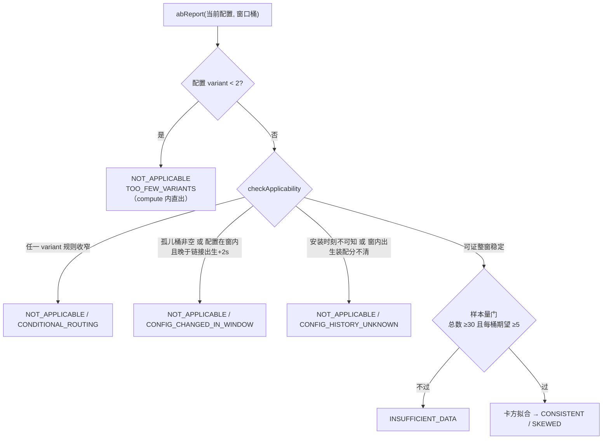

# 专题 16 · 链接能力扩展（批次 3 与幂等深化）

> 批次 1、2 修的是地基（限流、会话、团队），批次 3 长的是链接本身的能力面：标签与搜索让链接可管理，match_rule 让 A/B 分流从「纯权重抽签」升级为「先按请求画像收窄候选集，再抽签」，原始点击导出与 A/B 拟合诊断补上数据出口，恶意主机 feed 给域名门禁接上外部情报。同一批还把创建/导入的幂等从「记住结果」深化成「认得出请求体变了没有」。本专题按能力逐个拆，最后收在幂等深化上——它横跨创建与导入两条链，是全批最容易读漏的部分。

## 1. 业务背景：从「能建链」到「能运营」

v2.0.0 的链接列表只能翻页，没有搜索；variants 只有权重，抽签对所有访客一视同仁；统计只有聚合数，没有原始明细出口；A/B 分流是否均匀只能靠肉眼看桶。这四件事都是运营动作，不是跳转动作——所以它们整批出现，且全部落在管理面与统计面，跳转热路径只多了一步候选收窄（第 3 节）。

## 2. 相关类清单

| 类 | 角色 | 深入 |
|----|----|----|
| `LinkTags`（link.support） | 标签归一化纯函数：小写、去重、单标签 `[a-z0-9_-]{1,32}`、至多 10 个 | 本专题第 5 节节点一 |
| `MatchRule`（link.support，331 行） | match_rule JSON 的写时严校验 / 读时宽容解析 / 候选收窄，本批主角 | 本专题第 5 节节点二、三 |
| `ShortLinkService`（link.service） | list/export 带 keyword/tag 筛选；指纹 v2 与导入租约的宿主 | 本专题第 3、5 节 |
| `AbReport`（stats.support，286 行） | 卡方拟合优度纯函数 + S1 适用性门 | 本专题第 5 节节点五 |
| `ClickStatsService.abReport / exportClicks` | 报告组装（当前配置 + 窗口桶）与原始导出（id 游标分批） | 本专题第 3 节 |
| `CsvFormat.escapeSpreadsheet`（link.support） | CSV 公式注入中和（M8），全部 CSV 导出的出口 | 本专题第 5 节节点四 |
| `ImportIdempotencyLease`（link.support） | 导入在途租约：SET NX + Lua CAS settle/release | 本专题第 5 节节点七 |
| `MaliciousHostSnapshot` / `MaliciousHostSyncService` / `MaliciousFeedParser`（link 包） | feed 快照、定时导入、hostfile 解析 | 本专题第 5 节节点八 |
| `PhishingPolicy`（link.support） | 判定合并点：静态名单 + feed 快照同入 TargetPolicy 判定 | [7.2](../modules/07-redirection/02-password-and-domain-gates.md) |
| `V13` / `V14` 迁移 | `lf_short_link.tags`、`lf_link_variant.match_rule` 两列 + `lf_malicious_host` 表 | [4.2](../modules/04-mybatis-mysql/02-flyway-migrations.md) |

源码路径前缀 `src/main/java/com/linkforge/` 省略。

## 3. 完整调用链

### 3.1 列表与导出（管理面）

```
GET /api/links?keyword=&tag=
  → ShortLinkController.list（ShortLinkController.java:53-55）
  → ShortLinkService.list → pageOwn → applyFilters（ShortLinkService.java:510 起）
      keyword：对 code/original_url/title 做 LIKE（% 与 _ 先转义，按字面搜）
      tag：FIND_IN_SET(?, tags) 整词匹配（tags 是逗号拼接单列，V13 注释的规模取舍）
GET /api/links/export?keyword=&tag=  同筛选集，CsvFormat.escapeSpreadsheet 逐格中和
PATCH /api/links/{code}  tags 三态与 variants 同形：null 不动、[] 清空、非空整组替换（update :913-916）
```

### 3.2 跳转：match_rule 收窄候选集

```
resolveTarget 判定链全过（专题 4 / 7.1）→ variants 非空
  → ClickDimensions 先算 device/os（与维度分桶同一实现，值域即 MatchRule 的 DEVICES/OS_VALUES）
  → MatchRule.filterCandidates（MatchRule.java:320-330）
      每 variant：parseLenient(match_rule)（坏 JSON 退化通配，不炸跳转）
        rule == null（无规则/空规则）→ 恒入选
        rule.matches(device, os, language, now)：维度间 AND、同维度内 OR、时间窗列表 OR
      全部落选 → 返回完整集（规则只收窄，永不让链接无目标）
  → VariantPicker 在候选集内按权重抽签（7.3 原路径不变）
```

language 取 Accept-Language 第一项的主标签（`MatchRule.primaryTag`，zh-CN → zh）。时间窗的星期语义是 S/N 波 S4-4 的开窗日口径，见第 5 节节点三。

### 3.3 统计面新出口

```
GET /api/links/{code}/ab-report?days=
  → ClickStatsService.abReport（ClickStatsService.java:228-271）
      当前 variant 配置（权重）× 窗口内 variant 维度桶（观测）→ 孤儿桶单列
      先过 AbReport.checkApplicability 适用性门（节点五）→ 过门才 compute 卡方拟合
GET /api/links/{code}/clicks/export?days=
  → ClickStatsService.exportClicks（:286 起）
      id 游标分批（批 1000）拼 CSV，上限 linkforge.clicks-export-max-rows（默认 100,000）
      触顶 → 追加 "# truncated at N rows" 注释行 + X-Export-Truncated 头
```

## 4. 可视化

批次 3 无专属 Archify 图（判定链图 12 冻结在 v2.0.0 口径，时效见 [diagram-coverage-matrix](../reference/diagram-coverage-matrix.md)；mermaid 判定链图已按本批更新，见 [redirect-decision-chain](../diagrams/mermaid/redirect-decision-chain.md)）。A/B 报告的判定顺序用内嵌图对照：



## 5. 源码详解：八个节点

**节点一：标签用单列而不是联结表。** V13 只给 `lf_short_link` 加一列 `tags VARCHAR(512)`，归一化后逗号拼接存储（`LinkTags.normalize`，`LinkTags.java:37` 起）。V13 注释把取舍写明：这个规模下不建 join 表，整词查靠 FIND_IN_SET。代价是标签查不走索引、聚合统计做不了；收益是写入与三态更新（节点 3.1）与 variants 完全同形，零新机制。规模判断写进迁移注释，是「按当前量级选结构」的样本。

**节点二：match_rule 的双面解析。** 同一个 JSON，写读两副面孔。写侧 `MatchRule.parse`（`MatchRule.java:80` 起）严格：未知键、越界值、坏时区、from==to 全部 400——错误要在存入时拦下。读侧 `parseLenient`（:109-115）宽容：任何异常退化为 null（通配）——库里躺着一行坏规则（手工改库、旧版本写入）不能把跳转打成 500。判定词汇表钉死在 ClickDimensions 的输出域上（DEVICES/OS_VALUES 常量，:41-45），分桶与路由共用一套词汇，类注释要求两边 lockstep。

**节点三：时间窗与开窗日语义（S4-4）。** `windowMatches`（`MatchRule.java:283-312`）的规则：窗口在规则自带的 IANA 时区里求值；weekdays 缺省 = 每天。跨午夜窗（from > to）分两段：`[from, 24:00)` 与 `[00:00, to)`。S/N 波修的是第二段的星期归属：**严格跨午夜的尾段按开窗日（前一日）读 weekdays**——23:00–02:00 且 weekdays=[周一]，命中周一 23 点段与**周二**凌晨段，不命中周一凌晨段（那是周日开的窗的尾巴）。旧实现全程按当前日读，跨午夜窗要覆盖尾段必须把两天都列上；审计的 should-fix 指出这与直觉不符后才改。两个边界保持旧读法：开窗段与非跨午夜窗按当日读；from==to 的退化窗（写侧已拒绝，只防手工数据）整窗按当日读。纽约时区 DST 切换日的参数化用例在 MatchRuleTest 里钉着。

**节点四：CSV 公式注入中和（M8）。** 导出 CSV 的文本格（标题、原始 URL、代码）是用户可控的，`=cmd|...` 开头的格在 Excel 里会被当公式执行。`CsvFormat.escapeSpreadsheet`（`CsvFormat.java:29-52`）在 RFC4180 转义**之前**先看原文：跳过前导空白/制表/回车换行后，首字符是 `= + - @` 之一就给原值加单引号前缀（表格软件按文本渲染）。检测跑在未引号化的原文上，危险前缀藏不进 CSV 引号里。修复波把全部 CSV 出口（链接导出、点击导出）都换到这个函数；纯转义的 `escape` 只留给非表格场景。

**节点五：A/B 报告先过适用性门（S1）。** 报告的本体是卡方拟合优度（`AbReport.compute`，`AbReport.java:72` 起）：观测分布 vs 配置权重，p<0.05 判 SKEWED，附 Wilson 区间。它**不是转化测试**——类注释写明，能观测的只有点击本身，而点击数正是抽签的产物，所以它测的是「抽签管道有没有坏」（picker bug、缓存钉死某个 variant、路由规则吃掉某 variant 的流量）。S/N 波加的门在拟合之前（`checkApplicability`，:136-163），理由码优先级写死：

1. `CONDITIONAL_ROUTING`：任一当前 variant 的规则经**解析后**确实收窄（`isConstraining()`，:257-260；`"{}"` 不算，空数组在解析期归一为缺省维度）——全局权重拟合对条件流量无意义；
2. `CONFIG_CHANGED_IN_WINDOW`：孤儿桶非空（配置删过的 variant 还在窗口里留了点击），或当前配置的安装时刻在窗内且晚于链接出生 +2 秒；
3. `CONFIG_HISTORY_UNKNOWN`：安装时刻在窗内但与「出生即装配」分不清，或时刻不可知。

稳定性为什么可证：variant 行从不原地更新，全代码只有整集插入（创建/导入）与整集删+插（update），一集共享同一个应用侧 created_at（`AbReport.java:117-127` 的证明注释，并警告未来的原地编辑路径必须重新打戳）。NA 时 chiSquare/pValue 为 null、df=0、expected/share/CI 全 null，但 totalClicks 与逐行观测照报——窗口事实与拟合结论分开，响应不可能被误读成显著性结论（`notApplicable`，:165-179）。

**节点六：创建指纹 v2——密码进指纹，但只进 HMAC（M4）。** 批次 3b 的 create-v1 指纹只记「设没设密码」一位：同 key 同 URL、密码不同，也会被判同一请求重放——这是审计 M4 的原案。`createFingerprint`（`ShortLinkService.java:294-303`）的 create-v2 把规范形里那一位换成 `HMAC-SHA256(pepper, trim 后的密码字节)`：pepper 来自配置 `linkforge.idempotency.pepper`（环境变量 `LINKFORGE_IDEMPOTENCY_PEPPER`，仓库默认值只是 dev 用），指纹里带 `pv1` 椒盐版本段。两个细节是审出来的：HMAC 的输入必须是**存储语义的字节**——落库前密码会 trim，指纹就 HMAC trim 后的字节，否则「会存成同一凭据的两个请求」指纹不同（M4 B 项）；明文与裸哈希都不进指纹与 Redis，低熵密码经 HMAC 后不可离线爆破。settle 信封同步升为 `v3:<create-v2 指纹>:<code>`（doCreate :467-469）。

**节点七：旧信封的读回与 fail-closed。** `replayIdempotentCreate`（`ShortLinkService.java:213-264`）要同时读三代存量值：v3 按 v2 指纹验；`v2:`（3b 的旧指纹）对**无密码**重试仍可验旧指纹重放，对**带密码**重试直接 409——旧指纹证明不了密码相等，宁可让调用方换新 key（fail-closed）；无前缀的老值同理。旧值随 24 小时 TTL 自然老化，无需迁移。轮换 pepper 的后果同理：旧指纹全灭、409 fail-closed，配置注释明载。

**节点八：导入在途租约（M5）与 feed 的「先应用后声称」（S3）。** 导入的幂等在 3b 只有 settle 后缓存：两个并发同 key 导入都读到 miss、都执行。`ImportIdempotencyLease`（121 行）把 `idem-import:` 键做成小状态机：`pending:<ownerUUID>:<文件 SHA-256>` 由 SET NX 占位（TTL 120 秒），settle 与 release 都走 Lua 全值 CAS——租约过期被新尝试接管后，旧持有者既不能覆盖也不能删新值。`acquireImportLease`（`ShortLinkService.java:694` 起）的分类：同文件在途 → 409 `IDEMPOTENCY_IN_PROGRESS`；异文件 → 409 `IDEMPOTENCY_KEY_REUSED`；Redis 挂 → fail-open 无租约执行（回到 3b 行为，打点可见）。写前失败立即 CAS 释放租约（改对文件马上能重试），写后失败不释放——已有行落库，靠 settle 或 TTL 收场。边界明说：**这不是崩溃恢复**，持有者中途死掉的行已部分落库、租约过期后重试可能再执行一遍（专题 17 的未决披露之一）。feed 侧 S3 修的是顺序：`MaliciousHostSyncService.ingest`（`MaliciousHostSyncService.java:120-157`）先 upsert 入库，再 `snapshot.refresh()` 真正应用成功，才推进 `last_success` 仪表与 ok 计数；refresh 失败计 `apply_failed`、时间戳不动、判定继续用旧快照——「新鲜度声称」必须晚于「数据生效」。

**节点九：恶意判定是本地快照，不是逐请求外查。** feed 开关默认关（`linkforge.malicious-feed.enabled=false`，`application.yml:249-256`），开后每 6 小时把 URLhaus hostfile 导入 `lf_malicious_host`。判定路径零外呼：`MaliciousHostSnapshot` 把全表载入内存集合，`PhishingPolicy` 构建判定视图时把快照与静态名单合并（`PhishingPolicy.java:67` 附近），创建与跳转复用原 B9 通道（BLOCK 语义）。开关关时快照钉空——表里有存量行也零效果，与 3b 之前逐字一致。feed 里消失的 host 不自动除名（V14 注释：last_seen 停涨而已，除名是运营决策）。

## 6. 正常流程

| 场景 | 时间线 | 证据 |
|----|----|----|
| 带规则分流 | 移动端 zh 访客命中 devices+language 规则的 variant 候选集，抽签只在集内进行 | `MatchRule.java:320-330` + 7.3 抽签 |
| 规则全落选 | 三个 variant 各有规则且无一命中 → 完整集抽签，链接照常跳转 | `MatchRule.java:329` |
| A/B 报告（稳定配置） | 闸门放行 → compute：期望按权重分、卡方与 p 值出齐，verdict CONSISTENT | `AbReport.java:72-108` |
| A/B 报告（窗内改过权重） | 孤儿桶或安装时刻证据 → NA + CONFIG_CHANGED_IN_WINDOW，观测数照报、拟合数全 null | `ClickStatsService.java:245-262` |
| 原始导出触顶 | 游标批拼到 100,000 行，探一行确认截断，注释行 + 响应头标记 | `ClickStatsService.java:286-315` |
| 并发同 key 导入 | 先到者拿租约执行；后到同文件得 409 IN_PROGRESS，改完后（settle）再同 key 重放直接回存量结果 | `ShortLinkService.java:589-613` |

## 7. 异常流程

| 分支 | 结局 | 证据 |
|----|----|----|
| match_rule 写时不合语法/值域 | 400，逐键报错（如 unknown key、tz 非 IANA） | `MatchRule.java:80-107` |
| 库里 match_rule 已损坏（读时） | 该 variant 按通配处理，跳转不受影响 | `MatchRule.java:109-115` |
| 同 key 异体创建（含密码不同） | 409 IDEMPOTENCY_KEY_REUSED | `ShortLinkService.java:229-240` |
| 带密码重试撞旧 v2/无前缀存量值 | 409 fail-closed（证明不了相等） | :241-257 |
| 同 key 异文件导入 | 409 IDEMPOTENCY_KEY_REUSED（settle 后与在途两种情形同码） | :716-720、:794-796 |
| Redis 故障（租约/指纹读） | fail-open 继续执行，打点 `linkforge.cache.failopen{op=...}` | :694-707 等 |
| feed 拉取/解析失败 | 旧表旧快照不动，只计 sync failed；last_success 不推进 | `MaliciousHostSyncService.java:77-98` |
| feed 已入库但快照应用失败 | 计 apply_failed，判定用旧快照，下轮成功刷新自愈 | :141-152 |
| 导出窗口无数据 | 空 CSV（只有 BOM + 表头），不报错 | `ClickStatsService.java:286` 起 |

## 8. 设计取舍

**一、能力加在管理面，热路径只付候选收窄一步。** 标签、搜索、导出、报告都不进跳转路径；match_rule 是唯一例外，代价被压成「每 variant 一次宽容解析 + 一次纯函数判定」，且全落选回退完整集——规则配错的最坏结果是分流不准，不是链接打不开。

**二、严格写、宽容读。** match_rule 的双面解析与 feed 的「坏数据保旧」是同一取向两面：写入端拦错误（400 在保存时），运行端容忍错误（通配/旧快照继续服务）。把校验放在写侧，读侧就不需要为坏数据设计失败语义。

**三、拟合之前先问「能不能拟合」。** S1 的适用性门本质是把统计诚实做成代码：数据不支持结论时，API 返回的是「不适用 + 机器可读理由」，不是一个看似精确的 p 值。理由码是稳定线协议（枚举注释明载不改名），totalClicks 照报保证 NA 不是黑盒。

**四、幂等的演进方向是「认体」不是「认键」。** 3b 认键记结果 → M4 认体（含密码 HMAC）判重放 → M5 给导入补上在途互斥。三步都守一条线：敏感材料进指纹必须先过 HMAC，宁可 fail-closed 409 也不拿裸哈希或「设没设」糊弄相等性。

**五、外部情报只进本地判定。** feed 是唯一新增的外呼，且被隔离在定时任务里（fetch 与 ingest 分开，测试只驱动 ingest）。判定面永远读内存快照，外部服务商的可用性与本系统的跳转可用性彻底解耦；默认关则保证本地演示零外部依赖。

## 自测题

1. 为什么 M4 的指纹用 HMAC-SHA256 而不是把口令明文哈希（如裸 SHA-256）或直接不进指纹？（提示：裸哈希可离线撞库，「设没设」则同键异口令被误判重放。）
2. 导入租约为什么只防「在途并发」而不防「进程崩溃后续跑」？崩溃后同键同文件重试会发生什么，教材在哪一节登记了这条边界？
3. A/B 报告四个理由码的优先级为什么 CONDITIONAL_ROUTING 在 CONFIG_CHANGED_IN_WINDOW 之前？
4. 导出中和（M8）改的是单元格的显示值还是存储值？为什么只在导出层做、不在入库时做？
