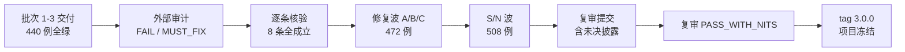

# 专题 17 · 正确性修复波：一次外部审计的完整闭环

> 批次 1–3 交付后，项目把全部代码交给外部审计（Grok）复核，结论是 FAIL / MUST_FIX：8 条必修（M1–M8）、4 条应修（S1–S4）、2 条建议（N1、N2）。本专题不讲新功能，讲这 8 条必修各自错在哪、根因是什么、怎么修的、靠什么测试证明修好了；再讲 S/N 的处置口径、三项至今未关的诚实披露，以及复审 PASS_WITH_NITS 后项目在 3.0.0 冻结的终局。它是全教材的收官专题：前面十六个专题讲「系统怎么工作」，这一篇讲「系统被证明错了之后怎么办」。

## 1. 背景：审计发现的是哪一类错

先给结论定性：8 条必修没有一条是「功能没实现」。功能都在、测试在审计前全绿（440 例）。它们全是**并发与边界语义**的错——两个操作交错时丢数、护栏被旧快照绕过、指纹少算了一位、导出少防了一类注入。这类错的共同点是：单线程测试全过，错误只在交错、重放、跨组件的缝里现形。审计的价值不在找崩溃，在找这些缝。

修复分三波 PR（A：M1+M2+M7 会话与团队；B：M3+M4+M5 数据与幂等；C：M6+M8 控制台与导出），随后 S/N 波处理应修与建议项，收尾文档对账后提交复审。下面逐条按同一格式记：审计发现 → 根因 → 修法 → 测试证据。类与机制的深讲在 [专题 15](15-auth-sessions-and-teams.md)、[专题 16](16-link-power-features.md)，本专题只记修复本身。

## 2. 修复波涉及的核心位置

| 条目 | 核心文件 | 一句话 |
|----|----|----|
| M1 | `auth/SessionService.java`、`user/mapper/UserAccountMapper.java` | 轮换与撤销的交错窗口 |
| M2 | `user/service/TeamService.java` | 最后 ADMIN 护栏的读快照时机 |
| M3 | `webhook/service/WebhookAggregateFlusher.java`、`V15` | 聚合 drain 的快照删行丢数 |
| M4 | `link/service/ShortLinkService.java`（createFingerprint） | 指纹不含密码材料 |
| M5 | `link/support/ImportIdempotencyLease.java` | 导入无在途互斥 |
| M6 | `src/main/resources/static/index.html` | 控制台保存静默清 matchRule |
| M7 | `security/ApiKeyAuthFilter.java`、`user/service/TeamService.java` | 改密墙与重置的凭据连坐缺失 |
| M8 | `link/support/CsvFormat.java` | CSV 公式注入未中和 |
| S1 | `stats/support/AbReport.java` | A/B 拟合无适用性前提 |
| S4-5 / N1 | `security/JwtAuthFilter.java`、`common/web/CorrelationIdFilter.java` | 认证存储故障语义与请求关联 id |

## 3. 时间线：从 FAIL 到冻结

| 阶段 | 内容 | 结果口径 |
|----|----|----|
| 批次 1–3 基线 | 三批交付，440 例全绿 | main `4f3580e` |
| 外部审计 | Grok 全量复核 | FAIL / MUST_FIX（M1–M8、S1–S4、N1、N2） |
| 开发侧核验 | 逐条对着代码复现/核对 | 8 条全部成立；两处口径由开发侧拍板（第 4 节 M5、M7） |
| 修复波 A/B/C | 三个 PR 分域修复 | 合并后 472 例 = 200 单测 + 270 IT + 2 时区 fork，零失败 |
| S/N 波 | 两个 PR（α 后端、γ 控制台）+ 文档对账 | 508 例 = 226 + 280 + 2，零失败 |
| 复审提交 | 自包含复审文档（基线、逐条探针映射、披露清单） | 外部审计改判 PASS_WITH_NITS |
| 冻结 | 用户打 tag `3.0.0`（`f27b9cb`） | 项目冻结，批次 4 池只登记不排期 |

两处需要开发侧拍板的口径，记在这里以免后文含糊：

- **M5 按审计合同的闸门口径修**（审计文本内部对 M5 有两种深度——完整检查点设计 vs 闸门的租约方案；复审提交里把分歧明示给审计方，复审接受了闸门口径）。含义见 M5 条目与第 7 节披露。
- **M7 的 key 处置选「永久撤销全部」**（而非只挂墙）：重置即事故恢复，见 M7 条目。

## 4. 可视化

## 5. M1–M8 逐条

### M1 · refresh 轮换与全量撤销非原子

- **审计发现**：`refresh` 的「标记旧行 ROTATED + 插后继行」与 `logout-all` / 改密的「撤全部行 + bump token_version」可以交错：撤销先提交、轮换后提交时，轮换新铸的后继行逃过撤销——撤销接口已经返回成功，会话却还活着。
- **根因**：两条路径没有共同的串行化点。版本号还是实体读-改-写，交错时后写覆盖先写，bump 会丢。
- **修法**：确立全局锁序 **租户行 → 用户行 → refresh 行**；SessionService 全部 mint/revoke 临界区进同一事务，第一条凭据语句 `selectForUpdate` 锁用户行，轮换在锁内重读 token 行（FOR UPDATE）再 rotate + 插后继 + 回填 replaced_by_id，一起提交；token_version 只走原子 SQL 自增。撤销排在轮换后面时，它撤的集合里包含刚铸的后继行——「撤销返回后无会话存活」成为可断言的合同（`SessionService.java:44-54` 类注释、:133-196）。
- **测试证据**：`insertSuccessor` 接缝（:344-347）让合同测试把轮换卡在半路，并发执行 logout-all / 改密，断言两边都返回后无任何可用会话；后继插入失败时整单回滚、旧 token 未被消费也可断言。

### M2 · 最后 ADMIN 护栏被 RR 旧快照击穿

- **审计发现**：成员写路径先在 REPEATABLE READ 快照里数活跃 ADMIN 再执行降级/禁用/移除。两个并发请求各在自己的快照里看到「还有 2 个 ADMIN」，双双放行，租户剩下 0 个 ADMIN。
- **根因**：护栏的**判定读**发生在拿锁之前，快照建立后别的事务改了世界，本事务看不见。这与护栏逻辑本身无关——逻辑是对的，读的时机是错的。
- **修法**：三个写路径（updateMember / removeMember / resetPassword）的第一条语句改为锁租户行（`tenantMapper.selectForUpdate`），锁后才重读调用者权限、目标行与活跃 ADMIN 集合，全部走 locking current read（`TeamService.java:228-231`、:374-395）。第二个并发请求在锁上排队，轮到它时读到的是第一个留下的世界。
- **测试证据**：并发屏障交错测试：两请求同发降级两个不同 ADMIN，断言恰一成功一 400、租户至少剩 1 个活跃 ADMIN。

### M3 · Webhook 聚合冲刷两条丢数路径

- **审计发现**：AGGREGATE 的 flusher 旧实现是「无锁读快照 → 生成 digest → 按快照 id 删行」，且撞 `uk_webhook_endpoint_event` 的 DuplicateKey 被吞。两条丢数：(1) 快照后、删除前落在已快照桶上的增量，行被删、数没进任何 digest；(2) 已冲刷窗口里迟到的**新**桶，下一批复用裸窗口 eventId 撞唯一键被吞，然后照样删行——未发送先删除。
- **根因**：读与删之间没有锁，事件 id 的命名空间（每窗一个）又装不下「同窗多次 drain」这个现实。
- **修法**：drain 改为单事务四步（`WebhookAggregateFlusher.java:149-171`）：`selectByEndpointWindowForUpdate` 锁行读桶 → 在 V15 新表 `lf_webhook_flush_state` 里给该 endpoint 分配持久序号 flush_seq（同事务推进，回滚不耗号）→ 以 `digest-{endpointId}-{windowStart}-{seq}`（分片加 `-part{n}`）插投递行 → 只删锁住的那批行。任何一步失败整单回滚，缓冲原样、序号未耗、重试复现同一批 eventId。被锁桶上的并发增量会阻塞到 drain 提交，然后落成新行进下一窗——不再有「删了没发」。
- **测试证据**：`insertDelivery` 接缝（:215-219）强制在 payload 构建后失败，断言投递行、删行、序号三者全回滚；迟到新桶场景断言以新 seq 正常发出。

### M4 · 幂等指纹只记「设了密码」

- **审计发现**：create-v1 指纹对访问密码只记一位 set/unset。同一个 Idempotency-Key、同一个 URL、**不同密码**的第二次请求被判为重放，返回第一次的短链——密码被静默吞掉。
- **根因**：指纹的规范形在「密码不可入指纹」的顾虑下过度脱敏，把一位布尔当成了密码的全部信息。
- **修法**：指纹升 create-v2：密码以 `HMAC-SHA256(pepper, trim 后字节)` 进规范形（pepper 走环境变量，带 pv1 版本段）；settle 信封升 `v3:<fpV2>:<code>`；旧 v2/无前缀存量值对带密码重试 fail-closed 409（证明不了相等就不重放）。细节见 [专题 16](16-link-power-features.md) 节点六、七（`ShortLinkService.java:277-303`、:213-264）。
- **测试证据**：同 key 异密码 → 409；同 key 同密码（含 trim 等价形）→ 正常重放；旧信封三代读回各有对应用例。

### M5 · CSV 导入没有在途互斥

- **审计发现**：导入幂等只有 settle 后结果缓存。两个并发同 key 导入都读到 miss、都执行，行被导入两遍。
- **根因**：缓存是「事后记账」，不是「事前占位」；create 的两段式 pending 机制没有移植到导入。
- **修法**：`ImportIdempotencyLease`：导入键先 SET NX 占位 `pending:<owner>:<文件 SHA-256>`（TTL 120 秒），settle/release 走 Lua 全值 CAS；同文件在途 409 `IDEMPOTENCY_IN_PROGRESS`，异文件 409 `IDEMPOTENCY_KEY_REUSED`；Redis 故障 fail-open 回到 settle-only 行为（`ImportIdempotencyLease.java` 全文、`ShortLinkService.java:684-707` 的范围注释）。
- **口径与披露**：按审计合同的闸门口径交付——租约只保证健康 Redis 下的并发互斥，**不做崩溃恢复**：持有者写一半死掉，租约等 TTL 过期，之后的重试可能再执行。这条限制写在类注释与服务注释里，复审时明示并被接受；详见第 7 节。
- **测试证据**：屏障交错的双导入并发测试：恰一份执行、另一份得 409；租约被接管后旧持有者 settle/release 均 CAS 失败。

### M6 · 控制台编辑静默清掉 matchRule

- **审计发现**：控制台的 variant 编辑表单没有 matchRule 编辑器，加载详情时读到了规则，保存时提交的整集却不带它——一次无关编辑（改个权重）就把运营配的路由规则清成 null，无任何提示。
- **根因**：前端把「表单没展示的字段」当成「字段不存在」，整集替换语义下缺席即删除。
- **修法**：控制台按「未动不提交、动了整集带全」重写 variant 提交（`index.html:691` 起的 M6 注释块）：每行 variant 的 matchRule 在加载时单独保存（state.editRules），结构化比较（键序无关的 canonical 序列化）判定整集是否真的变了；没变 → PATCH 不带 variants 字段；变了 → 整集每行都带回各自保存的规则（删除行才连规则一起丢）。后端整集语义一字未动。
- **测试证据**：Node 合同测试在本地实跑（CI 不执行该脚本）：构造「改权重不动规则」「增删行」等场景断言提交体；后端整集语义由既有 IT 覆盖。真实浏览器手点未做，见第 7 节披露。

### M7 · 改密墙只挡 JWT，且管理员重置不撤 API Key

- **审计发现**：两处。(1) must_change_password 的 403 墙只在 JwtAuthFilter 里，API Key 是另一条过滤器——被重置的成员拿旧 key 照常调数据面，墙形同虚设。(2) 管理员重置只换密码，被重置者已铸的 API Key 一个都没动。
- **根因**：墙按凭据类型实现而不是按「人」实现；重置的语义被当成「顺手解锁」而不是「凭据事故恢复」。
- **修法**：(1) ApiKeyAuthFilter 在 owner 回查后加同一堵墙：owner 处于 must-change 时，活 key 直接 403 `PASSWORD_CHANGE_REQUIRED`（与 JWT 字节一致，`ApiKeyAuthFilter.java:54-56`、:133-139）；已撤销的 key 在 owner 仍处于 must-change 时也回 403（持有人证明自己持有那把死 key，告诉他先改密不泄密），owner 改完密后该 key 回到统一 401。(2) `TeamService.resetPassword` 在同一锁序事务里 `revokeAllForUser` 永久撤销该成员全部 API Key，且 ApiKeyService 在 must-change 时拒绝铸新 key——重置与铸 key 竞态时，新 key 不是被撤就是被拒（`TeamService.java:310-341`、`ApiKeyService.java:67`）。
- **测试证据**：重置后旧 key 立即 401/403 的 IT；must-change 期间 key 调用得 403、改密后恢复的 IT；墙的响应体与 JWT 侧逐字一致有断言。

### M8 · CSV 导出未中和公式单元格

- **审计发现**：链接导出与点击导出只做 RFC4180 引号转义。标题、URL 等用户可控文本以 `=`、`+`、`-`、`@` 开头时，Excel/表格软件打开会当公式执行（CSV 公式注入）。
- **根因**：转义解决的是 CSV 语法问题，不是表格语义问题，两层被混为一谈。
- **修法**：`CsvFormat.escapeSpreadsheet`（`CsvFormat.java:29-52`）：先在**原文**上跳过前导空白类字符看首字符，命中四字符就在原值前加单引号再走原转义；其余值与旧行为逐字节一致。全部 CSV 出口换用它。
- **测试证据**：纯函数单测覆盖四字符、前导空白藏匿、引号内藏匿、正常值不变四类样本。

## 6. S/N 波处置（应修与建议）

| 条目 | 处置 | 要点 |
|----|----|----|
| S1 | 全量实现 | A/B 报告加适用性门（[专题 16](16-link-power-features.md) 节点五）；既有拟合 IT 以回拨配置安装时刻的方式保住原断言，没有为迁就新门改弱断言 |
| S2 | 控制台收尾组 | 改密强制页四入口统一分流、邀请接受视图（token 用后即从 URL 抹除、不入 DOM）、setPassword 的 prompt() 改 modal（全文静态断言 prompt( 为 0）、启动恢复会话、logout-all 按钮、列表 keyword/tag 筛选接线 |
| S3 | 只做一刀 | feed ingest 顺序反转：先应用快照、后声称新鲜（[专题 16](16-link-power-features.md) 节点八）；feed 上限/超限合同、流式落库、标签级查找等其余部分登记进批次 4 池，未做 |
| S4 | 五个小项全做 | 4-1 stats 三读合进一个只读 RR 快照事务（`ClickStatsService.java:77-79、164-183`，breakdown 仍是最终一致读，口径分开写明）；4-2 create 租约 CAS 未做，README 的幂等保证口径改准（settle 去重只覆盖顺序重放，pending 是 5 秒尽力标记，不宣称 exactly-once），机制登记批次 4；4-3 凭据 retention 未做，登记批次 4；4-4 跨午夜开窗日语义（[专题 16](16-link-power-features.md) 节点三）；4-5 两认证过滤器的存储故障统一稳定 503，日志只带 userId/keyId 不带凭据 |
| N1 | 实现 | CorrelationIdFilter（链首、服务端铸造不采信入站头）+ MDC `cid` + 响应头 + 日志 pattern `[%X{cid}]`；handleBiz 对 5xx/带 cause 的 BizException 恰记一次（含 cause 链），Bloom 失败文案改固定串 "bloom rebuild failed" 防双记 |
| N2 | 实现 | progress.md 文件头加活指针与状态表（经批准的历史文件头部例外，正文历史一字未动） |

被明确**砍掉**而不是推迟的三件，理由在案：重定向逐跳校验（目标是部署配置 URL + 名单阈值已有兜底，逐跳校验的收益不抵热路径代价）、熔断框架（现有手写 fail-open 已覆盖全部依赖故障语义，框架是净增复杂度）、前端 SPA 化（单文件控制台与项目规模匹配）。

## 7. 未决披露（复审时明示，至今未关）

这三条在复审提交文档里原样列给审计方，PASS_WITH_NITS 是在知情下给的。它们不是「忘了修」，是范围与证据的边界：

1. **M5 崩溃恢复不覆盖**：租约只管并发互斥。导入持有者进程中途死亡、已写部分行时，租约 120 秒后过期，同 key 重试可能再次执行该文件（行级 doCreate 的逐行成败会让重复行以失败行形式出现，但不保证）。关闭它需要持久化的导入操作记录表，本轮明确不建。
2. **M6 真实浏览器手点未做**：证据是 Node 合同测试（断言提交体形状）+ 后端 IT（整集语义）+ 源码走读；没有在真实浏览器里点一遍编辑-保存流程。控制台是单文件静态页、无构建链，合同测试覆盖的是它与 API 的契约面，但「手点」这一格空着，如实登记。
3. **M1 参数化矩阵未逐格铺满**：M1 的合同由接缝交错测试覆盖关键交错（轮换 × logout-all、轮换 × 改密、插入失败回滚），不是「全部操作 × 全部时点」的穷举矩阵。锁序论证（全局统一顺序 + 锁内重读）是其余格子的依据，测试只钉了最险的几格。

另有一条环境级限制顺带登记：Bloom 的 HTTP 级失败注入在本项目结构下不可行（其 mapper 喂 @PostConstruct 预热，注入点不在请求路径），Bloom 相关结论的证据等级是单测 + 源码走读。

## 8. 设计取舍（方法论层）

**一、先核验，再修。** 8 条必修开发侧逐条对着代码核过才动手——结论是全成立，但核验本身逼出了两个审计文本没写清的点（M5 两种深度、M7 的 key 处置），都在动手前拍板并记进复审提交。审计是输入，不是命令；被审方把分歧明示给审计方裁决，而不是挑对自己有利的读法默默执行。

**二、护栏与原子性的通用形状。** M1、M2 是同一课：并发护栏 = 一把大家共用的锁 + 锁内当前读 + 原子自增。任何「先查后改」的护栏在并发下都是建议而非保证；把检查搬进锁内、把计数搬进 SQL，是这波留下的可迁移结论（[专题 13](13-performance-and-consistency.md) 的一致性总表已按此更新）。

**三、fail-closed 只用在「证明不了相等」的地方。** M4 的旧信封、M5 的 peek 失败、S4-5 的 503，都是同一个判断：拿不到证据时，拒绝或显式报错，而不是猜一个对用户方便的答案。这与全项目的 fail-open 纪律不冲突——fail-open 保的是可用性（统计、限流），fail-closed 保的是凭据与幂等这类「猜错了会串账」的语义，[专题 12](12-dependency-failure-handling.md) 的矩阵按这个分界读。

**四、复审的 PASS_WITH_NITS 不是开发侧自封的。** 修复波关闭时开发侧的自评只写「M1–M8 闸门满足，待审计方独立复审」；FAIL→PASS_WITH_NITS 的改判由外部审计在复审提交（含本节三条披露）后给出。随后用户冻结项目并打 tag 3.0.0。教材对这段历史的口径与提交文档一致：结论归审计方，过程归本专题。

**五、冻结是登记，不是删除。** 没做的事分三格放好：批次 4 池（短码防枚举居首，及实时点击流、UTM 构建器、S3/S4 的剩余项等）、砍掉（第 6 节三件，理由在案）、随上云再议（自定义域名、Geo、B10 Linux bench、多实例指标）。冻结后若重启，入口是这三格而不是从零讨论——这是本专题作为收官的最后一件事：把「不做什么」也交代清楚。

## 自测题

1. M1 与 M2 为什么必须放在同一个 PR 里修？两条各自的竞态窗口在哪一行代码的哪两步之间？
2. 「闸门口径」是什么意思？M5 的 §12.4 与 §4C 之争里，开发侧最终按哪边交付、向审计方披露了什么？
3. 三项未关披露为什么不影响复审结论？如果将来解冻，处理它们的顺序应该是什么？
