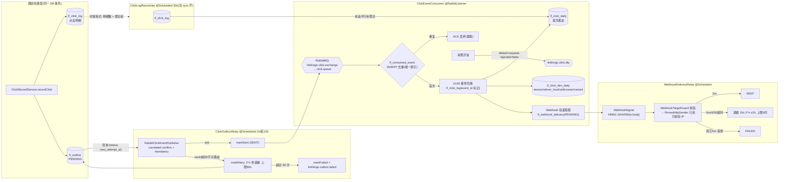

# Mermaid 备用图 · 点击统计管道（Outbox → MQ → 消费聚合 → Webhook）

> 交互版见 [../archify/html/14-click-pipeline-dataflow.html](../archify/html/14-click-pipeline-dataflow.html)。
> 口径来源：README「点击统计管道（A7）」「维度分析（A8）」「开放能力 B5」；实现类 `stats/service/ClickRecordService.java`、`stats/service/ClickOutboxRelay.java`、`stats/mq/ClickEventConsumer.java`、`webhook/service/*`。

要点核对表：

| 图上环节 | 关键语义 | 源码位置主题 |
|---|---|---|
| 同事务双写 | `@Transactional`：明细 + outbox 要么都在要么都不在 | `ClickRecordService` |
| Relay 投递 | broker ack 后才标 SENT；确认超时按失败重试 | `ClickOutboxRelay`、`RabbitClickEventPublisher` |
| 消费幂等 | 去重插入与聚合同一短事务（防中间崩溃少计） | `ClickStatsService.consume`/`ClickEventConsumer` |
| 回填明细 | sync 关闭后明细由消费者补写，event_id 标记防对账重放 | `ClickEventConsumer` |
| 维度聚合 | 只在消费路径解析 UA/Referer，热路径零新增计算 | `ClickDimensions` |
| Webhook 意图 | 在幂等事务内落 PENDING；断 MQ 期间停在 outbox，恢复自动补出 | `WebhookService` |
| 两个时钟 | outbox 用 DB 时钟退避；webhook 投递退避也在 DB 时钟，SENT 清理时 webhook 用 JVM 时钟 | `SentRowCleanup` |
