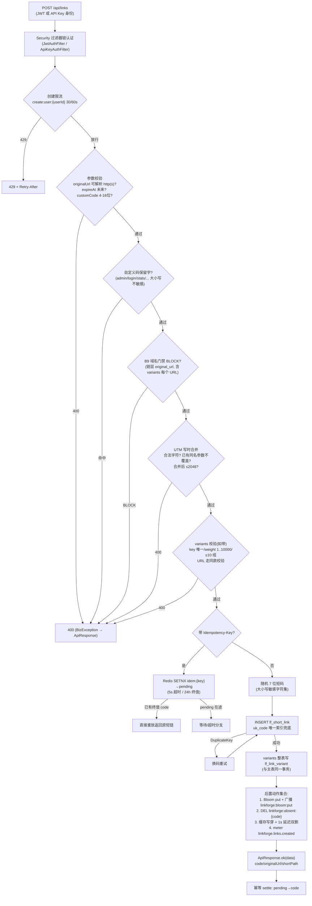

# Mermaid 备用图 · 创建短链流程（POST /api/links）

> 交互版见 [../archify/html/11-shortlink-create.html](../archify/html/11-shortlink-create.html)。
> 口径来源：README「短链管理」「A/B 权重分流与批量导入（C3）」「目标域名名单门禁（B9）」；实现类 `link/controller/ShortLinkController.java`、`link/service/ShortLinkService.java`（create→doCreate）。

要点核对表（课程 6.2 逐条展开）：

| 图上节点 | 语义要点 |
|---|---|
| 校验顺序 | 结构性校验全部在任何写之前（C3 导入也复用同一路径防漂移） |
| 撞码 | 不做「先查后插」，唯一索引是并发正确性来源，DuplicateKey 重试 |
| 幂等两段式 | pending 5 秒自愈、终值保留 24h；胜者崩溃后下一位可重新领头 |
| 门禁 BLOCK | 建链阶段拒绝存量写入；跳转阶段对行上 URL 复查（名单变更对存量立即生效） |
| 后置动作 | Bloom put、absent 清除、缓存写穿、广播全部在事务提交路径上，失败 fail-open 不阻断创建 |
