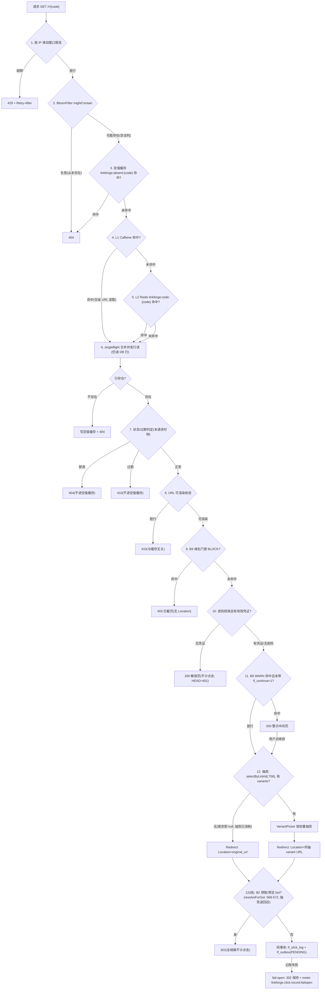

# Mermaid 备用图 · 跳转判定链（GET /r/{code}）

> 交互版见 [../archify/html/12-redirect-decision.html](../archify/html/12-redirect-decision.html)。
> 口径来源：课程 7.1「resolveTarget：12 步判定总顺序」表（源码 `ShortLinkService.java:601-712` 实测，编号以此为准；README 列表把 L1/L2 合并为一步且 B2 排在抽签前）；实现类 `link/controller/RedirectController.java` 与 `link/service/ShortLinkService.java`（resolveTarget/resolveForProbe/resolveForGet）。每步失败语义互不吞并。

要点核对表（对应源码主题，课程 07 系列逐条讲）：

| 图上节点 | 源码位置主题 |
|---|---|
| 1 限流 | `RedisRateLimiter` + `sliding_window.lua` |
| 2 Bloom | `CodeBloomFilter` |
| 3 空值缓存 | `ShortLinkService` absent 分支 |
| 4/5/6 L1/L2/行读 | `UrlLocalCache`、`ShortLinkRowLoader`、`SingleFlight` |
| 7/8 状态与校验 | 行状态字段 + `LinkValidations` |
| 9/11 B9 | `TargetPolicy`/`PhishingPolicy`/`GatePages` |
| 10 密码门 | `LinkAccessTokens`、`/r/{code}/unlock` |
| 12 抽签 | `VariantPicker`、`LinkVariantMapper` |
| 12(续) B2 | `ClickFilter` |
| 记账 | `ClickRecordService.recordClick` |
