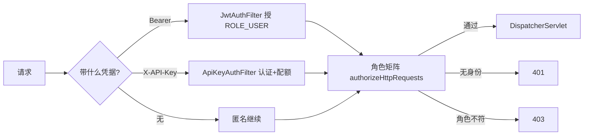

# 5.1 安全过滤器链：SecurityConfig 全链装配

> 本课回答一个问题：一个 HTTP 请求进到 LinkForge 后，在被 Controller 处理之前，安全层对它做了什么、按什么顺序做、失败时返回什么。

## 1. 本节学习目标

学完本课，你应该能：

1. 说出 4 个自定义 Filter 的执行顺序与各自的 `addFilterBefore/After` 锚点。
2. 背出 permitAll 放行清单与角色矩阵，并解释顺序为什么敏感。
3. 解释 `linkforge.docs-enabled` 三层开关在 prod 如何逐层关掉文档与控制台。
4. 分清 401 与 403 的框架级双来源（entryPoint 与 accessDeniedHandler），以及项目里额外的第三种 401。

## 2. 前置知识

- Servlet Filter（过滤器）：请求进 Servlet 之前经过的组件，多个 Filter 串成链，每个决定「继续传」还是「自己写响应返回」。
- `SecurityFilterChain`：Spring Security 管理的 Filter 链，排在 `DispatcherServlet` 之前，安全判断发生在 MVC 分发之前。请求全貌见模块 3.2。`@Configuration`/`@Bean` 模块 1.2 已讲。

## 3. 本节涉及的源码

| 文件 | 行数 | 职责 | 阅读顺序 |
|----|----|----|----|
| `src/main/java/com/linkforge/security/SecurityConfig.java` | 100 | 本课主角：装配整条安全链 | 1 |
| `src/main/java/com/linkforge/security/MetricsScrapeTokenFilter.java` | 66 | 用常量时间比较守卫 /actuator/prometheus | 2 |
| `src/main/java/com/linkforge/security/JwtAuthFilter.java` | 60 | 解析 Bearer JWT，授予 ROLE_USER | 3（5.2 深讲） |
| `src/main/java/com/linkforge/security/ApiKeyAuthFilter.java` | 162 | X-API-Key 认证、配额、ROLE_API_KEY | 4（12.1 深讲） |
| `src/main/java/com/linkforge/security/QrShareAuthFilter.java` | 73 | exp+sig 签名放行 GET qr.png | 5 |

为什么这个顺序读：SecurityConfig 只做「装配」，四个 Filter 是四个待填的槽位，后面两课再逐个打开。

## 4. 类的定位（在项目中的位置）

`SecurityConfig` 是 LinkForge 安全体系唯一的一张「总装配台」。整个项目只有一个 `SecurityFilterChain` Bean（`SecurityConfig.java:33-94`），所有路径的放行、拒绝、角色要求、401/403 响应体都定义在这一个方法里。它位于 `security` 包，这个包一共 9 个文件：1 个配置类、4 个 Filter、2 个承载身份的值对象（`AuthUser`、`UserContext`）、1 个 record（`QrSharePrincipal`）、1 个签发器（`JwtService`，5.2 讲）。

对外它只暴露两样东西：这条 Filter 链，和一个 `PasswordEncoder` Bean（`SecurityConfig.java:96-99`，BCrypt 实现，注册与登录用它哈希与比对密码）。

## 5. 核心源码详解

### 5.1 类声明与注入

```java
@Configuration
@EnableWebSecurity
@RequiredArgsConstructor
public class SecurityConfig {

    private final JwtAuthFilter jwtAuthFilter;
    private final ApiKeyAuthFilter apiKeyAuthFilter;
    private final QrShareAuthFilter qrShareAuthFilter;
    private final MetricsScrapeTokenFilter metricsScrapeTokenFilter;
```
（`src/main/java/com/linkforge/security/SecurityConfig.java:19-27`）

- `@EnableWebSecurity` 是框架行为：打开 Spring Security 的 Web 安全支持，没有它不会构建 Filter 链。四个 Filter 都是 `@Component`，由 `@RequiredArgsConstructor` 生成构造器注入（模块 1.2 的标准姿势）。

### 5.2 一个不走 LinkForgeProperties 的配置

```java
/** false in prod: docs are denied at the filter chain before reaching springdoc. */
@Value("${linkforge.docs-enabled:true}")
private boolean docsEnabled;
```
（`SecurityConfig.java:29-31`）

这是主源码里少见的直接用 `@Value` 的地方。项目其余业务配置统一走 `LinkForgeProperties`（`@ConfigurationProperties`，模块 1.3）；这里单用一个布尔值，注解说清了动机：prod 置 false 时，文档在过滤器链这一层就被拒绝，根本到不了 springdoc。默认 true，所以 dev 与 test 不用配它。

### 5.3 三条全局开关：CSRF、CORS、会话

```java
http.csrf(AbstractHttpConfigurer::disable)
        .cors(Customizer.withDefaults())
        .sessionManagement(sm -> sm.sessionCreationPolicy(SessionCreationPolicy.STATELESS))
```
（`SecurityConfig.java:37-39`）

- 关 CSRF：CSRF（跨站请求伪造）是「浏览器自动带上 Cookie 会话」带来的攻击面。本项目不用 Cookie 会话（见 STATELESS），凭据放在请求头里由客户端显式携带，浏览器不会自动带，所以可以关。
- CORS 用默认配置：交给全局的 CORS 配置处理，不是本课重点。
- STATELESS：Spring Security 不创建、不使用 HttpSession。每个请求的身份都是 Filter 现场算出来的，请求结束即丢弃。代价是没有「登录一次、服务器记住你」的能力，收益是服务可以水平扩容，不用粘会话。

### 5.4 permitAll 清单

| 行 | 规则 | 为什么放行 |
|----|----|----|
| `:41` | `/actuator/health`、`/api/health` | 存活探针，调用方（负载均衡、compose healthcheck）没有凭据 |
| `:42` | `/api/auth/**` | 登录与注册本身，用户此刻还没有 token |
| `:43-44` | `GET/HEAD /r/**` | 短链跳转，匿名访客是业务主体 |
| `:45-46` | `POST /r/*/unlock` | 密码短链的解锁表单，注释写明：设计上匿名，服务层限流兜底 |

注意 `:45` 的注释：「anonymous by design, brute-force limited in the service」。放行不等于不设防，防线从链层挪到了服务层（模块 7.2 讲解锁限流）。

### 5.5 docsEnabled 分支与三层开关

```java
if (docsEnabled) {
    auth.requestMatchers(docsPaths).permitAll()
            .requestMatchers(consolePaths).permitAll();
} else {
    // prod: deny docs and the static console at the filter chain;
    // add-mappings=false alone leaves "/" erroring with 500.
    auth.requestMatchers(docsPaths).denyAll()
            .requestMatchers(consolePaths).denyAll();
}
```
（`SecurityConfig.java:47-55`；`docsPaths` 与 `consolePaths` 定义在 `:35-36`）

prod 的 `application.yml` 用三层开关逐层收紧（`src/main/resources/application.yml:247-261`）：

1. `spring.web.resources.add-mappings: false`（`:254`）：不再把静态资源目录映射进来。
2. `springdoc.api-docs.enabled: false` 与 `springdoc.swagger-ui.enabled: false`（`:255-259`）：springdoc 自身关闭。
3. `linkforge.docs-enabled: false`（`:261`）：过滤器链层 `denyAll` 兜底。

注释（`:51-52`）点出了为什么要第三层：只关 `add-mappings` 时，`/` 不再返回控制台页面，但也没人处理它，结果是 500。`denyAll` 让它变成明确的拒绝。

### 5.6 角色矩阵

显式能力白名单（`SecurityConfig.java:61-69`），三个要点先记下：

| 路径 | 允许角色 | 行 |
|----|----|----|
| `GET /api/links/{code}/qr.png` | USER 或 API_KEY 或 QR_SHARE | `:61-62` |
| `/api/links/**` | USER 或 API_KEY | `:63` |
| `/api/keys/**`、`/api/webhooks/**` | 仅 USER | `:64` |
| `/actuator/prometheus` | 仅 METRICS | `:67` |
| `/actuator/**` | 仅 USER | `:68` |
| `anyRequest()` | 仅 USER | `:69` |

三个要点：

- KEY 不能摸管理面：`/api/keys/**` 只给 USER，API_KEY 访问会得到 403。注释（`:56-58`）称之为 explicit capability whitelist。
- QR_SHARE 是签名访客：`QrShareAuthFilter` 校验 exp+sig 后授予（`:59-60` 注释），所以没有 permitAll 的 QR 路由。
- 顺序敏感：`:67` 的 `/actuator/prometheus` 必须写在 `:68` 的 `/actuator/**` 前面。`authorizeHttpRequests` 从上到下取第一条匹配规则，若颠倒，prometheus 会先被 `/actuator/**` 吃掉，要求 USER 角色，采集器永远 401。

### 5.7 401 与 403 的框架级双来源

```java
.exceptionHandling(eh -> eh
        .authenticationEntryPoint((request, response, ex) -> {
            response.setStatus(HttpServletResponse.SC_UNAUTHORIZED);
            response.setContentType("application/json;charset=UTF-8");
            response.getWriter().write("{\"code\":401,\"message\":\"unauthorized\",\"data\":null}");
        })
        .accessDeniedHandler((request, response, ex) -> {
            response.setStatus(HttpServletResponse.SC_FORBIDDEN);
            response.setContentType("application/json;charset=UTF-8");
            response.getWriter().write("{\"code\":403,\"message\":\"forbidden\",\"data\":null}");
        }))
```
（`SecurityConfig.java:71-83`）

- 401 来自 `authenticationEntryPoint`（`:72-76`）：请求没带任何凭据却撞上受保护路径。Spring Security 抛出的 AuthenticationException 走到这里。
- 403 来自 `accessDeniedHandler`（`:79-80`）：身份有了，角色不够。注释（`:77-78`）举例：API_KEY 命中任何白名单之外的路径，得到 JSON 403。

两个 handler 都手写 JSON。响应体形状与 `ApiResponse`（`{code,message,data}`）一致，但没有复用那个类，原因见第 9 节。

### 5.8 四个 Filter 的挂载点

```java
.addFilterBefore(jwtAuthFilter, UsernamePasswordAuthenticationFilter.class)
.addFilterBefore(metricsScrapeTokenFilter, JwtAuthFilter.class)
.addFilterAfter(apiKeyAuthFilter, JwtAuthFilter.class)
.addFilterAfter(qrShareAuthFilter, ApiKeyAuthFilter.class);
```
（`SecurityConfig.java:89-92`）

`addFilterBefore/After` 用「锚点 Filter 的类」表达相对位置；`UsernamePasswordAuthenticationFilter` 是内置表单登录过滤器的位置标记，本项目借它当锚。最终顺序：

```
MetricsScrapeTokenFilter → JwtAuthFilter → ApiKeyAuthFilter → QrShareAuthFilter → （其余 Spring Security 内置 Filter）→ DispatcherServlet
```

`:84-88` 的注释解释了这样排的理由：metrics 过滤器必须在 JWT 之前看到原始 Bearer（scrape token 不是 JWT，先过 JwtAuthFilter 会被 401）；key 过滤器在 JWT 之后，两个都可能建立 SecurityContext；两个都带则由 key 过滤器报 400（12.1 讲）。QrShare 排最后，只处理带签名参数的请求。

## 6. 技术原理补充

**SecurityFilterChain（框架概念）。** 一条有序 Filter 链，定义「谁能过、怎么认证、失败返回什么」。它把安全从业务代码里剥出来，Controller 只面对已认证请求。不用它，每个 Controller 都要自己查 token、判角色。本项目用一个 Bean 装配全部规则；优点是集中可审计，缺点是规则改动都挤在这一个方法里。

**permitAll 与 hasRole（框架概念）。** `permitAll()` 不要求认证；`hasRole("USER")` 要求角色 `ROLE_USER`，参数写 `USER`，框架自动补 `ROLE_` 前缀，所以 Filter 里 `new SimpleGrantedAuthority("ROLE_USER")` 的前缀必须手写。`:69` 的 `anyRequest().hasRole("USER")` 是兜底：清单外一律按 JWT 用户处理。

**CSRF 与 STATELESS（框架概念）。** 两者是配套决策。有会话 Cookie 才需要防 CSRF；纯 Header 凭据加 STATELESS 时 CSRF 失去载体。代价是接受「没有记住登录」的能力。若未来引入 Cookie 会话登录，CSRF 必须重开。

**Filter 顺序即语义（本项目实现）。** 先设 SecurityContext 的 Filter 决定这个请求是谁。三个 Filter 都可能设身份，互斥性靠顺序与显式检查：key 过滤器看到 Bearer 头直接 400（`ApiKeyAuthFilter.java:73-78`），JWT 过滤器用 `shouldNotFilter` 躲开 prometheus 路径。

## 7. 可视化

按顺序看：

1. [10-auth-sequence](../../diagrams/archify/html/10-auth-sequence.html)（本模块专属时序图，注册/登录/过滤器链）
2. [03-package-map](../../diagrams/archify/html/03-package-map.html)：security 包 9 个文件的位置与相互引用。
3. [00-system-architecture](../../diagrams/archify/html/00-system-architecture.html)：安全层在整体架构中的入口位置。

把时序图节点对到类：`MetricsScrapeTokenFilter` 对「scrape 守卫」，`JwtAuthFilter` 对「JWT 校验」，`ApiKeyAuthFilter` 对「key 认证」，两个 handler 对「401/403 JSON」出口。Obsidian 无 auth 专用 Mermaid 备用图，可用这张自带图：



## 8. 项目中的真实执行过程

以三个请求为例（都在 `DispatcherServlet` 之前）：

1. `GET /api/links/abc123`，带 `Authorization: Bearer eyJ...`。MetricsScrapeTokenFilter 的 `shouldNotFilter` 返回 true（不是 prometheus，`MetricsScrapeTokenFilter.java:34-41`）直接放行；JwtAuthFilter 解析 token 成功，设 SecurityContext 为 ROLE_USER；ApiKeyAuthFilter 看到无 `X-API-Key` 头放行；角色矩阵 `:63` 命中 USER，进入 Controller。
2. `GET /r/abc123`，匿名。三个自定义 Filter 都放行（跳转路径无凭据），permitAll `:43` 命中，进跳转逻辑。
3. `GET /actuator/prometheus`，无凭据。JwtAuthFilter 被跳过；MetricsScrapeTokenFilter 发现没配 token 或 token 不匹配，常量时间比较失败后直写 401（`MetricsScrapeTokenFilter.java:49-55`），请求到此为止。这个 401 不经过 `:72-76` 的 entryPoint，401 在本项目有三个来源，5.2 并排列清楚。

## 9. 为什么这样设计

- **默认拒绝（fail-closed）。** `anyRequest().hasRole("USER")`（`:69`）让新增路径默认受保护，放行必须显式声明。这是白名单思路：清单外一律拒绝。
- **拒绝也要友好。** `:51-52` 注释说明 denyAll 是为了把「静默 500」换成「明确拒绝」。三层开关层层递进，理由都写在原注释里。
- **为什么 401/403 手写 JSON 而不复用 ApiResponse。** 统一异常处理在 `GlobalExceptionHandler`（模块 2.1），而 Filter 在 DispatcherServlet 之前，Filter 里抛的异常到不了那个 Advice。ApiKeyAuthFilter 的类注释（`ApiKeyAuthFilter.java:36-37`）明说了这一点，两处 JSON 形状靠人工保持一致，是一个已知维护点。
- **位置关系写在同一处。** 四个 `addFilter*` 行相邻（`:89-92`），读一个方法就能重建整条链的顺序。（设计意图推断，源码未注释。）

## 10. 本节总结

SecurityConfig 用约 60 行 DSL 定义了全项目的访问控制：先关 CSRF、定死 STATELESS，再列放行清单，然后按 docsEnabled 决定文档可见性，接着是角色白名单，最后挂上 4 个自定义 Filter 并手写 401/403 JSON。记住三件事：顺序敏感（prometheus 在 /actuator/** 前）、默认拒绝（anyRequest 兜底）、Filter 层的 JSON 与全局异常处理是双份的。

## 11. 课后练习

**练习 1（执行过程）。** 写出请求依次经过的 4 个自定义 Filter 的类名与顺序，并说明每个 Filter 挂载用的锚点类。

参考答案：MetricsScrapeTokenFilter（`addFilterBefore` 锚 JwtAuthFilter，`SecurityConfig.java:90`）→ JwtAuthFilter（`addFilterBefore` 锚 UsernamePasswordAuthenticationFilter，`:89`）→ ApiKeyAuthFilter（`addFilterAfter` 锚 JwtAuthFilter，`:91`）→ QrShareAuthFilter（`addFilterAfter` 锚 ApiKeyAuthFilter，`:92`）。

**练习 2（源码定位）。** 一个只带 `X-API-Key` 的请求访问 `GET /api/keys`，最终状态码是什么？由哪个组件产生？

参考答案：403。ApiKeyAuthFilter 的 `shouldNotFilter` 对 `/api/` 一律不跳过（`ApiKeyAuthFilter.java:58-60`），key 有效则授 ROLE_API_KEY；角色矩阵 `:64` 要求 USER，不匹配，AccessDeniedException 走 `accessDeniedHandler`（`SecurityConfig.java:79-83`）返回 `{"code":403,"message":"forbidden","data":null}`。

**练习 3（设计分析）。** 把 `:67` 的 prometheus 规则挪到 `:68` 的 `/actuator/**` 之后会发生什么？

参考答案：`authorizeHttpRequests` 按声明顺序取第一条匹配规则。`/actuator/prometheus` 会先命中 `:68`，要求 ROLE_USER，METRICS 角色的采集器全部 401/403，`:67` 变成永远到不了的死规则。

**练习 4（概念理解）。** prod 里匿名请求 `GET /swagger-ui.html` 会命中哪个分支？直觉上的「403」一定成立吗？

参考答案：命中 denyAll 分支（`SecurityConfig.java:50-55`，由 yml `:261` 的 false 驱动）。匿名访问被拒时，Spring Security 的 ExceptionTranslationFilter 会先尝试引导认证，走 entryPoint 返回 401，而不是 403；带有效 JWT 的用户才会收到 403。后半句是框架一般行为（Spring Security 6 默认匿名认证开启），本项目测试未直接断言这一场景，作合理推断标注。

**练习 5（设计分析）。** 如果要在 `/api/auth/**` 下新增一个 `POST /api/auth/logout` 接口，需要改 SecurityConfig 吗？

参考答案：不需要。`:42` 的 `/api/auth/**` 已按前缀放行。反过来说，auth 包的任何新端点都自动匿名可达，必要时用更窄的 matcher 收紧。

## 12. 与后续课程的联系

5.2 打开链上第二个槽位：JwtAuthFilter 与 JwtService 的逐行实现，并回答「401 到底有几个来源」。5.3 讲项目自建的 UserContext 与授权判定。12.1 打开第三个槽位 ApiKeyAuthFilter，包括配额双闸与吊销即时性。之后可读专题[「注册与登录全链路」](../../advanced/01-registration-login.md)与[「API Key 认证」](../../advanced/10-api-key-auth.md)。
