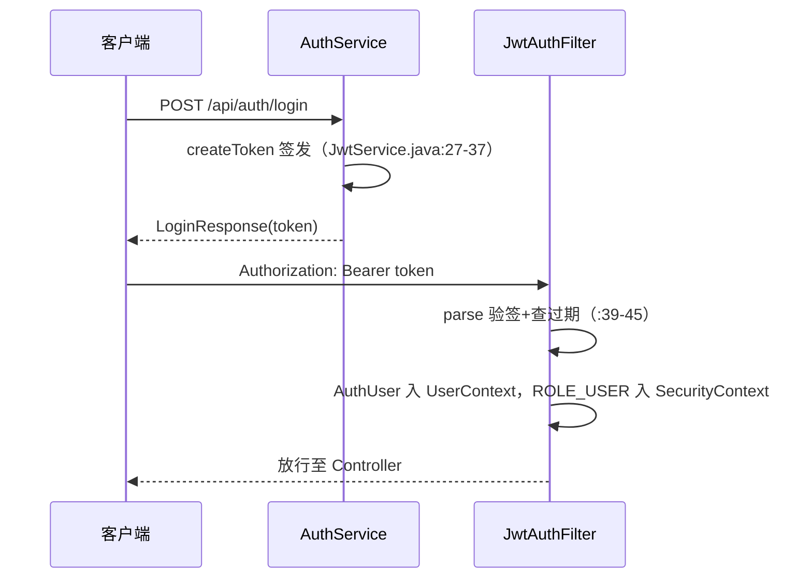

# 5.2 JWT 签发与校验：JwtService 与 JwtAuthFilter

> 上一课把 JwtAuthFilter 当黑盒。本课打开它，连同它背后的 JwtService，并把「401 到底从哪来」数清楚。

## 1. 本节学习目标

1. 逐行读懂 JwtService 的签发（createToken）与校验（parse），说出 jjwt 0.12 的 builder、parser、Keys 三件套各做什么。
2. 逐步跟踪 JwtAuthFilter 处理一个 Bearer 请求的每一步，包括两条非正常出口。
3. 辨析本项目三个 401 来源的行号与响应体差异。
4. 通过课堂推演理解 `Long.valueOf` 的 500 隐患与 catch 边界的关系。
5. 说清 token 过期后的现状：项目没有续期机制，过期即重新登录。

## 2. 前置知识

- JWT（JSON Web Token）：一个自包含的令牌，形如 `xxxxx.yyyyy.zzzzz` 三段，点号分隔。前两段是 Base64url 编码的 JSON（头部、负载），第三段是对前两段的 HMAC 签名。签名保证内容没被改过，但不加密，任何人都能读出负载。
- HMAC：带密钥的哈希。只有掌握密钥的一方才能算出正确的签名，校验方用同一密钥重算并比对。
- Base64url：Base64 的 URL 安全变体，把 `+`、`/` 换成 `-`、`_`。token 要放进 HTTP 头，不能带 URL 特殊字符。
- 过滤器链位置：本课两个类是 5.1 那条链上的第 2 个槽位及其依赖。

## 3. 本节涉及的源码

| 文件 | 行数 | 职责 | 阅读顺序 |
|----|----|----|----|
| `src/main/java/com/linkforge/security/JwtService.java` | 46 | HMAC 签发与校验 JWT | 1 |
| `src/main/java/com/linkforge/security/JwtAuthFilter.java` | 60 | 每请求解析 Bearer，建立身份 | 2 |
| `src/main/java/com/linkforge/security/AuthUser.java` | 14 | 校验成功后的身份载荷 | 3 |
| `src/main/resources/application.yml` | `:103-105` | `linkforge.jwt` 配置段 | 4 |
| `src/main/java/com/linkforge/config/LinkForgeProperties.java` | `:89-92` | Jwt 内部类：secret、expireHours 默认 24 | 5 |

jjwt 是外部依赖，版本 0.12.6（`pom.xml` 管理）。「三件套」指本课会用到的三个入口：`Jwts.builder()`（组装并签名）、`Jwts.parser()`（构建校验器）、`Keys.hmacShaKeyFor()`（把字节数组变成 HMAC 密钥对象）。

## 4. 类的定位

`JwtService` 是全项目唯一碰 JWT 的类，签发与校验都从这里走。它有两个消费者：`JwtAuthFilter` 每个请求调 `parse`（校验），`AuthService` 在注册和登录成功时调 `createToken`（签发，`AuthService.java:54` 与 `:97`）。`JwtAuthFilter` 是 5.1 安全链上的第二个自定义 Filter，只做一件事：把合法的 Bearer token 变成一个已认证的 SecurityContext 加一个 `UserContext` 载荷。`AuthUser` 是两个认证 Filter（JWT 与 API Key）共用的身份载体，14 行，字段含义在第 5 节逐个讲。

## 5. 核心源码详解

### 5.1 JwtService：构造器把配置变成密钥

```java
@Service
public class JwtService {

    private final SecretKey key;
    private final long expireHours;

    public JwtService(LinkForgeProperties properties) {
        byte[] bytes = properties.getJwt().getSecret().getBytes(StandardCharsets.UTF_8);
        this.key = Keys.hmacShaKeyFor(bytes);
        this.expireHours = properties.getJwt().getExpireHours();
    }
```
（`JwtService.java:15-25`）

三个点：

- 密钥只算一次。`SecretKey` 是不可变对象，放在 final 字段里，构造时从 `linkforge.jwt.secret`（yml `:104`，环境变量 `JWT_SECRET`）取字节。所有请求共用一个实例，无锁也无线程问题。
- `Keys.hmacShaKeyFor` 是框架行为：按字节长度决定 HMAC 变体（32 字节对应 HS256 一档，更长对应更强的变体），不足 256 位直接抛异常拒绝启动。项目不写死算法，密钥强度由配置决定。
- `expireHours` 默认 24（`LinkForgeProperties.java:91`，yml `:105` 可覆盖）。

### 5.2 createToken：签发逐行

```java
public String createToken(Long userId, Long tenantId, String username) {
    Instant now = Instant.now();
    return Jwts.builder()
            .subject(String.valueOf(userId))
            .claim("tenantId", tenantId)
            .claim("username", username)
            .issuedAt(Date.from(now))
            .expiration(Date.from(now.plus(expireHours, ChronoUnit.HOURS)))
            .signWith(key)
            .compact();
}
```
（`JwtService.java:27-37`）

- `subject` 是 JWT 标准字段，放 userId 的字符串形式。
- `tenantId`、`username` 是自定义 claim，随 token 走，校验方不用回库查。
- `expiration` 是标准过期时间，`now + expireHours` 小时。过期判断由 jjwt 在 parse 时自动做。
- `signWith(key)` 用构造器里那把密钥签名，`compact()` 输出三段式字符串。

注意签发时没有放角色、没有放 tenantRole。角色是校验方按「能出示合法 token」这一事实授予的固定值 ROLE_USER（见 5.3），tenantRole 判断每次回库查（5.3 课细讲）。token 负载里只有身份，没有权限，改权限不需要重新签发。

### 5.3 parse：校验一行核心

```java
public Claims parse(String token) {
    return Jwts.parser()
            .verifyWith(key)
            .build()
            .parseSignedClaims(token)
            .getPayload();
}
```
（`JwtService.java:39-45`）

`parseSignedClaims` 一步做完三件事：验签（签名对不上就抛异常）、读负载、查过期（过期抛 `ExpiredJwtException`）。这些异常全部是 `JwtException` 的子类，这个继承关系决定了 JwtAuthFilter 的 catch 写法，是本课最重要的一个框架事实。

### 5.4 JwtAuthFilter：每个请求走一遍

```java
protected void doFilterInternal(HttpServletRequest request, HttpServletResponse response, FilterChain filterChain)
        throws ServletException, IOException {
    try {
        String header = request.getHeader(HttpHeaders.AUTHORIZATION);
        if (header != null && header.startsWith("Bearer ")) {
            String token = header.substring(7);
            Claims claims = jwtService.parse(token);
            Long userId = Long.valueOf(claims.getSubject());
            Long tenantId = claims.get("tenantId", Long.class);
            String username = claims.get("username", String.class);
            AuthUser authUser = new AuthUser(userId, tenantId, username, null);
            UserContext.set(authUser);
            var authentication = new UsernamePasswordAuthenticationToken(
                    authUser, null, List.of(new SimpleGrantedAuthority("ROLE_USER")));
            SecurityContextHolder.getContext().setAuthentication(authentication);
        }
        filterChain.doFilter(request, response);
    } catch (JwtException ex) {
        response.setStatus(HttpServletResponse.SC_UNAUTHORIZED);
        response.setContentType("application/json;charset=UTF-8");
        response.getWriter().write("{\"code\":401,\"message\":\"invalid token\",\"data\":null}");
    } finally {
        UserContext.clear();
        SecurityContextHolder.clearContext();
    }
}
```
（`JwtAuthFilter.java:34-59`）

逐步拆解：

1. 取 `Authorization` 头，只有以 `Bearer ` 开头（`JwtAuthFilter.java:38`）才尝试解析。没有这个头就是匿名请求，直接放行进链（`:50`），能不能访问由后面的角色矩阵决定。这是「无凭据放行、受保护路径再拦」的设计，5.1 的 entryPoint 负责拦。
2. `parse` 抛出的任何 `JwtException`（签名错、格式错、过期）都进 catch（`:51`），统一返回 401 文案 `invalid token`。注意这是 Filter 直接写响应，不抛异常，因为 Filter 层的异常到不了 `GlobalExceptionHandler`。
3. 解析成功后组装 `AuthUser`（`:44`），第四个参数 scope 传 null，标记「这是 JWT 用户，不是 key」。`UserContext.set` 把它放进 ThreadLocal（`:45`），服务层代码随后用 `UserContext.get()` 取，不必碰 Spring Security 类型。
4. 同时写 SecurityContext（`:46-48`）：principal 是 AuthUser，权限是 ROLE_USER。角色矩阵就认这个 ROLE_ 前缀字符串。
5. finally 双清（`:55-58`）：无论成功、匿名还是 401，都清掉 ThreadLocal 与 SecurityContext。为什么必须清，5.3 课用整节讲。
6. 类上还有一个 `shouldNotFilter`（`:27-31`）：`/actuator/prometheus` 直接跳过本 Filter。注释写了原因（决策号 D-Bw345-42）：scrape token 不是 JWT，若让本 Filter 先解析，会在 metrics 过滤器有机会授角色之前就 401。

`AuthUser` 本身（`AuthUser.java:6-14`）是 `@Data @AllArgsConstructor` 的 POJO：`userId`、`tenantId`、`username`、`apiKeyScope` 四个字段，最后一个只有 key 认证时非 null。

## 6. 技术原理补充

**JWT 签名防篡改（框架概念）。** 是什么：对头部加负载做 HMAC，签进第三段。为什么需要：负载是明文 Base64url，任何人可改，没有签名就等于裸奔的身份声明。不用会怎样：改一下负载里的 userId 就能冒充任何人。本项目怎么用：密钥只存在服务端（yml `:104`），校验方重算签名比对。局限是签名不加密，token 内容别放敏感数据；本项目只放了 userId、tenantId、username，符合这个约束。

**OncePerRequestFilter（框架概念）。** 是什么：Spring 提供的 Filter 基类，保证一次请求只执行一次逻辑（Servlet 转发、include 场景下原生 Filter 可能进多次）。为什么需要：解析 token 这类动作重复执行既浪费又可能互相覆盖。本项目怎么用：四个自定义 Filter 都继承它，只覆写 `doFilterInternal` 与可选的 `shouldNotFilter`。

**过期与续期现状（本项目实现）。** token 有效期 `now + 24 小时`（yml `:105`）。项目没有 refresh token，没有滑动续期。过期后 parse 抛 `ExpiredJwtException`，用户拿到 401，唯一出路是重新调 `/api/auth/login` 换新 token。对内部管理系统这是合理取舍：实现简单、没有刷新链路的安全面。代价是 24 小时一次的强制重登。若要改，方向是加一个独立的 refresh 端点并缩短 access token 时效，那是新设计，现在没有。

## 7. 可视化

1. [10-auth-sequence](../../diagrams/archify/html/10-auth-sequence.html)：注册/登录/过滤器链时序图，本模块专属。
2. [03-package-map](../../diagrams/archify/html/03-package-map.html)：security 包内部，JwtService 与两个 Filter 的引用方向。
3. 登录签发与请求校验的对应关系：



## 8. 项目中的真实执行过程

登录到业务请求的完整链路：客户端 POST `/api/auth/login`，AuthService 校验密码后调 `createToken`（`AuthService.java:54`），token 进 LoginResponse 返回。客户端把它放进后续每个请求的 `Authorization: Bearer` 头。JwtAuthFilter 每请求解析一次，成功则 Controller 与服务层通过 `UserContext.get()` 拿到身份。

三条 401 路径对照表（这是面试级考点，也是排障入口）：

| # | 触发条件 | 产生位置 | 响应体 |
|----|----|----|----|
| 1 | 无凭据或凭据无效导致未认证，撞上受保护路径 | SecurityConfig entryPoint（`SecurityConfig.java:72-76`） | `{"code":401,"message":"unauthorized","data":null}` |
| 2 | 带了 Bearer 但 token 坏（签名/格式/过期） | JwtAuthFilter catch（`JwtAuthFilter.java:51-54`） | `{"code":401,"message":"invalid token","data":null}` |
| 3 | 带 X-API-Key 但 key 无效或已吊销 | ApiKeyAuthFilter（`ApiKeyAuthFilter.java:82`、`:88`） | `{"code":401,"message":"invalid api key","data":null}` |

三者的 message 文案不同，排障时看 body 就能定位是哪一层拒绝的。12.1 讲第 3 条的内部细节。

## 9. 为什么这样设计

**catch 边界与 Long.valueOf 的 500 隐患（课堂推演）。** catch 只写 `JwtException`（`:51`），而 `:41` 的 `Long.valueOf(claims.getSubject())` 在 subject 不是数字时会抛 `NumberFormatException`，它不是 JwtException 子类，不会被捕获，会一路冒泡出 Filter，由容器按 500 处理。问题来了：这能触发吗？本项目的 token 都出自 `createToken`，subject 由 `String.valueOf(userId)` 生成（`:30`），一定是数字，正常与异常路径都触发不了；攻击者改不了负载（会先死在验签）。所以它是潜伏缺陷而非现实漏洞。课堂推演两个问题：第一，什么改动会引爆它（比如引入第三方签发方、或有人把 subject 改成复合字符串）；第二，怎么修最小化，把 `:41` 包一层 try 或把 catch 扩为 `JwtException | NumberFormatException`。读代码时要能区分「现在会不会坏」与「改一行就坏」，这行属于后者。

**为什么 401 在 Filter 里直写而不抛异常。** Filter 排在 DispatcherServlet 之前，`@RestControllerAdvice` 只覆盖 Controller 层，Filter 抛出的异常到不了它。与其依赖框架默认错误页，不如就地写一个与 `ApiResponse` 同形状的 JSON（ApiKeyAuthFilter 类注释 `ApiKeyAuthFilter.java:36-37` 明说了这个约束）。代价是与全局异常处理的文案存在双份维护。

**为什么 scope 传 null。** `AuthUser.apiKeyScope` 是 key 认证的专属标记。JWT 用户的视野边界在库里（按 createdBy 查），不需要 scope 字段，传 null 让下游判断「这不是 key」时有一个明确信号。

## 10. 本节总结

JwtService 46 行，管两件事：用 `linkforge.jwt.secret` 签 24 小时有效的 HS* token，用同一把密钥解析并自动查过期。JwtAuthFilter 60 行，管三件事：无 Bearer 放行、坏 token 直写 401、好 token 建立 AuthUser 与 ROLE_USER。记住三个数字：一个密钥、两条路径（匿名放行 vs 携带解析）、三个 401 来源。

## 11. 课后练习

**练习 1（概念理解）。** token 的负载是明文可读的，为什么还能说它安全？签名到底防什么？

参考答案：JWT 的安全目标是防篡改与防伪造，不是保密。负载改一个字节，重算的 HMAC 就对不上，服务端在 parse 时拒绝（`JwtService.java:40-43`）。伪造同理：不知道密钥就算不出合法签名。敏感数据不能进负载，因为它 Base64url 解码即可读。

**练习 2（源码定位）。** 客户端拿着过期 token 请求 `GET /api/links?page=1`，哪个异常在哪一行抛出，最终响应体是什么？

参考答案：`parseSignedClaims` 在 `JwtService.java:43` 抛 `ExpiredJwtException`（JwtException 子类），被 `JwtAuthFilter.java:51` 捕获，`:52-54` 直写 401，body 为 `{"code":401,"message":"invalid token","data":null}`。不会走到角色矩阵或 entryPoint。

**练习 3（执行过程）。** 匿名请求（无 Authorization 头）经过 JwtAuthFilter 时发生了什么？为什么没有立刻 401？

参考答案：`:38` 的条件不成立，整个 if 块跳过，`:50` 直接放行进链。匿名不是错误，`/api/auth/**`、`/r/**`、health 都是合法匿名路径。若最终撞上受保护路径，由 SecurityConfig 的 entryPoint（`SecurityConfig.java:72-76`）返回 401 unauthorized，这是两个 401 来源的分工。

**练习 4（设计分析）。** 把 JwtAuthFilter 的 finally 块删掉，在什么测试里最容易复现问题？

参考答案：Tomcat 工作线程是池化复用的。删除 finally 后，带 token 的请求把 AuthUser 留在线程里，下一个恰好复用同一线程的匿名请求会读到上一个用户身份。复现要点是用小线程池跑「匿名与带 token 交替」的请求。具体机制与泄漏分析在 5.3 展开，这里先建立直觉：Filter 里的 ThreadLocal 必须用 finally 清理。

## 12. 与后续课程的联系

5.3 把 finally 双清背后的 ThreadLocal 机制讲透，并讨论服务层如何用 `UserContext` 做授权判定与越权防护。12.1 的 ApiKeyAuthFilter 与本课 Filter 结构同构，可对照阅读。注册登录的完整业务链路（限流、租户创建、BCrypt）在专题[「注册与登录全链路」](../../advanced/01-registration-login.md)展开。
