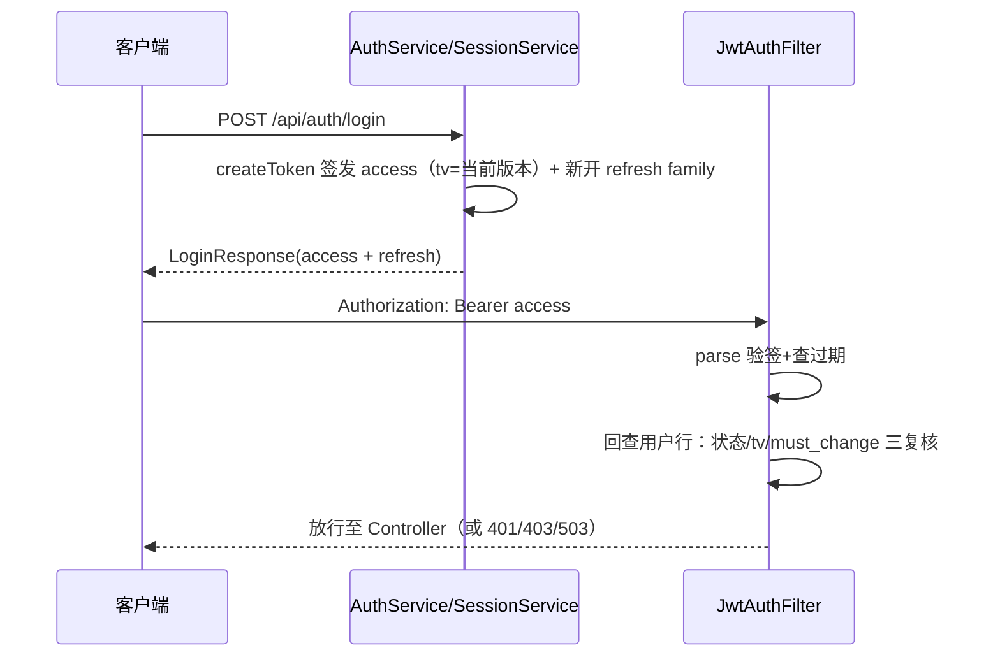

# 5.2 JWT 签发与校验：JwtService、JwtAuthFilter 与每请求回查

> 上一课把 JwtAuthFilter 当黑盒。本课打开它，连同它背后的 JwtService，并把「401/403/503 到底从哪来」数清楚。3.0.0 的认证模型与旧版有本质区别：access token 只活 1 小时、带 `tv` 版本 claim，过滤器**每个请求都回查用户行**；长会话靠 refresh token 轮换维持（5.4 专讲）。

## 1. 本节学习目标

1. 逐行读懂 JwtService 的签发（createToken）与校验（parse），说出 jjwt 0.12 的 builder、parser、Keys 三件套各做什么。
2. 说清 `tv` claim 的作用：它把 token 钉在签发时的 `lf_user.token_version` 上，使「改密/logout-all/管理员动作」能让全部存量 access token 在下一次请求时集体失效。
3. 逐步跟踪 JwtAuthFilter 处理一个 Bearer 请求的每一步：验签 → 回查用户行 → 状态/token_version/强制改密三道复核 → 建立身份，包括全部非正常出口（401/403/503 与「静默未认证」）。
4. 辨析本项目 401/403/503 的来源与响应体差异。
5. 说清 access/refresh 的分工：access 1 小时无状态校验 + 回查撤销，refresh 30 天有状态轮换（细节在 5.4）。

## 2. 前置知识

- JWT（JSON Web Token）：一个自包含的令牌，形如 `xxxxx.yyyyy.zzzzz` 三段，点号分隔。前两段是 Base64url 编码的 JSON（头部、负载），第三段是对前两段的 HMAC 签名。签名保证内容没被改过，但不加密，任何人都能读出负载。
- HMAC：带密钥的哈希。只有掌握密钥的一方才能算出正确的签名，校验方用同一密钥重算并比对。
- Base64url：Base64 的 URL 安全变体，把 `+`、`/` 换成 `-`、`_`。token 要放进 HTTP 头，不能带 URL 特殊字符。
- 过滤器链位置：本课两个类是 5.1 那条链上的第 2 个槽位及其依赖。
- 行锁与版本号撤销（预告）：`token_version` 是用户行上的一个整数计数器，只增不减；「让某人的全部 token 失效」= 把计数器 +1，已签发 token 里的旧值立即对不上。5.4 会讲它如何与 refresh 撤销在同一把行锁里原子完成（审计 M1）。

## 3. 本节涉及的源码

| 文件 | 行数 | 职责 | 阅读顺序 |
|----|----|----|----|
| `src/main/java/com/linkforge/security/JwtService.java` | 64 | HMAC 签发与校验 JWT（含 tv claim） | 1 |
| `src/main/java/com/linkforge/security/JwtAuthFilter.java` | 160 | 每请求解析 Bearer + 回查用户行 + 强制改密墙 | 2 |
| `src/main/java/com/linkforge/security/AuthUser.java` | 14 | 校验成功后的身份载荷 | 3 |
| `src/main/resources/application.yml` | `:109-115` | `linkforge.jwt`（expire-hours 默认 1）与 `linkforge.auth`（refresh 30 天、邀请 7 天） | 4 |
| `src/main/java/com/linkforge/config/LinkForgeProperties.java` | `:121-134` | Jwt 内部类（expireHours 默认 1）、Auth 内部类（refreshExpireDays 30、invitationExpireDays 7） | 5 |

jjwt 是外部依赖，版本 0.12.6（`pom.xml` 管理）。「三件套」指本课会用到的三个入口：`Jwts.builder()`（组装并签名）、`Jwts.parser()`（构建校验器）、`Keys.hmacShaKeyFor()`（把字节数组变成 HMAC 密钥对象）。

## 4. 类的定位

`JwtService` 是全项目唯一碰 JWT 的类，签发与校验都从这里走。它有三个消费者：`JwtAuthFilter` 每个请求调 `parse`（校验）；`AuthService` 在注册/登录时调 `createToken` 签发 access；`SessionService` 在 refresh 轮换成功后用回查到的最新 `token_version` 再签一枚（5.4）。`JwtAuthFilter` 是 5.1 安全链上的第二个自定义 Filter，职责是把合法的 Bearer token 变成一个已认证的 SecurityContext 加一个 `UserContext` 载荷——但 3.0.0 起它多了一层：**token 合法只算过第一关，用户行现状（存在/启用/版本/强制改密标记）说了才算数**。`AuthUser` 是两个认证 Filter（JWT 与 API Key）共用的身份载体，字段含义在第 5 节逐个讲。注意 AuthUser 的身份字段（userId/tenantId/username）现在全部取自回查到的用户行，**不取 claims**——claims 只用来找到「查哪一行」和比对 tv。

## 5. 核心源码详解

### 5.1 JwtService：构造器把配置变成密钥

```java
@Service
public class JwtService {

    private final SecretKey key;
    private final long expireHours;

    public JwtService(LinkForgeProperties properties) {
        byte[] bytes = properties.getJwt().getSecret().getBytes(StandardCharsets.UTF_8);
        this.key = Keys.hmacShaKeyFor(bytes);
        this.expireHours = properties.getJwt().getExpireHours();
    }
```
（`JwtService.java:16-25`）

三个点：

- 密钥只算一次。`SecretKey` 是不可变对象，放在 final 字段里，构造时从 `linkforge.jwt.secret`（yml `:109`，环境变量 `JWT_SECRET`）取字节。所有请求共用一个实例，无锁也无线程问题。
- `Keys.hmacShaKeyFor` 是框架行为：按字节长度决定 HMAC 变体（32 字节对应 HS256 一档，更长对应更强的变体），不足 256 位直接抛异常拒绝启动。项目不写死算法，密钥强度由配置决定。
- `expireHours` 默认 **1**（`LinkForgeProperties.java:123`，yml `:110` 可覆盖）。旧版是 24 小时；批次 2a 把 access 压到 1 小时的前提，是有了 refresh 轮换来续命（5.4）——短命 access 把「撤销最长延迟」从 24 小时压到 1 小时，再叠加每请求回查，实际撤销是即时生效的。

### 5.2 createToken：签发逐行（tv claim 是新增的那一笔）

```java
public String createToken(Long userId, Long tenantId, String username, int tokenVersion) {
    Instant now = Instant.now();
    return Jwts.builder()
            .subject(String.valueOf(userId))
            .claim("tenantId", tenantId)
            .claim("username", username)
            .claim("tv", tokenVersion)
            .issuedAt(Date.from(now))
            .expiration(Date.from(now.plus(expireHours, ChronoUnit.HOURS)))
            .signWith(key)
            .compact();
}
```
（`JwtService.java:38-49`）

- `subject` 是 JWT 标准字段，放 userId 的字符串形式。
- `tenantId`、`username` 是自定义 claim。注意：它们只是随 token 走的**声明**，过滤器建立身份时用的是回查行里的值（5.4 节），claims 里的同名字段不再被信任为身份事实。
- `tv`（token version）把这枚 token 钉在签发时刻用户的 `token_version` 上。用户行版本一动（logout-all、改密、重用击杀、管理员禁用/重置都会 +1，且只经 `UserAccountMapper.incrementTokenVersion` 的原子 SQL 自增），所有旧 token 在下一次请求时 tv 对不上、静默失效。
- `expiration` 是标准过期时间，`now + expireHours` 小时。过期判断由 jjwt 在 parse 时自动做。
- 三参的旧签名 `createToken(userId, tenantId, username)` 还在（`:28-30`），等价于 tv=0——V11 之前签发的 token 没有 tv claim，`getTokenVersion` 对缺失 claim 读作 0（`:52-55`），恰好等于新列的默认值，所以升级部署不会把存量会话一刀切死，它们活满（现在 1 小时的）自然寿命。

签发时仍然没有放角色。角色是校验方按「能出示合法 token 且用户行健康」授予的固定值 ROLE_USER（见 5.3），tenantRole 判断每次回库查（5.3/5.4 细讲）。token 负载里只有身份与版本，没有权限，改权限不需要重新签发。

### 5.3 parse：校验一行核心

```java
public Claims parse(String token) {
    return Jwts.parser()
            .verifyWith(key)
            .build()
            .parseSignedClaims(token)
            .getPayload();
}
```
（`JwtService.java:57-63`）

`parseSignedClaims` 一步做完三件事：验签（签名对不上就抛异常）、读负载、查过期（过期抛 `ExpiredJwtException`）。这些异常全部是 `JwtException` 的子类，这个继承关系决定了 JwtAuthFilter 的 catch 写法，是本课最重要的一个框架事实。

### 5.4 JwtAuthFilter：验签之后还要过回查这一关

主干（`JwtAuthFilter.java:63-84`）：

```java
protected void doFilterInternal(HttpServletRequest request, HttpServletResponse response, FilterChain filterChain)
        throws ServletException, IOException {
    try {
        String header = request.getHeader(HttpHeaders.AUTHORIZATION);
        if (header != null && header.startsWith("Bearer ")) {
            String token = header.substring(7);
            Claims claims;
            try {
                claims = jwtService.parse(token);
            } catch (JwtException ex) {
                // a bad signature / expired token stays a hard 401, as before
                writeJson(response, HttpServletResponse.SC_UNAUTHORIZED,
                        "{\"code\":401,\"message\":\"invalid token\",\"data\":null}");
                return;
            }
            if (!authenticate(request, response, claims)) {
                return;
            }
        }
        filterChain.doFilter(request, response);
    } finally {
        UserContext.clear();
        SecurityContextHolder.clearContext();
    }
}
```

逐步拆解：

1. 取 `Authorization` 头，只有以 `Bearer ` 开头才尝试解析。没有这个头就是匿名请求，直接放行进链，能不能访问由后面的角色矩阵决定。这是「无凭据放行、受保护路径再拦」的设计，5.1 的 entryPoint 负责拦。
2. `parse` 抛出的任何 `JwtException`（签名错、格式错、过期）都在内层 catch 直写 401 文案 `invalid token` 并 return。注意这是 Filter 直接写响应，不抛异常，因为 Filter 层的异常到不了 `GlobalExceptionHandler`。
3. 验签通过后进 `authenticate`（`:107-153`）做**回查复核**，这是批次 2a 关掉「签发后从不复核」审计项的核心：
   - 先从 subject 解出 userId（解不出就静默放行未认证，不写响应）；
   - `userAccountMapper.selectById(userId)` 回查用户行。逻辑删除的行查不到（MyBatis-Plus 逻辑删除），被移除的成员天然落进「查无此人」；
   - 行不存在或 `status != 1` → **不写响应、返回 true 继续链但不建身份**：请求以未认证状态走下去，受保护路径随后由 entryPoint 回 401，permitAll 路径（如还带着旧 access 的 refresh 调用）不受牵连。这是刻意的语义（计划自审 A1）：「复核未过」不等于「凭据造假」，不能在这里抢答 401；
   - claim 的 tv 与行上的 `token_version` 不一致 → 同上，静默未认证；
   - `must_change_password = 1` 且请求路径不在豁免集 `FORCED_CHANGE_EXEMPT`（`:41-43`：change-password、logout、logout-all、refresh、/actuator/health）→ **直写 403**，body `{"code":403,"message":"PASSWORD_CHANGE_REQUIRED","data":null}` 并中断链。这是唯一在回查阶段抢答的情形，因为请求**是**已认证的，继续放行要么泄漏资源、要么误报 401；
   - 全部通过才组装 `AuthUser`（字段取自用户行）、写 `UserContext`、把 ROLE_USER 写进 SecurityContext。
4. finally 双清：无论成功、匿名还是错误出口，都清掉 ThreadLocal 与 SecurityContext。为什么必须清，5.3 课用整节讲。
5. 类上还有 `shouldNotFilter`（`:46-60`）：`/actuator/prometheus` 跳过（scrape token 不是 JWT，决策号 D-Bw345-42）；另外 `/api/auth/refresh`、`/api/auth/logout`、`/api/auth/accept-invitation` 三个**自带凭据**的入口也跳过——它们靠请求体里的 refresh token/邀请令牌自证身份，请求上附带的过期 access 不能把它们挡在门外。注意是精确匹配：`logout-all` 与 `change-password` 不在此列，它们仍需 JWT 复核（也正因如此它们在强制改密豁免集里）。

**回查存储故障的 503（S/N 波，审计 S4-5）。** 若 `selectById` 本身抛 `DataAccessException`/`PersistenceException`（DB 挂了），语义完全不同：这不是「复核未过」，而是「复核做不了」。过滤器直写稳定 503，body 与 ApiKeyAuthFilter 逐字节相同（共用常量 `STORE_UNAVAILABLE_BODY`，`:36-37`）：`{"code":503,"message":"authentication store unavailable","data":null}`，不授予任何身份，日志只带 userId、绝不带 token。把「依赖故障」误报成 401「凭据不对」会让客户端走错恢复路径（反复重登），把异常放任冒泡成容器 500 又丢了口径——503 是两者的中间解。无 token 的请求根本走不到回查，不受影响。

`AuthUser` 本身（`AuthUser.java:6-14`）是 `@Data @AllArgsConstructor` 的 POJO：`userId`、`tenantId`、`username`、`apiKeyScope` 四个字段，最后一个只有 key 认证时非 null。

## 6. 技术原理补充

**JWT 签名防篡改（框架概念）。** 是什么：对头部加负载做 HMAC，签进第三段。为什么需要：负载是明文 Base64url，任何人可改，没有签名就等于裸奔的身份声明。不用会怎样：改一下负载里的 userId 就能冒充任何人。本项目怎么用：密钥只存在服务端（yml `:109`），校验方重算签名比对。局限是签名不加密，token 内容别放敏感数据；本项目放了 userId、tenantId、username、tv，符合这个约束。

**OncePerRequestFilter（框架概念）。** 是什么：Spring 提供的 Filter 基类，保证一次请求只执行一次逻辑（Servlet 转发、include 场景下原生 Filter 可能进多次）。为什么需要：解析 token、回查这类动作重复执行既浪费又可能互相覆盖。本项目怎么用：四个自定义 Filter 都继承它，只覆写 `doFilterInternal` 与可选的 `shouldNotFilter`。

**无状态 token 的撤销难题与本项目的解法（本项目实现）。** 纯 JWT 的经典缺陷是签出去就收不回：禁用账号、改密码都拦不住一枚没过期的 token。本项目叠了三层把它收回来：access 只活 1 小时（损害窗口上限）；每请求回查用户行状态（禁用/删除即时生效）；`tv` 版本比对（全量撤销即时生效）。代价是每请求多一次按主键点查——这正是「无状态」被有意放弃一半的地方，面试时要能说清这笔交换：本项目选的是「JWT 的传输形状 + 服务端可撤销」，不是教科书式的无状态。

**过期与续期（本项目实现）。** access 过期后 parse 抛 `ExpiredJwtException`，客户端拿 refresh token 调 `POST /api/auth/refresh` 换一对新凭据（轮换语义见 5.4）；refresh 也过期/被撤销，才需要重新登录。旧版「24 小时到期强制重登」的体验问题就此消失，代价是多了一张 `lf_refresh_token` 表与一整套轮换/重用检测状态机。

## 7. 可视化

1. [10-auth-sequence](../../diagrams/archify/html/10-auth-sequence.html)：注册/登录/过滤器链时序图，本模块专属。
2. [03-package-map](../../diagrams/archify/html/03-package-map.html)：security 包内部，JwtService 与两个 Filter 的引用方向。
3. 登录签发与请求校验的对应关系：



## 8. 项目中的真实执行过程

登录到业务请求的完整链路：客户端 POST `/api/auth/login`，AuthService 双桶限流与密码校验通过后调 `createToken`（带当前 tv），SessionService 再开一条 refresh family，access + refresh 一起进 LoginResponse 返回（签发细节 5.4）。客户端把 access 放进后续每个请求的 `Authorization: Bearer` 头。JwtAuthFilter 每请求验签 + 回查，成功则 Controller 与服务层通过 `UserContext.get()` 拿到身份。access 过期后客户端先走 refresh 换新对（5.4），不是直接重登。

四种拒绝口径对照表（面试级考点，也是排障入口）：

| # | 触发条件 | 产生位置 | 响应 |
|----|----|----|----|
| 1 | 无凭据或复核未过导致未认证，撞上受保护路径 | SecurityConfig entryPoint | 401 `{"code":401,"message":"unauthorized","data":null}` |
| 2 | 带了 Bearer 但 token 坏（签名/格式/过期） | JwtAuthFilter 内层 catch | 401 `{"code":401,"message":"invalid token","data":null}` |
| 3 | token 与用户行都健康，但 must_change_password=1 且路径不在豁免集 | JwtAuthFilter 回查（`:142-145`） | 403 `{"code":403,"message":"PASSWORD_CHANGE_REQUIRED","data":null}` |
| 4 | 回查时认证存储（DB）故障 | JwtAuthFilter 回查 catch（`:130-131`） | 503 `{"code":503,"message":"authentication store unavailable","data":null}` |
| 5 | 带 X-API-Key 但 key 无效或已吊销 | ApiKeyAuthFilter | 401 `{"code":401,"message":"invalid api key","data":null}` |

文案互不相同，排障时看 body 就能定位是哪一层拒绝的。12.1 讲第 5 条的内部细节（以及它与第 3/4 条同源的 403/503）。

## 9. 为什么这样设计

**为什么回查未过是「静默未认证」而不是直写 401。** 三个理由。其一，permitAll 路径的附带旧 token 不该被牵连：refresh 请求按设计会带着已过期的 access（虽然 shouldNotFilter 已让 refresh/logout/accept-invitation 跳过本 Filter，但同样的原则适用于其它公开路径）。其二，未认证状态下受保护路径本来就有统一的 401 出口（entryPoint），过滤器抢答只会制造第二份口径。其三，强制改密 403 是唯一的例外，因为它必须区分「没认证」与「认证了但被墙挡住」——后者继续放行会真的把资源给出去。判断准则：**能让链继续走的就不抢答，抢答只发生在「继续走必然出错」时**。

**为什么 401 在 Filter 里直写而不抛异常。** Filter 排在 DispatcherServlet 之前，`@RestControllerAdvice` 只覆盖 Controller 层，Filter 抛出的异常到不了它。与其依赖框架默认错误页，不如就地写一个与 `ApiResponse` 同形状的 JSON（ApiKeyAuthFilter 类注释明说了这个约束）。代价是与全局异常处理的文案存在多份维护——503 的 body 因此被抽成两个 Filter 共用的常量，避免漂移。

**为什么 scope 传 null。** `AuthUser.apiKeyScope` 是 key 认证的专属标记。JWT 用户的视野边界在库里（按 createdBy 查），不需要 scope 字段，传 null 让下游判断「这不是 key」时有一个明确信号。

**subject 解析失败不再是 500 隐患。** 旧版把 `Long.valueOf(claims.getSubject())` 放在只 catch JwtException 的 try 里，subject 非数字会冒泡成容器 500；新版 `authenticate` 把解析包在 `catch (RuntimeException)` 里、失败即静默未认证（`:111-115`）。本项目的 token 都出自 `createToken`，subject 一定是数字，这是防御第三方签发方或未来改 subject 格式的护栏——读代码时要能区分「现在会不会坏」与「改一行就坏」，这一行现在属于后者且已被堵上。

## 10. 本节总结

JwtService 64 行，管两件事：用 `linkforge.jwt.secret` 签 1 小时有效、带 tv 的 HS* token，用同一把密钥解析并自动查过期。JwtAuthFilter 160 行，管四件事：自带凭据入口跳过、无 Bearer 放行、坏 token 直写 401、好 token 回查用户行后再建身份（状态/tv 不合静默未认证，强制改密 403，存储故障 503）。记住：**验签只证明 token 是本系统签的，回查才证明持有人现在仍有资格**。

## 11. 课后练习

**练习 1（概念理解）。** token 的负载是明文可读的，为什么还能说它安全？签名到底防什么？

参考答案：JWT 的安全目标是防篡改与防伪造，不是保密。负载改一个字节，重算的 HMAC 就对不上，服务端在 parse 时拒绝（`JwtService.java:57-63`）。伪造同理：不知道密钥就算不出合法签名。敏感数据不能进负载，因为它 Base64url 解码即可读。

**练习 2（源码定位）。** 客户端拿着过期 token 请求 `GET /api/links?page=1`，哪个异常在哪一行抛出，最终响应体是什么？

参考答案：`parseSignedClaims` 在 `JwtService.java:60-62` 抛 `ExpiredJwtException`（JwtException 子类），被 `JwtAuthFilter.java` 的内层 catch 捕获，直写 401，body 为 `{"code":401,"message":"invalid token","data":null}`。不会走到回查、角色矩阵或 entryPoint。

**练习 3（执行过程）。** 匿名请求（无 Authorization 头）经过 JwtAuthFilter 时发生了什么？为什么没有立刻 401？

参考答案：头部条件不成立，整个 if 块跳过，直接放行进链。匿名不是错误，`/api/auth/**`、`/r/**`、health 都是合法匿名路径。若最终撞上受保护路径，由 SecurityConfig 的 entryPoint 返回 401 unauthorized，这是两个 401 来源的分工。

**练习 4（设计分析）。** 管理员刚把某用户禁用（status=0），该用户手里的 access 还剩 40 分钟才过期。他的下一次请求会发生什么？若回查时数据库正好宕机，又会发生什么？

参考答案：回查读到 status != 1，`authenticate` 返回 true 但不建身份，请求以未认证状态撞上受保护路径，由 entryPoint 回 401 unauthorized——禁用即时生效，不必等过期。若 DB 宕机，`selectById` 抛 DataAccessException，被 S4-5 的 catch 接住，直写 503 `authentication store unavailable`：依赖故障不伪装成凭据问题，客户端应重试而不是重登。

**练习 5（调用链）。** 把 JwtAuthFilter 的 finally 块删掉，在什么测试里最容易复现问题？

参考答案：Tomcat 工作线程是池化复用的。删除 finally 后，带 token 的请求把 AuthUser 留在线程里，下一个恰好复用同一线程的匿名请求会读到上一个用户身份。复现要点是用小线程池跑「匿名与带 token 交替」的请求。具体机制与泄漏分析在 5.3 展开，这里先建立直觉：Filter 里的 ThreadLocal 必须用 finally 清理。

## 12. 与后续课程的联系

5.3 把 finally 双清背后的 ThreadLocal 机制讲透，并讨论服务层如何用 `UserContext` 做授权判定与越权防护。5.4 紧接本课：refresh 轮换、重用检测、原子撤销与团队协作都在那里。12.1 的 ApiKeyAuthFilter 与本课 Filter 结构同构（回查 + 同一面改密墙 + 同一 503），可对照阅读。注册登录的完整业务链路（限流、租户创建、BCrypt）在专题[「注册与登录全链路」](../../advanced/01-registration-login.md)展开，会话与团队的端到端故事在专题[「认证会话与团队协作」](../../advanced/15-auth-sessions-and-teams.md)。
