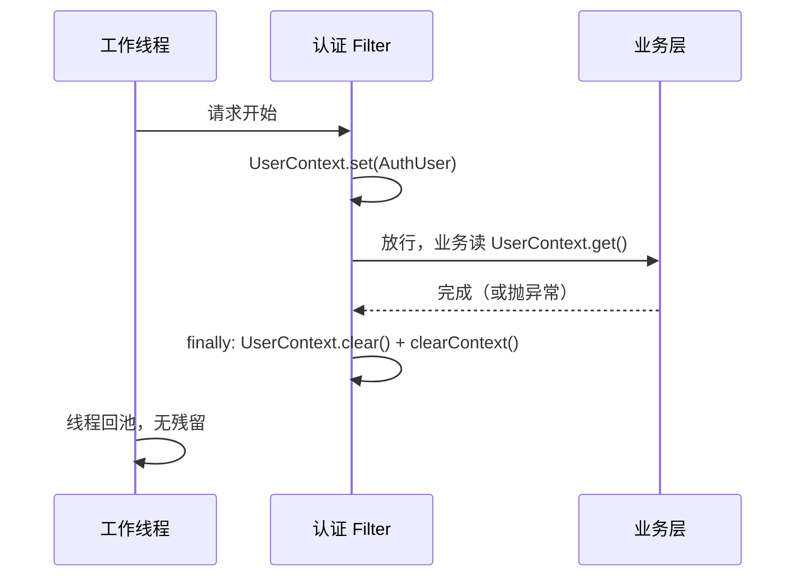

# 5.3 UserContext 与授权：ThreadLocal 生命周期与越权语义

> 前两课解决了「你是谁」。本课解决「你能碰什么」：项目如何把身份递给业务层、如何在服务层判权、失败时为什么不告诉你资源在不在。

## 1. 本节学习目标

1. 说清 ThreadLocal 的工作机制，以及为什么 Filter 里的 ThreadLocal 必须在 finally 中清理。
2. 列出 `UserContext.set/clear` 的全部调用点（各 2 处）与 5 个消费点。
3. 说出 tenant_role 的 ADMIN/MEMBER 判定发生在哪几处（铸 TENANT key、Bloom 重建、团队管理门），以及 V12 之后角色为什么是「写明的事实」而不再是空值约定。
4. 解释越权返回 404 而不是 403 的语义。
5. 说清批次 1 如何补上登录防线：IP + 账号双桶限流与 dummy BCrypt 时序抹平分别堵哪个探测面。

## 2. 前置知识

- ThreadLocal（就地补课）：每个 Thread 对象内部有一张 ThreadLocalMap，key 是 ThreadLocal 实例本身，value 是你存的值。`set` 往「当前线程」的 map 里放，`get` 从当前线程取。同一个 ThreadLocal 变量，不同线程看到不同值。
- 线程池复用：Tomcat 用固定大小的工作线程池处理请求，请求结束后线程不销毁，回到池里等下一个请求。这意味着上一个请求留在 ThreadLocal 里的值，会被下一个请求读到，除非有人清理。
- Authentication vs Authorization：认证（authentication）回答「你是谁」，授权（authorization）回答「你能做什么」。本课前两课都在讲认证，本课进入授权。

## 3. 本节涉及的源码

| 文件 | 关键行 | 职责 |
|----|----|----|
| `src/main/java/com/linkforge/security/UserContext.java` | 全文 21 行 | 静态 ThreadLocal 封装 |
| `src/main/java/com/linkforge/security/AuthUser.java` | `:6-14` | 载荷：userId/tenantId/username/apiKeyScope |
| `src/main/java/com/linkforge/security/JwtAuthFilter.java` | `:148`、`:84-85` | set（回查通过后）与 clear（finally） |
| `src/main/java/com/linkforge/security/ApiKeyAuthFilter.java` | `:153`、`:159-160` | set 与 clear（key 路径） |
| `src/main/java/com/linkforge/apikey/service/ApiKeyService.java` | `:67-80` | 铸钥的 must-change 拒绝与 TENANT 铸钥的 ADMIN 门 |
| `src/main/java/com/linkforge/link/controller/BloomAdminController.java` | `:35-36` | Bloom 重建的 ADMIN 门 |
| `src/main/java/com/linkforge/user/service/TeamService.java` | `:341-380` | 团队管理的 ADMIN 门（含锁内复核版，5.4） |
| `src/main/java/com/linkforge/link/service/ShortLinkService.java` | `:1369-1394` | 归属校验与越权 404 |
| `src/main/java/com/linkforge/user/service/AuthService.java` | `:41-97` | 登录双桶限流 + dummy BCrypt、注册限流 |

阅读顺序：先 UserContext 与 AuthUser 两个小类，再看两个 Filter 的 set/clear 对称结构，最后看三个消费场景。

## 4. 类的定位

`UserContext` 是项目自建的「请求级身份快照」。Spring Security 其实自带类似机制（SecurityContext 也是请求级的），项目为什么再造一个：服务层与 Controller 只 import 自己的 `AuthUser`/`UserContext`，不 import Spring Security 的类型。好处是业务层与安全框架解耦，将来换认证方案（比如换掉 Spring Security）业务代码不动；代价是身份存了两份，两处都要清理（两个 Filter 的 finally 都清双份）。这是刻意取舍，不是重复。

`AuthUser` 是载荷本体。四个字段里 `apiKeyScope` 最特别：JWT 用户恒为 null（`JwtAuthFilter.java:147` 构造），key 请求携带 "USER" 或 "TENANT"（`ApiKeyAuthFilter.java:150-151`）。scope 的消费点在 ShortLinkService 的视野判定，第 5.6 节展开。注意 JWT 路径的 AuthUser 字段全部取自回查到的用户行，而不是 token 里的 claims（5.2）。

## 5. 核心源码详解

### 5.1 UserContext：21 行全文

```java
public final class UserContext {

    private static final ThreadLocal<AuthUser> HOLDER = new ThreadLocal<>();

    private UserContext() {
    }

    public static void set(AuthUser user) {
        HOLDER.set(user);
    }

    public static AuthUser get() {
        return HOLDER.get();
    }

    public static void clear() {
        HOLDER.remove();
    }
}
```
（`UserContext.java:3-20`）

三个语言点：`final class` 加私有构造器（`:7-8`）是「工具类禁止实例化」的惯用写法；`static final` 的 HOLDER 全局唯一，值按线程隔离；`remove()` 是清理的正解，把整个 entry 从当前线程的 map 里摘掉。

### 5.2 set 与 clear 的全部调用点

全项目 `UserContext.set` 只有 2 处、`clear` 只有 2 处：

| 动作 | 位置 | 时机 |
|----|----|----|
| set | `JwtAuthFilter.java:148` | Bearer 验签 + 回查用户行全部通过后 |
| set | `ApiKeyAuthFilter.java:153` | key 认证、属主回查、配额检查通过后 |
| clear | `JwtAuthFilter.java:84-85` | finally，含匿名与 401/403/503 路径 |
| clear | `ApiKeyAuthFilter.java:159-160` | finally，含无 key 早退路径 |

两个 clear 都在 finally 里，且对匿名请求也执行（幂等，清一个本来就没值的 ThreadLocal 无害）。Metrics 与 QrShare 两个 Filter 不碰 UserContext，所以消费方一律判空。为什么不写在 try 里：try 里的清理遇到异常会跳过，finally 保证任何出口都执行。

### 5.3 不清理会怎样（内存与串号双重风险）

风险一是串号。请求 A（用户甲）在线程 T 上 set，结束后线程 T 回池；请求 B（匿名）复用 T，若没清理，B 上的 `UserContext.get()` 返回甲。所有按 userId 过滤的查询都会把甲的数据吐给匿名请求，这是水平越权事故，不只是脏数据。

风险二是内存泄漏。ThreadLocalMap 的 key 对 ThreadLocal 是弱引用，但 value 是强引用。线程不死，value 就一直可达。Tomcat 工作线程与应用同生命周期，一个不清理的 entry 等于永久占用，且持有的是带 userId、tenantId 的身份对象。Spring 对 `SecurityContextHolder` 有同款问题，所以两个 Filter 的 finally 都做了双清（`JwtAuthFilter.java:83-86`、`ApiKeyAuthFilter.java:158-161`）。

### 5.4 消费方：判空三连与容错一处

Controller 与服务层取身份的惯用模式：

```java
private static AuthUser requireUser() {
    AuthUser user = UserContext.get();
    if (user == null) {
        throw new BizException(401, "unauthorized");
    }
    return user;
}
```
（`ApiKeyController.java:47-53`；BloomAdminController.java:42-48、ShortLinkService.java:1388-1394、WebhookController.java:51、AuthController 同款）

链上已经保证「受保护路径必有身份」，这里再判空像是多余。它是纵深防御：Filter 的 `shouldNotFilter`、角色矩阵改动、或未来加新入口时，这层判空让错误表现为干净的 401 而不是 NullPointerException 换 500。

唯一的容错消费点在点击记录：`Long userId = UserContext.get() == null ? null : UserContext.get().getUserId();`（`ClickRecordService.java:64`）。跳转是匿名业务，点击事件的 user_id 允许为空。

### 5.5 tenant_role：从「空值约定」到「写明的事实」

批次 2b 之前，`lf_user.tenant_role` 的语义是约定式的：只有注册创始人（`AuthService.register`，注释标 D-C1-13）与 BootstrapDataLoader 的 demo 管理员被写成 "ADMIN"，没人写 "MEMBER"，member 是「非 ADMIN」的隐式状态，pre-V8 的老行甚至是 null。团队协作落地后这套约定撑不住了——角色要被邀请指定、被 ADMIN 改来改去，必须成为可写的事实。V12 因此做了一次回填（`UPDATE lf_user SET tenant_role='MEMBER' WHERE tenant_role IS NULL`），写入点也随之成体系：

| 写入点 | 写什么 |
|----|----|
| `AuthService.register` | 创始人 = ADMIN |
| `TeamService.acceptInvitation` | 被邀请人 = 邀请上注明的角色（ADMIN 或 MEMBER） |
| `TeamService.updateMember` | ADMIN 改任意成员的角色（列级写，过最后 ADMIN 护栏） |
| `BootstrapDataLoader` | demo 管理员 = ADMIN |

读侧判定现有三处，形状一致——**回库读调用者行，只有字面 "ADMIN" 通过，其余（MEMBER、null、任何脏值）一律按 MEMBER 拒绝**，null 容忍是留给回填前老数据的（V12 注释明示读侧继续容忍 null）：

```java
if ("TENANT".equals(scope)) {
    if (!"ADMIN".equals(owner.getTenantRole())) {
        throw new BizException(403, "only a tenant ADMIN can mint a TENANT-scope api key");
    }
}
```
（`ApiKeyService.java:75-80`；注意它前面 `:67-71` 还有一道 must_change 拒绝，见 12.1）

```java
if (account == null || !"ADMIN".equals(account.getTenantRole())) {
    throw new BizException(403, "only a tenant ADMIN can trigger a bloom rebuild");
}
```
（`BloomAdminController.java:35-36`）

第三处是 `TeamService.requireAdmin`/`requireAdminUnderLock`（5.4）：团队管理的全部端点都过这道门，且写路径用的是「租户锁内当前读」版本。判定结果也透给前端展示：登录/注册/接受邀请响应里的 `tenantRole` 字段与成员列表的 `MemberView.role`（经 `TeamService.roleOf` 归一：只有字面 ADMIN 算 ADMIN）。

### 5.6 越权 404：getOwnedLink 的归属判定

```java
ShortLink getOwnedLink(String code) {
    AuthUser user = requireUser();
    ShortLink link = shortLinkMapper.selectOne(new LambdaQueryWrapper<ShortLink>().eq(ShortLink::getCode, code));
    if (isTenantWide(user)) {
        if (link == null || !Objects.equals(link.getTenantId(), user.getTenantId())) {
            throw new BizException(404, "short link not found");
        }
        return link;
    }
    if (link == null || link.getCreatedBy() == null || !link.getCreatedBy().equals(user.getUserId())) {
        throw new BizException(404, "short link not found");
    }
    return link;
}
```
（`ShortLinkService.java:1369-1382`；isTenantWide 在 `:1385-1387`，判断 `"TENANT".equals(user.getApiKeyScope())`）

读法：TENANT scope 的 key 看「整个租户」（tenantId 相等即可），其余一切身份（JWT 用户、USER scope 的 key）看「自己创建的」（createdBy 等于 userId）。三种失败（不存在、不是你的、不是你租户的）统一 404 `short link not found`。对比模块 12 的 revoke 也是同款：别人的 key 与不存在的 key 都是 404。团队侧同理：成员管理里跨租户的成员 id 与不存在的 id 同为 404（5.4）。例外是 QR 分享：签名即授权，走 `requireExisting`（`:1360-1366`）只查存在性不查归属，因为签名本身就是物主同意。

## 6. 技术原理补充

**404 越权语义（安全设计惯例，本项目实现）。** 把「资源存在但不属于你」也报 404，外部观察者无法通过状态码枚举资源：猜别人的短码只能得到与「不存在」完全相同的响应。若报 403，等于承认「这个码存在」，攻击者可以先扫 403 再专门攻击存在的目标。代价是排障时用户分不清「码打错」与「没权限」，需要靠文档与约定弥补。

**BCrypt（框架/算法概念）。** 是什么：带盐的自适应慢哈希，专为密码设计。为什么需要：SHA-256 这类快哈希可以每秒算数十亿次，密码库泄露后被暴力破解毫无阻力；BCrypt 有内置盐（同密码每次哈希不同）且速度可调（成本因子），单次比对约几十毫秒量级。不用会怎样：泄露的 password_hash 表几分钟内被跑完弱密码。本项目怎么用：注册时 `passwordEncoder.encode`（`AuthService.java` register 段），登录时 `passwordEncoder.matches`（`:88-90`，不存在账号时比对 dummy 哈希），Bean 定义在 `SecurityConfig.java:96-99`。

**登录防线：双桶限流 + 时序抹平（批次 1 已修复，本项目现状）。** 旧版登录既无限流又有时间差：租户不存在直接 401 不跑 BCrypt，租户存在必然跑一次几十毫秒的 `matches`，测响应时间就能枚举租户/账号。批次 1 把两处都补上了（`AuthService.login`，`:41-97`）：

- **双桶滑动窗口**（算法见 9.1）：先按客户端 IP 记一桶 `login:{ip}`（默认 5 次/600s），再按规范化账号记一桶 `login-acct:{tenant}:{username}`（租户名与用户名都 trim + 小写，与库的 case-insensitive 排序口径对齐，大小写变体共用一个桶，默认同为 5 次/600s）。IP 桶拦分布式撞库的单点来源，账号桶拦「换 IP 盯着一个账号打」。任一桶超限回 429 + Retry-After，并分别打点 `entry=login` / `entry=login_account`。
- **dummy BCrypt 抹平时序**：每条登录路径**恰好执行一次** `passwordEncoder.matches`——账号不存在（或租户不存在）时，比对对象换成预计算的哑哈希常量 `DUMMY_PASSWORD_HASH`（cost 10、对应一个丢弃口令，`:36-38` 注释在案）。于是「用户不存在」与「密码错」耗时不可区分，枚举的时间预言机被关掉。再叠加全部失败统一 401 `invalid credentials`（文案也不可区分），登录口只剩限流这一道可观测面。

同批的还有 refresh/logout/accept-invitation 三个公开凭据入口一并入桶（5/600s·IP，5.4 与 9.1），公开面的限流口径至此统一。

## 7. 可视化

1. [03-package-map](../../diagrams/archify/html/03-package-map.html)：user 包 9 文件与 security 包的依赖方向（security 依赖 user 的实体与 Mapper，反向无依赖）。
2. [05-database-erd](../../diagrams/archify/html/05-database-erd.html)：lf_tenant 与 lf_user 的关系，lf_user.tenant_role 列。
3. 身份在请求内的生命周期：



## 8. 项目中的真实执行过程

场景一（ADMIN 门）：MEMBER 用户登录拿到 JWT，POST `/api/keys` 传 `scope=TENANT`。角色矩阵放行（`/api/keys/**` 要 USER，JWT 用户是 USER），ApiKeyService 先过 must_change 检查（`:67`），再进 TENANT 分支（`:75-80`），属主行 tenant_role 为 MEMBER，抛 403。TenantApiKeyIT 的 `tenantAdminMintsTenantKeyButMemberIsRejected` 断言了这个行为（`src/test/java/com/linkforge/apikey/TenantApiKeyIT.java`）。

场景二（匿名点击）：访客 GET `/r/abc123` 命中短链。三个认证 Filter 都没设身份，ClickRecordService 落库时 `UserContext.get()` 为 null，user_id 存 null（`:64`），点击统计不因匿名而失败。

场景三（越权探测）：用户乙拿自己的 JWT GET `/api/links/{甲的code}`。getOwnedLink 查到行但 createdBy 不等于乙的 userId，抛 404。乙无法区分「码不存在」与「码是别人的」。

## 9. 为什么这样设计

- **身份走自己的类型。** 业务层只认 AuthUser，不认 Spring Security 的 UserDetails 体系。解耦的代价是双份存储与双份清理，两个 finally 块就是代价的具象化。
- **ADMIN 门放在服务层而不是链层。** 过滤器链只认「角色」（ROLE_USER），tenant_role 是业务数据，链层够不着；由服务层回库判定（`:46`、BloomAdminController `:33`）。角色和业务属性分层处理，各管各的。
- **requireUser 的重复不是坏味道。** 四个类各有一份同款私有方法而不抽公共工具，是刻意的局部性：判空逻辑小到复制成本低于抽象成本，且各处可独立演化（ClickRecordService 就演化出了判 null 版本）。（设计意图推断，源码未注释。）
- **登录防线曾经不对称，批次 1 已对齐。** 旧版注册有限流、解锁有限流（模块 7.2），唯独登录裸奔且带时间差；批次 1 用双桶 + dummy BCrypt 一并补上（第 6 节）。这个「先被审计点名、再用一课讲清修复」的形态，在本项目里反复出现（M1–M8 同理），读码时值得留意类注释里的 audit 编号。

## 10. 本节总结

UserContext 用 21 行封装了请求级身份，两个 Filter 各管 set 与 finally clear，消费点四查一容。tenant_role 在批次 2b 后是写明的事实：铸 TENANT key、Bloom 重建、团队管理三处 ADMIN 门形状一致，只有字面 ADMIN 通过，null 读作 MEMBER。越权一律 404，不给枚举机会。登录侧曾经的限流缺口与 BCrypt 计时差异已由批次 1 的双桶 + dummy 哈希关闭——「审计发现 → 一课讲修复」是这套教材在 3.0.0 的固定叙事。

## 11. 课后练习

**练习 1（概念理解）。** ThreadLocal 变量是 static 的，为什么不同请求不会读到彼此的值？

参考答案：值存在每个 Thread 自带的 ThreadLocalMap 里，key 是 ThreadLocal 实例，value 每线程独立。`HOLDER.set` 实际写入「当前线程」的 map，线程不同，map 不同，互不可见。

**练习 2（源码定位）。** 找出全项目给 UserContext.set 传值的两个位置，并说出这两个 Filter 的 finally 各清理了哪两样东西。

参考答案：`JwtAuthFilter.java:148` 与 `ApiKeyAuthFilter.java:153`。finally 里都执行 `UserContext.clear()` 加 `SecurityContextHolder.clearContext()`（`JwtAuthFilter.java:83-86`、`ApiKeyAuthFilter.java:158-161`），对应 ThreadLocal 身份与 Spring Security 上下文两份状态。

**练习 3（执行过程）。** 一行 tenant_role 为 null 的老数据用户尝试铸 TENANT scope 的 key，结果是什么？这行数据在 3.0.0 的库里还会存在吗？

参考答案：403。`ApiKeyService.java:78` 的条件 `!"ADMIN".equals(owner.getTenantRole())` 对 null 成立（null 不是 "ADMIN"），抛 BizException(403)，读侧把 null 按 MEMBER 处理（fail-closed）。但这行数据在跑过 V12 的库里不会存在：V12 回填把 null 全部改成 'MEMBER'，读侧的 null 容忍只是留给未回填环境的护栏。

**练习 4（设计分析）。** 越权访问别人的短链返回 404 而不是 403，如果产品要求改成 403「forbidden」，你会怎么向产品解释风险？

参考答案：403 暴露存在性。攻击者可以批量探测短码，把「403」当作「码存在」的信号先圈定目标，再对存在的目标做密码爆破或分享链伪造；404 让两类目标不可区分（`ShortLinkService.java:1375`、`:1380` 一带同文案）。若产品坚持 403，至少应只对「已认证且归属不符」的场景返回，并保留对匿名请求的 404，但枚举面仍然扩大，建议维持现状。

**练习 5（设计分析）。** 旧版登录为什么能被用来探测「某租户下某账号是否存在」？批次 1 的两个修复各堵住哪一半？

参考答案：旧实现租户/账号不存在时直接 401 不跑 BCrypt，存在时跑一次几十毫秒的 matches，响应时间即预言机；且登录无限流，探测成本为零。修复一半是**时序抹平**：`AuthService.login` 让每条路径恰好跑一次 matches，不存在时比对预计算的 `DUMMY_PASSWORD_HASH`（`:36-38`、`:88-90` 一带），耗时不可区分。另一半是**双桶限流**：IP 桶与规范化账号桶各 5 次/600s（`:46-64`），把探测速率压到没有实用价值。两半缺一不可：只抹平时序，慢速撞库仍可行；只限流，单次时间差仍泄漏存在性。

## 12. 与后续课程的联系

5.4 紧接本课：团队管理的 ADMIN 门（TeamService）与会话撤销如何共用本课的回查/角色语义。12.1 的 ApiKeyAuthFilter 会在 `:150-151` 构造带 scope 的 AuthUser，scope 如何改变服务层视野（TENANT 见全租户）已在 5.6 铺垫。配额检查（filter 里的双闸）与固定窗口日配额的算法细节在模块 9 展开。注册登录的完整时序、租户与用户的两表事务，见专题[「注册与登录全链路」](../../advanced/01-registration-login.md)。
