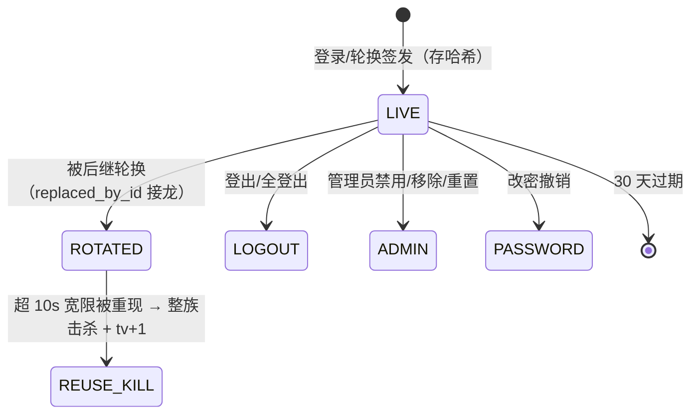

# 5.4 刷新会话与团队协作：SessionService、TeamService 与原子撤销

> 5.2 留了两个尾巴：access 只活 1 小时，靠什么续？「让全部会话立刻死」怎样保证不漏？本课讲批次 2 引入的会话域（`auth` 包）与团队协作（`TeamService`），以及外部审计 M1/M2/M7 在这两个类上钉死的并发合同。

## 1. 本节学习目标

1. 说清 refresh token 的存储纪律（只存 SHA-256 哈希）、family 轮换链与 `revoke_cause` 五种撤销原因各自的来源。
2. 逐步跟踪一次 refresh 轮换：无锁 peek 定位属主 → 用户行锁 → 锁内复读 token 行 → 条件 UPDATE 轮换 → 插入后继 → 回填 `replaced_by_id`，全程一个事务。
3. 解释重用检测的精确语义：只有「ROTATED 且超过 10 秒宽限」的重现才升级为盗用（整 family 击杀 + tv 自增）；主动撤销（LOGOUT/ADMIN/PASSWORD/REUSE_KILL）的 token 重现只回 401。
4. 说清 M1 的序列化合同：全局锁序 租户行 → 用户行 → refresh 行；`token_version` 只经原子 SQL 自增；撤销与轮换交错时后继 token 也必被覆盖。
5. 说清团队协作的四件套：邀请（bearer 链接、单次、7 天、只存哈希）、成员管理、最后 ADMIN 护栏（M2：租户行锁先行 + 锁内当前读复核）、管理员重置（M7：临时口令 + 强制改密 + 永久撤销全部 API Key）。

## 2. 前置知识

- 5.2 的 access/JWT 模型：access 1 小时、带 tv claim、JwtAuthFilter 每请求回查用户行。
- 刷新令牌模式（RFC 9700 一脉）：长效凭据只用于「换一对新凭据」，每次使用即轮换，旧的作废；已作废的令牌再次出现，是令牌被复制的强信号。
- 行锁基础：`SELECT ... FOR UPDATE` 在事务内锁住行，后来者在锁外排队；MySQL 默认 REPEATABLE READ 下，普通快照读可能读到事务开始时的旧值，而锁定读（current read）读最新已提交值——M2 的区别全在这里。
- MyBatis-Plus 逻辑删除：`lf_user.deleted` 标记的行被普通查询自动过滤，但 `FOR UPDATE` 这类原始锁定读会绕过它，代码必须显式判 `deleted`。

## 3. 本节涉及的源码

| 文件 | 行数 | 职责 | 阅读顺序 |
|----|----|----|----|
| `src/main/resources/db/migration/V11__auth_token_version_and_refresh.sql` | — | `lf_user` 加 tv/must_change 两列、建 `lf_refresh_token` | 1 |
| `src/main/java/com/linkforge/auth/SessionService.java` | 388 | 会话全生命周期：签发/轮换/登出/全登出/改密 | 2 |
| `src/main/java/com/linkforge/auth/RefreshToken.java` | 42 | refresh 行实体 + 五个 CAUSE 常量 | 3 |
| `src/main/java/com/linkforge/auth/mapper/RefreshTokenMapper.java` | 44 | 锁读、条件轮换、按 family/用户撤销 | 4 |
| `src/main/resources/db/migration/V12__tenant_invitation_and_role_backfill.sql` | — | 建 `lf_tenant_invitation`、角色回填 | 5 |
| `src/main/java/com/linkforge/user/service/TeamService.java` | 450 | 邀请与成员管理（ADMIN 门、最后 ADMIN 护栏、重置） | 6 |
| `src/main/java/com/linkforge/user/controller/AuthController.java` / `TeamController.java` | 99 / 75 | `/api/auth/**` 与 `/api/tenant/**` 端点面 | 7 |
| `src/main/java/com/linkforge/user/mapper/UserAccountMapper.java` | — | `selectForUpdate`、`incrementTokenVersion`、`selectActiveAdminIdsForUpdate` | 8 |

## 4. 类的定位

`SessionService`（`auth` 包）是会话的唯一管家：`AuthService` 只管「核对凭据」（登录双桶限流、BCrypt、dummy 时序抹平，见专题 15 与 9.1），凭据之后的一切 token 物料流转——登录开 family、轮换、登出、改密——都归它。`TeamService`（`user.service`）是团队管理面：邀请与成员的全部写路径都在这里，它不发明第二套撤销机制，而是复用 2a 的机器（tv 自增 + refresh 全撤 + 过滤器回查），只额外加一手「重置时永久撤销 API Key」。两个类共同的骨架是**锁序**：凡是多表多行的关键区，都按 租户行 → 用户行 → refresh 行 的全局顺序取锁，这是 M1/M2 两条审计项收敛出的同一条纪律。

## 5. 核心源码详解

### 5.1 refresh 行长什么样：哈希存储与 family 链

`lf_refresh_token`（V11）每个行代表一枚 refresh token 的一生：

- `token_hash`：CHAR(64)，原始 token（32 随机字节 Base64URL，`SessionService.prepare`）的 SHA-256 十六进制。**原文永不落库**——与 `lf_api_key`、邀请令牌同一纪律：库泄漏不等于会话泄漏。
- `family_id`：一次登录 = 一个 family（UUID）。同一台设备的连续轮换在同一 family 内接龙，登出只杀本 family，不扰其它设备。
- `revoked_at` / `revoke_cause`：撤销时刻与原因，五种原因（`RefreshToken.java:20-24`）：`ROTATED`（正常轮换）、`LOGOUT`、`REUSE_KILL`（重用击杀）、`ADMIN`（管理员禁用/移除/重置）、`PASSWORD`（改密/重置的会话撤销）。
- `replaced_by_id`：ROTATED 时指向后继行，整条链可审计回溯。
- `expires_at`：签发 +30 天（`linkforge.auth.refresh-expire-days`，yml `:113`）。

### 5.2 轮换：一次 refresh 的完整事务（M1 的原子性）

`SessionService.refresh`（`:133-195`）分两段：

1. **入口限流与无锁 peek**：先按 IP 过 refresh 桶（5/600s，与 login 同级，因为这是公开凭据入口）；再用 token 哈希做一次**无锁**点查（`selectOne` by hash）。peek 只回答「这枚 token 属于哪个用户」以便决定锁哪一行，它的结果**从不被信任**。
2. **锁内事务**（`tx.executeWithoutResult`）：第一条凭据语句就是 `userAccountMapper.selectForUpdate(userId)` 锁住用户行；随后 `refreshTokenMapper.selectByHashForUpdate(hash)` 以 `FOR UPDATE` 复读 token 行——校验与动作之间没有读-改间隙。分支：
   - 行已撤销 → 走 5.3 的重用判定（可能是击杀，也可能只是 401）；
   - 行已过期、或用户行已非 active（被禁用/删除）→ 统一 401 `invalid refresh token`。**全部 refresh 失败都是同一个 401 同一文案**：未知、过期、已撤销、被重用在外部不可区分，不给枚举预言机（与登录失败口径同构）；
   - 正常路径：`refreshTokenMapper.rotate(id, now)`——一条带 `AND revoked_at IS NULL` 的条件 UPDATE（`RefreshTokenMapper.java:29-31`），并发同 token 双 refresh 时只有一方更新到 1 行，另一方更新 0 行按拒绝处理，**不可能签出两个后继**；
   - `insertSuccessor` 插入新行（同 family、新哈希、+30 天），再回填旧行 `replaced_by_id`。新 access 的 tv 取自锁内读到的用户行。插入失败则整事务回滚——**旧 token 不会被消费掉**，轮换是原子的（`insertSuccessor` 是 protected 方法，正是 M1 合同测试暂停/弄坏轮换的接缝）。

### 5.3 重用检测：为什么只对 ROTATED 超宽限升级

已撤销行被再次出示时，`isReuseKill`（`:218-222`）只认一种盗用信号：`revoke_cause = ROTATED` 且撤销时刻距今超过 `REUSE_GRACE_SECONDS = 10` 秒（`:59`）。

- **ROTATED + 宽限内**：多半是客户端并发刷新/重试的良性竞态——401，但 family 活着。
- **ROTATED + 超宽限**：这枚 token 是被一次合法轮换淘汰的，现在还拿它来的人要么是小偷、要么拿着被偷的副本——升级处置：`revokeFamily(REUSE_KILL)` 整族撤销 + `incrementTokenVersion` 让全部 access 立刻失效，打点 `linkforge.refresh.reuse_kill`，然后回 401。
- **LOGOUT / ADMIN / PASSWORD / REUSE_KILL**：主动撤销后的重现，最可能是不知情的旧客户端在重试（如登出与在途 refresh 赛跑）。补救已经发生，无可升级；若在这里也击杀，一次登出会连环踢掉该用户所有设备，还会让「登出的 refresh 是否真的死了」变得不可测（探针本身就会触发警报）。这是批次 2a 的一条刻意修订，类注释里完整在案。

一个实现细节值得单独记：击杀必须**先提交再抛 401**。代码在事务回调里先做完 family 击杀与 tv 自增、置位 `reuseKilled[0]`、正常 return，等 `tx.executeWithoutResult` 返回（事务已提交）后才在事务外抛 BizException——在回调里抛异常会把击杀一起回滚。

### 5.4 登出三档与改密：撤销半径各不相同

| 操作 | refresh 侧 | access 侧 | 说明 |
|---|---|---|---|
| `logout`（`:233-253`） | 只撤本 family（CAUSE_LOGOUT） | **不 bump tv**：本 family 的 access 活到自然过期（≤1h） | 幂等且安静：未知 token 也回成功，端点不是有效性预言机；撤销前先取属主行锁，与在途轮换串行 |
| `logoutAll`（`:255-270`） | 全撤（CAUSE_LOGOUT） | tv +1，全部 access 下一请求即死 | 用户行锁内一气呵成 |
| `changePassword`（`:272-315`） | 全撤（CAUSE_PASSWORD） | tv +1 | 锁内验当前口令 → 列级 UPDATE 写新哈希 + 清 must_change → tv 自增 → 全撤 refresh，**包括调用者自己的会话**：改密后必须用新口令重登，无一幸免 |
| 管理员禁用/移除/重置（TeamService） | 全撤（CAUSE_ADMIN 或 PASSWORD） | tv +1 | 见 5.6 |

注意 `changePassword` 的写是 `LambdaUpdateWrapper` 列级 SET（只写 password_hash、must_change_password、updated_at 三列），不是整行 `updateById`——整行回写会把锁外读到的旧实体盖回去，冲掉并发撤销刚自增的 tv。**tv 只许经 `incrementTokenVersion` 的原子 SQL（`SET token_version = token_version + 1`）移动，永不读改写整行**，这是 M1 的另一半。

### 5.5 邀请：bearer 链接的完整纪律

`TeamService` 的邀请四件套（`:104-160`、`:162-201`）：

- **创建**（`POST /api/tenant/invitations`，仅 ADMIN）：32 随机字节生成原始令牌，只存 SHA-256 哈希（复用 `SessionService.sha256Hex`），`expires_at = now + 7 天`（`invitation-expire-days`）；原始令牌只在创建响应里出现一次，链接形状 `/?invite=<raw>`，由创建者带外转交——**项目没有邮件基础设施，找回/邀请都不靠邮箱**（口令找回的答案是 5.6 的管理员重置）。
- **接受**（`POST /api/auth/accept-invitation`，permitAll + 按 IP 限流 5/600s，且**先烧限流再查任何东西**，让探测令牌有效性保持昂贵）：一个事务内先插新用户（角色 = 邀请的 `invited_role`），再用条件 UPDATE 抢占邀请行（`TenantInvitationMapper.accept`：`SET accepted_by/accepted_at WHERE id=? AND accepted_at IS NULL AND revoked_at IS NULL`，更新 0 行 = 竞态落败，回滚连账号一起撤）。用户名撞租户内唯一索引回 409 且**不消费邀请**，可换名重试。全部失败（不存在/已撤/已用/过期）统一 401 `invalid invitation`，不说是哪一项。接受成功直接返回完整 LoginResponse（`SessionService.issueLoginResponse` 开新 family），被邀请人落地即登录态。
- **列表/撤销**：列表只出未接受、未撤销、未过期的；撤销置 `revoked_at`，已接受的撤销回 400。邀请行从不返回哈希以外的令牌材料。

### 5.6 成员管理与最后 ADMIN 护栏（M2）、管理员重置（M7）

成员写路径（`updateMember`/`removeMember`/`resetPassword`）共享同一骨架，以 `updateMember`（`:228-275`）为例：

1. 事务第一条语句：`tenantMapper.selectForUpdate(caller.tenantId)` 锁**租户行**；
2. 锁内以锁定当前读重验调用者（`requireAdminUnderLock`：调用者此刻仍是本租户的 active ADMIN——排队期间被降级/禁用的人在这里被拒，而不是凭排队前的旧快照放行）；
3. 锁内当前读目标行（`requireTenantMemberUnderLock`：跨租户 id 与不存在同为 404，逻辑删除行也按 404）；
4. 护栏判定：若目标是 active ADMIN 且本次操作会让它失去这个身份（降级或禁用），数当前 active ADMIN 集合（`selectActiveAdminIdsForUpdate`，锁定读），`<= 1` 则 400 `the tenant's last ADMIN cannot be demoted or disabled`（移除版文案 `...cannot be removed`）。

M2 修的就是第 4 步的旧实现：在 RR 快照里数 ADMIN，两个并发降级各看到「还有 2 个 ADMIN」双双放行，租户归零。修法不是「把护栏挪到锁后」一句话，而是**锁先行 + 全部当前读**：护栏数的那一行集合，必须是锁住之后的世界。

- **改角色**本身不撤销任何东西：角色每请求从行里读（5.3/12.1），新角色下一请求生效。
- **禁用**是会话击杀：列级写 status + tv 自增 + refresh 全撤（CAUSE_ADMIN），同锁完成。
- **移除**（`removeMember`，`:282-302`）：先 tv 自增 + refresh 全撤，再 `deleteById` 逻辑删除。行留着，成员创建的链接/webhook 是**租户资产**不动；凭据之死靠回查：access 死于 JwtAuthFilter 查不到行，refresh 在此已撤，API Key 死于 ApiKeyAuthFilter 的属主回查（键行本身从不被成员管理触碰）。
- **重置**（`resetPassword`，`:318-337`，即本项目的「忘记密码」）：生成 16 位临时口令（字母表刻意去掉 0/O、1/l/I 等易混字符，只在响应里出现一次、永不打日志），写哈希 + `must_change_password=1`，tv 自增、refresh 全撤。**M7 追加的一刀**：同一锁内事务里 `apiKeyMapper.revokeAllForUser` **永久撤销该成员的全部 API Key**（USER 与 TENANT scope 都算）——重置是「凭据可能已泄漏」的处置，不是方便解锁，旧 Key 永不恢复；成员改密后自建新 Key，且 `ApiKeyService` 在 must_change 期间拒绝建 Key，堵住与重置赛跑的建 Key 窗口。

### 5.7 强制改密墙的形状（与 5.2 的衔接）

`must_change_password=1` 的用户：JwtAuthFilter 在回查时对非豁免路径直写 403 `PASSWORD_CHANGE_REQUIRED`（5.2 已讲）；ApiKeyAuthFilter 对活 Key 同样回这面墙（12.1）；登录响应带 `mustChangePassword: true` 让控制台直接把人送进改密页（S2）。墙的豁免集只有 change-password、logout、logout-all、refresh 与 health——「清标记与结束/轮换会话」的路不能被标记本身堵死。改密成功（`changePassword`）清标记的同时全撤会话，所以改密页流程的终点是回登录页重登。

## 6. 技术原理补充

**为什么 refresh 只存哈希（本项目实现）。** refresh 是 30 天的长效凭据，若明文（或可逆形式）落库，一次库泄漏 = 全部会话被接管 30 天。只存 SHA-256 后，泄漏者拿到的是不可用的哈希；原始值只在签发响应与客户端手里。代价是不可找回：丢了就重登，这正是要的。

**为什么轮换而非固定 refresh（框架外设计）。** 固定 refresh 被偷后 30 天内无感通行；轮换 + 重用检测把「被偷」变成可观测事件：合法客户端与小偷迟早有一方会出示旧 token，超宽限的那次出示就是警报。宽限 10 秒是给良性并发（双标签页同时刷新、网络重试）留的活口。

**行锁串行化 vs 乐观锁（本项目实现）。** 会话关键区的竞争者很少（同一用户的并发 refresh/登出），行锁排队简单且语义直接；`rotate` 的条件 UPDATE 与 tv 的原子自增是锁内的双保险。锁序全局统一（租户→用户→refresh）是为了让 TeamService 与 SessionService 的关键区永不交叉死锁。

## 7. 可视化

1. [10-auth-sequence](../../diagrams/archify/html/10-auth-sequence.html)：认证时序图（登录/回查部分与本课互补）。
2. refresh 轮换的状态机：

3. 团队写路径的锁序：`TeamService`（租户行锁 → 调用者/目标当前读 → 护栏 → 列级写 → tv 自增 → refresh 撤销）与 `SessionService`（用户行锁 → refresh 行锁读 → 轮换/撤销）在 [02-architecture-map](../../02-architecture-map.md) 第 4 节链路表里有归属对照。

## 8. 项目中的真实执行过程

**场景一：access 过期后的静默续期。** 客户端 access 过期（401 invalid token）→ POST `/api/auth/refresh` 带 refresh（此路径跳过 JwtAuthFilter，靠 refresh 自证）→ SessionService 先过 IP 桶、peek 定属主、锁用户行、锁内复读并轮换 → 返回新 access（tv 不变，仍是锁内读到的版本）+ 新 refresh → 客户端无感继续。旧 refresh 自此进入 ROTATED 态。

**场景二：手机被偷后的全量击杀。** 用户在另一设备点 logout-all → 用户行锁内 refresh 全撤（LOGOUT）+ tv+1 → 被偷设备上的 access 下一请求 tv 对不上、静默未认证回 401；它的 refresh 已是 LOGOUT 态，重现只回 401 不再升级（补救已完成）。若被偷的是「刚轮换过的旧 refresh」且小偷抢先在宽限外使用，则触发 REUSE_KILL，整族连同新设备刚换的会话一起死——这正是设计要的：宁可误伤一次重登，不放过一次盗用。

**场景三：新同事入职。** ADMIN 在控制台建邀请（选 MEMBER）→ 复制 `/?invite=...` 链接带外发出 → 同事打开链接设用户名口令 → accept 事务建号 + 抢占邀请 + 开 family 直接登录 → ADMIN 在成员列表看到新人。若 ADMIN 误建，可在被接受前撤销；若同事忘口令，ADMIN 重置得临时口令转交，同事登录后被墙拦进改密页，且其名下 API Key 已在重置时全部作废需重建。

## 9. 为什么这样设计

**为什么撤销必须与轮换同锁（M1 的教训）。** 审计前的实现里，撤销与轮换各走各的事务：logout-all 提交后，一次在途 refresh 仍能凭撤销前读到的状态签出后继——「撤销返回成功，但被撤的会话还活着」。行锁串行化后只剩两种时序：轮换先提交，撤销随后把它的后继一并撤掉；或撤销先提交，轮换在锁内看到已撤销行直接拒绝。**撤销的合同是「返回即生效」，不是「大概率生效」**，这只能靠锁序与同一事务保证，靠重试和 TTL 都不行。

**为什么最后 ADMIN 护栏要用当前读（M2 的教训）。** 护栏是一个「集合基数」判定，天然怕并发：判定时看到的世界必须与写入时的世界是同一个。RR 快照读给的是事务开始时的世界，哪怕只差毫秒，两个并发降级就能互相掩护。把租户行锁作为事务第一语句，等于把整个租户的成员写操作排成单列，后来者读到的永远是前人提交后的集合。

**为什么没有邮件找回。** 项目明确不建邮件基础设施（无 SMTP 依赖、无发信凭据管理）。找回的等价物是「管理员重置 + 强制改密」：信任根从邮箱转到租户 ADMIN 本人，对自托管小团队这是可接受的信任模型；它也顺带决定了邀请走 bearer 链接带外转交的形状。

## 10. 本节总结

会话域三句话：refresh 只存哈希、按 family 轮换、重用超宽限才击杀；一切撤销与轮换在「租户→用户→refresh」的统一锁序里原子完成，tv 只经原子自增移动；团队协作 = bearer 邀请（单次/7 天/哈希）+ ADMIN 门 + 锁内当前读的最后 ADMIN 护栏 + 重置即全量凭据回收（会话与 API Key 一起）。5.2 的回查是这套机器的读侧，本课是它的写侧。

## 11. 课后练习

**练习 1（概念理解）。** 为什么 `logout`（单设备登出）不 bump tv，而 `logoutAll` 要？

参考答案：logout 只终止本 family 的 refresh 链，它的合同是「这台设备别再续期」；该设备的 access 至多还剩 1 小时自然寿命，风险可接受，且 bump tv 会误杀该用户**其它设备**的 access（tv 是用户级的）。logoutAll 的合同是「全部立刻死」，只有 tv 自增能让存量 access 在下一请求集体失效。撤销半径与合同一一对应。

**练习 2（源码定位）。** 一枚 ROTATED 后第 5 秒被重现的 refresh 与第 60 秒被重现的 refresh，结局分别是什么？判定代码在哪？

参考答案：判定在 `SessionService.isReuseKill`（`:218-222`）+ 常量 `REUSE_GRACE_SECONDS = 10`（`:59`）。第 5 秒：宽限内，判良性竞态，只回 401，family 不动。第 60 秒：判盗用，事务内 `revokeFamily(REUSE_KILL)` + `incrementTokenVersion` 先提交，随后回 401，打点 `linkforge.refresh.reuse_kill`。

**练习 3（执行过程）。** 两个 ADMIN 同时点「降级对方」，为什么最终至少留下一个 ADMIN？把关键的两步写出来。

参考答案：两个请求都先在 `tenantMapper.selectForUpdate` 上排队（`TeamService.updateMember:231` 一带，事务第一语句）。先得锁者降级对方并提交；后得锁者在 `requireAdminUnderLock` 与 `selectActiveAdminIdsForUpdate` 里读到的是**提交后的当前世界**——此时自己已不是 ADMIN（在第一步就被 `requireAdminUnderLock` 拒掉），或集合计数已是 1 被护栏 400。旧实现用 RR 快照计数，两个请求都看到 2、双双放行，租户归零，那正是 M2。

**练习 4（设计分析）。** 被移除成员的名下有一把还在用的 API Key。移除动作本身没有碰 `lf_api_key` 任何一行，这把 Key 为什么下一请求就死了？

参考答案：ApiKeyAuthFilter 每请求用 key 的 userId 回查属主行（`userAccountMapper.selectById`），逻辑删除的行被 MyBatis-Plus 自动过滤，属主查无此人 → 按 `owner_inactive` 回 401（细节 12.1）。移除只做逻辑删除 + tv 自增 + refresh 全撤，Key 之死是回查语义的推论——**凭据的有效性永远派生自属主行的现状**，不需要逐表级联撤销。这是 V12 注释明示的设计（成员移除故意不给 `lf_user` 加新列）。

## 12. 与后续课程的联系

5.2 是本课的读侧前置；本课的回查语义会在 12.1（API Key 的属主回查与改密墙）再次出现。登录的限流双桶与 dummy BCrypt 在 9.1 与专题[「认证会话与团队协作」](../../advanced/15-auth-sessions-and-teams.md)展开，后者按端到端故事重走本课的全部链路。`lf_refresh_token` 与 `lf_tenant_invitation` 的表结构细节在 4.2 的 V11/V12 段。
