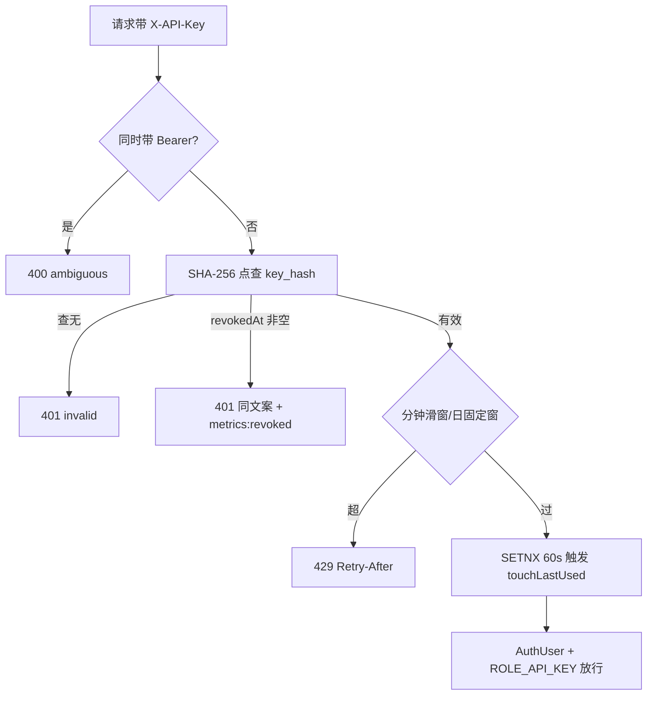

# 12.1 API Key 全流程：铸造、认证、配额与吊销

> 这是模块 12 的唯一一课，把 apikey 包 5 个文件与 ApiKeyAuthFilter 串成一条线：一把 key 从被造出来，到被用来调接口，再到被吊销失效，全程怎么走。

## 1. 本节学习目标

1. 复述造钥流程：随机串怎么生成、为什么库里只有 SHA-256 哈希、明文为什么只在创建响应里出现一次。
2. 逐步跟踪 ApiKeyAuthFilter 的认证六步：混发 400、哈希点查、吊销即时拒绝、配额双闸、SETNX 节流的 last_used 更新、身份建立。
3. 解释 USER/TENANT 双 scope 的语义与租户 ADMIN 铸钥门，说出 key 的权限白名单与摸管理面时的 403。
4. 把 ApiKeyIT 与 TenantApiKeyIT 的 10 个测试用例对应到源码行为。

## 2. 前置知识

- 模块 05 的三课是硬前置：本课的 Filter 挂在 5.1 那条链上，AuthUser/UserContext 机制在 5.3。
- SHA-256：输出 256 位摘要的快哈希，同样输入必得同样输出，不可逆推。BCrypt 与它的差别在 5.3 节正面对比。
- 限流窗口：滑动窗口逐请求记录最近 N 秒，固定窗口每个周期一个计数器。滑动窗口由一个 Lua 脚本实现（RedisRateLimiter，模块 9 详讲），日配额用固定窗口。
- Redis SET NX：`SET key value NX EX ttl` 只在 key 不存在时写入。本项目用它做「每分钟最多执行一次」的节流闸。

## 3. 本节涉及的源码

| 文件 | 行数 | 职责 | 阅读顺序 |
|----|----|----|----|
| `src/main/java/com/linkforge/apikey/service/ApiKeyService.java` | 165 | 造钥、列表、撤销、authenticate | 1 |
| `src/main/java/com/linkforge/apikey/dto/ApiKeyDtos.java` | 57 | CreateRequest/Created/View | 2 |
| `src/main/java/com/linkforge/apikey/entity/ApiKey.java` | 31 | lf_api_key 实体 | 3 |
| `src/main/java/com/linkforge/apikey/mapper/ApiKeyMapper.java` | 18 | BaseMapper + touchLastUsed | 4 |
| `src/main/java/com/linkforge/apikey/controller/ApiKeyController.java` | 54 | /api/keys 增列撤 | 5 |
| `src/main/java/com/linkforge/security/ApiKeyAuthFilter.java` | 162 | X-API-Key 认证与配额 | 6 |
| `src/test/java/com/linkforge/apikey/ApiKeyIT.java` | 215 | 6 个生命周期测试 | 7 |
| `src/test/java/com/linkforge/apikey/TenantApiKeyIT.java` | 223 | 4 个 scope 测试 | 8 |

配置在 `application.yml:146-152` 的 `linkforge.api-key` 段，与 `LinkForgeProperties.ApiKey`（`LinkForgeProperties.java:170-178`）。

## 4. 类的定位

apikey 包是一个自洽的小域：controller、service、entity、mapper、dto 各一个，对外只暴露 `/api/keys` 管理面与 `X-API-Key` 认证。跨包依赖仅两个方向：security 包的 AuthUser/UserContext（身份载体）与 user 包的 UserAccountMapper（ADMIN 门查 tenant_role）。SecurityConfig 的角色矩阵（`SecurityConfig.java:63-64`）决定这个包的两张面孔：`/api/keys/**` 仅 JWT 的 USER 可进，`/api/links/**` 是 key 的使用面。

实体 `ApiKey`（`ApiKey.java:10-31`）对应 lf_api_key 表，四个教学级字段：`scope`（USER 或 TENANT，`:19-20`）、`keyPrefix`（展示用 `lfk_xxxxxxxx`，`:22-23`）、`keyHash`（全明文的 SHA-256 hex，唯一索引，`:24-25`）、`revokedAt`（非 null 即已吊销）。

## 5. 核心源码详解

### 5.1 造钥：ApiKeyService.create

create 方法 56 行（`ApiKeyService.java:39-94`），分五段：

1. **scope 归一化与校验**（`:40-43`）：空或空白按 USER，其他值转大写，不是 USER/TENANT 抛 400。
2. **TENANT 的 ADMIN 门**（`:45-51`）：TENANT scope 只能由 tenant_role 为 ADMIN 的用户铸造，MEMBER 得 403。判定与 pre-V8 空值处理在 5.3 课已逐行讲过。
3. **数量与配额上限**（`:52-58`、`:59-65`）：每用户活跃 key 数上限 `max-active-per-user`（默认 10，yml `:150`）；请求的 quotaPerMinute/quotaPerDay 不得超过硬帽 1000/100000（`LinkForgeProperties.java:176-177`）。
4. **生成随机串并入库**：

```java
String prefix = randomBase62(PREFIX_LENGTH);
String secret = randomBase62(SECRET_LENGTH);
String plaintext = KEY_PREFIX_TAG + prefix + "_" + secret;

ApiKey key = new ApiKey();
key.setScope(scope);
key.setKeyPrefix(KEY_PREFIX_TAG + prefix);
key.setKeyHash(sha256Hex(plaintext));
apiKeyMapper.insert(key);
```
（`ApiKeyService.java:67-81`，节选；tenantId、userId、name、配额、createdAt 的赋值见原文件）

明文形如 `lfk_{8位前缀}_{32位机密}`，用 SecureRandom 从 62 字符表取字（常量在 `:25-28`）。前 8 位随 keyPrefix 明文存库供界面辨认；整条明文只有 SHA-256 hex 进库（`:77`）。randomBase62 与 sha256Hex 的实现在 `:144-150`、`:152-164`。

5. **一次性响应**（`:83-93`）：组装 `ApiKeyDtos.Created`，`:87` 的 `created.setKey(plaintext)` 是明文在整个系统里唯一一次出现在响应中。

### 5.2 明文一次性与 DTO 的两面

`ApiKeyDtos` 是私有构造的容器类（`ApiKeyDtos.java:10-13`），内嵌三个 DTO，注释把边界写得很清楚：`Created`（`:29-41`）是「the ONLY place the plaintext key is ever returned」，key 字段在 `:35`；`View`（`:43-56`）「no plaintext, no hash, ever」，列表只回 name/prefix/scope/配额/lastUsedAt/revokedAt。客户端丢了明文只能吊销重造，服务端没有恢复手段，GitHub 的 personal access token 用同一套约定。`ApiKeyController` 三个端点（create `:31-34`、list `:36-39`、revoke `:41-45`）都先过 `requireUser()`（`:47-53`）拿 AuthUser。

### 5.3 authenticate：哈希点查与快慢哈希选型

```java
public ApiKey authenticate(String plaintextKey) {
    return apiKeyMapper.selectOne(new LambdaQueryWrapper<ApiKey>()
            .eq(ApiKey::getKeyHash, sha256Hex(plaintextKey)));
}
```
（`ApiKeyService.java:119-122`）

认证是「把请求里的明文哈希一遍，拿摘要当条件查」。能这样做是因为 SHA-256 确定性：同一明文永远得到同一摘要，key_hash 有唯一索引，一次点查完成。注释（`:117-118`）写明返回约定：查到已吊销的 key 也原样返回，让 Filter 有机会打 revoked 标签。

为什么不用 BCrypt：BCrypt 每次哈希带随机盐，同一密码两次编码结果不同，只能逐行取出再 matches，无法走索引。key 是 40 个随机 Base62 字符，熵远超暴力破解预算，不需要慢哈希抵抗字典攻击，快哈希加唯一索引才是对的工具。

| 维度 | BCrypt（密码） | SHA-256（API key） |
|----|----|----|
| 输入特点 | 人类口令，熵低 | 40 字符随机串，熵极高 |
| 可否点查索引 | 否（盐随机） | 是（确定性） |
| 单次耗时 | 慢（毫秒量级） | 快（微秒量级） |
| 本项目用在哪 | lf_user.password_hash | lf_api_key.key_hash |

### 5.4 revoke：幂等与不泄露存在性

revoke 只有 11 行（`ApiKeyService.java:105-115`），三个行为：不存在的 key 与别人的 key 同样 404（`:106-109`，与 5.3 课的越权 404 语义一致）；已吊销的 key 再撤一次直接 return（`:110-112`，幂等）；吊销即写 revokedAt 时间戳（`:113-114`）。只允许吊自己的 key，没有租户管理员越级吊销成员 key 的通道。

### 5.5 ApiKeyAuthFilter 的势力范围

`shouldNotFilter`（`ApiKeyAuthFilter.java:55-62`）：`/api/**` 全查；`/actuator/**` 除 health 外也查；`/r/**` 与 health 不查。类注释（`:53-54`）解释了 actuator 为什么进范围：带 key 访问 actuator，应当得到「干净的 403」（白名单拒绝），而不是先被 MetricsScrapeTokenFilter 打成 401。角色矩阵 `SecurityConfig.java:68` 要求 USER，key 的 ROLE_API_KEY 必然被拒。health 保持开放，探针不带凭据。

### 5.6 doFilterInternal：认证六步

```java
String authorization = request.getHeader(HttpHeaders.AUTHORIZATION);
if (authorization != null && authorization.startsWith("Bearer ")) {
    meterRegistry.counter("linkforge.apikey.auth", "result", "ambiguous").increment();
    writeJson(response, 400, "{\"code\":400,\"message\":\"ambiguous credentials: send either a bearer token or X-API-Key\",\"data\":null}");
    return;
}
ApiKey key = apiKeyService.authenticate(apiKey);
if (key == null) {
    meterRegistry.counter("linkforge.apikey.auth", "result", "invalid").increment();
    writeJson(response, 401, "{\"code\":401,\"message\":\"invalid api key\",\"data\":null}");
    return;
}
if (key.getRevokedAt() != null) {
    // still a uniform 401 outside; the tag just separates the reasons (Bw2-N3)
    meterRegistry.counter("linkforge.apikey.auth", "result", "revoked").increment();
    writeJson(response, 401, "{\"code\":401,\"message\":\"invalid api key\",\"data\":null}");
    return;
}
if (!withinQuota(key, response)) {
    return;
}
```
（`ApiKeyAuthFilter.java:73-93`，节选）

六步读法：

1. **无头放行**（`:67-71`）：没带 X-API-Key 的请求与本 Filter 无关，匿名进链。
2. **混发 400**（`:73-78`）：同时带 Bearer 与 key，报 `ambiguous credentials` 并打 metrics 标签。类注释（`:32-38`）交代背景（决策号 D-Bw2-2）：key 走 X-API-Key，永远不走 Authorization，避免非 JWT 的 bearer 串被 JwtAuthFilter 误报 401。
3. **点查失败 401**（`:79-84`）：authenticate 返回 null，打 invalid 标签。
4. **吊销即时 401**（`:85-90`）：对外与 invalid 完全同文案，对内 metrics 多一个 revoked 标签，即「对外不泄露、对内可排障」范式（注释标 Bw2-N3）。没有认证缓存，吊销后的下一个请求立刻失败。
5. **配额双闸**（`:91-93`，实现在 `:112-137`）：不过则直写 429，见 5.7。
6. **身份建立**（`:94-103`）：AuthUser 的 username 是 `apikey:{prefix}`（日志好认），scope 原样透传，角色 ROLE_API_KEY；finally 双清（`:104-107`）与 JwtAuthFilter 完全同构。

### 5.7 withinQuota：分钟滑窗加日固定窗

```java
RateLimitDecision minute = rateLimiter.acquire(
        RateLimitKeys.sw(rlPrefix, "min:" + key.getId()), perMinute, 60);
if (!minute.allowed()) {
    meterRegistry.counter("linkforge.apikey.quota.rejected", "window", "minute").increment();
    writeQuotaExceeded(response, minute.retryAfterSeconds());
    return false;
}
ZoneId zone = ZoneId.of("Asia/Shanghai");
LocalDate today = LocalDate.now(zone);
String day = today.format(DateTimeFormatter.BASIC_ISO_DATE);
if (!rateLimiter.tryAcquireFixedWindow(rlPrefix + "day:" + key.getId() + ":" + day, perDay, 86_400)) {
    meterRegistry.counter("linkforge.apikey.quota.rejected", "window", "day").increment();
    return false;
}
```
（`ApiKeyAuthFilter.java:118-129`，节选；perMinute/perDay 的回退取值在 `:115-116`：key 行存 null 时用 yml 默认 120/10000）

两道闸分工：分钟闸用滑动窗口（平滑），超限的 Retry-After 按窗口内最老记录算到过期还有几秒；日闸用固定窗口，键里编进 `yyyyMMdd`，时区钉死 Asia/Shanghai，Retry-After 是「距午夜几秒」（`:130-133`）。`writeQuotaExceeded`（`:139-142`）统一加 Retry-After 头并回 429 文案。Redis 挂了时 RedisRateLimiter 内部 fail-open 放行（模块 9 详讲），配额不因依赖故障而全站拒绝。

### 5.8 touchLastUsed：SETNX 节流

```java
Boolean first = stringRedisTemplate.opsForValue()
        .setIfAbsent(TOUCH_KEY_PREFIX + key.getId(), "1", Duration.ofSeconds(60));
if (Boolean.TRUE.equals(first)) {
    apiKeyService.touch(key.getId());
}
```
（`ApiKeyAuthFilter.java:153-157`）

认证通过后执行。`setIfAbsent` 就是 SET NX EX：键 `linkforge:apikey:touch:{id}` 一分钟内只有一个请求写成功，只有它触发一次 `UPDATE lf_api_key SET last_used_at = ...`（`ApiKeyMapper.java:16-17`）。这是写放大控制：每 key 每分钟至多一次 UPDATE，而不是每次认证都写。整段包在 try/catch 里，异常只打 warn（`:158-160`），last_used_at 是统计字段，丢一次不影响认证。

## 6. 技术原理补充

**明文一次性返回（行业惯例，本项目实现）。** 凭据只在诞生那一刻完整展示一次，之后服务端只留摘要。库泄露也拿不到可用 key；用户丢了明文自证不了身份，只能重造。体验上的「无法查看」用 keyPrefix 缓解。

**双闸配额（本项目实现）。** 分钟闸拦突发（脚本失控打满），日闸拦总量（被当免费代理）。只有一道，要么突发拦不住（窗口太长），要么日均分摊后 burst 全拒（窗口太短）。成本是每次认证两次 Redis 往返。日窗口选固定窗：自然日边界对使用者直观，键带日期自动过期，无需清理任务。

**SETNX 节流（本项目实现）。** 把「要不要执行低频写」变成「谁抢到 Redis 键谁写」。不用它，高频认证路径上的 UPDATE 会成为数据库热点；用本地内存节流则多实例各写各的，节流失效。选 Redis 是因为项目本就依赖它。

**Filter 层白名单 403（本项目实现）。** key 只进 `/api/links/**`，其余一切被 `SecurityConfig.java:63-69` 的矩阵挡下，accessDeniedHandler 回 JSON 403（`:79-83`）。类注释（`:56-58`）称之为 explicit capability whitelist：key 是能力受限的主体，管理面无论如何不可达。

## 7. 可视化

1. [05-database-erd](../../diagrams/archify/html/05-database-erd.html)：lf_api_key 表全列与 lf_user 的关系（user_id）。
2. [02-function-map](../../diagrams/archify/html/02-function-map.html)：「开放能力」域下的 key 能力叶。
3. [10-auth-sequence](../../diagrams/archify/html/10-auth-sequence.html)：认证时序。
4. 认证决策流：



## 8. 项目中的真实执行过程

完整生命周期，括号里是对应测试（`ApiKeyIT.java`，除非另注）：

1. 用户甲用 JWT POST `/api/keys`，拿到明文一次（`keyLifecycleHashOnlyStorageAndCreatorIdentity` `:50-89`：断言明文格式 `:57-58`、列表不含明文与哈希 `:61-65`、库里只有哈希 `:67-70`）。
2. 甲用 X-API-Key 建短链，落库 created_by 等于 key 的 user_id（`:73-80`）。key 以创建者身份行动（`ApiKey.java:17-18` 注释，决策号 D-Bw2-3）。
3. 设 quotaPerMinute=3 的 key 第 4 次请求 429，Retry-After 是真实剩余秒数（`perKeyMinuteQuotaReturns429WithRetryAfterAndSpareOthers` `:134-163`），别的 key 与 JWT 不受影响。
4. DELETE `/api/keys/{id}` 吊销，下一个请求立刻 401（`revokedKeyFailsOnTheVeryNextRequestAndForgedKeysAreInvalid` `:92-106`，断言文案「no auth cache」）；伪造串与垃圾串同样 401。
5. key 摸 `/api/keys`、`/api/webhooks/endpoint`、`/actuator/metrics` 全 403，health 保持 200（`keySurfaceIsForbiddenToKeysButHealthStaysOpen` `:120-131`）；活跃 key 到 3 把后再造被 400，吊销一把后又能造（`activeKeyLimitIsEnforced` `:166-181`）。
6. scope 维度在 TenantApiKeyIT 四个测试：ADMIN 才能铸 TENANT key（`tenantAdminMintsTenantKeyButMemberIsRejected` `:97-116`）；TENANT key 见全租户、USER key 只见自己、跨租户 404（`tenantKeySeesWholeTenantWhileUserKeyStaysPersonalAndCrossTenantIsRejected` `:119-160`）；TENANT key 摸不到管理面（`tenantKeyActsAsItsCreatorAndNeverTouchesAdminSurfaces` `:163-186`）；列表可见 scope/createdBy 且吊销即时（`keyViewExposesScopeCreatorLastUsedAndRevocationIsImmediate` `:189-222`）。

## 9. 为什么这样设计

- **key 即用户代理。** 一把 key 绑定一个创建者，请求以创建者身份落库（D-Bw2-3），审计口径统一：无论 JWT 还是 key，created_by 都是真实 user_id。TENANT scope 只扩视野，不换身份。
- **key 永远拿不到管理面。** 能力白名单（D-Bw2-4）让泄露 key 的爆炸半径限于数据面：能读能建短链，不能造新 key、改 webhook、看 actuator。矩阵没写的一律拒绝，未来加 scope 新值也一样。
- **吊销零延迟。** 认证每次点查数据库，没有缓存层可失效。代价是每次 key 认证一次 DB 查询，收益是「吊销立即生效」的强保证（测试钉死）。安全即时性换一个可负担的索引查询。
- **同文案不同标签。** invalid 与 revoked 对外不可区分，攻击者无法据此维护「哪些 key 曾有效」的清单；metrics 的 result 标签保留排障能力。

## 10. 本节总结

一把 key 的一生：JWT 用户调 create，SecureRandom 生成 `lfk_前缀_机密`，SHA-256 hex 入库，明文只回一次；之后每个带 X-API-Key 的请求被 ApiKeyAuthFilter 哈希点查，过混发检查、吊销检查、双闸配额，再以创建者身份加 ROLE_API_KEY 进业务层；吊销写 revokedAt，下个请求即 401。记住四个数字：前缀 8 位、机密 32 位、默认配额 120/分钟与 10000/天、SETNX 节流 60 秒。

## 11. 课后练习

**练习 1（概念理解）。** 为什么 lf_api_key.key_hash 用 SHA-256 而 lf_user.password_hash 用 BCrypt？互换会各坏在哪？

参考答案：key 是 40 字符随机串，熵极高，不需要慢哈希抗字典攻击，但要认证快且可索引，SHA-256 确定性加唯一索引正合适；换 BCrypt 则无法点查，认证退化为 O(n) 的逐行慢哈希。密码是人类口令，熵低，必须用 BCrypt 的慢哈希与盐抵抗离线爆破；换 SHA-256 则泄露的哈希表可被每秒数十亿次的暴力攻击碾碎。

**练习 2（源码定位）。** 同时携带 Bearer 与 X-API-Key 的请求会得到什么？在 Filter 的哪几行？为什么这样设计？

参考答案：400，body 为 `ambiguous credentials: ...`（`ApiKeyAuthFilter.java:73-78`）。动机见类注释 `:32-38`（决策号 D-Bw2-2）：key 只走 X-API-Key 头，避免非 JWT 的 bearer 串被 JwtAuthFilter 当坏 token 报 401；混发时与其让两层过滤器打架，不如明确拒绝。

**练习 3（执行过程）。** 吊销一把 key 后立即用它请求，状态码与 body 是什么？运维从哪里看出这次拒绝是「吊销」而非「无效」？

参考答案：401，body `{"code":401,"message":"invalid api key","data":null}`（`:85-90`）。对外看不出差别，运维看 Prometheus 的 `linkforge.apikey.auth` 计数器 result 标签：revoked 还是 invalid（`:87`、`:81`）。测试断言在 `ApiKeyIT.java:100-102`。

**练习 4（调用链）。** key 行的 quota_per_minute 为 NULL 时分钟配额取多少？两道闸的 Redis 键长什么样？

参考答案：回退默认 120（`ApiKeyAuthFilter.java:115` 加 yml `:148`），日配额同理回退 10000。分钟闸键形如 `linkforge:rl:apikey:min:{keyId}`（`:118-119`），日闸键形如 `linkforge:rl:apikey:day:{keyId}:{yyyyMMdd}`（`:128`），时区 Asia/Shanghai。

**练习 5（设计分析）。** 把 touchLastUsed 的 SETNX 门去掉，每次认证都 UPDATE，会出什么问题？把 60 秒延长到 1 小时呢？

参考答案：去掉后每次 key 认证多一次数据库写，高频调用下 lf_api_key 成为写热点，行版本大量无意义增长。延长到 1 小时则 last_used_at 粒度粗到小时级，「这个 key 还活着吗」的运维判断失真（`TenantApiKeyIT.java:209-217` 等 lastUsedAt 出现的窗口也变长）。60 秒是排障够用且写放大可控的折中。

## 12. 与后续课程的联系

模块 9 会把两道闸用到的 RedisRateLimiter 拆开：Lua 滑动窗口逐行、fail-open 语义、固定窗口的 INCR/EXPIRE 细节。TENANT scope 对服务层视野的改变（`ShortLinkService.java:906-908`）在 5.3 已铺垫。Webhook 的 endpoint 管理同为 JWT-only，key 触不到，对照模块 13。综合演练见专题「API Key 认证」（[../../advanced/10-api-key-auth.md](../../advanced/10-api-key-auth.md)）。
