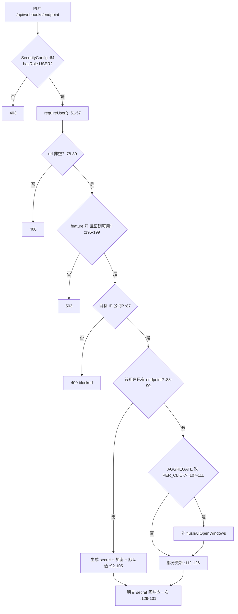

# 13.1 端点配置与密钥加密：Webhook 管理面与 AES-256-GCM

> 这是模块 13 的第一课。Webhook 是 LinkForge 的「点击事件外推」能力：用户配置一个回调地址，每次短链被点一下，系统把点击事件 POST 到这个地址。本课先讲管理面（endpoint 怎么配置、secret 怎么加密存储），投递、签名、重试与聚合模式留给 13.2，SSRF 防护留给 13.3。

## 1. 本节学习目标

1. 说出 Webhook 在整个项目里的业务定位，解释「建在 Outbox 链上」意味着热路径零新增。
2. 逐方法读懂 `/api/webhooks/endpoint` 的四个端点，理解 uk_webhook_tenant 唯一索引带来的「每租户只有一个 endpoint」语义。
3. 掌握明文 secret 只出现一次、掩码视图、轮换三件事的代码位置。
4. 逐段读懂 WebhookSecretCipher 的 AES-256-GCM 实现，说出为什么这里必须用「可逆加密」而不是模块 12 那样的哈希。
5. 解释 503 门的三种结果：feature 关、主密钥缺失、主密钥正常。

## 2. 前置知识

- Outbox 链（模块 10、11 的硬前置）：点击发生时 `ClickRecordService` 往 lf_outbox 插一行 PENDING，`ClickOutboxRelay` 每 2 秒抽水到 RabbitMQ，`ClickStatsService.consume` 消费并做幂等去重。本模块的投递行生成就挂在 consume 事务的末尾。
- AES-256-GCM：一种带认证的对称加密。AES 负责把明文变成密文，GCM（Galois/Counter Mode）是工作模式，加密的同时生成一个 128 位的认证标签（tag）。密文被篡改一个比特，解密时标签校验失败，直接报错而不是返回坏数据。nonce 是「用一次就换的随机数」，同一把密钥下每个密文用不同 nonce，相同明文加密两次结果不同。
- 对称加密与哈希的区别：加密可逆（拿密钥能还原明文），哈希不可逆。什么时候用哪个，本课 5.5 节正面回答。
- JWT 与 API Key（模块 5、12）：JWT 是登录后的会话凭据，API Key 是程序调用凭据。两者在本模块的分界线上对立，见 5.1。

## 3. 本节涉及的源码

| 文件 | 行数 | 职责 | 阅读顺序 |
|----|----|----|----|
| `src/main/java/com/linkforge/webhook/controller/WebhookController.java` | 58 | `/api/webhooks` 四个端点 | 1 |
| `src/main/java/com/linkforge/webhook/service/WebhookService.java` | 327 | endpoint 管理 + 投递行生成（上半） | 2 |
| `src/main/java/com/linkforge/webhook/entity/WebhookEndpoint.java` | 33 | lf_webhook_endpoint 实体 | 3 |
| `src/main/java/com/linkforge/webhook/support/WebhookSecretCipher.java` | 106 | AES-256-GCM 加解密 | 4 |
| `src/main/java/com/linkforge/webhook/mapper/WebhookEndpointMapper.java` | 9 | 空壳 BaseMapper | 5 |
| `src/main/java/com/linkforge/webhook/mapper/WebhookDeliveryMapper.java` | 54 | 投递行 SQL（本课只看 `selectNewestByEndpoint`） | 6 |
| `src/main/java/com/linkforge/security/SecurityConfig.java` | 100 | 角色矩阵（本课只看 `:64` 一行） | 7 |
| `src/main/java/com/linkforge/config/LinkForgeProperties.java` | 239 | 配置类（看 `:180-200` 的 Webhook 内嵌类） | 8 |
| `src/test/java/com/linkforge/webhook/support/WebhookSecretCipherTest.java` | 82 | cipher 的 5 个单测 | 9 |

配置原文在 `application.yml:153-173` 的 `linkforge.webhook` 段。WebhookService 全文 327 行，本课只讲 1-231 行（管理面），235-326 行的消费钩子是 13.2 的主角。

## 4. 类的定位

webhook 包共 15 个文件，分五层：controller 1、entity 3、mapper 3、service 3、support 5。本课覆盖 controller、service 上半、entity 的 WebhookEndpoint、mapper 的 WebhookEndpointMapper、support 的 WebhookSecretCipher。

「建在 Outbox 链上」是这个包最重要的架构事实。README 的口径（`README.md:512-516`）说得很直白：投递来源是 `recordClick` 热路径零新增，点击照旧 outbox → MQ → consume，webhook 在消费侧的幂等去重事务里落 `lf_webhook_delivery(PENDING)`，再由独立 relay 轮询 HTTP 投递。换句话说，为支持 Webhook，最热的跳转路径（模块 7 的 302 全链）一行代码都没改。点击事件的采集、传输、去重全部复用模块 10/11 的既有管道，Webhook 只是多了一个「消费者末尾的挂钩」（`ClickStatsService.java:110`）。

这个决定用代价换确定性。代价是 webhook 投递的实时性受 MQ 链路影响（断 MQ 期间点击停在 outbox，恢复后自动补出投递）。收益有三条：去重逻辑不重写（lf_consumed_event 主键就是幂等锁）、投递意图与统计原子（同一事务）、流量削峰天然继承 Outbox 设计。WebhookDeliveryRelay 与 ClickOutboxRelay 是一对平行结构：都是 @Scheduled 定时器，都扫 `status='PENDING' AND next_attempt_at <= NOW()` 的批，都写退避。对照着读能省一半力气。

## 5. 核心源码详解

### 5.1 WebhookController：仅 JWT 的四端点

```java
@RestController
@RequestMapping("/api/webhooks")
@RequiredArgsConstructor
public class WebhookController {

    private final WebhookService webhookService;

    @PutMapping("/endpoint")
    public ApiResponse<Map<String, Object>> upsert(@RequestBody Map<String, Object> request) {
        return ApiResponse.ok(webhookService.upsert(request, requireUser()));
    }
```
（`WebhookController.java:23-33`，节选；GET `:35-38`、POST rotate-secret `:40-43`、DELETE `:45-49`）

四个端点共用一个路径名词 `/endpoint`，动作由 HTTP 方法区分。PUT 是「创建或更新」（upsert），GET 是查看，POST 是轮换密钥，DELETE 是删除。请求体是松散的 `Map<String, Object>` 而不是强类型 DTO，解析容错交给 service 层的 parse 方法。

安全边界写在类注释里（`WebhookController.java:19-22`）：JWT only (hasRole USER)，泄露的 API Key 不能改租户的回调地址（决策号 D-Bw2-4/16）。落地分两层。第一层在 `SecurityConfig.java:64`，`/api/webhooks/**` 要求 `hasRole("USER")`，API Key 的角色是 ROLE_API_KEY，矩阵直接拒成 403（模块 12 的能力白名单）。第二层在 `:51-57` 的 `requireUser()`，从 ThreadLocal 取 AuthUser，取不到抛 401。为什么这么严：回调地址是「点击数据流向哪里」的总开关，API Key 一旦泄露，攻击者改掉 webhook 地址就能把全租户的点击事件偷走，所以这个面只信任持 JWT 的真人登录。

### 5.2 WebhookEndpoint 实体与 uk_webhook_tenant

```java
@Data
@TableName("lf_webhook_endpoint")
public class WebhookEndpoint {

    public static final String MODE_PER_CLICK = "PER_CLICK";
    public static final String MODE_AGGREGATE = "AGGREGATE";

    @TableId(type = IdType.AUTO)
    private Long id;
    private Long tenantId;
    private String url;
    /** AES-GCM ciphertext ("v1:" + Base64(nonce||ct||tag)); plaintext never persisted. */
    private String secret;
```
（`WebhookEndpoint.java:10-22`，节选）

实体对应 lf_webhook_endpoint 表（V6 建，V9 加聚合三列）。三个教学级字段值得停留。`secret` 存的是 AES-GCM 密文，字段上的注释把格式写死了（`:21-22`），明文从不落库。`deliveryMode` 是 V9 加的投递模式（`:24-25`，决策号 D-C1-18），注释补了一句「切换模式不轮换 secret」。`aggregateWindowSeconds` 与 `aggregateMaxEvents`（`:26-29`，决策号 D-C1-19）是聚合模式的两个旋钮，合法区间 15..300 秒与 1..100000 事件。

数据库侧，这张表有唯一索引 `uk_webhook_tenant(tenant_id)`（V6 迁移），含义是每租户最多一行 endpoint。它不是「每租户多个 webhook 里选一个」，而是「一个租户一个回调」。这让 GET/DELETE/rotate 都不需要传 id，也让 service 层所有查询都退化成「按 tenantId 点查一行」。

### 5.3 upsert：创建与更新分叉的 60 行

upsert 方法在 `WebhookService.java:74-133`，按执行顺序分六段。

第一段，解析与必填校验（`:75-80`）。url 从 Map 里取出，空或空白抛 `BizException("url is required")`。单参构造默认 400（`BizException.java:10-12`），所以前端收到的是 400 而不是 500。

第二段，503 门（`:81` 的 `requireWebhookAvailable()`，实现在 `:195-199`）：

```java
private void requireWebhookAvailable() {
    if (!properties.getWebhook().isEnabled() || !cipher.isAvailable()) {
        throw new BizException(503, "webhook not available: feature disabled or master key not configured");
    }
}
```
（`WebhookService.java:195-199`）

两种不可用合并成一个 503。feature 关是配置选择（`LINKFORGE_WEBHOOK_ENABLED=false`），主密钥缺失是运维事故（env 变量 `LINKFORGE_WEBHOOK_SECRET_KEY` 没配或配错）。503 是「服务暂时不可用」的标准语义，客户端应该稍后重试，而不是像 400 那样改请求。rotateSecret 走同一个门（`:141`）。

第三段，参数归一化（`:82-86`）。deliveryMode 只认两个字符串，其他值 400（`:159-168`）；windowSeconds 与 maxEvents 走 `parseBounded`（`:170-184`），支持 JSON 数字或字符串两种形态，越界 400，报错文案把合法区间写全（如 `aggregateWindowSeconds must be 15..300`，`:84`）。

第四段，SSRF 预检（`:87` 的 `targetGuard.check(url)`）。保存时就把危险目标拒成 400，这是三层 SSRF 防护的第一层，实现细节是 13.3 的主角。

第五段，创建分支（`:90-105`）。按 tenantId 点查，查不到就是创建：

```java
if (created) {
    endpoint = new WebhookEndpoint();
    endpoint.setTenantId(user.getTenantId());
    endpoint.setUrl(url);
    plaintextSecret = WebhookSecretCipher.generateSecret();
    endpoint.setSecret(cipher.encrypt(plaintextSecret));
    endpoint.setEnabled(enabled != null ? enabled : Boolean.TRUE);
    endpoint.setDeliveryMode(deliveryMode != null ? deliveryMode : WebhookEndpoint.MODE_PER_CLICK);
    endpoint.setAggregateWindowSeconds(windowSeconds != null ? windowSeconds : AggregateWindows.DEFAULT_WINDOW_SECONDS);
    endpoint.setAggregateMaxEvents(maxEvents != null ? maxEvents : DEFAULT_MAX_EVENTS);
```
（`WebhookService.java:92-101`）

三件事按顺序发生：`generateSecret()` 生成形如 `whsec_` 加 64 个十六进制字符的明文（`WebhookSecretCipher.java:96-105`）；`cipher.encrypt()` 把明文加密后进库（`:97`）；五个字段用「请求给了就用请求的，没给用默认」的空值合并，默认模式 PER_CLICK、默认窗口 60 秒（`AggregateWindows.java:15`）、默认阈值 100（`:54`）。

第六段，更新分支（`:106-127`）。如果请求把 deliveryMode 从 AGGREGATE 改成 PER_CLICK，先冲刷再改配置：

```java
// D-C1-25: flush what the aggregate buffer still holds BEFORE the mode flips
if (WebhookEndpoint.MODE_PER_CLICK.equals(deliveryMode)
        && WebhookEndpoint.MODE_AGGREGATE.equals(endpoint.getDeliveryMode())) {
    aggregateFlusher.flushAllOpenWindows(endpoint);
}
```
（`WebhookService.java:107-111`）

顺序不能反。缓冲表 lf_webhook_agg_buffer 里的桶要靠 endpoint 上的窗口配置才能算出 digest，mode 一旦改掉，旧窗口就成了没人认领的孤儿。先冲刷把已积累的点击兑现成 digest 投递行，再落 mode 更新，数据无损。反向切换（PER_CLICK → AGGREGATE）不需要任何动作，逐次投递行本来就是一次性的。更新分支的其余字段照旧「请求给了才改」（`:112-125`），secret 与 createdBy 不在可改清单里，模式切换永远不换密钥。

响应组装在 `:128-132`，明文只在这一处出现：

```java
Map<String, Object> view = toView(endpoint);
if (created) {
    view.put("secret", plaintextSecret); // only ever here and in rotate
}
return view;
```
（`WebhookService.java:128-132`）

`:130` 的行内注释就是契约的原文：明文只在这里和 rotate 出现。这是模块 12「明文一次性返回」惯例的第二次使用，连实现口径都一致。

### 5.4 掩码视图、轮换与删除

`toView`（`WebhookService.java:201-217`）是 GET 与 upsert 共用的出参。掩码逻辑在 `:202-204`：密文长度超过 8 就取前 7 个字符接四个星号，否则直接四个星号。注意掩码露的是**密文**前缀 `v1:xxxx`，不是明文 secret，它只是让运维认出「这行有 secret」而不是泄露任何可用信息。视图还带 `deliveryMode`、两个聚合旋钮和 `lastDelivery`（`:212-215`，决策号 D-C1-34），后者查 `WebhookDeliveryMapper.selectNewestByEndpoint`（`WebhookDeliveryMapper.java:51-53`），返回该 endpoint 最新一条投递行的 eventId、状态、attempts 等六字段（`:219-231`），「无论什么状态都给」，排障时不用再查库。

`rotateSecret`（`:140-150`）三步：过 503 门、生成新明文加密覆盖旧密文、响应里回一次明文。没有确认弹窗对应的 API 参数，也没有 grace period，旧 secret 立刻失效，因为签名发生在投递时（13.2），轮换后下一批投递就用新密钥。

`delete`（`:152-157`）两行主体：先 `discardBufferedOnDelete` 把聚合缓冲里的未封窗口落成 FAILED 的 digest 行留痕（`:155`），再物理删 endpoint 行（`:156`）。为什么先留痕再删：直接删掉 endpoint 会让缓冲里已积累的点击凭空消失，用户视角是「数据静默丢失」。落成 FAILED 状态的 digest 行，relay 永远不会捞它（只捞 PENDING），但审计视角看得见「这里曾有 N 个窗口的点击」。细节在 13.2 的 5.9。

### 5.5 WebhookSecretCipher：为什么必须可逆加密

类注释（`WebhookSecretCipher.java:14-24`）先回答了「为什么不学 API Key 存哈希」：webhook secret 在**发送时**要用来计算 HMAC 签名（13.2），签名需要明文本身，哈希不可逆，所以哈希这条路直接堵死。这是本模块与模块 12 最本质的选型差异：API Key 认证时只需要「验证你给的串等于我存的串」，比对摘要就够；Webhook 签名需要「拿我存的串算出一个新值」，必须能还原明文。

At-rest 格式是 `"v1:" + Base64(nonce(12字节) || ciphertext || tag)`（`:29-31` 三个常量，`:61-73` 组装）。encrypt 的核心五行：

```java
Cipher cipher = Cipher.getInstance("AES/GCM/NoPadding");
cipher.init(Cipher.ENCRYPT_MODE, new SecretKeySpec(masterKey, "AES"));
byte[] nonce = cipher.getIV();
byte[] ciphertext = cipher.doFinal(plaintext.getBytes(StandardCharsets.UTF_8));
byte[] packed = ByteBuffer.allocate(nonce.length + ciphertext.length)
        .put(nonce).put(ciphertext).array();
return VERSION_PREFIX + Base64.getEncoder().encodeToString(packed);
```
（`WebhookSecretCipher.java:63-69`，首行在 `:63`）

JDK 的 GCM 实现每次 init 自动生成 12 字节随机 nonce（`:65` 的 `getIV()`），并把 tag 附在 ciphertext 末尾一起返回，所以 packed 就是 nonce 与「密文加 tag」的拼接。`v1:` 前缀是版本号，未来换算法（比如换密钥长度或换成信封加密）可以无歧义地共存旧数据，decrypt 时前缀不对直接抛错（`:77-79`）。

decrypt（`:76-94`）按同格式拆包，`GCMParameterSpec(128, nonce)` 显式指定 tag 长度，`doFinal` 内部完成标签校验。密钥不对或密文被篡改，异常统一包装成 `IllegalStateException`（`:91-93`），消息里写明两种可能（wrong master key or tampered data）。

主密钥的取舍全在构造器（`:35-55`）：

```java
public WebhookSecretCipher(LinkForgeProperties properties) {
    byte[] key = null;
    String configured = properties.getWebhook().getSecretMasterKey();
    if (configured != null && !configured.isBlank()) {
        try {
            key = Base64.getDecoder().decode(configured.trim());
        } catch (IllegalArgumentException ex) {
            log.warn("LINKFORGE_WEBHOOK_SECRET_KEY is not valid Base64 — webhook disabled");
            key = null;
        }
        if (key != null && key.length != 32) {
            log.warn("LINKFORGE_WEBHOOK_SECRET_KEY must decode to 32 bytes (AES-256), got {} — webhook disabled",
                    key.length);
            key = null;
        }
    }
    this.masterKey = key;
```
（`WebhookSecretCipher.java:35-51`，节选）

三种坏配置（空、非 Base64、长度不是 32 字节）都走同一条路：key 置 null，打 warn 日志。之后 `isAvailable()`（`:57-59`）返回 false，整个 webhook 功能降级为关。这是 fail-safe（失效安全）而不是 fail-open（失效放行）：密钥坏了绝不用「将就的密钥」加密或签名，宁可功能不可用。错误配置在启动那一刻就被发现并写进日志，而不是等第一次加密时才炸。主密钥永不落库、不进代码，只从 env 注入（`application.yml:158`，README 给了 openssl 与 PowerShell 两种生成命令，`README.md:519`）。丢主密钥的后果也写在类注释里（`:22-23`）：存量密文全部不可恢复，运维必须对全部租户执行 rotate-secret 重新下发。

`generateSecret()`（`:96-105`）用 SecureRandom 取 32 随机字节，逐字节展开成两个十六进制字符，前面拼 `whsec_`，总长 70 字符。单测 `WebhookSecretCipherTest.generatedSecretsLookRight`（`WebhookSecretCipherTest.java:69-75`）断言前缀与长度。

### 5.6 503 门的三种结果与投递侧的对照

`requireWebhookAvailable` 管的是**管理面**（保存与轮换）。投递面对同一个 `cipher.isAvailable()` 有完全不同的反应，这里先立起对照，13.2 会展开：

- 管理面（本课）：主密钥不可用直接 503，用户存不了 endpoint。
- 入队面（13.2）：`recordClickDelivery` 只看 feature 开关，不看密钥。密钥缺失时投递意图照常落 PENDING（`WebhookService.java:235-246` 的注释，决策号 S1-b），不静默丢。
- 投递面（13.2）：relay 每轮先查密钥，不可用整批跳过，不消耗 attempts（`WebhookDeliveryRelay.java:70-76`）。

三条路合起来是一个闭环：密钥缺失期间，配置操作被挡在门外，但已产生的点击事件不丢，密钥恢复后自动补投。分界线是「数据的不可再生性」：点击事件一旦错过就永远错过，所以入队不设密钥门槛；endpoint 配置随时可以重存，所以管理面可以硬拒。

## 6. 技术原理补充

**AES-256-GCM（行业加密标准，本项目标准用法）。** AES 是分组密码，256 指密钥长度，GCM 把分组密码变成流式加密并附送完整性校验。不用 GCM 用普通 CBC 也行，但 CBC 不防篡改，攻击者翻密文里某一段，解密出的明文跟着变，服务端毫无察觉。GCM 的 tag 让任何篡改在解密时暴露。代价是密钥误用风险：同一密钥下 nonce 重复一次，密钥流重复，加密强度崩塌。本项目 nonce 由 JDK 安全随机生成，风险可控。

**明文一次性返回（行业惯例，本项目第二次使用）。** 与 API Key 同一逻辑：凭据只在诞生时刻完整展示一次。差别在「丢了怎么办」。API Key 丢了只能吊销重造，因为服务端只有哈希。Webhook secret 丢了可以 rotate（`:140-150`），因为服务端持有密文加主密钥，能算出新密文替换旧的，明文从头到尾不需要知道。

**fail-safe 降级（安全工程原则，本项目实现）。** 依赖的安全性配置缺失时，系统应该停在安全的一侧。这里的反面是「用默认密钥或空密钥继续跑」，那样密文形同明文，泄露风险静默存在。降级成「功能关」让缺失变成可感知事件（warn 日志加 503 响应），修复动作明确（配好 env 重启）。

**密钥版本前缀（业界惯例，本项目实现）。** `v1:` 前缀让密文自带格式版本。没有它，将来换格式就要猜「这行旧数据是什么格式」。Stripe、GitHub 的 webhook 密文与签名都有同款设计。成本是 3 个字节的存储，收益是永久的向前兼容。

## 7. 可视化

1. [05-database-erd](../../diagrams/archify/html/05-database-erd.html)：lf_webhook_endpoint 全列与 uk_webhook_tenant 一对一标注，看 secret 列的长度 512 与 V9 三列。
2. [04-core-class-relations](../../diagrams/archify/html/04-core-class-relations.html)：看 stats 管道与 webhook 的衔接位（类卡片里有 WebhookService 的挂点说明）。
3. 管理面请求流：



## 8. 项目中的真实执行过程

以「租户 7 第一次配置 webhook」为例走一遍。请求是 `PUT /api/webhooks/endpoint`，body 为 `{"url":"https://hooks.example.com/lf","deliveryMode":"AGGREGATE","aggregateWindowSeconds":30}`。

1. JwtAuthFilter 验签通过，UserContext 里有 AuthUser（模块 5 的链路）。SecurityConfig 匹配 `/api/webhooks/**` 要求 USER 角色，通过。
2. WebhookController.upsert 调 `requireUser()`，把 Map 与 AuthUser 交给 service。
3. service 取出 url，非空。过 503 门，假设 feature 开着、主密钥已配置，通过。
4. deliveryMode 解析为 AGGREGATE，windowSeconds=30 在 15..300 内，maxEvents 缺省按 null 处理。
5. `targetGuard.check("https://hooks.example.com/lf")`：解析域名，全部 IP 都是公网，放行（13.3 详讲）。
6. 按 tenantId=7 点查，没有行，走创建分支。生成 70 字符明文 secret，AES-GCM 加密成 `v1:...` 密文，模式 AGGREGATE，窗口 30，阈值默认 100，插入 lf_webhook_endpoint。
7. 响应里 `secret` 是那次唯一的明文，用户复制保存；之后 GET 只见 `secretMasked: "v1:xxxxx****"`。
8. 从下一次点击消费开始，`ClickStatsService.consume` 末尾（`ClickStatsService.java:110`）会查到这条 enabled 的 AGGREGATE endpoint，点击进聚合缓冲，这是 13.3 的剧情。

单元测试覆盖在第 9 号源码里：`roundTripRecoversThePlaintextAndNeverStoresIt`（`WebhookSecretCipherTest.java:20-32`）断言密文不含明文、往返可还原、同明文两次加密结果不同（GCM 随机 nonce 的直接证据）；`tamperedCiphertextIsRejected`（`:34-43`）翻转 tag 一个比特，解密抛 IllegalStateException；`missingOrWrongSizeMasterKeyDegradesOff`（`:55-67`）断言三种坏密钥都 `isAvailable()==false`，且降级后的 cipher 加密时抛错而不是产出坏密文。

## 9. 为什么这样设计

- **每租户一个 endpoint，不是多个。** uk_webhook_tenant 把配置面压到最简：无列表、无选择、无默认项排序问题。REST 语义随之简化成 PUT 单数名词。聚合窗口、阈值这些旋钮也挂在唯一行上，查询永远是一次点查。推断这个取舍面向的是中小团队场景：一个租户通常只有一套「点击事件接收系统」，多目的地需求用接收方自行分发解决。
- **secret 加密 at-rest 而不是明文加列权限。** 数据库备份、binlog、慢查询日志都可能带走行内容。明文 secret 一旦进备份，泄露面就从「数据库」扩大到「每一份备份」。AES-GCM 把这个面缩到主密钥。这是「签名需要明文」约束下的最强可行存储形态。
- **API Key 与 Webhook 管理面同权 JWT-only。** 两者的决策号相邻（D-Bw2-4 与 D-Bw2-16），动机相同：程序凭据的可信级别低于登录会话，所有「改配置」的面都应只信任真人。key 的能力白名单（模块 12）是从凭据侧收权，SecurityConfig 的角色矩阵是从路由侧收权，两侧一致才有纵深。
- **模式切换先冲刷缓冲。** 这是对「改配置不改数据」原则的落实。配置变更不该制造数据黑洞，AGGREGATE 缓冲里的每一条点击都已计入统计，切换模式必须先把「待投递」兑现成投递行，再改配置。实现选在 service 层而不是 DB 触发器，让这个顺序显式可见、可测试。

## 10. 本节总结

Webhook 的管理面是一个 60 行的 upsert 加三个小方法。四个 HTTP 端点只对 JWT USER 开放，API Key 摸不到。每租户唯一索引把配置简化成单行。secret 用 AES-256-GCM 加密存储，格式 `v1:` + Base64(nonce‖ct‖tag)，主密钥是 env 里 Base64 的 32 字节，坏配置让整个功能降级为关，管理面 503、入队照常、relay 跳批。明文只在创建与轮换的响应里出现一次，GET 只有掩码。模式切换从 AGGREGATE 改回 PER_CLICK 时先冲刷聚合缓冲。记住四个数字：nonce 12 字节、tag 128 位、窗口 15..300 秒、阈值 1..100000。

## 11. 课后练习

**练习 1（概念理解）。** lf_api_key.key_hash 存 SHA-256，lf_webhook_endpoint.secret 存 AES-GCM 密文。同一类「凭据」为什么两种存法？

参考答案：用途决定存法。API Key 认证只需要判断「请求带来的串是否等于当初签发的串」，比对 SHA-256 摘要即可，不可逆反而让泄露的库不可用。Webhook secret 要在投递时计算 HMAC 签名，必须拿到明文参与运算（`WebhookSecretCipher.java:14-24` 类注释明说 hash is impossible），所以只能可逆加密，安全性转移到主密钥上。

**练习 2（源码定位）。** 用一个 API Key 调 `PUT /api/webhooks/endpoint` 会得到什么状态码？在哪个类的哪一行被挡下？为什么不是 401？

参考答案：403。挡在 `SecurityConfig.java:64` 的 `hasRole("USER")`，API Key 的角色是 ROLE_API_KEY，不满足。这是授权失败（身份有效但角色不符）而非认证失败，所以 403 不是 401。类注释 `WebhookController.java:19-22`（决策号 D-Bw2-4/16）写明动机：泄露的 key 不能重指回调地址窃取点击流。

**练习 3（执行过程）。** 主密钥 env 未配置时，依次执行「GET /endpoint」「PUT /endpoint」「一次真实点击」，各得到什么结果？

参考答案：GET 是查询，不过 503 门，返回掩码视图（只要 endpoint 已存在）。PUT 被 `requireWebhookAvailable`（`WebhookService.java:195-199`）拒成 503。真实点击不受影响：`recordClickDelivery` 只看 feature 开关（`:248-252`），投递意图照常落 PENDING 行，密钥缺失只让 relay 整批跳过（`WebhookDeliveryRelay.java:73-75`），恢复后自动补投。

**练习 4（调用链）。** 已是 AGGREGATE 模式、缓冲里有 3 个未封窗口的租户，发 PUT 把 deliveryMode 改成 PER_CLICK。说出方法内发生的三件事与其顺序。

参考答案：顺序在 `WebhookService.java:106-126`。第一，`:107-111` 检测到 AGGREGATE→PER_CLICK，调 `flushAllOpenWindows`，3 个窗口各自在一个事务里变成 digest 投递行（PENDING，可正常投递）。第二，`:112-117` 更新 url 与 mode（若请求带了）。第三，`:126` updateById 落库。若顺序颠倒，mode 先改，缓冲窗口与 PER_CLICK 配置不匹配，digest 无法正确生成，点击凭空滞留。

**练习 5（设计分析）。** 把 WebhookSecretCipher 构造器里的 32 字节长度检查删掉，用 16 字节密钥会怎样？系统还能启动吗？

参考答案：能启动，且短期一切正常，因为 JDK 的 SecretKeySpec 接受 16 字节并按 AES-128 跑。坏处在更深处：README 与运维文档都按「32 字节」生成主密钥（`README.md:519`），某台机器配错成短密钥时没有 fail-safe，服务会用错误密钥把新 secret 加密入库；这批数据在换回正确密钥后全部解不开，批量 rotate 前投递持续失败。检查（`WebhookSecretCipher.java:45-49`）把这类配置错误从「静默数据损坏」提前为「启动日志 warn 加功能降级」。

## 12. 与后续课程的联系

13.2 拿走 WebhookService 的下半（`:247-326`）：点击怎么变成投递行、payload 长什么样、AGGREGATE 模式的窗口与 digest 怎么生成（本课的 `flushAllOpenWindows` 在那里展开）、relay 怎么签名与重试、mark 三条 UPDATE 的 PENDING 守卫。13.3 是安全专题：本课 `targetGuard.check`（`:87`）背后的三层 SSRF 防护，以及 PinnedHttpSender 怎么把「校验通过后 DNS 再改」的窗口钉死。密钥不工作时三种反应的对照表会在 13.2 的「投递面」一栏补全。时区 fork 的背景知识在 15.2（`WebhookRetryClockIT` 的执行位置）。
