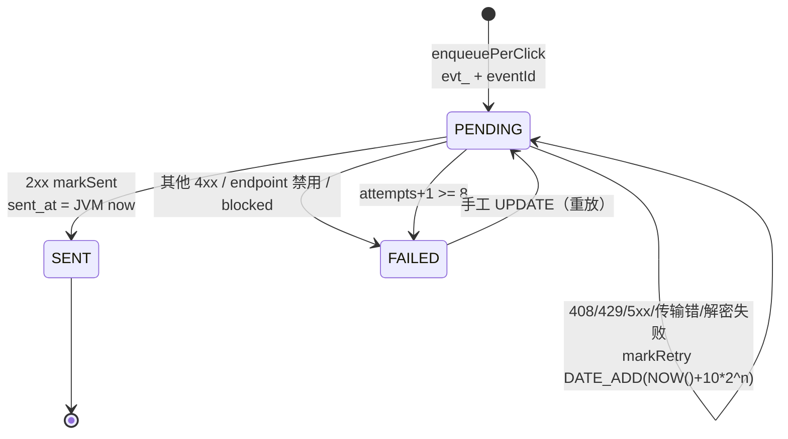

# 13.2 投递、签名与重试：从点击到 HTTP POST 的状态机

> 上一课配置好了 endpoint 与密钥。本课把数据面走完：一次被消费的点击怎么变成 PENDING 投递行，relay 怎么把它 POST 出去，签名怎么算，失败怎么退避重试，8 次之后怎么进 FAILED 终态；5.9 补上 AGGREGATE 聚合模式从缓冲桶到 digest 的完整生成侧。

## 1. 本节学习目标

1. 跟踪 recordClickDelivery 的每个出口：feature 关、无 endpoint、重复插入、其他异常，说出各自对 consume 事务的影响。
2. 背出 PER_CLICK 投递的 eventId 规则与 payload 字段表，解释 uk_webhook_endpoint_event 如何兜底幂等。
3. 逐段读懂 WebhookDeliveryRelay 的门禁与投递，背出状态机的五个转移。
4. 手算 HMAC 签名串 `v1=` + hex(HMAC-SHA256(secret, ts + "." + body))，说出接收方验证三步。
5. 解释 DB 时钟调度与 JVM 时钟业务戳的双时钟口径，以及 WebhookRetryClockIT 为什么要在独立时区 fork 里跑。
6. 描述 AGGREGATE 模式的完整闭环：窗口网格怎么算、缓冲桶怎么幂等累加、双触发怎么封窗、digest 怎么分片与截断、删除 endpoint 时怎么留痕。

## 2. 前置知识

- consume 事务（11.1 与 13.1 铺垫）：`ClickStatsService.consume` 在一个事务里做幂等去重、明细回填、日聚合，末尾调 `webhookService.recordClickDelivery(event)`（`ClickStatsService.java:110`）。本课解释挂在这里为什么安全。
- HMAC-SHA256：带密钥的哈希消息认证码。密钥只有收发双方知道，签名随消息走，接收方用同一密钥重算比对。与「哈希存库」的区别是这里密钥和消息都在请求之外。
- HTTP 语义：2xx 成功；408 是请求超时，429 是太多请求，5xx 是服务端错误，这三个都可能「稍后再试就成功」；其他 4xx（401/403/404 等）是明确拒绝，重试没有意义。
- MyBatis 注解 SQL（模块 4）：@Select/@Update 直接写 SQL，本课的 mark 三语句全靠条件更新做并发守卫。

## 3. 本节涉及的源码

| 文件 | 行数 | 职责 | 阅读顺序 |
|----|----|----|----|
| `src/main/java/com/linkforge/stats/service/ClickStatsService.java` | 154 | 消费事务（本课只看 `:106-110` 调用段） | 1 |
| `src/main/java/com/linkforge/webhook/service/WebhookService.java` | 327 | 消费钩子与投递行生成（`:233-326`） | 2 |
| `src/main/java/com/linkforge/webhook/entity/WebhookDelivery.java` | 34 | lf_webhook_delivery 实体与三个状态常量 | 3 |
| `src/main/java/com/linkforge/webhook/mapper/WebhookDeliveryMapper.java` | 54 | 扫批与三个 mark 语句 | 4 |
| `src/main/java/com/linkforge/webhook/service/WebhookDeliveryRelay.java` | 167 | 定时投递器（本课主角） | 5 |
| `src/main/java/com/linkforge/webhook/support/WebhookSigner.java` | 35 | HMAC 签名 | 6 |
| `src/main/java/com/linkforge/stats/mapper/OutboxMapper.java` | 36 | 对照组（mark 无 PENDING 守卫） | 7 |
| `src/main/java/com/linkforge/retention/SentRowCleanup.java` | 73 | SENT 行保留清理（本课只看时钟口径） | 8 |
| `src/test/java/com/linkforge/webhook/WebhookRetryClockIT.java` | 199 | 时区 fork 回归测试 | 9 |
| `src/test/java/com/linkforge/webhook/support/WebhookSignerTest.java` | 41 | 签名单测 | 10 |
| `src/main/java/com/linkforge/webhook/support/AggregateWindows.java` | 54 | AGGREGATE 窗口网格（5.9） | 11 |
| `src/main/java/com/linkforge/webhook/service/WebhookAggregateFlusher.java` | 237 | 封窗与 digest 生成（5.9） | 12 |
| `src/main/java/com/linkforge/webhook/mapper/WebhookAggregateBufferMapper.java` | 71 | 聚合桶 SQL（5.9） | 13 |

配置在 `application.yml:159-167`（relay 开关、节奏、批量、重试上限、退避、超时）与 `LinkForgeProperties.java:180-200`。

## 4. 类的定位

本课的四个类是一条流水线上的三站。第一站 WebhookService.recordClickDelivery，跑在 MQ 消费线程的 dedup 事务里，把点击变成投递行。第二站 WebhookDeliveryRelay，跑在共享调度线程池的独立 @Scheduled 定时器上，每 2 秒扫一批 PENDING 行发 HTTP。第三站 WebhookDeliveryMapper，三条件 UPDATE 守住并发下的状态转移。WebhookSigner 是无状态工具类，被第二站在每次投递时调用。

与模块 10 的 ClickOutboxRelay 是刻意的同构：同样的 selectPendingBatch 形状（`WebhookDeliveryMapper.java:23-25` 对照 `OutboxMapper.java:14-17`），同样的 DB 时钟退避，同样的「FAILED 是终态、重放靠手工 UPDATE」。读过 10.2 的读者在这里只需要学差异，差异有三处：webhook 多一层密钥可用性门禁，退避上限是 1 小时而不是 60 秒，mark 语句带 PENDING 守卫（5.6 节对照）。类注释（`WebhookDeliveryRelay.java:23-34`）还写明了投递语义是 at-least-once：多个 relay 实例可能投同一行，接收方按 event id 去重。

调度隔离也写进了注释（`:27-29`）：relay 跑在共享调度池上，隔离靠池子够大而不是各自独立执行。池的默认大小是 6（`application.yml:11-12` 的 `spring.task.scheduling.pool.size`），慢的 webhook 目标拖住的是自己这条 @Scheduled，点击 outbox 的追平不排在它后面。读源码时的一个眼力练习：这段注释写的是 shared (but now 4-thread)，与 yml 的默认 6 对不上，注释随配置演化滞后了，配置才是事实。

## 5. 核心源码详解

### 5.1 recordClickDelivery： consume 事务末尾的四个出口

```java
public void recordClickDelivery(ClickEvent event) {
    boolean featureOff = !properties.getWebhook().isEnabled();
    if (featureOff) {
        // S1-a: clicks during an explicitly disabled feature are not back-delivered (README)
        return;
    }
    try {
        WebhookEndpoint endpoint = endpointMapper.selectOne(new LambdaQueryWrapper<WebhookEndpoint>()
                .eq(WebhookEndpoint::getTenantId, event.getTenantId())
                .eq(WebhookEndpoint::getEnabled, true));
        if (endpoint == null) {
            return;
        }
        List<ClickDimensions.Dimension> dims = ClickDimensions.of(event.getUserAgent(), event.getReferer());
        String device = dims.stream().filter(d -> ClickDimensions.TYPE_DEVICE.equals(d.type()))
                .findFirst().map(ClickDimensions.Dimension::value).orElse("unknown");
        String refererHost = dims.stream().filter(d -> ClickDimensions.TYPE_REFERER_HOST.equals(d.type()))
                .findFirst().map(ClickDimensions.Dimension::value).orElse("direct");
        if (WebhookEndpoint.MODE_AGGREGATE.equals(endpoint.getDeliveryMode())) {
            bufferAggregateClick(endpoint, event, device, refererHost);
        } else {
            enqueuePerClick(endpoint, event, device, refererHost);
        }
    } catch (DuplicateKeyException ex) {
        meterRegistry.counter("linkforge.webhook.enqueue.failed", "reason", "duplicate").increment();
    } catch (Exception ex) {
        meterRegistry.counter("linkforge.webhook.enqueue.failed", "reason", ex.getClass().getSimpleName()).increment();
        log.warn("webhook delivery enqueue failed for event {}: {}", event.getEventId(), ex.getMessage());
        throw ex instanceof RuntimeException runtime ? runtime : new IllegalStateException(ex);
    }
}
```
（`WebhookService.java:247-277`）

四个出口按顺序读。出口一，feature 关（`:248-252`）：直接 return，期间的点击不补发（决策号 S1-a，README 口径），区别于主密钥缺失（照常入队，见 13.1 的 5.6）。出口二，租户没有 enabled 的 endpoint（`:254-259`）：不算错误，return。出口三，重复插入（`:270-271`）：捕获 DuplicateKeyException 打 meter 后吞掉，语义是「并发路径已经入过队，这次不用再做」，事务继续正常提交。出口四，其他异常（`:272-276`）：重新抛出。

出口四最关键。调用点注释（`ClickStatsService.java:106-109`）写明后果：非重复失败向上传播，整个 consume 事务回滚进 DLQ（决策号 S1-d）。这样设计的原因是原子性：统计与投递意图「要么都成功要么都没有」。假如入队失败却吞掉异常，consume 提交，这次点击计入了统计但没有投递行，用户永久丢一条 webhook，且无任何痕迹。回滚把问题升级为 MQ 重投（at-least-once），重投时幂等锁保证不重复计数，投递行补上。

device 与 refererHost 的提取（`:260-264`）复用 `ClickDimensions.of`（模块 11.2 的分桶器，绝不抛异常）。AGGREGATE 分流在 `:265-268`，`bufferAggregateClick` 的完整机制见 5.9。

### 5.2 enqueuePerClick：投递行与最小 payload

```java
String eventId = "evt_" + event.getEventId();
String payload = objectMapper.writeValueAsString(Map.of(
        "id", eventId,
        "type", EVENT_TYPE,
        "createdAt", LocalDateTime.now(),
        "data", Map.of(
                "linkId", event.getLinkId(),
                "code", event.getCode(),
                "clickedAt", event.getClickedAt() != null ? event.getClickedAt() : LocalDateTime.now(),
                "device", device,
                "refererHost", refererHost)));

WebhookDelivery delivery = new WebhookDelivery();
delivery.setTenantId(event.getTenantId());
delivery.setEndpointId(endpoint.getId());
delivery.setEventId(eventId);
delivery.setEventType(EVENT_TYPE);
delivery.setPayload(payload);
delivery.setStatus(WebhookDelivery.STATUS_PENDING);
delivery.setAttempts(0);
delivery.setCreatedAt(LocalDateTime.now());
deliveryMapper.insert(delivery);
```
（`WebhookService.java:280-303`，节选）

eventId 规则是 `"evt_" + 原事件 eventId`（`:282`）。原 eventId 要么是 `log-{id}`（同步双写开着），要么是 UUID。加前缀有两个目的：一是命名空间隔离，digest 事件用 `digest-{endpointId}-{windowStart}`（见 5.9），同一个 endpoint 的投递表里两类事件不撞车；二是实体注释（`WebhookDelivery.java:23-24`）写的「跨重试与重放稳定」（决策号 D-Bw2-12），接收方拿它去重，重试发的必须是同一个 id。

payload 字段表：

| 字段 | 类型 | 来源 | 说明 |
|----|----|----|----|
| id | string | `evt_` + ClickEvent.eventId | 幂等键，随 X-LinkForge-Event-Id 头同值 |
| type | string | 常量 `link.clicked`（`:50`） | digest 事件是 `link.clicks.digest` |
| createdAt | string | JVM 时钟 now（`:286`） | 事件生成时刻 |
| data.linkId | number | ClickEvent | 便于回查 |
| data.code | string | ClickEvent | 命中的短码 |
| data.clickedAt | string | ClickEvent，null 回退 now（`:290`） | 点击发生时刻 |
| data.device | string | ClickDimensions | unknown/device 值 |
| data.refererHost | string | ClickDimensions | direct 或去 www 的主机名 |

没有 IP、没有完整 User-Agent、没有 referer 原文。这是刻意的最小化：webhook 是把数据推到租户自己的服务器，推得越多泄露面越大，README 明确 digest payload 同样无原始 IP 与完整 UA（`README.md:523`）。需要明细的租户走统计 API。

幂等兜底在库表：唯一索引 `uk_webhook_endpoint_event(endpoint_id, event_id)`（V6 迁移）。5.1 的出口三捕获的就是撞这个索引。insert 成功后 `linkforge.webhook.enqueued` 计数器加一（`:304`）。

### 5.3 drain：每 tick 的三道门禁

```java
@Scheduled(fixedDelayString = "${linkforge.webhook.relay-fixed-delay-ms:2000}",
        initialDelayString = "${linkforge.webhook.relay-initial-delay-ms:5000}")
public void drain() {
    LinkForgeProperties.Webhook cfg = properties.getWebhook();
    if (!cfg.isEnabled() || !cfg.isRelayEnabled()) {
        return;
    }
    // S1-c: without a usable master key no delivery can be signed — skip the
    // WHOLE batch without touching rows (no attempts consumed, no state change).
    if (!cipher.isAvailable()) {
        meterRegistry.counter("linkforge.webhook.relay.skipped", "reason", "master_key_unavailable").increment();
        return;
    }
    List<WebhookDelivery> batch = deliveryMapper.selectPendingBatch(cfg.getRelayBatchSize());
```
（`WebhookDeliveryRelay.java:63-77`）

三道门按开销排。feature 与 relay 开关是内存判断。主密钥门（`:73-76`，决策号 S1-c）注释把语义写全：整批跳过，不碰任何行，不消耗 attempts，行保持 PENDING，密钥配好后照常流动。批量查询默认 50 行（`application.yml:162`），SQL 扫 `status='PENDING' AND (next_attempt_at IS NULL OR next_attempt_at <= NOW()) ORDER BY id LIMIT 50`（`WebhookDeliveryMapper.java:23-25`），退避中的行 next_attempt_at 在未来，天然被过滤。

循环体里有一个防毒行设计（`:78-87`）：

```java
for (WebhookDelivery delivery : batch) {
    try {
        deliver(delivery);
    } catch (Exception ex) {
        // N7: a poisoned row must not be re-picked every tick — count the
        // attempt and back it off (or fail it) like any other error.
        log.warn("webhook delivery {} failed unexpectedly: {}", delivery.getId(), ex.getMessage());
        scheduleRetry(delivery, null, "relay exception: " + ex.getClass().getSimpleName());
    }
}
```
（`WebhookDeliveryRelay.java:78-87`）

某一行数据异常（比如 payload 反序列化在下游炸了）如果不管，每 2 秒都会被重新选中，阻塞同批后面的行。catch 把它按普通失败走退避或终态，决策号 N7。

### 5.4 deliver：从行到 HTTP 响应的五个分支

```java
WebhookEndpoint endpoint = endpointMapper.selectById(delivery.getEndpointId());
if (endpoint == null || !Boolean.TRUE.equals(endpoint.getEnabled())) {
    deliveryMapper.markFailed(delivery.getId(), null, "endpoint disabled");
    meterRegistry.counter("linkforge.webhook.delivery", "result", "failed").increment();
    return;
}
```
（`WebhookDeliveryRelay.java:91-96`）

分支一，endpoint 没了或被禁用：立即 FAILED，last_error 记 `endpoint disabled`。禁用 endpoint 是用户主动停止接收，已排队的行没有继续投的意义。

分支二，目标校验（`:99-108`）：`resolveForSend` 一次解析并校验全部 IP，违规立即 FAILED，last_error 统一写 `blocked target`，meter 加 `linkforge.webhook.blocked`。日志刻意不回显解析到的地址与内部原因（决策号 D-C4-8，`:104-106`），防止 SSRF 探测者用失败文案扫描内网。完整机制是 13.3 的主戏。

分支三，解密（`:110-116`）：`cipher.decrypt(endpoint.getSecret())` 失败（主密钥被换、密文损坏）按可重试处理，走 scheduleRetry。这里值得停一下：主密钥错了重试也不会成功，为什么还给退避而不是立即 FAILED。因为 scheduleRetry 的终态是 8 次后的 FAILED，行不会无限循环；而运维可能在几个 tick 内修好主密钥，立即 FAILED 会把可恢复的故障变成需要手工重放的终态。宁可多试几次。

分支四，签名与发送（`:118-129`）：

```java
String body = delivery.getPayload();
long timestamp = System.currentTimeMillis() / 1000;
Map<String, String> headers = Map.of(
        "Content-Type", "application/json",
        WebhookSigner.HEADER_EVENT_ID, delivery.getEventId(),
        WebhookSigner.HEADER_TIMESTAMP, String.valueOf(timestamp),
        WebhookSigner.HEADER_SIGNATURE, WebhookSigner.sign(secret, timestamp, body));

PinnedHttpSender.Result result = sender.send(endpoint.getUrl(), resolved.pinned(),
        body.getBytes(StandardCharsets.UTF_8), headers,
        Duration.ofMillis(properties.getWebhook().getConnectTimeoutMs()),
        Duration.ofMillis(properties.getWebhook().getRequestTimeoutMs()));
```
（`WebhookDeliveryRelay.java:118-129`）

三个自定义头在 `WebhookSigner.java:14-16`：X-LinkForge-Event-Id、X-LinkForge-Timestamp、X-LinkForge-Signature。签名的时间戳与投递时刻同步取。超时两个值来自 yml（连接 2000ms、请求 5000ms，`application.yml:166-167`）。发送本体（PinnedHttpSender，13.3 详讲）返回密封接口 Result，失败归 `Failed(IOException)`，成功归 `Responded(statusCode)`。

分支五，按状态码分流（`:130-146`）：

```java
if (result instanceof PinnedHttpSender.Failed failed) {
    scheduleRetry(delivery, null, failed.cause().getClass().getSimpleName());
    return;
}
int statusCode = ((PinnedHttpSender.Responded) result).statusCode();
if (statusCode >= 200 && statusCode < 300) {
    deliveryMapper.markSent(delivery.getId(), statusCode, LocalDateTime.now());
    meterRegistry.counter("linkforge.webhook.delivery", "result", "success").increment();
    return;
}
if (statusCode == 408 || statusCode == 429 || statusCode >= 500) {
    scheduleRetry(delivery, statusCode, "http " + statusCode);
} else {
    // the receiver explicitly refused (401/403/404/410/...): retrying is pointless
    deliveryMapper.markFailed(delivery.getId(), statusCode, "http " + statusCode);
    meterRegistry.counter("linkforge.webhook.delivery", "result", "failed").increment();
}
```
（`WebhookDeliveryRelay.java:130-146`）

2xx 用 JVM 时钟写 sent_at（`:136`），last_status_code 记下响应码。传输失败与 408/429/5xx 退避重试。其余 4xx 首败即 FAILED，注释给出理由：接收方明确拒绝（凭据错、路径错、资源没了），重试没有意义。全部指标走 `linkforge.webhook.delivery{result=success|failed|retry}`。

### 5.5 scheduleRetry：重试状态机

```java
private void scheduleRetry(WebhookDelivery delivery, Integer statusCode, String error) {
    int attempts = (delivery.getAttempts() == null ? 0 : delivery.getAttempts()) + 1;
    LinkForgeProperties.Webhook cfg = properties.getWebhook();
    if (attempts >= cfg.getMaxAttempts()) {
        deliveryMapper.markFailed(delivery.getId(), statusCode, error);
        meterRegistry.counter("linkforge.webhook.delivery", "result", "failed").increment();
        log.warn("webhook delivery {} -> FAILED after {} attempts ({})", delivery.getId(), attempts, error);
        return;
    }
    long backoffSeconds = Math.min(cfg.getBackoffMaxSeconds(), cfg.getBackoffBaseSeconds() * (1L << attempts));
    deliveryMapper.markRetry(delivery.getId(), backoffSeconds, statusCode, error);
    meterRegistry.counter("linkforge.webhook.delivery", "result", "retry").increment();
}
```
（`WebhookDeliveryRelay.java:154-166`）

状态机全貌，默认配置（max-attempts 8、base 10、max 3600，`application.yml:163-165`）：

| 状态 | 触发 | 出口 |
|----|----|----|
| PENDING(attempts=0) | 入队（5.2） | 被 drain 选中 |
| PENDING(attempts=n) | markRetry（传输错/超时/408/429/5xx，未到 8） | next_attempt_at = NOW() + 退避 |
| SENT | markSent（2xx） | 终态，保留 7 天后清理 |
| FAILED | markFailed（其他 4xx、endpoint 禁用、blocked、第 8 次失败） | 终态，手工 UPDATE 回 PENDING 才能重放 |

退避公式是 `min(3600, 10 × 2^attempts)`，attempts 是加一后的值，方法注释（`:150-153`）写明「首次重试等 base·2^1」。逐次排出来：20s、40s、80s、160s、320s、640s、1280s。第 8 次尝试失败时 attempts 到 8，进 FAILED，不再排下一次。全程总等待约 2540 秒（42 分钟出头），8 次 HTTP 尝试。1 小时上限在默认参数下实际不会被碰到（10×2^8=2560 还小于 3600），它是为运维调大 max-attempts 的场景兜底。

### 5.6 mark 三语句的 PENDING 守卫：与 OutboxMapper 对照

```java
@Update("UPDATE lf_webhook_delivery SET status = 'SENT', attempts = attempts + 1, "
        + "last_status_code = #{code}, sent_at = #{now}, last_error = NULL WHERE id = #{id} AND status = 'PENDING'")
int markSent(@Param("id") long id, @Param("code") int code, @Param("now") LocalDateTime now);

@Update("UPDATE lf_webhook_delivery SET attempts = attempts + 1, "
        + "next_attempt_at = DATE_ADD(NOW(), INTERVAL #{backoffSeconds} SECOND), "
        + "last_status_code = #{code}, last_error = #{error} WHERE id = #{id} AND status = 'PENDING'")
int markRetry(@Param("id") long id, @Param("backoffSeconds") long backoffSeconds,
              @Param("code") Integer code, @Param("error") String error);

@Update("UPDATE lf_webhook_delivery SET status = 'FAILED', attempts = attempts + 1, "
        + "last_status_code = #{code}, last_error = #{error} WHERE id = #{id} AND status = 'PENDING'")
int markFailed(@Param("id") long id, @Param("code") Integer code, @Param("error") String error);
```
（`WebhookDeliveryMapper.java:27-39`，三个 AND status = 'PENDING' 分别在 `:28`、`:33`、`:38`）

对照组 OutboxMapper 的同名三语句全部只有 `WHERE id = #{id}`，没有状态守卫（`OutboxMapper.java:19-20`、`:22-23`、`:25-27`）。这是两个 relay 在并发强度上的真实差异：webhook 的投递行可能被多个触发源碰到（relay 轮询、手工重放、聚合冲刷），一条「只有 PENDING 才能被改」的条件更新让并发转移收敛为恰好一次，输家影响行数为 0。int 返回值就是影响行数，调用方靠它判断自己是否抢到了状态。outbox 行只有 ClickOutboxRelay 一个写者，简化掉了守卫。教学结论：条件更新守卫不是教条，写者超过一个就要加。

### 5.7 WebhookSigner：四行签名与接收方三步验证

```java
public static String sign(String secret, long unixTimestampSeconds, String rawBody) {
    try {
        Mac mac = Mac.getInstance("HmacSHA256");
        mac.init(new SecretKeySpec(secret.getBytes(StandardCharsets.UTF_8), "HmacSHA256"));
        byte[] digest = mac.doFinal((unixTimestampSeconds + "." + rawBody).getBytes(StandardCharsets.UTF_8));
        StringBuilder hex = new StringBuilder(digest.length * 2);
        for (byte b : digest) {
            hex.append(Character.forDigit((b >> 4) & 0xF, 16)).append(Character.forDigit(b & 0xF, 16));
        }
        return "v1=" + hex;
    } catch (Exception ex) {
        throw new IllegalStateException("HMAC-SHA256 unavailable", ex);
    }
}
```
（`WebhookSigner.java:21-34`）

签名串的输入是时间戳加句点加原始 body，逐字节展开成小写十六进制，前缀 `v1=`（`:30`）。时间戳参与签名意味着「截获签名重放到几小时后」不可行，时间戳变了签名就对不上。body 整体参与签名意味着网关或代理篡改一个字节都会失效。

接收方验证三步（README 展示过伪代码，`WebhookSigner.java:8-11` 注释引用）：第一步校验 X-LinkForge-Timestamp 与本地时钟差在 ±300 秒内，防重放；第二步用自己保存的 secret 重算 HMAC-SHA256(secret, ts + "." + rawBody)，与 X-LinkForge-Signature 比对，比较用常量时间函数，防时序侧信道；第三步按 X-LinkForge-Event-Id 去重，因为投递是 at-least-once。三步缺一不可。单测 `WebhookSignerTest` 用独立实现的 HMAC 对照（`WebhookSignerTest.java:15-32`），并断言时间戳、body、secret 任一变化都改变签名（`:34-40`）。

### 5.8 双时钟口径：DB 时钟调度，JVM 时钟记账

WebhookDeliveryMapper 的类注释（`:14-19`）把规则一次说全：next_attempt_at 是调度列，写入用 DATE_ADD(NOW(), ...)，比较用 NOW()，全在 DB 时钟；sent_at 与 created_at 是业务列，由调用方从 JVM 时钟写入。markRetry 的 SQL（`:31-33`）与 markSent 的 #{now} 参数（`:27-28`）是这条规则的两个落地。

为什么要分家。调度列若用 JVM 时钟写入，而 MySQL 容器跑在 UTC、JVM 跑在 UTC+8，写入的「8 小时后」在 DB 眼里是「32 小时后」，重试被拖长 8 小时；反过来 JVM 落后时重试几乎每 tick 都触发。这个 bug 真实发生过，README 与测试注释都留了案底：JVM(+8) 与 DB(UTC) 的偏差曾把退避拖到约 8 小时（`WebhookRetryClockIT.java:27-38`）。业务列若用 DB 的 NOW() 写，sent_at 会出现「比 created_at 早 8 小时」的怪数据，排序与报表全乱。

回归测试 WebhookRetryClockIT 被编排进一个独立的 failsafe fork（`pom.xml:235-247`，execution id `webhook-tz-it`，argLine 钉死 `-Duser.timezone=Asia/Shanghai`），Testcontainers 的 MySQL 保持在 UTC，人为制造最大偏差。第一个测试 `retryBackoffFollowsTheDbClockEvenWithSkewedJvm`（`:127-159`）让桩返回 500，断言 decisive 一条：

```java
Long diffSeconds = jdbc.queryForObject(
        "SELECT TIMESTAMPDIFF(SECOND, NOW(), next_attempt_at) FROM lf_webhook_delivery "
                + "WHERE tenant_id = ? ORDER BY id DESC LIMIT 1", Long.class, tenantIdOf(token));
assertNotNull(diffSeconds);
assertTrue(diffSeconds >= 0 && diffSeconds <= 20,
        "next_attempt_at must sit within [0, 20]s of the DB NOW(), got " + diffSeconds
                + "s — a JVM-clock schedule under UTC/UTC+8 skew reads ~28800s: row=" + row);
```
（`WebhookRetryClockIT.java:145-151`）

TIMESTAMPDIFF 用 DB 自己的 NOW() 量 next_attempt_at，落在 [0, 20] 秒内说明退避完全按 DB 时钟排；旧实现下这个差值是 28800 秒。第二个测试（`:161-198`）反向断言业务列：sent_at 必须 >= created_at（`:194-196`），证明业务时间戳走的是 JVM 时钟，没有误用 NOW()。清理侧同一规则延伸到 SentRowCleanup：outbox 的 cutoff 用 DB 时钟（`OutboxMapper.java:29-35`），webhook 的 cutoff 由调用方按 JVM 时钟计算后传入（`SentRowCleanup.java:49-51` 注释、`:61` 的 `LocalDateTime.now().minusDays(days)`、`:65` 的调用），列怎么写就怎么比，一条列一个时钟。

### 5.9 AGGREGATE 模式：从逐条推送到窗口摘要

AGGREGATE 模式不生成逐条投递行，点击先落进缓冲表 lf_webhook_agg_buffer 的桶里，封窗时兑成 digest 投递行。digest 行与逐条行是同一张表里的两种事件，relay、签名、重试全复用，这是 C1 决策（D-C1-18..25）的核心省法。入口是 5.1 的分流（`WebhookService.java:265-268`）。

第一段是窗口网格，纯函数在 AggregateWindows：

```java
/** Floor of the click's epoch second onto the window grid (null clickedAt = now). */
public static long windowStartOf(LocalDateTime clickedAt, Integer windowSeconds) {
    int window = window(windowSeconds);
    long epoch = (clickedAt != null ? clickedAt : LocalDateTime.now())
            .atZone(ZoneId.systemDefault()).toEpochSecond();
    return Math.floorDiv(epoch, window) * (long) window;
}

/** Classification in one step: late clicks join the open window (D-C1-24). */
public static Slot slotOf(LocalDateTime clickedAt, Integer windowSeconds, long nowEpochSeconds) {
    long open = openWindowStart(windowSeconds, nowEpochSeconds);
    long own = windowStartOf(clickedAt, windowSeconds);
    boolean late = isLate(own, open);
    return new Slot(late ? open : own, late);
}
```
（`AggregateWindows.java:25-49`，节选；默认窗口 60 秒在 `:15`）

epoch 秒对窗口长度做向下取整（`Math.floorDiv`，`:29`），得到窗口起点。一个点击被分到自己的窗口（own）；如果那个窗口已经封了（own 落后于正在填充的 open 窗口），就并入 open 窗口并打 late 标记（`:44-49`）。README 的口径（`README.md:523`）是「迟到点击并入下一开放窗并带 late:true，不回补历史」。注意分类用的是 JVM 时钟网格（点击的 clickedAt 是业务数据，`AggregateWindows.java:7-10` 注释），而 13.2 一直强调的调度列对比在 DB 时钟，缓冲的过期扫描马上会见到。单测把边界钉死：正好踩在窗口起点不算迟到，差一秒就算（`AggregateWindowsTest.java:51-59`）。

第二段是桶的幂等累加，一条 SQL 完成：

```java
@Insert("INSERT INTO lf_webhook_agg_buffer(tenant_id, endpoint_id, window_start, link_id, code, "
        + "clicks, sample_device, sample_referer_host, sample_clicked_at, late) "
        + "VALUES(#{tenantId}, #{endpointId}, #{windowStart}, #{linkId}, #{code}, "
        + "1, #{sampleDevice}, #{sampleRefererHost}, #{sampleClickedAt}, #{late}) "
        + "ON DUPLICATE KEY UPDATE clicks = clicks + 1, late = late | VALUES(late)")
```
（`WebhookAggregateBufferMapper.java:27-31`）

唯一索引 uk_agg_window_link(endpoint_id, window_start, link_id)（V9）让每个（endpoint，窗口，链接）组合只有一行。重复插入时 clicks 加一、late 位或上（`late | VALUES(late)`），而三个 sample 列保持不动，注释（`:23-26`）写明 sample_* 保留桶内第一次点击。调用侧（`WebhookService.java:313-326`）算出槽位后 upsert，再查 `sumClicks`（`WebhookAggregateBufferMapper.java:42-44`），达到 `aggregateMaxEvents` 阈值就地调 `flushWindow`（`:323-325`）。

第三段是双触发封窗。触发一，事件阈值：5.9 上一段说的 inline flush，跑在 consume 已持有的事务里（`WebhookAggregateFlusher.java:32-36` 注释解释 PROPAGATION_REQUIRED 的语义，digest 行与统计同生共死）。触发二，时间到期：sweep 定时器（`:79-98`）默认每 5 秒扫一次（yml `:171-172`），SQL 直接在 DB 侧算过期（`WebhookAggregateBufferMapper.java:62-67`）：

```java
@Select("SELECT b.endpoint_id, b.window_start FROM lf_webhook_agg_buffer b "
        + "JOIN lf_webhook_endpoint e ON e.id = b.endpoint_id "
        + "WHERE e.delivery_mode = 'AGGREGATE' AND e.enabled = 1 "
        + "AND b.window_start <= UNIX_TIMESTAMP() - e.aggregate_window_seconds "
        + "GROUP BY b.endpoint_id, b.window_start ORDER BY b.endpoint_id, b.window_start")
```
（`WebhookAggregateBufferMapper.java:62-67`）

UNIX_TIMESTAMP() 是 DB 时钟，mapper 的时钟注释（`:14-19`）把 window_start 归为调度列。一个窗口冲刷失败不拖累别的窗口，逐窗 try/catch 只 warn（`WebhookAggregateFlusher.java:91-96`）。

第四段是 digest 行的生成。doFlush（`:135-145`）读全窗桶（`selectWindow` 按 link_id 排序，`:46-50`，注释说「digest parts are deterministic slices」），调 emitParts 生成投递行，然后删桶（`deleteWindow`，`:69-70`），全部在一个事务里。emitParts（`:152-195`）的分片规则：每片最多 500 个 link 桶（`:44`）；eventId 第一片是 `digest-{endpointId}-{windowStart}`，续片加 `-partN`（`:165-166`），跨重试稳定所以接收方照样能去重；窗口总点击数、partIndex/partCount 进 payload（`:214-220`）。分片数超过 `aggregate-max-parts`（默认 10，yml `:173`）时只发前 N 片，最后一片 payload 带 `truncated: true`（`:170` 的 `truncated && partIndex == emitted`、`:222-224`），同时打 warn 日志（`:190-193`）。数据可以少发，但不能无声地少发。并发收敛靠唯一索引：DuplicateKey 说明另一个触发源已经冲刷过同一片，置 existed 标记后继续（`:183-185`），meter 记 `aggregate.flush{result=partial}`（`:142-144`）。

第五段是两种特殊冲刷，都回指 13.1 的管理面。模式切换 AGGREGATE→PER_CLICK：`flushAllOpenWindows`（`:116-120`）按窗口起点从老到新逐窗冲刷，每窗独立事务，中途崩溃的窗口留给下次（幂等重冲）。删除 endpoint：`discardBufferedOnDelete`（`:128-133`）走同一个 doFlush，但状态直接写 FAILED、lastError 写常量 `endpoint deleted with pending aggregate buffer`（`:46`）。FAILED 行 relay 不捞，所以不会真的发送，投递意图留在表里可审计。

## 6. 技术原理补充

**指数退避（行业惯例，本项目实现）。** 重试间隔按 2 的幂增长，让故障方获得指数级的恢复窗口。固定间隔会在故障期形成整整齐齐的重试洪峰，规模大时反而是二次伤害。上限（1 小时）防止间隔发散到没有意义。代价是尾延迟：第 8 次尝试前要等约 42 分钟，对「接收方重启了 10 秒」的场景偏慢，但对「接收方下线一晚」的场景省掉了 2 万多次无效请求。

**at-least-once 与幂等接收（分布式惯例，本项目实现）。** 本项目的可靠性承诺是「至少一次」而不是「恰好一次」。恰好一次需要接收方与发送方共享事务，跨网络的 HTTP 做不到；发送方把「可能重复」诚实告知（类注释 `WebhookDeliveryRelay.java:32-34`），把去重的责任交给接收方的 event id。这与 MQ 消费侧的幂等锁是同一思想的两侧。

**HMAC（密码学惯例，本项目实现）。** 纯哈希只能证明内容没改，HMAC 加上密钥能证明「持密钥的一方签的」。webhook secret 只在租户与服务器两端存在，中间人没有密钥就伪造不出签名。时间戳入签把「可重放窗口」从无限压到 ±300 秒。

**条件更新作状态守卫（并发惯例，本项目实现）。** 「查一下再改」在并发下有窗口，两条 UPDATE 可以同时通过检查。把状态条件放进 UPDATE 的 WHERE，数据库行锁保证检查与写入原子完成，影响行数就是抢锁结果。这是单表状态机的最低成本实现，不需要显式分布式锁。

**INSERT ON DUPLICATE KEY UPDATE 作累加桶（MySQL 特性，本项目实现）。** 聚合桶的写入模式是「存在则加计数，不存在则建行」，upsert 一条语句原子完成，应用层不需要先查后插。唯一索引是它的承重墙：uk_agg_window_link 决定桶的粒度。sample 列靠「UPDATE 子句不碰它们」保住首击。与模块 11 日聚合表的 upsert（ON DUPLICATE KEY UPDATE clicks + 1）是同一手法。

**窗口聚合推送（本项目实现，D-C1-18）。** 逐条推送的成本在两头：接收方要抗住峰值，发送方要为每条付签名与连接成本。按时间窗或事件数攒批，把 N 条压成 1 条 digest，代价是实时性（最多一个窗口期，15..300 秒）与细节（只有 sample，无逐条明细）。两种模式共用投递链路，切换成本只是配置值。

## 7. 可视化

1. [16-webhook-delivery-lifecycle](../../diagrams/archify/html/16-webhook-delivery-lifecycle.html)：PENDING → SENT/FAILED 状态机与退避标注。
2. [07-rabbitmq-topology](../../diagrams/archify/html/07-rabbitmq-topology.html)：投递行的上游，点击事件经 exchange/queue 进 consume，DLQ 接回滚的批次。
3. 状态机：



## 8. 项目中的真实执行过程

以「接收方抖动 30 秒」的一次真实投递为例，对应 WebhookRetryClockIT 第一个测试的剧本。

1. 用户点短链，302 返回的同时 outbox 落行（模块 10）。2 秒后 relay 抽水，consumer 消费：dedup 插入成功，统计落表，事务末尾调 recordClickDelivery。
2. 租户 endpoint enabled，PER_CLICK 模式。生成 `evt_log-123`，payload 按 5.2 的字段表序列化，插入 lf_webhook_delivery，PENDING、attempts=0。事务提交。
3. 下一轮 drain（最多 2 秒后）选中这行。三道门全过。deliver 查 endpoint、解析目标 IP 全公网、解密 secret 成功。
4. 签名：时间戳 1798000000，body 是 payload 原文，头三件套加上 Content-Type 发出。接收方返回 500。
5. scheduleRetry：attempts 变 1，小于 8，markRetry 写 next_attempt_at = NOW() + 20 秒（DB 时钟），meter result=retry。
6. 20 秒后同一行再被选中，这次接收方返回 200。markSent 写 SENT、attempts=2、last_status_code=200、sent_at=JVM now。投递完成。
7. 7 天后 SentRowCleanup 把这条 SENT 行删掉（`SentRowCleanup.java:61-65`）。若 8 次全失败，行停在 FAILED，last_error 留着最后一次原因（如 `http 500`），运维排障后手工 UPDATE 回 PENDING 重放。

## 9. 为什么这样设计

- **挂进 consume 事务而不是自己起一个。** 入队与统计同生共死（S1-d），dedup 锁顺带保证一个 eventId 至多入队一次。独立事务要做两套幂等，还可能出现「统计成功、投递行丢了」的中间态。代价是 webhook 的表结构变更会影响 consume 的事务时长，一个消费路径上多了一次点查与一次 insert。
- **重试判断看状态码语义，不看异常类型。** 传输失败、超时、408、429、5xx 归一类，共同点是「服务端暂不可用或限流，稍后可能恢复」；其他 4xx 归另一类，共同点是「请求本身有问题，重试无意义」。这个划分让接收方用一个状态码就能控制发送方的行为，是 webhook 协议的行业共识（GitHub、Stripe 同款语义）。
- **FAILED 是终态但可手工重放。** 自动重试 8 次后停止，防止坏目标永久消耗 relay 预算；行不删除，last_error 与 last_status_code 保留全部现场；实体注释（`WebhookDelivery.java:16-17`）直接称之为本仓库的死信等价物。重放是一条 SQL UPDATE 回 PENDING，与 outbox 的手工重放同款。
- **双时钟是教训换来的架构规则。** 单一时钟看似更简单，但 JVM 与 DB 部署在不同容器、不同时区是常态而不是意外。把「调度归 DB、记账归 JVM」写成 mapper 注释与 IT 断言，比寄希望于运维对齐时区可靠。测试跑在独立时区 fork 里（`pom.xml:235-247`），回归保护是永久性的。

## 10. 本节总结

投递链五步：consume 事务末尾入队（异常回滚进 DLQ，重复吞掉）、relay 每 2 秒扫 50 行、deliver 五分支分流、签名 `v1=` + hex(HMAC-SHA256(secret, ts + "." + body))、退避重试收尾；状态机的五个转移与逐次退避数字已在 5.5 的表格与第 7 节状态图里给全，此处不再重复。双时钟口径：next_attempt_at 与退避全按 DB 时钟，sent_at 与 createdAt 按 JVM 时钟，WebhookRetryClockIT 在 Asia/Shanghai fork 里钉死这条规则。payload 只给 8 个字段，无 IP 无完整 UA。AGGREGATE 模式把点击攒进（endpoint，窗口，链接）桶，阈值或 5 秒 sweep 封窗，digest 按 500 桶分片、超 10 片截断标记，删除 endpoint 时以 FAILED 留痕，投递全复用同一条链路。

## 11. 课后练习

**练习 1（概念理解）。** recordClickDelivery 里 DuplicateKeyException 被吞掉、其他异常被重新抛出，两种处理的后果分别是什么？

参考答案：重复说明并发路径已为同一 (endpoint_id, event_id) 插过行（uk_webhook_endpoint_event，`WebhookDeliveryMapper` 对应表索引 V6），这次点击的投递意图已存在，吞掉后 consume 事务正常提交，统计不丢。其他异常重新抛出会让 consume 事务回滚（`ClickStatsService.java:106-109`，决策号 S1-d），统计与投递行一起消失，事件经 MQ 重投再试，失败批次最终进 DLQ。前者是「别人已做对」，后者是「本轮全不做」。

**练习 2（源码定位）。** 接收方依次返回 500、500、403，写出这行的最终状态、attempts 与 last_error，并指出每次转移的代码行。

参考答案：第一次 500 走 scheduleRetry（`WebhookDeliveryRelay.java:140-141`），attempts=1，退避 20s。第二次 500 同路，attempts=2，退避 40s。第三次 403 落在「其他 4xx」分支（`:142-146`），markFailed 立即终态。最终 FAILED、attempts=3、last_error=`http 403`、last_status_code=403。403 是明确拒绝，重试无意义，所以不耗完 8 次。

**练习 3（执行过程）。** 主密钥被误改后重启，已经 PENDING 的投递行经历什么？三个阶段（relay 门禁、deliver 解密、scheduleRetry）各起什么作用？

参考答案：门禁阶段密钥仍「可用」（只是错的），行照常被选中。deliver 解密失败（`:110-116`），scheduleRetry 退避。反复 8 次后 FAILED，last_error=`secret decryption failed`。期间 relay 的 master_key_unavailable 跳批（`:73-76`）不会触发，因为密钥存在只是不对。修回正确密钥后，PENDING 行自动恢复流动，FAILED 行需手工 UPDATE 回 PENDING。这正是 5.4 分支三「解密失败也退避」的容错逻辑：短暂配错可自愈，最终有界。

**练习 4（调用链）。** 手算 secret=`whsec_abcdef`、ts=100、body=`hi` 时的 HMAC 输入串，并说明为什么时间戳必须进签名。

参考答案：输入串是 `100.hi`，即 `unixTimestampSeconds + "." + rawBody`（`WebhookSigner.java:25`），对它做 HMAC-SHA256(secret) 得 32 字节摘要，展开十六进制加前缀 `v1=`。时间戳进签名后，攻击者截获一条 (headers, body) 无法改时间戳重放，改了签名校验必失败；配合接收方 ±300 秒窗口检查，重放窗口从无限缩到 5 分钟。不进签名的时间戳只是个可任意伪造的公告字段。

**练习 5（设计分析）。** 把 WebhookDeliveryMapper 三个 mark 语句的 `AND status = 'PENDING'` 全删掉，构造一个能暴露 bug 的并发场景。

参考答案：两个 relay 实例同 tick 选中同一行，都发 HTTP：先返回的 markRetry 排了退避，后返回的 markSent 直接把行置 SENT，接收方收到两次、状态却是 SENT，排障无从对账。守卫机制与 OutboxMapper 写者数的完整对照见 5.6，这里只补一句结论：守卫在场时后到的语句影响行数为 0，这条 bug 不可能发生。

**练习 6（执行过程）。** AGGREGATE 窗口 15 秒、阈值 100 万（永远不会到）。t=1000 与 t=1005 各有一次链接 7 的点击，t=1020 时 sweep 到来。说出两次 upsert 的 window_start 与 late 值、digest 的 eventId 与 payload 里的 clicks。

参考答案：t=1000 的点击落窗 floorDiv(1000,15)*15=990，late=false；t=1005 正好踩在网格上，floorDiv(1005,15)*15=1005，落新窗 1005（窗口 990 的最后一秒是 1004），此刻 open 窗也是 1005，own=open，late 同样为 false。于是产生（endpoint，990，链接 7）与（endpoint，1005，链接 7）两个桶，各 insert 建桶、clicks=1，谁也走不到 ON DUPLICATE 分支（`WebhookAggregateBufferMapper.java:31`），sample_* 各记本窗首击。t=1020 时 `selectExpiredWindows` 的条件 window_start <= UNIX_TIMESTAMP()-15 是闭边界：990 <= 1005 与 1005 <= 1005 同时成立（`WebhookAggregateBufferMapper.java:65`），窗口 1005 覆盖 1005..1019，t=1020 恰好到期，两个窗口在同一次 sweep 里各冲刷一次，产出两条 digest，eventId 分别为 `digest-{endpointId}-990` 与 `digest-{endpointId}-1005`（各单桶单片，无 -partN，`WebhookAggregateFlusher.java:165-166`），payload 的 links 数组各一条记录 clicks=1、late=false、sample 带各自首击的设备与主机名（`WebhookAggregateFlusher.java:200-212`）。

## 12. 与后续课程的联系

13.3 是安全专题：deliver 里被一句带过的 resolveForSend（`WebhookDeliveryRelay.java:99-108`）展开成 SSRF 三层防护，PinnedHttpSender 怎么把「校验通过后 DNS 再改」的窗口钉死，以及这套防护与模块 7 跳转侧 B9 门禁的分工。本课生成的每一条投递行（逐条也好、digest 也好）最终都从 PinnedHttpSender 那条钉死的路上出去。本课的定时器（relay 与 sweep）会在 14.3 的任务地图里再见到；时区 fork 的执行细节在 15.2。
